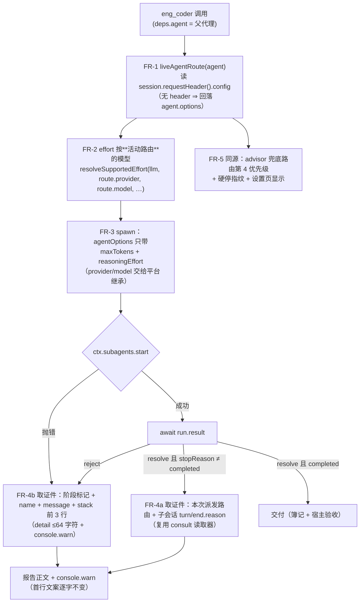

# eng_coder「派发即死」根因修复与失败取证（批 32 · 设计档）

- 日期：2026-10-09
- 提交方（缺陷报告）：会话 `session-9fdfe32c-b4e5-4cfe-b751-2ff8b4b11ace`（工作区 `D:\workspace\dsh-plugins\dsh-team-link`，工程模式使用者）
- 缺陷号：**D-62**（登记表 `docs/2026-09-05-defect-registry.md`）
- 影响版本：**≤ 0.30.0**（本档对应修复版本 **0.30.1**）
- 平台基线：DSH `0.2.0-rc.2`（desktop；`D:\DSH-Desktop-Official\resources\app.asar`）

<!-- doc-shape
count-marks: 项|处|条|档|值|步|腿
-->

> **本档形状**：只有**可数事实标记**一种受管面（`（N 条：…）`），**无锚表、无 AC 表**——本批的验收面是
> 代码行为与既有锁的零漂移，不引入新的锚号/AC 号（避免与批 16/17 的号段打架）。
> 定位口径：本档行号仅 as-of；一切改动按符号/字面锚定。

## 〇、三句话结论（给用户）

1. **这事是什么**：`eng_coder` 会把子代理派到**用户早就切换掉的那条旧模型通道**上——因为插件把「建会话那一刻的模型」当成了「会话现在用的模型」。本次真机事故里那条旧通道（minimax-cn 的 Token Plan）已欠费，子代理第一句就被 429 顶回来，19 秒后死掉。
2. **对用户的东西有什么影响**：不只是「跑不起来」——**报告面一个字都不说**为什么（全文只有 `eng_coder ended: error` + 空 partial），使用者只能猜；而且同一个根因还牵连 advisor 的兜底路由与设置页显示（它们读的是同一份旧快照）。
3. **建议怎么办**：按本档修（路由改读**活动路由** `session.requestHeader().config`，子代理不再被插件覆写路由；失败报告附「真因 + 本次派发路由 + 崩在哪一步」）。**改的是 `lib/**` ⇒ 需重启 DSH 才生效**（重启时机由用户决定）。

## 一、背景

2026-10-09 16:36 / 16:41 / 16:53，提交方在**工程模式**下三次派发 `eng_coder`（第三次刻意收成「只改一个文件、无 stages、同步」的最小单），三次同签名失败：

- 派发被接受（返回 `eng_coder started as background job eng-dsh-NN`）；
- 约 **19 秒**后结束，job 报告 **569 B**：`eng_coder ended: error` + **空** partial，无任何异常文本；
- 子会话落盘存在（`agentPreset: "ptc"`、`origin: "subagent"`、`delegationDepth: 1`），工作区零改动。

提交方已排除「设计令牌失效 / 任务书形态 / 工作区脏 / 沙箱禁子进程（D-48 那一支）」，并给出主要怀疑（`toolFilter.deny` 名域、effort 解析、其它 spawn 期抛错）与诉求：**该分支必须补诊断面**（异常 message + stack 前几行 + 失败阶段标记 + console.warn）。本档逐条落地，并把根因钉在源码与真机读数上。

## 二、问题（现象 + 根因，带 `file:line` 证据）

### 2.1 真机读数（三条独立证据链，全部可复核）

| # | 证据 | 读数 |
|---|---|---|
| E1 | 父会话 `session-9fdfe32c…` 的全部 `request/header` | **从头到尾**都是 `{"provider":"deepseek-official","model":"deepseek-flash"}`（首个 `model/selection` 落在 18:12:29） |
| E2 | 三次失败的子会话 `d43a0c32…` / `1733bd62…` / `bd014d26…` 的 `request/header` | `{"provider":"minimax-cn","model":"M3.1-Flash-Preview","reasoningEffort":"high","maxTokens":65536}`——**不是**父会话的活动路由 |
| E3 | 同上三份子会话档的 `turn/end` | `{"kind":"error","error":{…"已达到 Token Plan 用量上限…(2056)","code":"RATE_LIMIT"}}`——首次模型请求即 **429**，重试 5 次（退避 0.5+0.95+2.03+3.83+7.98 ≈ 15.3s + 请求耗时）⇒ **≈19 秒**结束，`output` 为空 |

> 复核方式：对子会话档做**多帧 zstd 切帧解压**后逐行读事件——与插件同一套读取器（`lib/consult.mjs` 的
> `locateChildSessionLog` + `readZstdFrames`，批 30 / US-6 的补导出面）。
> 证据路径：`<DSH_HOME>/sessions/--D-workspace-dsh-plugins-dsh-team-link--/<childId>/session.v4.jsonl.zstd`
> （父会话 = `session-9fdfe32c…`；三份失败子会话 = `d43a0c32…` / `1733bd62…` / `bd014d26…`）；
> job 报告 = `<DSH_HOME>/.thincoder/jobs/eng-dsh-29.txt` · `eng-dsh-30.txt`（各 569 B）。
> 一句话：**19 秒 = 5 次 429 重试的退避之和**，与「spawn 期抛错」无关——子代理确实开跑了（36 个事件），只是跑在一条死路上。

### 2.2 根因（插件侧）

平台对「子代理继承什么」有明文规则（`app.asar` 内 `@deepseek-ai/dsh-subagent/lib/index.js`）：

```js
// :406-424  parentAgentOptionsForDelegation(parent)  （JSDoc :407-410 逐字）
//   「The latest request header owns provider, model, and reasoning effort after request-time
//    selection; creation options remain the fallback before the first request and retain the
//    configured output-token limit.」
const requestConfig = parent.session.requestHeader()?.config     // ← 活动路由（权威面）
if (requestConfig === void 0) return { ...parent.options }        // ← 仅「首次请求之前」兜底
return { ...createdOptions, provider: requestConfig.provider, model: requestConfig.model, … }
```

```js
// :436-451  resolveChildAgentOptions(parent, requested, childDepth)
const resolved = { ...parentProvider, ...parentModel, …, ...requested, subagentDepth: childDepth }
//                                                    ↑ requested = 调用方传的 agentOptions，**覆盖**继承面
```
一次性（one-shot）派发路径逐字消费它：`@deepseek-ai/dsh-subagent-in-process-driver/lib/index.js:186`
`agentOptions: resolveChildAgentOptions(parent, request.agentOptions, childDepth)`。

而插件（修复前）把**创建期快照**当成「父代理路由」并**显式覆写**给子代理：

| 位置 | 修复前代码 | 后果 |
|---|---|---|
| `lib/eng.mjs:1340` | `const agentOpts = agent.options ?? {}` | `agent.options` 是 `ctx.agents.create()` 的**创建期**选项（`@deepseek-ai/dsh-agent-loop/lib/index.js:774` `this.options = options`），**不随模型切换更新** |
| `lib/eng.mjs:1687` | `agentOptions: { provider: agentOpts.provider, model: agentOpts.model, … }`（后台路径） | 覆盖平台继承 ⇒ 子代理被钉在创建期路由 |
| `lib/eng.mjs:1850-1851` | 同上（同步路径） | 同上 |
| `lib/advisor.mjs:2038` | `const agentOpts = agent.options ?? {}` | advisor 兜底路由第 4 优先级「主代理路由」读到的是同一份旧快照 |
| `lib/advisor.mjs:1927` / `lib/index.mjs:972` / `:1350` | 同上（硬停指纹 / 显示面） | 同一份事实三处各读各的，且**测不到**会话中途换模型 |

（上表行号为**修复前** as-of `6b46978`；修复后 `lib/eng.mjs` 的相关行整体下移约 70 行。）

真机时间线正好落在这个缝里：**18:12:19** 建会话（创建期路由 = 部署默认 `minimax-cn/M3.1-Flash-Preview`）→ **18:12:29** 用户切到 `deepseek-official/deepseek-flash` → 此后每一次 eng_coder 派发都拿 18:12:19 那份快照去覆写子代理。

### 2.3 为什么报告面一个字都没有

`lib/eng.mjs:1732`（后台）/ `:1903`（同步）的 `stopReason !== "completed"` 分支，旧文案只有 `stopReason`；而 `stopReason` 的取值域里 `"error"` **不含任何原因**。真因（`turn/end.reason`）**本来就躺在子会话档里**，与会诊 #13（D-58）的形态逐字同族——consult 侧已修，eng 侧这次一并补上。

## 三、目标 / 非目标

**目标**

1. **路由真值**：子代理实际跑的路由 = **会话当前路由**（活动路由），与平台自己的继承规则逐字一致；插件不再覆写它。
2. **决策同源**：effort 校验/回落、advisor 兜底路由、硬停指纹、设置页显示——**四处同读一份**活动路由。
3. **失败可诊断**：`stopReason !== "completed"` 与异常两条失败面都自证——真因 / 本次派发路由 / 崩在哪一步 / 异常 name+message+stack 前 3 行，且 `console.warn` 同发一份。

**非目标**

- 不改 codex 后端（`engCoderRunner=codex-cli`）的任何行为；
- 不新增配置项（不引入 `engCoderProvider/engCoderModel`——见 §四 D2）；
- 不实现「路由可用性预检」（要真发一次模型请求才能判配额，见 §四 D3）；
- 不改 `toolFilter.deny` / 静默看门狗 / 落盘契约（D-29-1…6 的既有结论一律不动）；
- 不动 `lib/**` 的定时器与中止写点计数（T-AP7 / 写点 5 处，逐字不变）。

## 四、决策与理由

| # | 决策 | 为什么 | 被否决的备选与理由 |
|---|---|---|---|
| **D1** | 子代理 **不传** `provider/model`，只传 `maxTokens` + `reasoningEffort` | 平台的 `resolveChildAgentOptions` **本来就继承活动路由**；显式传值只会把「继承」变成「覆写」。少写两个键 = 结构性免疫（连读错的机会都没有） | ①**显式传活动路由**：值正确但多一步「读→传」，将来任何读取面漂移都会重新变成覆写；且会**压制**平台的「换路由即清路由自带 effort」规则（`:450`）。②**保留现状 + 加校验**：校验不了（读面拿不到就问不出「平台会继承什么」） |
| **D2** | 新增配置项 `engCoderProvider/engCoderModel` 来「钉死」路由 | —— | **不做**：用户从未要求 eng_coder 走固定模型；引入它等于把「跟随会话」变成「要么跟随要么固定」的两态，反而扩大面。真需要时再立项 |
| **D3** | 派发前**不做**路由可用性预检 | 配额/账号态只有真发一次请求才知道；预检要么假阳性（多花钱）要么假阴性（放过必败） | 预检腿：**不做**，改为**失败时把真因写进报告**（FR-4，成本零、信息全） |
| **D4** | 失败取证**复用** `consult.mjs` 的 `readChildTurnEndReason`（补导出），不新建读取器 | 同一份通道知识（`locateChildSessionLog` + 多帧 zstd 切帧）已有单一事实源；复制一份必然漂移。先例：批 30 / US-6 的「补导出、不新建模块」 | 新建 `lib/child-log.mjs`：理由不足，且会把同一段解压逻辑变成两份 |
| **D5** | 取证件放在 **partial 之后**（而不是首行） | `doc-hygiene` 的 SITES 针**逐字钉死**了两条 `stopReason` 失败返回点的前缀（首行 `eng_coder ended: <stopReason>` 与 `\nPartial output:` 相邻）——首段是给别人看的死亡文案契约 | 改前排：需改 SITES 针 + T-AP2 首段锁 ⇒ 锁面噪声大、收益为零（partial 为空时取证件紧跟其后，可读性等价） |
| **D6** | 异常面的 `detail` 收成「阶段 · name: message」**≤64 字符** | `dsh017-compat` 的 D-46b 已把「detail 是短句」写成契约；阶段标记正是「崩在哪一步」的机器可读形 | 把 stack 塞进 detail：违 D-46b，且完成通知会变噪声墙 |

## 五、方案（FR-1…FR-5）



### FR-1 活动路由单一事实源（新叶子模块 `lib/agent-route.mjs`）

`liveAgentRoute(agent)` → `{ provider, model, reasoningEffort, maxTokens, source }`：

- ① `agent.session.requestHeader()?.config`（平台权威面，与平台同一处读）；② 回落 `agent.options`（**仅**首次请求之前，平台同款）；③ 都不可得 ⇒ `source:"none"`（不编造）。
- **`maxTokens` 恒取创建期选项**——平台 JSDoc 原文「creation options … retain the configured output-token limit」⇒ F9 预算链（`engCoderMaxTokens > 父代理 maxTokens > 65536`）逐字不变。
- **永不抛**（读面抛错 ⇒ 回落；取证/决策面不得成为新的失败源）。

### FR-2 effort 按活动路由的模型校验

`lib/eng.mjs` 的 `resolveSupportedEffort(deps.ctx?.llm ?? null, route.provider, route.model, engCoderEffort)`——修复前传的是创建期快照 ⇒ 拿**错模型**的支持集做回落（2026-09-04「eng_coder 三连败」那一类秒死面的同族风险）。

### FR-3 子代理不再被覆写路由

后台（`lib/eng.mjs:1759` 起）与同步（`:1937` 起）两个 spawn 点，`agentOptions` 收敛为：

```js
agentOptions: { maxTokens: engCoderMaxTokens,
  ...(engCoderEffortFinal !== null ? { reasoningEffort: engCoderEffortFinal } : {}) }
```

### FR-4 失败取证（两条腿）

- **FR-4a（`stopReason !== "completed"`，即本次真机形态）**：`childFailureForensics(deps, run, agent, route)` →
  单行「本次派发路由 = `<provider>/<model>（来源）`；子会话 turn/end = `<reason>`」；读不到时**如实写不可读**（不假装）。
  落点：首行文案与 partial 之后（决策 D5）；`detail` 仍为 `stopReason`（不扩契约面）。
- **FR-4b（异常面）**：`engFailureForensics(e, stage)` → `{ detail, block }`；阶段取自**钉死枚举** `ENG_FAILURE_STAGES`
  （`ctx.subagents.start` / `watchdog-attach` / `await run.result` / `deliver-bookkeeping` / `host-stage-checks`，枚举外记 `unknown`）。
  落点：`detail`（≤64 字符）+ 报告正文 + `console.warn`。

### FR-5 决策同源（把同一份事实的三处消费面收敛）

`lib/advisor.mjs`（兜底路由第 4 优先级 + 硬停指纹）、`lib/index.mjs`（`advisor_config` 显示面 + 设置页 `agentOptionsOf`）
一律改读 `liveAgentRoute`。硬停指纹的**成文意图**本就是「agent 路由变化 ⇒ 指纹失配 ⇒ 硬停自动解除」——旧的创建期快照永远测不到换模型，本 FR 让那句注释第一次成立。

## 六、机制伪代码（前置 / 后置条件）

```js
// lib/agent-route.mjs
/** @pre  agent 可为 null/畸形；本函数**永不抛**（含 `agent.options` 抛错 getter）
 *  @post provider/model/reasoningEffort 三键：**整对**取 `requestHeader().config`（两键都非空才算读到），
 *        否则**整对**回落 `agent.options` —— **绝不跨源混搭**（半空 header ⇒ 整对回落）
 *  @post maxTokens **恒**取 `agent.options.maxTokens`（平台同款；与路由来源无关）
 *  @post source ∈ {"request-header","creation-options","none"} —— 供证据行自证「从哪儿读来的」 */
function liveAgentRoute(agent) { … }

/** @pre  run = ctx.subagents.start 的返回对象（可缺 id / 可 reject 已发生）
 *  @post 恒返回**单行**非空字符串；读不到 ⇒ 明写「不可读（哪一步不可行）」，绝不假装、绝不抛 */
function childFailureForensics(deps, run, agent, route) { … }

/** @pre  stage ∈ ENG_FAILURE_STAGES（枚举外按 "unknown" 记账，不抛）
 *  @post detail 单行且 ≤64 字符；block 含阶段 + name + message + stack 前 3 行（栈不可得 ⇒ 只给前两项） */
function engFailureForensics(e, stage) { … }
```

spawn 点的**后置条件**（不变式）：`agentOptions` 的键集合 ⊆ `{maxTokens, reasoningEffort}`——出现 `provider`/`model` 即违反 D1（由 `lib/contract-baseline.mjs` 锁 ④ 的负向断言机械守住）。

## 七、状态与 schema

- **新增模块**：`lib/agent-route.mjs`（纯函数，无状态、无持久化）。
- **新增导出**：`liveAgentRoute` · `routeLabel`（agent-route）· `childFailureForensics` · `engFailureForensics` · `ENG_FAILURE_STAGES`（eng）· `readChildTurnEndReason`（consult **补导出**，此前为私有）。
- **持久化面：零变更**（session-state / token-store / job 落盘格式一字不动）。
- **谁写谁读**：`liveAgentRoute` 只读 `agent.session.requestHeader()` 与 `agent.options`；写面为零。

## 八、防偏离（怎么被机械验证）

| 类型 | 断言 | 位置 |
|---|---|---|
| **行为（修复前必红）** | 创建期 `minimax-cn/M3.1-Flash-Preview` + 活动路由 `deepseek-official/deepseek-flash` ⇒ spawn 载荷不含 provider/model；按平台合并规则（`:406-424`+`:436-451` 逐字复刻）算出的**子代理实际路由 = 活动路由**；effort 按活动路由的模型回落（两模型阶梯刻意不同 ⇒ 拿错模型即拿错档） | `test/codex-runner.test.mjs`（eng dsh 块，腿 1） |
| **行为（修复前必红）** | 子会话档 `turn/end = RATE_LIMIT` ⇒ 报告含 `已达到 Token Plan 用量上限`（真因）与 `deepseek-official/deepseek-flash`（派发路由）；`console.warn` 同发 | 同上（腿 2） |
| **行为（修复前必红）** | spawn 抛 `SubagentError` ⇒ 报告含 `阶段 = ctx.subagents.start` + name + `at …:行:列` | 同上（腿 3） |
| **行为** | `liveAgentRoute` 四态：活动路由优先 / 首次请求前回落 / 读面抛错回落 / 空串不算路由 | 同上（腿 4） |
| **行为（修复前必红）** | advisor 空配置 + 创建期快照 + 活动路由 ⇒ 实际 stream 的 provider/model = 活动路由 | 同上（advisor dsh 主路径块，腿 5） |
| **负向锁（源码）** | `lib/eng.mjs` 不得再出现 `provider: agentOpts.provider` / `model: agentOpts.model`；必须出现 `const route = liveAgentRoute(agent)` 与 `route.provider, route.model` | `lib/contract-baseline.mjs` 锁 ④ |
| **负向锁（源码）** | `lib/advisor.mjs` / `lib/index.mjs` 不得再出现 `agent.options ?? {}`，且必须出现 `liveAgentRoute(agent)` | 同上（锁 ④b） |
| **既有锁零漂移** | SITES 表 **16 条 / 17 个挂点** · `failStop(` 恒 18 · T-AP2 首段 · T-AP7 定时器 · 中止写点 5 · 落盘契约 | `doc-hygiene` · `death-provenance` · `stage-gate` · `job-persistence` 全绿 |
| **计数** | 顶层用例数 **594 不变**（新腿并入既有 test 块）⇒ 台账与 CHANGELOG 计数行不动 | `node --test` + `release-check` G3 |

## 九、边界

| 边界 | 处置 |
|---|---|
| `agent.session.requestHeader` 不存在 / 抛错 | 回落 `agent.options`；`source` 如实标 `creation-options`（**不得**当成已读到活动路由） |
| `requestHeader().config.provider/model` 为空串 | **整对语义**：两键**都**非空才算「读到活动路由」；**单侧**空串 ⇒ **整对**回落创建期选项（否则会产出「header 的 model ⊕ 创建期的 provider」这种从未存在过的跨源混搭对——它既让取证件失真，也会绕过 advisor 兜底路由的「成对/禁跨环混搭」纪律。交付评审 #1 🟡 的修复轮落点） |
| `agent.options` 被实现成抛错的 getter | 属性读**也**包在 try 内 ⇒ 归零为 `{}`（「永不抛」契约；交付评审 #2 🔵） |
| 子会话档定位不到 / 多帧解压失败 / 无 `turn/end` | 取证件明写「不可读（哪一步不可行）」——不假装、不吞掉（fail-open 朝向**报告**，不是朝向行为） |
| 异常栈不可得（非 Error 抛出 / 字符串抛出） | `name` 回落 `Error`，message 取 `String(e)`，栈缺省只给前两项 |
| 会话中途换模型（并发） | 每次派发**就地**读一次活动路由（不缓存） ⇒ 与平台 `parentAgentOptionsForDelegation` 同一次调用内一致 |
| 重启 | 本批无持久化面 ⇒ 重启后行为由 `lib/**` 新代码决定（**需重启 DSH 才生效**） |
| 平台升级 | 读面是平台**自带**的 `parent.session.requestHeader()`（`dsh-subagent` 自己就在用）；若平台改名 ⇒ 回落创建期快照（退化为旧行为，不崩）——`contractWatch` 九锁会在换版时先红 |
| 失败方向 | 路由读取 fail-**open**（读不到就交还平台继承）；取证 fail-**open**（读不到就明写不可读）；两者都**不新增中止/抛出点** |

## 十、遗留与登记

遗留登记（4 条：R-62-1 排除项 · R-62-2 排除项 · R-62-3 观察项 · R-62-4 待评估触点）：

- **R-62-1**：`toolFilter.deny` 名域（提交方报告 §5.1 的怀疑）经本次取证**不成立**——三份子会话的 `request/header` 里工具面只有 `run_code`（PTC 呈现传输），插件既没把 `run_code` 推进 deny（`EXEC_TOOL_RE` 不匹配它），也没有任何 spawn 期抛错痕迹（子代理有 36 个事件、`turn/end` 齐全）。**如实登记为「已排除」，不再追**。
- **R-62-2**：`agentPreset: "ptc"`（提交方 §3 的对照项）同样**不是**成因：同一次会话里成功跑起来的两名队友（16:51 建）preset 也是 `ptc`，它们只是路由正确。
- **R-62-3**：`lib/eng.mjs` 的探针 `readChildModelToolSurface`（批 30 / US-6）与本次取证读的是**同一份**子会话档 ⇒ 坏形状下**一条通道两处读**，本批未合并（两处语义不同：一个读 `request/header` 的工具面，一个读 `turn/end`），登记为观察项。
- **R-62-4（待评估触点）**：本批**新消费**了一个平台面 —— `agent.session.requestHeader()`（此前插件只读 `agent.options`）。它**尚未进** `lib/contract-baseline.mjs` 的**九条触点锁矩阵**（该矩阵的条数是既成事实，扩成十条会连带改 `contractWatch` 工具描述与结项页）。本批的补偿：① 读取面**两级回落**（拿不到就退创建期快照，退化为旧行为而非崩）；② `contractWatch` 的版本哨兵在换版时先告警。**建议下一批**把「会话对象上的 `requestHeader()` 是否仍在」正式登记为触点（或明确判为「不升锁」并写明理由）。

## 十一、交付评审与修复轮

**独立代码评审（本插件 advisor，`zai-coding-cn:glm-5.3`，1800s 预算）：`VERDICT: PASS`**，4 条发现（1 🟡 + 3 🔵）逐条处置：

| # | 级别 | 发现 | 处置 |
|---|---|---|---|
| 1 | 🟡 | 半空 header ⇒ 逐键回落产出**跨源混搭对**且 `source` 谎报 `request-header`；该对象喂 advisor 兜底路由会绕过「成对/禁跨环混搭」纪律 | **已修**：整对语义（两键都非空才认 header）+ 两腿新断言（单侧空串 ⇒ 整对回落 · 不得标 `request-header`）；**红读数**：还原逐键逻辑 ⇒ `半空 header ⇒ 整对回落（不得标 request-header）` 断言红，恢复即绿 |
| 2 | 🔵 | `agent.options` 的属性读在 try 之外 ⇒ 理论上违反「永不抛」 | **已修**：属性读并入 try，抛错 getter ⇒ 归零 `{}`；新增一条「抛错 getter 不上抛」断言 |
| 3 | 🔵 | 同步路径结算期异常的取证件落在失败菜单**之后** | **保留（有据）**：doc-hygiene SITES 第七针把该返回点的 wrapper 实参**钉到 message 表达式收尾** ⇒ 取证件只能接在之后；同一形态的 spawn 期失败（`:1969`）则落在菜单**之前**。评审亦判「可接受的现状」 |
| 4 | 🔵 | `oneLine` 与 consult 的 `squashEvidence` 形状重复 | **保留（已声明）**：两模块各自成立的读面；提共享叶子会多一个模块面而收益仅 5 行。若将来单边演化，登记为可提共享的候选 |

