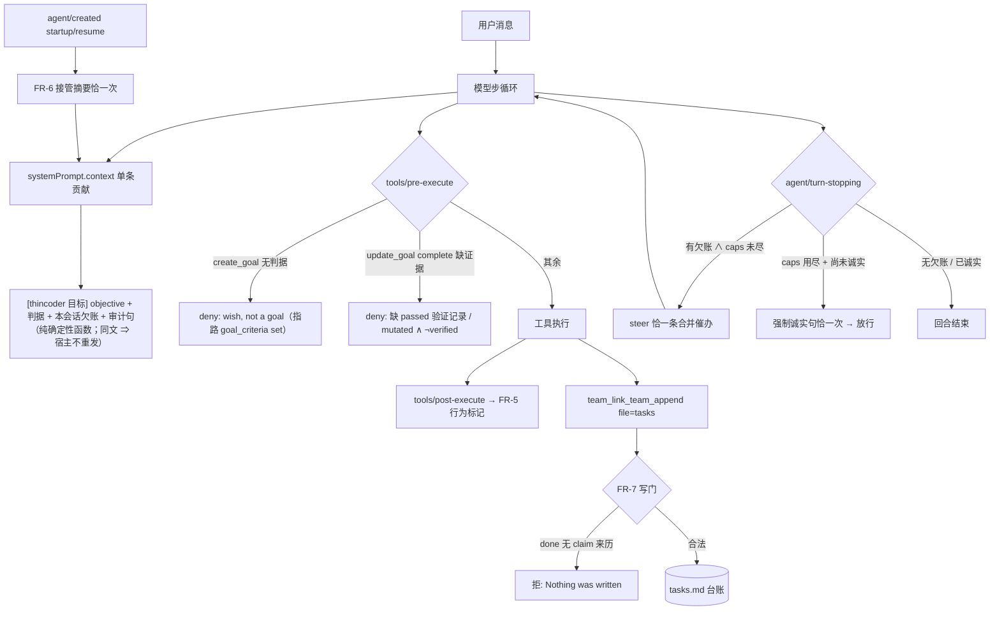
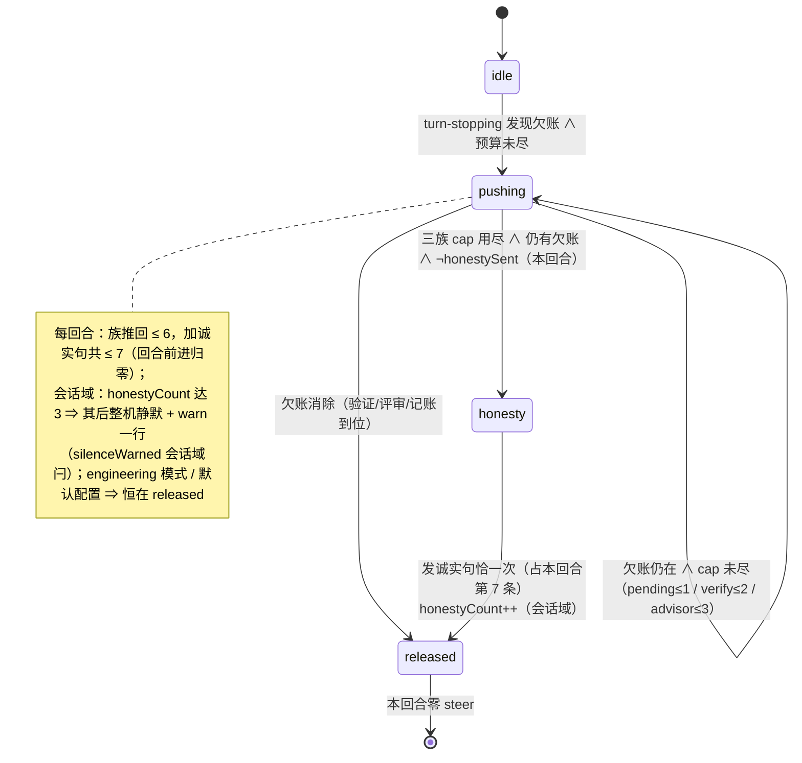
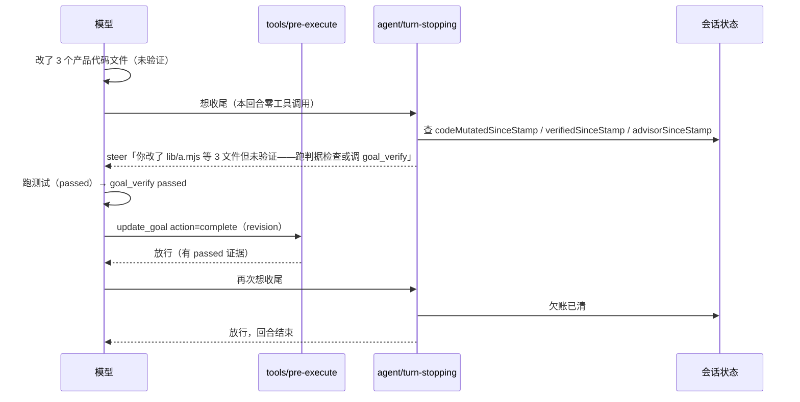

# 设计：长任务防漂（anti-drift）—— 批 34 · 设计档

- 日期：2026-10-14
- 需求档：[`2026-10-14-anti-drift-requirements.md`](./2026-10-14-anti-drift-requirements.md)
- 会诊：[`docs/consult-minutes/2026-10-14-consult-74-minutes.md`](./consult-minutes/2026-10-14-consult-74-minutes.md)（consult **#74**；交付 **4 / 5**，有效 **4 / 5**；逐条处置 = **44** 条，`adopted` **43** · `rejected` **1** · `pending` **0**；分歧裁定 **6** 处）
- 设计评审：**轮次 1 `FAIL`**（🔴4 · 🟡6 · 🔵3）⇒ 修正轮 1；**轮次 2 `FAIL`**（🔴2 · 🟡8 · 🔵4）⇒ 修正轮 2；**轮次 3 未过**（🔴3 · 🟡6 · 🔵3；评审员未给 `VERDICT` 行、正文判"须先解决"）⇒ **修正轮 3** 落地。（「腿 1」纪律：本行不写「N 条：」形计数，计数与列表一律住在 §15）
- 状态：**已实施（2026-10-14；实现提交 = `899f4e9`）· 待用户决定重启时机**（成文流程 = 需求档 + 设计档 → 用户确认 → 实施计划 → 用户确认 → 实施；本批四轮评审后签发令牌，用户当轮拍板「实施；先不重启」）
- 事实基线（2026-10-14 父侧实读，非转述）：
  - 装机面 = `D:\DSH-Desktop-Official\resources\app.asar` → `@deepseek-ai/dsh` **0.2.0-rc.2**（父侧字节扫描）
  - 源码面 = `D:\workspace\deepseek-harness` @ `d743267388` → `@deepseek-ai/dsh-root` **0.2.1-alpha.2**
  - 参考面 = `D:\workspace\thincoder`；本仓面 = `dsh-thincoder-suite`（TH）+ `dsh-team-link`（TL）
- 行号口径：**除装机面字节扫描偏移外，所有 `file:line` 均为 2026-10-14 实读坐标（as-of）**；跨仓引用写「仓名:路径:行」

<!-- doc-shape
count-marks: 项|处|条|档|值|步|腿
-->

## §0 三句话结论

1. **DSH 有回合收尾拦截，不用自造**：`agent/turn-stopping` 是官方预留的回合收口点——回合提交前被 await，监听器调 `agent.steer(msg)` 即**同回合再跑一步**（同回合号，不新开 `turn/start`）。出厂插件 `workspace-changes` 已在用。上一轮「插件没有拦截能力」的判断**已被源码证伪**。
2. **三层分工对齐 thincoder**：静态层（纪律，压缩动不了）+ **动态层（每回合把目标/判据/欠账重新送进上下文——我们整个缺这一层）** + 硬约束层（工具闸）。本批补动态层，并按「complete 门封闭、回合推回有界」的不对称口径补齐硬约束层。
3. **推回默认关、工程模式禁用、用尽即放行并留诚实声明**——照抄 thincoder 的三条保守选择；**不移植** checklist / 批次档 / 机检判据 / 阈值化自动动作（上游已删或由用户逐字撤销）。

## §1 背景

**用户实测痛（2026-10-14）**：长任务上 agent 静默丢承诺——收尾时不跑 advisor 评审、改完不验证就宣告完成、不记团队台账；原始目标与待办随上下文衰减，越长越漂。**用户提问**：thincoder 里有什么可吸收的，特别是记忆 / 看板 / 台账那套。

**已试且无效**：纪律写进系统提示词静态段（TH `lib/index.mjs:890-903`，`systemPrompt.section("thincoder:discipline")`）。静态段回答「角色与纪律是什么」，回答不了「**此刻还欠什么**」——前者是常量，后者是状态。

**参考实现的四件套**（`thincoder`，即上游）：① goal 必须带**机器可验判据**（`thincoder-core/agent-tools/goal.mjs:32-34` 拒建：*"a goal without a machine-checkable proof of completion is a wish, not a goal"*）；② **每回合**注入目标 + 判据 + 预算 + 两句审计语（`thincoder-core/agent/post-turn.mjs:51-67`）；③ 回合尾**有界推回**（`thincoder-core/agent/completion.mjs:55-152`：待办 ≤1 / 验证 ≤2 / 评审 ≤3，用尽后强制诚实句）；④ 台账**结构硬约束**（`thincoder-core/ledger-db.mjs:79-95`：六态 CHECK + 「在途/待核销 必带 `task_book` 指针」）。

**上游的净方向是「减强制」**（2026-09/10）：废 checklist（「两套待办跟踪是重复，删一留一」+「注入面纯移除，不承接」）、撤 V1–V4 机检判据、三层测试门砍成一条、**用户逐字撤销零产出阈值**（「不要零产出那个阈值，这样会让行为不容易判断」）。⇒ 本批吸收的是**剩下来没被砍的那几条**，不是整个体系。

## §2 问题（现象 + 根因，带证据）

**现象**：① 收尾不跑 advisor；② 改完不验证就宣告完成；③ 不记台账；④ 压缩/重启后忘原始目标与未收口事项。

| # | 根因 | 证据（2026-10-14 实读） |
|---|---|---|
| **R1** | **动态层整体缺席**：没有任何机制在每回合把「目标 + 判据 + 欠账」重新送进上下文。压缩后目标只剩残影 | 对照 `thincoder:thincoder-core/agent/post-turn.mjs:51-67`（每工具回合注入）；本方唯一动态注入 = TL 的会话资源行（TL `lib/index.js:4715-4749`），**无目标/欠账内容** |
| **R2** | **收尾边界不设防**：模型宣告「完成」的那一刻无人复核欠账 | 宿主 `agent/turn-stopping`（`deepseek-harness:packages/core/agent/src/runtime-types.ts:364-381`）在**两插件中零引用**（`TH lib/**` + `TL lib/**` grep 0 命中）；对照 `thincoder:thincoder-core/agent/completion.mjs:55-152` |
| **R3** | **台账无权威**：`tasks.md` 行有闭集 kind 但**无状态迁移约束**——未 `claim` 也能写 `done`；且写入口自述「写黑板没有权限门」 | TL `lib/index.js:7751`（工具 description 逐字）、行格式 `:6701-6706`；对照 `thincoder:thincoder-core/ledger-db.mjs:79-95` |
| **R4** | **判据无处可存**：宿主 goal 对象只有 `objective` + `max_goal_rounds`，**无 criteria 字段** ⇒ 「做完」没有可核对的判据 | `deepseek-harness:packages/goal/tool-goal/src/index.ts:207-232`（参数面）；完成无任何前置校验（`:313-314` 直调 `ctx.goals.complete`） |
| **R5** | **我方会话状态恢复链在真机上空转**（本批独立发现，详见 §15 L-3） | TH `lib/index.mjs:1290-1297` 监听 `agent/session-start`；该事件名在装机 0.2.0-rc.2（`app.asar` 字节扫描 **0 命中**）与开发树 0.2.1-alpha.2（`packages/` 全仓 grep **0 命中**）**均不存在**；真名 = `agent/created`（`runtime-types.ts:125,261`）。⇒ 写入侧一直在写、读取侧从未触发 |

**根因一句话**：thincoder 的「不忘」= **静态层 + 动态层 + 硬约束层三层分家**。我们只有第一层和半个第三层，**中间层整个缺席**——本设计补中间层，并把第三层补成「完成封闭、回合有界」。

## §3 目标 / 非目标

**目标**（做完之后什么变了）：

- **G1 判据先行**：建目标必须能说清「跑什么检查、看什么输出」；说不清就建不起来（wish → goal 的机械升级）。
- **G2 完成带证据**：宣告完成前，判据必须被实际执行并留痕；改了文件没验证 ⇒ **完不成**（封闭门，永不耗尽）。
- **G3 每回合可见**：每个模型步都能看见「目标 + 判据 + 本会话欠账 + 审计句」；文本无变化时零重发（不破前缀缓存）。
- **G4 带欠账收尾被有界拦下**：≤1 / 2 / 3 三族 caps + 单回合硬上限 6；用尽 ⇒ 一句诚实声明 ⇒ 放行。
- **G5 台账有来历**：任务状态按迁移表推进——`done` 必须该任务先有过 `claim`。
- **G6 开工接管**：新建或恢复会话时，本会话欠账摘要恰一次送到眼前。

**非目标**（本批不做，逐条给理由）：

1. **不复活 checklist 任何形态**（含「启动时被动注入待办清单」）：上游刻意删除，理由是两套待办跟踪重复；本批的注入对象是**目标与欠账**，不是第二份待办清单。
2. **不移植批次档六段骨架 / 段白名单 / close 冻结门**：上游自记「档过长（>1000 行）使父侧注意力下降」为其漏项/误报的**机制性根因**；且其 close 机检只查「§6 非空」，真正的收口清单全靠人肉 ⇒ 收益/负担比差。
3. **不移植文档机检引擎（V1–V4）/ 提示词双面流程 / 三层测试门 / 零产出阈值类自动动作**：上游已删或已整条撤销。
4. **不改宿主源码**：全部机制落在两个自有插件内（纯插件层）。
5. **不做独立完成裁判 LLM**：上游该面本身是 fail-open 洞（裁判抛错即放行）；收益不抵一次额外 LLM 调用的延迟与成本。
6. **不做台账写权门（ACL）**：我方无授权模型；TL §9.4 既定裁定 = 黑板模型（署名行 + 人判）。本批只补**结构门**。
7. **一期不做跨插件读取**（见 §4 D8 与 §15 L-1）：suite 不读 `team.md`，team-link 不改推回。

## §4 决策与理由

| # | 决策 | 为什么 | 被否决的备选及否决理由 |
|---|---|---|---|
| **D1** | 推回挂 `agent/turn-stopping` + `agent.steer(msg)` | 唯一的回合命运杠杆：serial、提交前 await、steer 同回合续步（`runtime-types.ts:364-381`）；契约测试 `agent-loop/tests/contract-regressions.spec.ts:319-341`；出厂先例 `deliverables/workspace-changes/src/index.ts:155` | ① `agent/pre-step` **reject**——那是「不让步开始」，reject 会把回合关成 `blocked` 且零模型调用（**硬停**，不是推回）；② `turn/end`——只是落盘日志，无拦截语义；③ 等宿主加钩子——已有 |
| **D2** | 每回合注入挂 `ctx.systemPrompt.context` **单条**贡献；**绝不动 `systemPrompt.section`** | 该通道的每次贡献渲染成**尾部追加**的一条 user 消息，宿主按整条文本去重（同文 ⇒ 不提交）；不动系统提示前缀 ⇒ 前缀缓存安全（`agent-loop/src/runtime-context.ts:152-163`；TL 已有同款先例 `lib/index.js:4861-4886`，并已为此把资源行搬出段面，见 `:4799-4800`） | ① 动态文本进 `section`——section 是系统提示本体，每变一次重组系统提示 = 前缀缓存**全灭**；② 自建「回合门」缓存——宿主已按文本去重，自建门会造出「谁能重发」的第二个判据（本仓历史上「两套跟踪」正是被删过的反模式）；③ 在 `agent/pre-step` 手工改写消息数组——每步改历史，且与 TL 既有深链改写抢同一瀑布（TL `lib/index.js:430-474`） |
| **D3** | 判据走**伴随存储 + 独立工具**（`goal_criteria`）；`set` **不要求目标已存在**——`goal_id` 可省，省下即为**会话级待绑判据**，在目标建成时绑定（键 = 会话状态，见 D4 与 §5 FR-1） | 宿主工具参数面固定（`tool-goal/src/index.ts:207-232`），插件加不了字段；`objective` 是**用户面文本**且每轮被原样注入（`goal-round-driver/src/prompt.ts:12-25`），塞机器子句同时改语义与显示；「待绑」形态解开 D4 的键循环（评审轮 1 🔴1） | ① **判据内嵌 objective 文本再解析**（会诊 #3 主张）——需从自由文本抠判据 = 自然语言解析，违反本仓「机检不得靠自然语言理解」的既有铁律；且污染用户面字段；② 注册同名工具顶替原生——双工具混淆 + 破坏宿主 guidance；③ 改宿主 schema——越界；④ **只以 goalId 为键、不设待绑槽**——建目标时无键可挂 ⇒ 判据门在创建点不可实现（评审轮 1 🔴1 的原缺陷） |
| **D4** | complete 门挂 `tools/pre-execute`，`deny` + 指路文案；**独立注册**，不并入既有写门/冻结门的函数体。门**同时覆盖两个动作**：`create_goal`（须有可绑判据：待绑槽 ∨ 已绑）与 `update_goal(action=complete)`（须有 passed 证据） | 与既有闸同型（TH `lib/index.mjs:1256-1263` 写门、冻结门；`eng.mjs:471` 的 `{kind:"deny"}` 形）；「先写判据再建目标」正是 US-1 的判据面，而**待绑槽**使它可实施（不再是鸡生蛋） | ① **取消创建点门、只在 complete 拦**（评审 #1 的备选 b）——被否：那会把 US-1「建不起来」降级为「建了也完不成」，与 thincoder 原始法理（*"…is a wish, not a goal"* 发生在**立目标**那一刻）不符；② 对判据「是否真跑过」做语义机检——不可靠，归评审与人工 |
| **D5** | **不对称口径**：complete 门 = **封闭**（永不耗尽）；回合推回 = **有界开放**（caps 用尽即放行 + 一句诚实声明） | 这是「把假完成堵死、又不把会话锁死」的唯一自洽形态：假的完成比没完成更坏（不可回滚的信任损失）；而推回无限循环会退化成唠叨（上游实测痛点原文 = "unbounded looping"） | 反过来（complete 也耗尽放行 = 允许假完成；回合永不放行 = 死锁） |
| **D6** | 推回 caps = 待办/欠账 **1** · 验证 **2** · 评审 **3**（三族之和 = **6**），**另加单回合 steer 绝对上限 6**（诚实句计入该 6）；**默认 OFF（opt-in）**、**工程模式禁用** | caps 取上游原值（`thincoder-core/agent/completion.mjs:12-15`）；「默认 OFF + eng 禁用」是上游自己的克制选择，也是「烦人风险」的最强证据；宿主**无内置回合预算**（`agent-loop/README.md:220`）⇒ 失控 steer 会无限转，绝对上限是结构保证（不靠自觉） | ① 推回默认开——违背上游用脚投票；② 只提醒不推回——有拦截点就不必退化；③ 无限推回——正是用户忌讳 |
| **D7** | 台账写门**收窄为一条**：`done(t-N)` 必须该 `t-N` 先有过 `claim`（在 team-link 唯一写入口内校验）；**默认 OFF**、先单队试点 | 这是上游 `task_book` CHECK 同型的**最小可用形态**（「声称完成一件没人接过的事」是典型漂移）；TL 已有闭集 kind + 任务号登记校验（`:7751`），本规则是它的增量 | ① 一步到位上「六态 + 指针闸」（重：指向什么还没定约，且 TL 行是**事件流**不是状态槽，状态由派生算出）；② 全套迁移表（会误伤既有实践：`plan → block → done` 等路径） |
| **D8** | 归属分家：**写门在 team-link**（自己的文件自己管）、**判据/完成门/注入/推回/接管全在 suite**；**一期无跨插件读取** | 两插件目前零运行时耦合（各自独立装配、生命周期互不可见）；一期引入「suite 读 team 黑板布局」= 把隐式路径契约变成硬依赖，而该布局的既定归属是 team-link | ① 合并成一个跨插件守卫（坏一个全停）；② suite 直接读 `team/*/tasks.md`（隐式路径 + 跨仓耦合，一期不做；登记为遗留 §13 L-1） |
| **D9** | 与宿主 `goal-round-driver` **各走各路**：推回续**本回合**；driver 在 **idle 之后**才投递下一回合的 `<goal_round>`；推回计数随回合起止重置，两者预算分开声明 | 两个机制作用在不同边界（回合内 vs 回合间）；宿主钩子语义已保证次序（driver 要求 `status === 'idle'`，而 turn-stopping 在回合未关时触发） | 给推回加 driver 感知（无谓耦合 + 多一个跨插件依赖） |
| **D10** | 失败朝向**逐面声明**：complete 判据门 = **fail-closed**；注入 / 推回 / 接管 = **fail-open**（内部任何异常 ⇒ 不注入 / 不 steer / 不接管，并留一行痕）；写门 = **fail-closed**（解析不了 ⇒ 拒写） | 监听器抛错会让**本回合以 `{kind:'error'}` 收尾**（`contract-regressions.spec.ts:346-363`）⇒ 推回监听器必须整体 try/catch；渲染抛错不能拖垮装配（TL `warnRender` 先例 `lib/index.js:5313-5315`） | 推回 fail-closed（一次内部 bug 把所有回合打挂，不可接受） |

## §5 方案（FR-1 … FR-8）

**挂点矩阵**（机制 → 钩子 → 失败方向）：

| FR | 机制 | 挂点 | 失败方向 | 落点 |
|---|---|---|---|---|
| **FR-1** | 判据记录（`goal_criteria` 工具 + `goal-criteria.json`） | 新工具 | 写入校验 fail-closed | suite |
| **FR-2** | 验证记录薄（`goal_verify` 工具）+ advisor PASS 同置位 | 新工具 + advisor 结算点 | 记录校验 fail-closed | suite |
| **FR-3** | 每步注入行（目标 + 判据 + 欠账 + 审计句） | `ctx.systemPrompt.context` 单条 | **fail-open**（抛错 ⇒ 空串） | suite |
| **FR-4** | 有界推回（三族 caps + 硬上限 6 + 诚实句） | `agent/turn-stopping` → `agent.steer` | **fail-open**（读不出 ⇒ 不推） | suite |
| **FR-5** | 行为标记（mutated / codeMutated / verified / advisorRan） | `tools/post-execute` + `turn/start` 复位 | fail-open（只记不拦） | suite |
| **FR-6** | 开工接管摘要（恰一次） | `agent/created`（`source ∈ {startup, resume}`） | **fail-open**（只提示） | suite |
| **FR-7** | 台账写门（`done` 需 `claim` 来历） | TL `team_link_team_append` 的 tasks 分支内 | **fail-closed**（解析不了 ⇒ 拒写） | team-link |
| **FR-8** | 配置面 + 探测降级（钩子缺席 ⇒ 该面关闭） | 装配期探测 + 配置 | 探测失败 ⇒ 关面 + 一行 warn | 两插件各自侧 |



### FR-1 判据记录与工具（suite）

- 新工具 **`goal_criteria`**：`action ∈ {set, get, clear}`。
  - `set` 参数：`{criteria, check, goal_id?}`。校验（**形状门，不判语义**）：`criteria` 去空白后**非空**；`check` 去空白后**非空**；`goal_id` **可省**——省下即写入**会话级待绑槽**（`pending`），在下一个 `create_goal` 被门放行时由 `tools/post-execute` 绑定到宿主生成的 `goalId`。不满足 ⇒ 拒，文案逐字引上游法理：
    > a goal without a machine-checkable proof of completion is a wish, not a goal.
  - **两种记录形**（互斥，同一时刻至多一条在席）：
    - `pending`：`{criteria, check, setAt}` —— 尚未绑定任何目标（**建目标前的唯一合法形态**；**仅内存态，不落盘**）；
    - `bound`：`{criteria, check, setAt, goalId}` —— 已绑定；`get` 无参返回二者之一。
  - **`proofRef` 语义（解评审轮 2 🟡3）**：`proofRef` **≡ 该目标在席 `bound` 记录的标识**，标识取 **`goalId`**（宿主铸造、稳定、唯一，且已在记录里）——**不新增铸造 `proofId`**。判据因此可定形：`goal_verify` 的 `proofRef` 必须逐字等于**当前 `bound` 记录的 `goalId`**；记录被 `clear` / `complete` 清除后同值传入 ⇒ **拒**（"已清记录"）。腿 A-3 即按此断言。
  - `clear` 两种形态都可清；`update_goal` 的 `complete` / `blocked` 成功后自动清 `bound` 记录（见 §7）。
- **门与槽的耦合（解评审轮 1 🔴1 的键循环 + 评审轮 2 🟡5 的陈旧绑定位 + 评审轮 3 🔴3 的收窄未落地）**：`create_goal` 的前置 = **「有 `pending` 槽」**——**唯一条件**，且**不设"已有 bound 即放行"的旁路**（那条旁路正是"陈旧绑定"漏洞：会话里留着一个已消费/属于第一个目标的 bound，第二个目标就能无判据地建起来）。故：① 每建一个目标都必须**先写一次判据**（`goal_criteria set` 不带 `goal_id` ⇒ 进 `pending` 槽）；② 建目标成功后，槽被**消费**（提升为 `goals[goalId]`）⇒ 下一个目标同样需要新的 `pending`；③ `set` 显式给了 `goal_id` 时**必须该目标已存在**（读宿主 goal 服务核对），否则**拒**（"不要为一个不存在的目标铸绑定"）；不存在时修法 = **省略 `goal_id`** 走 pending。这一条同时是 US-1「先写判据、后立目标」的机械形态。
- 落盘：`goal-criteria.json`（与 `token-store.mjs` 同址，沿用 `dsh-home.writeFileAtomic` 原子写）；**`pending` 槽只活在会话内**（不落盘——它本来就只服务于本会话的下一建目标动作）。
- **诚实边界**：形状门只保证「写了」，不保证「可机检」——判据的语义质量归评审（登记为最痛失败面，见 §9 F-1）。

### FR-2 验证记录薄与完成证据（suite）

- 新工具 **`goal_verify`**：参数 `{proofRef, command, status, summary}`，`status ∈ {passed, failed, skipped}`。
  - 校验：`proofRef` 必须等于**当前在席 `bound` 记录**的标识（引用不存在/伪造/已清记录 ⇒ 拒，零写）；`status='skipped'` 且 `summary` 去空白为空 ⇒ 拒；**`failed` 恒被尊重**（不可被后续写入覆盖，只能再记一条）。
  - 记录形：`{proofRef, command, status, summary, at}`，滚动上限 **20** 条。
- **置位与"Stamp"语义（解评审轮 1 🔴2）**：本设计把"验证过了没有"拆成**两个不同生命期的标记**，禁止混用：
  - **`verifiedSinceStamp`（目标/会话级，落盘）**——含义 = "**自上次落章以来**没有出现未验证的产品代码改动"；`passed` ⇒ `true`；**任何产品代码改动成功 ⇒ 立即 `false`**；`complete` 门只读它。
  - **`verifyRanThisTurn`（回合级，不落盘）**——含义 = "本回合跑过一次判据检查"；只服务推回谓词 P2 的"这一轮做过了"判读。
- **advisor 同置位（解评审轮 3 🟡6）**：advisor 代码评审结算为**裁决 `pass`** ⇒ 置 `verifiedSinceStamp = true` 与 `advisorSinceStamp = true`（复用既有结算点，零新机制）。**大小写口径**：本仓裁决协议在模型面输出**大写 `VERDICT: PASS`**（见 `lib/prompts/discipline.md` / `verdict-contract.md`），而内部判定标记为小写 `pass` ⇒ 判据按**大小写不敏感**（`/^VERDICT:\s*pass$/i`）实现，**不得**写成区分大小写的字面量（否则永不触发）。腿 A-2② 即钉这一支路。

### FR-3 每步注入行（suite）

- 注册 `ctx.systemPrompt.context({ name: "thincoder:anti-drift", order: <有限值>, text: renderAntiDriftLine })`；`text` 为零参闭包**捕获注册时的 agent**（宿主 `AssembleContext` 无 `agent` 字段——TL 已实证，`lib/index.js:4846-4849`）。
- 渲染体（**纯确定性函数**：禁时间戳 / 禁百分比 / 禁步数 / 禁随机；同输入 ⇒ 逐字节同输出）：

  ```text
  [thincoder 目标]
  <untrusted_objective>{objective｜（无活跃目标）}</untrusted_objective>
  <untrusted_completion_criterion>{check｜（无判据记录——按纪律应先调 goal_criteria set）}</untrusted_completion_criterion>
  欠账：{活跃目标缺判据 / 自上次落章以来有未验证改动 / 未评审，逐项列；无欠账则本行整行省略}
  审计句：只有判据的检查实际跑过并通过才算完成——弱证据、计划、摘要都不算完成。
  ```

- 后置条件：**整串 ≤ 512 字符**（超限 ⇒ 按 objective → check → 欠账 的次序截断，**审计句永不截断**）；无活跃目标 ∧ 无欠账 ⇒ **返回空串**（空串 = 本步不贡献上下文）；任一读取抛错 ⇒ 返回空串 + `onError` 一次性留痕；objective / check 各截断至 **64 / 64** 字符（**设计取值**，实施轮以实测调，见 §14 L-6）。
- **不含**：轮次 / 预算行（读数可得性未验证，不造读数——§4 D5 与 §15 L-2）。

### FR-4 有界推回（suite）

- 监听 `agent/turn-stopping`，谓词**按序取第一个未耗尽项**，一次边界**恰一条** merge 后的 steer：

  | 序 | 谓词（**phase 1 的本地定义**，见下） | cap | steer 要点 |
  |---|---|---|---|
  | P1 | **活跃目标存在 ∧ 该目标无 `bound` 判据记录**（`criteriaMissing`） | **1** | 点名"这个目标没有判据" + 指路 `goal_criteria set` |
  | P2 | `codeMutatedSinceStamp ∧ ¬verifiedSinceStamp` **∧ ¬verifyRanThisTurn** | **2** | 点名改动文件（≤3 个）+ 指路跑判据 / `goal_verify` |
  | P3 | `codeMutatedSinceStamp ∧ ¬advisorSinceStamp` | **3** | 指路调 `advisor`（带上轮次与剩余次数） |

  > **单回合 steer 预算（解评审轮 4 🟡1：把记账一次定死；实施轮二次定死，见下）**：三族 caps 回合前进各归零 ⇒ 单回合族推回上限 **1+2+3 = 6**；**诚实句占第 7 条**（`honestySent` 保证每回合至多一句）⇒ **单回合 steer 总数硬上限 = 7**（≤7 不变式）。为何不把诚实句塞进 6：三族之和恰为 6 且每族"恰好推满"是 A-4 的断言，若诚实句也记账在同一 6 里，三族推满后诚实句**永不可达**（评审轮 4 抓到的算术矛盾）。
  >
  > ★ **实施轮定案：`caps` 只有三个族键，没有 `total`**（2026-10-14 实施时时发现并删除）。原稿在 `caps` 里另设一个 `total`，实施时发现它在**两种取值下都不成立**：
  > - `total ≤ Σ族`（默认即 `6 = 1+2+3`）⇒ 族预算先被三族耗光 ⇒ **诚实句永不可达**（轮 4 的矛盾原地复活）；
  > - `total > Σ族` ⇒ 它就成了**第二套族预算**，与三族各自的上限语义重叠，徒增歧义。
  >
  > ⇒ **唯一事实源 = 三族上限**；诚实句的名额 = **Σ族 + 1**（由 `turnSteerHardMax(caps)` 现算，不落配置）。`test/anti-drift.test.mjs` 的腿 A-14 显式断言「传 `total` ⇒ 拒（未知子键）」，把这条钉成机器可检——**勿再加回 `total`**。
  >
  > **另一条实施轮发现（同类：默认值让某支不可达）**：把 `honestySent` 放在**会话域**会让「每回合至多一句诚实句」变成「每会话至多一句」⇒ 会话封顶 3 永不生效。已改回**回合域**（§7 三域表为准）。

- **P1 的定义变更（解评审轮 1 🔴3）**：原稿 P1 写"本会话有未收口欠账（`plan` 无 `done` 等）"，而该数据源来自 `team.md`——一期已裁**不读跨插件台账**（§4 D8 / §14 L-1）⇒ 原 P1 **不可达**（其内容要么无源、要么与 P2/P3 重复）。修正为**纯本插件可判**的 `criteriaMissing`：它正对 US-1 的痛点（"立了目标却没说清怎么算完"），且与 P2/P3 语义不相交（前者是"目标缺判据"，后者是"改动缺证据"）。
- **前置条件**（全部满足才生效）：配置 `antiDrift.pushback === true` ∧ 非工程模式 ∧ **存在活跃目标** ∧ `!signal.aborted`。**注意**：本前置**不含** `honestyCount`/`steerTotal` 的数值门槛——那两条是**步骤内的短路**（见 §6 步骤 2 与 FR-4 后置），把数值门槛放进前置会让"用尽后仍要发诚实句"这一支永不可达（评审轮 3 🔴2 / 🟡7）。
- **`depth === 0` 已移除（解评审轮 2 🟡4）**：原前置含 `depth === 0`，但**已核实的 `turn-stopping` 载荷只有 `{agent, turn, signal}`**，`depth` 从哪个面读**未指定且未核实**——正是本批 V-0/L-3（「不信未核实的读数」）要防的物种。替代判据取 **`hasActiveGoal`**（宿主 goal 服务可读，进 V-0b 核对），理由三条：① 宿主 `goal-round-driver` 只驱动**顶层会话**的目标（子代理/队员无 `goal`）⇒ 有活跃目标天然排除子代理；② 本监听器只在**顶层回合边界**触发（子代理回合不派发 `agent/turn-stopping` 到本插件）；③ 谓词 P1 本就以「有活跃目标」为条件 ⇒ 前置与之同源，不引入第二个未核实读数。
- **后置条件**：恰一条 steer 或零操作；**永不 steer 两次同一边界**；三族 caps 全尽 ⇒ 发**恰一句**固定诚实声明（"我改了代码但未完成验证/评审——不要把这一轮当作已完成。"）并置 `st.honestySent = true`（**回合域**：每回合至多一句）；**会话累计**由 `honestyCount++` 记账，达 **3** 时置 `silenceWarned` 并 warn 恰一行（**会话域闩**，跨回合不再复位）。
- **绝对上限语义（解评审轮 3 🟡7 + 轮 4 🟡1 的算术修正）**：`steerTotal` 是**每回合**计数（回合前进即归零），**硬上限 = 7** = 三族之和 6 + 诚实句 1。路径 =「三族依次推满（1+2+3）→ 第 7 条是诚实句 → 该回合结束」；若诚实句之后仍有触发，步骤 2 的短路命中 ⇒ **不再 steer**（至多 warn 一次）。**诚实句占第 7 条而不是豁免**（否则单回合可能无限发）；但它**不占用三族预算**（否则三族推满后它不可达）。
- **误伤排除**：`codeMutatedSinceStamp` 由 `touchedFiles` 经 **`TH lib/path-kind.mjs` 的 `isProductCodePath`** 过滤后非空判定（**纯文档改动不触发推回**）。
- **整体 try/catch**：内部任何异常 ⇒ 不 steer（回合正常关闭）+ 一次性 warn。
- **回合边界判据（解评审轮 1 🟡7）**：本监听器与 FR-5 的"本回合"**不依赖任何未经核实的回合事件名**——采用**惰性回合比较**：`turn-stopping` 载荷自带 `turn`，每次进入时 `st.turn !== turn ⇒ 重置回合域`。因此**不需要** `turn/start` 之类的重置事件（该名本批未核实，见 §13 V-0）。

### FR-5 行为标记（suite）

- 监听 `tools/post-execute`（`deepseek-harness:packages/core/tools/src/index.ts:177`）：先 `await next()`，再按结果置位并**按各自的域分层**（解评审轮 1 🔴2——"ThisRun" 这个名字本身含混，故拆成显式两族）：

  | 标记 | 域 | 置位 | 复位 |
  |---|---|---|---|
  | `touchedFiles` / `codeMutatedSinceStamp` | **落章域**（跨回合、跨重启；随目标存活） | 写/编辑类成功 ⇒ `touchedFiles` 追加；产品代码 ⇒ `codeMutatedSinceStamp = true` | **仅**一次合格落章（`goal_verify passed` ∨ advisor PASS）⇒ 清 `codeMutatedSinceStamp` 与 `touchedFiles` |
  | `advisorSinceStamp` | **落章域** | `advisor` 工具成功 ⇒ `true` | 同左（落章时清） |
  | `verifyRanThisTurn` | **回合域**（不落盘） | shell 类成功且命令形匹配 `/test|build|check|typecheck|lint/i`（**可单独关**） | 由 FR-4 的**惰性回合比较**在回合前进时清；**被 P2 读取**（本回合已跑过检查 ⇒ 这一轮不再催） |
  | `mutatedThisTurn` | **回合域**（不落盘） | 任一写/编辑类成功 | 同上 |
  | `criteriaMissing` | 派生（读判据存储） | — | 无需复位（每次现算） |

- **为什么拆**：原稿把 `mutatedThisRun` / `verifiedThisRun` 同时写成"回合级复位"与"须跨重启存活"（评审轮 1 🔴2 抓到的直接矛盾），且若真按回合复位，**第 N 回合的改动可在第 N+1 回合被无证据地"完成"**——G2 的封闭门会被绕过。落章域与回合域分离后：complete 门只读**落章域**（跨回合不可绕过），推回谓词读两域（回合域用于"这一轮刚做过"）。
- **只记不拦**：本监听器永不改 decision。
- `session/disposed` 清理进程内对象（**回合域与会话域都清**）；落章域随会话状态按 F12 白名单落盘（见 §7）。**注意**：`honestyCount` / `handoffSent` 属**会话域**——回合前进**不得**复位它们（否则会话级诚实句封顶形同不存在）。

### FR-6 开工接管摘要（suite）

- 监听 **`agent/created`**（`source ∈ {startup, resume}`；`clear` / `compact` **排除**——否则压缩后会重复接管），payload = `{agent, source, signal?}`。
- 动作：计算一次欠账摘要（活跃目标有无判据 / **落章域**存在未验证或未评审改动 / 最老的未收口项 ≤3 条），经 `agent.inject(msg)` 注入——**`inject` 不唤醒驱动**（`agent/created` 阶段驱动尚未起跑，正是初始化注入的正规点）。
- 闩：`handoffSent` 每会话恰一次（进程内；重启后重发一次可接受）。
- **整体 try/catch**：`agent/created` 是 **serial 且被 await**，抛错会让**创建失败**（`runtime-types.ts:252-255`）⇒ 本监听器必须只读 + 全包 try/catch。

### FR-7 台账写门（team-link）

- 落点：`team_link_team_append` 的 `file="tasks"` 分支**内部**（唯一写入口），插在既有「任务号必须已登记」校验**之后**、追加之前。
- 规则（**两条**）：① `kind === "done"` ⇒ 该 `t-<n>` 在文件中必须已存在至少一条 `kind === "claim"` 行；否则**拒且零写入**，文案示例：
  > 拒写 done(t-7)：该任务没有 claim 行——先 claim 再收工（Nothing was written）。
  ② `kind === "retract"` ⇒ 正文必须含一个指向**本文件里真实存在、且属于同一任务**的行的指针（`t-<n>` 或 `#<seq>`）；否则**拒且零写入**。
- ★ **规则② 的来历与判据（2026-10-15 夜班轮补，会诊 #78 裁定后回填 —— 这一段是"补权威"，不是"补功能"）**：
  **事实**：规则② 的要求来自**用户转述的吸收清单第 6 项**（原话「收口规则：不能跳步、撤回必须带证据」），而它**从未被写进本档或需求档**——会诊 #78 四家实读证实需求档 `retract|撤回` **0 命中**、本档 §5 FR-7 原文只有**一条**规则。于是出现一个真实的治理缺口：**两个会话各自按"用户说过"去实现它，而实现所引用的设计依据是假的**（代码注释写着「依据设计档 §5 FR-7」，而该档当时没有这一条）。本段即为关闭该缺口：**把判据定义补进档面，使实现有据**。
  **判据（可机检，零自然语言理解）**：正文里抽出全部 `t-<数字>` 与 `#<数字>`；**至少一个命中**「本文件可解析行里、`task` 等于本行 `task` 的行」⇒ 过；全不命中 ⇒ 拒 + 零写入（文案点名抽到的引用 + 列本任务可用行 + `Nothing was written`）。解析口径 = 既有 `parseTasksRow`（坏行不算存在），复用已读入的 `existing.text`，**零新增 IO**。
  **为什么是「同任务」而不是「文件里任意真实存在的行」**：后者等于**声称撤回 A 却拿 B 当凭据**（装饰不是证据）；且它与规则① **对称**——两条门都要求「前件是同一件事上的行」。**放宽成"任意存在"只需删一个谓词**，若将来出现跨任务撤回的正当场景，改这里即可。
  **明确不做（三条，均为会诊 #78 的共识边界）**：① 不判**作者是否同一人**（台账档 :249 约定「资格留给人类判断」，本档承诺不动写权限口径）；② 不判**撤回是否真的驳倒了它**（那需要 NLP 或裁决，撞本仓铁律）；③ **不加 `kind` 白名单**——会诊 §2 建议 `kind ∈ {claim,done,block}`，但既有**合法**夹具 `dsh-team-link/host-half.test.mjs:2679` 的正文是「撤回 #4 的第 2 处」而 `#4` 那行是 **dispute**（retract 在既有设计里**正是用来消解 dispute 的**，§9.3.4 规则 2）⇒ 该白名单会打红既有合法撤回，**故不采纳**。
  **已知的既有语料不一致（如实登记，供将来收紧时处理）**：`dsh-team-link/README.md` 的撤回示例写作裸「43 的第 2 处」（**无 `#`**），而本判据只认 `#<seq>` / `t-<n>` 两种形态 ⇒ 门 ON 时该形态的正文会被拒（门**默认 OFF**，故既有部署不受影响）。
- 开关：`antiDrift.ledgerTransitionGate`（team-link 侧读自己的配置面），**默认 OFF**。
- **不改**行格式、seq 分配、单行上限、既有 kind 闭集校验、读面派生逻辑。

### FR-8 配置面与探测降级（两插件各自侧）

**开关面 = 配置文件 + 工具面两处（解评审轮 1 🔴4；「设置页」本批不做，US-6 已相应收窄）**

- **配置落点（base-only）**：六键全部读**插件配置**（`advisor_config` 同一配置面，即 TH `lib/config-store.mjs` 已有的那一层）——
  - suite 五键：`antiDrift.inject`（默认 `true`）· `antiDrift.completeGate`（默认 `true`）· `antiDrift.pushback`（默认 `false`）· `antiDrift.verifyHeuristic`（默认 `true`）· `antiDrift.caps`（默认 `{pending:1, verify:2, advisor:3}`——**只有三族键，无 `total`**，理由见 FR-4 的记账定案）。
  - team-link 一键：`antiDrift.ledgerTransitionGate`（默认 `false`）。
- **为什么本批只做「配置文件 + 工具面」而**不**做设置页**（如实声明，逐条）：
  1. 本仓对**用户层**（`settings.yaml` 白名单）键的既有纪律是三面同步 = `config-store.mjs` ⊕ `index.mjs` 的 PUT 校验 ⊕ 设置页表单（`METHODOLOGY.md` D-29 行；`docs/2026-09-02-settings-ui-design.md`）——那是一条**独立完整的交付面**，塞进本批会让「机制本体」与「UI 面」互相拖累；
  2. 工具面**已满足本设计的实际需要**（模型/用户可即时翻转并当场观察行为），而这正是六键的**唯一**运行时用途；
  3. 六键**全是 base-only** ⇒ **不需要**用户层白名单条目、不需要 PUT 校验、不需要设置页控件 —— 即：**本批不碰任何用户层写入面**（零新增用户层键，故不触发 D-29 三面同步义务）。
- **工具面**：新工具 **`anti_drift_config`**（`action ∈ {get, set}`，参数 `{key, value?}`）——单键读写上述**七键**；对**键名**与**取值类型**做闭集校验（未知键 / 错型 ⇒ 拒，零写），未知键拒绝文案列出全部合法键名。**`caps` 子键校验（解评审轮 3 🔵12 + 实施轮定案）**：`caps` 的值对象子键闭集 = `{pending, verify, advisor}`（各为 **0–6 的整数且全部必填**）；**传 `total` ⇒ 拒（未知子键）**（见 FR-4 的记账定案）；**`stallRepeat`**（FR-9 阈值）为 **0–20 的整数**，`0` ⇒ 关闭停滞检测。越界 / 非整数 / 缺键 / 未知子键 ⇒ **整体拒 + 零写入**（不做部分写入）。**工程模式禁写**（避免在纪律最重的模式下被临时关掉机制）——覆盖腿 = **A-5③**（`caps` 子键校验的覆盖腿是 **A-14**；`stallRepeat` 的覆盖腿是 **尾-3**；解评审轮 4 🔵5 的指路更正 + 夜班轮补）。
- **生效语义（解评审轮 2 🟡6）**：**六键均为 base 层读法**——本插件每次需要时**现读配置**（先例 = 既有 `configDefaultEngineering` 的读法，见 `lib/index.mjs`），因此 `anti_drift_config` 的写入**在本会话内即时生效**（下一次渲染 / 下一次推回判读就按新值走），**不需要重启**；写入落在**同一 base 配置文件**（与 `advisor_config` 同一配置面），重启后仍在。**两项如实声明**：① **不需要**用户层（`settings.yaml`）白名单 ⇒ 不触发 D-29 三面同步义务；② 若某个键在实施时被做成**装配期快照**（而非现读），则该键**必须**在描述面写明「重启生效」——**不许**保留"即时生效"的措辞（N-7）。
- **探测降级**（装配期一次性探测，缺面 ⇒ 该面关闭 + **恰一行** warn，不阻断装配）：`ctx.systemPrompt?.context` 缺席 ⇒ 注入面关；`ctx.on("agent/turn-stopping")` 不可注册 ⇒ 推回面关（**降级路径 = FR-3 注入行仍在**，见需求档 US-7 的收窄注）；`tools/post-execute` 缺席 ⇒ 谓词恒不命中（等价关闭）；宿主 goal 服务缺席 ⇒ FR-2/FR-3 的 goal 部分静默跳过。
- **第七键 `antiDrift.stallRepeat`**（**夜班轮补，兑现吸收清单第 8 项**）：停滞检测阈值，默认 **3**，`0` ⇒ 关该机制。它是**数字键**（其余为布尔 / 对象）⇒ 闭集校验里单独一支。

### FR-9 停滞检测（suite；夜班轮补 · 吸收清单第 8 项）

**治什么**：死循环刷步数——同一工具 + 同一份参数**连续**再来第三遍，多半不是在推进任务（读同一个文件、跑同一条命令、重复同一个搜索），而是在空转。

- **判定**：`tools/post-execute` 末尾（**横跨所有工具**，不做分派）记一次调用签名 = `工具名|稳定序列化参数`；**同签名连续计数 ≥ `stallRepeat`** ⇒ 判定停滞。
- **动作 = 提醒，不是拦**：经 **`agent.inject`**（下一步可见、**不唤醒驱动**）投一句固定文案。**刻意不用 steer**——steer 会改变回合命运，而"重复读一个文件"是无害行为，不该把回合钉住（与 FR-4 的推回形成对比）。
- **四条刻意收窄的边界**（每条都对着一类失败）：
  | # | 边界 | 不这样会怎样 |
  |---|---|---|
  | ① | 只在**同一回合**内累积（回合域），回合前进即归零 | 跨回合"又读了一次"被算成停滞 ⇒ 误伤 |
  | ② | 同一次调用**只记一次** | 重试/被拒路径重复计数 ⇒ 计数虚高 |
  | ③ | 触发后**每回合至多一条**（`stallNoticed` 回合域闩） | 变成新的唠叨源（本批最忌讳的物种） |
  | ④ | 参数序列化**剔除易变字段**（`signal`/`timeout`/`requestId`/`id`/`index`/`seq`）并**键排序** | 同一次调用因时间戳/序号不同而永远"不同" ⇒ **此机制永不触发**（恒真断言那一族） |
- **确定性**：`stallNotice(toolName, count)` 是纯函数——同输入逐字同输出，且**禁时间戳**（与 FR-3 同纪律，腿 尾-2 断言）。
- **配置**：`antiDrift.stallRepeat`（默认 3；`0` ⇒ 关）。
- **迁移说明（与吸收清单原文的差异，如实登记）**：吸收清单第 8 项写的是「连续 3 次相同工具调用 ⇒ 死循环刷步数」，本实现**取提醒而非拦截**，理由是"拦截"已被 FR-4 的推回占用，且重复读文件的风险远低于"改完不验证"；**这是有意的收窄，不是遗漏**。另：会诊曾提示宿主可能有同族能力（`repeat-tool-reminder`），但**我方仓库实测 0 命中、未在开发树核到**，故不据此省掉本机制（该旁证在纪要 §5 标为未验证）。

## §6 机制伪代码（前置 / 后置）

```text
renderAntiDriftLine():                       # FR-3（宿主每步调用；纯函数、无副作用、不抛）
  前置: config.antiDrift.inject === true; agent 由注册闭包捕获
  后置: 整串 ≤512 字符；无活跃目标 ∧ 无欠账 ⇒ ""
        同输入 ⇒ 逐字节同输出（无时间戳/百分比/步数）；异常 ⇒ "" + onError 一次
  1. goal = ctx.goals.get(agent)                      # 宿主服务，可 undefined
  2. crit = criteriaStore.readBound(goal?.id)         # 损坏 ⇒ undefined（不抛）
  3. debts = localDebts(agent)                        # ①活跃目标缺判据 ②未落章改动 ③未评审
  4. goal 空 ∧ debts 空 ⇒ return ""
  5. 确定性拼装（objective 64 字 / check 64 字截断；审计句永不截断）；return 串

goalCriteriaGate(exec, next):                # FR-1/FR-2 门（tools/pre-execute；独立注册）
  前置: next 可调用
  1. d = await next(); d 已被拒 ⇒ 原样返回
  2. 工具名 === "create_goal":
       有 pending 槽 ⇒ 原样返回（成功创建后由 tools/post-execute 把槽提升为 bound）
       否则 ⇒ { kind:"deny", reason:"…a wish, not a goal…先调 goal_criteria set 写明判据（不填 goal_id 即待绑；建目标后自动绑定）" }
       注：**不设**「已有 bound 记录 ⇒ 放行」的旁路（陈旧绑定漏洞，见 §5 FR-1）
  3. 工具名 === "update_goal" ∧ args.action === "complete":
       无 bound 记录 ∧ 判为目标早于本插件装配 ⇒ 只判落章域（不因缺判据拒旧目标）
       有 bound 记录 ∧ 无其 passed 验证记录 ⇒ deny（指名缺哪条证据 + 补哪个调用）
       codeMutatedSinceStamp ∧ ¬verifiedSinceStamp ⇒ deny
       其余 ⇒ 原样返回
  4. 其余 ⇒ 原样返回；状态读抛错 ⇒ 原样返回 + warn 一次（fail-open，不锁死会话）

bindPendingOnCreated():                      # FR-1 槽绑定（tools/post-execute，create_goal 成功后）
  前置: 有 pending 槽
  后置: 槽 ⇒ bound{goalId}（宿主生成的 id）；无 pending ⇒ 零动作

goalVerify(args):                            # FR-2
  前置: proofRef 非空; status ∈ {passed, failed, skipped}
  后置: proofRef ≠ 在席 bound 标识 ⇒ 拒（零写）; skipped ∧ summary 空白 ⇒ 拒
        成功 ⇒ 追加记录（上限 20，滚动）; passed ⇒ verifiedSinceStamp = true
              并清 codeMutatedSinceStamp / touchedFiles（= 一次合格落章）

trackPostExecute(exec, result, next):        # FR-5（永不改 decision）
  1. d = await next()
  2. result 成功 ∧ 写/编辑类 ⇒ mutatedThisTurn = true; 产品代码 ⇒ codeMutatedSinceStamp = true; touchedFiles 追加; verifyRanThisTurn = false
  3. result 成功 ∧ 工具名 === "advisor" ⇒ advisorSinceStamp = true
  4. result 成功 ∧ shell 类 ∧ 命令形匹配（可关）⇒ verifyRanThisTurn = true
  5. return d

pushbackGuard(turnStopping):                 # FR-4（serial；绝不 throw）
  前置: enabled ∧ ¬engineering ∧ hasActiveGoal(agent) ∧ ¬signal.aborted
  后置: 恰一条 steer 或零操作；同一边界不重复 steer；三族 caps 尽且仍有欠账 ⇒ 诚实句；会话累计 3 句后整机静默
  1. st = pushbackState.of(agent.session)
     st.turn !== turn ⇒ 重置「回合域」（含 steerTotal=0、honestySent=false）并把 st.turn = turn
  2. ¬st.honestySent ∧ st.steerTotal ≥ 7 ⇒ { if ¬silenceWarned { warn(硬上限); silenceWarned = true }; return }
  3. P1: goal 存在 ∧ ¬criteriaStore.hasBound(goal.id) ∧ cap(pending) 未尽 ⇒ steer(判据缺失文案); st.steerTotal++; return
  4. P2: codeMutatedSinceStamp ∧ ¬verifiedSinceStamp ∧ ¬verifyRanThisTurn ∧ cap(verify) 未尽 ⇒ steer(验证文案); st.steerTotal++; return
  5. P3: codeMutatedSinceStamp ∧ ¬advisorSinceStamp ∧ cap(advisor) 未尽 ⇒ steer(评审文案); st.steerTotal++; return
  6. ¬st.honestySent ∧ hasOutstandingDebt(agent) ⇒        # ★ 闸：必须有欠账（解评审轮 4 🟡4）
                                                            #   hasOutstandingDebt = 步骤 3/4/5 的谓词至少有一个为真（不看 cap）
       steer(诚实句); st.honestySent = true; st.steerTotal++;          # 诚实句占第 7 条
       honestyCount++;                                                  # 会话域计数
       若 honestyCount ≥ 3 ∧ ¬silenceWarned ⇒ { warn(整机静默); silenceWarned = true }   # 会话域闩，恰一次
       return
  7. 否则 return（本回合已诚实过；或无欠账；或 caps 未尽而无可催项）

onAgentCreated({agent, source}):             # FR-6（serial；绝不 throw）
  前置: source ∈ {startup, resume} ∧ ¬handoffSent(agent.session)
  后置: 至多一次 agent.inject(...)；异常 ⇒ warn 一次，不影响创建
  1. 计算欠账摘要（≤3 条 + 一行指路）
  2. summary 空 ⇒ return（零注入）
  3. agent.inject(createUserMessage 等价字面量, source = { kind: "plugin" })
  4. handoffSent = true

boardTasksGate(newKind, taskNo, rows):       # FR-7（team-link；落点 = tasks 分支内）
  前置: 既有校验（闭集 kind / 号码已登记 / 单行 ≤2000 码点 / 无换行）已过
  后置: 通过 ⇒ 零副作用；拒绝 ⇒ 零写入，文案含修法
  1. 开关关 ⇒ 通过
  2. newKind === "done" ∧ rows 中无该 taskNo 的 claim 行 ⇒ throw(拒写文案)
  3. 通过
```

## §7 状态与 schema（谁写谁读）

| 状态 | 形态 | 谁写 | 谁读 | 生命期 / 落盘 |
|---|---|---|---|---|
| `goal-criteria.json`（**盘上只有 `goals`**；`pending` 仅内存态，见下注） | `{version:1, goals:{<goalId>:{criteria, check, setAt}}}`；**内存**另持 `pending?:{criteria, check, setAt}`（**不写入文件**——解评审轮 2 🔵12） | `goal_criteria set/clear`；`create_goal` 成功后把 `pending` 提升为 `goals[goalId]`；`update_goal` complete/blocked 成功后清该 id | FR-1 门、FR-2 门、FR-3 渲染 | `goals` 随目标、**落盘**（原子写）；`pending` **只活会话内**（不落盘、不跨会话） |
| 验证记录 `verifyRecords[]` | `{proofRef, command, status, summary, at}`，上限 **20** | `goal_verify` | FR-2 门 | 会话级；**落盘** |
| **落章域**：`codeMutatedSinceStamp` · `verifiedSinceStamp` · `advisorSinceStamp` · `touchedFiles` | 布尔／数组 | FR-5（`tools/post-execute`）、FR-2（`goal_verify`）、advisor settle | **FR-2 完成门**（唯一权威）、FR-3 渲染、FR-4 谓词 | **跨回合、跨重启**（随目标存活；重启用白名单恢复）——**只有合格落章才清** |
| **回合域**：`pushback{turn, pending, verify, advisor, steerTotal, honestySent}` · `mutatedThisTurn` · `verifyRanThisTurn` · `lastToolSig` · `repeatCount` · `stallNoticed` | 计数／布尔／字符串 | FR-4、FR-5、FR-9（停滞检测） | FR-4 谓词（含**每回合**绝对上限 6）· FR-9 | **进程内**；回合前进时按惰性比较重置（`st.turn !== turn` ⇒ 各族 caps 归零、`steerTotal=0`、`honestySent=false`、停滞计数与闩归零）；`session/disposed` 清；重启清零 = 接受的代价 |
| **会话域**：`honestyCount` · `silenceWarned` · `handoffSent` | 计数／布尔 | FR-4、FR-6 | FR-4（会话级诚实句封顶 3 + 静默闩）、FR-6（每会话一次闩） | **进程内**、**跨回合存活**、`session/disposed` 清、重启清零（**回合前进不得复位**——否则会话级封顶恒不生效，评审轮 2 🔴2 / 轮 3 🔴2） |
| tasks.md 行 | 既有六列（TL `lib/index.js:6701-6706`） | `team_link_team_append`（经 FR-7 门） | 既有派生读面 / 人 | 文件 |

**schema 变更面**：suite `lib/state.mjs` 的白名单/净化链 + `lib/session-store.mjs` 各扩**落章域**字段（沿用 F12 视图白名单口径；**回合域与会话域均不落盘**）；team-link **零 schema 变更**（锚在正文，行格式不动）。

**三域的判定规则（解评审轮 1 🔴2 + 评审轮 2 🔴2）**：一个标记属哪一域，看**它的复位点由什么事件决定**——
- **落章域**：复位点 = **一次合格落章**（与回合无关，跨重启仍须为真）⇒ 只读它的有完成门；例：`verifiedSinceStamp`（"自上次落章以来无未验证改动"）。
- **回合域**：复位点 = **回合前进**（同一回合内多次步进不得复位）⇒ 服务"这一轮做没做过"的推回判读；例：`verifyRanThisTurn`。
- **会话域**：复位点 = **会话销毁/重启**（**回合前进不得复位**）⇒ 承担"整机静默/防复读/每会话一次"这类**跨回合预算**；例：`honestyCount`（会话级 ≤3 诚实句封顶）、`silenceWarned`（静默 warn 恰一次）、`handoffSent`（每会话一次）。
- **三域各自装什么（一表定案——解评审轮 3 🔴1/🔴2 的两处双列冲突）**：`steerTotal` 与 `honestySent` **只在回合域**（前者是"每回合族推回 ≤6、加诚实句 ≤7"的记账位，后者是"每回合至多一句诚实句"）；`honestyCount` / `silenceWarned` / `handoffSent` **只在会话域**。**每一个标记恰好出现在一行**——两行同时出现（如原稿的 `steerTotal`）即为本仓 D3 同族的清单不一致，实施前必须消除。
- **单一事实源（解评审轮 4 🟡2 的教训）**：**本表是三域归属的唯一权威**。文档其余位置（如 §9 重启段）只声明操作语义（"重启全清"），**不得**再复述域归属——轮次 4 抓到 §9 复发过一次陈旧标注，而 A-15 只扫本表 ⇒ 故补 **A-15 的全文腿**（见 §8）。

**写入者/读取者单向性**：FR-1/FR-2 是唯一的判据/证据写者；FR-3 只读；FR-4 只读状态 + 写 steer（不改状态）；FR-7 在 team-link 侧独占。

## §8 防偏离（机械验证：验收腿 + 负向断言）

<!-- 本表首列用「腿」编号（A-1…）而非 AC/A 形 id：doc-shape 的面级结构检测器把首列匹配
     `AC-\d+` / `A\d+` 的表判为 AC 表 / 锚表；声明 `acs` 会连带要求一张锚表
     （`checkAnchorsAndACs` 两节都须可定位），而本批的验收腿是**测试名锚**，不是那张锚表。
     故按既有设计档先例（2026-10-14-codex-app-server-design.md 同形）保持普通表。
     ★ 该检测器同时接受 `A\d+`，故编号形态取 `A-1`（带连字符）以稳定避开。 -->

**验收腿（编号进测试名）**：

| 腿 | 断言 | 怎么验 |
|---|---|---|
| **A-1** | ① 无判据调 `create_goal` ⇒ deny；② 先 `goal_criteria set`（**不填 `goal_id`**）再建 ⇒ 放行且槽提升为 `bound`；③ **第二目标**：槽已被首次创建消费后再调 `create_goal` ⇒ **仍 deny**（无陈旧绑定旁路）；④ 显式传**不存在**的 `goal_id` 调 `set` ⇒ 拒（不铸幻影绑定） | 直调闸函数 + 集成跑工具调用 + 两次 create 序列 |
| **A-2** | ① 有判据但无 `passed` 记录调 `update_goal complete` ⇒ deny；补 `goal_verify passed` ⇒ 放行；② **advisor 落章路径**：经 advisor 结算（裁决为 `pass`，大小写不敏感）⇒ `verifiedSinceStamp`/`advisorSinceStamp` 双置位 ⇒ `complete` 放行（不依赖 `goal_verify`） | 表驱动 + advisor 结算夹具（评审轮 3 🟡6） |
| **A-3** | `goal_verify` 引用不存在/伪造/已清 `proofRef` ⇒ 拒；`skipped` 无 summary ⇒ 拒；`failed` 不被覆盖 | 表驱动 |
| **A-4** | 三族 caps 分别恰好推 1 / 2 / 3 次（P1 = 活跃目标缺判据）；**三族推满后**恰 **1** 句诚实句（占第 7 条）；其后本回合零 steer；**单回合 steer 总数恰 7（= 族 6 + 诚实 1）**，且 ≥8 恒不可能；**无欠账的干净回合 ⇒ 零 steer 与零诚实句**（步骤 6 的闸） | 模拟 `turn-stopping` 序列（stub 派发），数 steer 次数与文案（评审轮 3 🟡7 + 轮 4 🟡1/🟡4） |
| **A-5** | ① 工程模式会话推回次数恒 **0**；② `antiDrift.pushback` 缺省（未开）时恒 **0**；③ **工程模式下 `anti_drift_config set` ⇒ 拒 + 零写入** | 两次会话跑突变回合 + 配置面直调（评审轮 3 🟡5） |
| **A-6** | 连续多步无状态变更 ⇒ 该源的快照消息**不新增**（宿主去重生效）；渲染输出**不含** `\d{4}-\d{2}-\d{2}` 与百分比模式；整串 ≤ **512** 字符 | 数历史里该源消息条数 + 正则否定 + 长度断言 |
| **A-7** | `done(t-N)` 且 `t-N` 无 `claim` 行 ⇒ 拒且零写入（含 "Nothing was written"）；有 `claim` ⇒ 过；开关关 ⇒ 一律过 | TL `host-half.test.mjs` 直调 `team_link_team_append`（档位见 §11） |
| **A-8** | `agent/created`（`startup` 与 `resume` 各一次）⇒ 接管摘要恰一次注入；`compact` / `clear` ⇒ **零**注入 | 夹具派发三种 source |
| **A-9** | 纯文档改动（`touchedFiles` 全非产品代码）⇒ P2/P3 谓词不触发 | `path-kind` 夹具 |
| **A-10** | **跨回合不泄漏**：第 N 回合改产品代码 → 第 N+1 回合直接 `complete` 仍被拒（落章域未被回合边界复位） | 两回合夹具序列（评审轮 1 🔴2 的回归锁） |
| **A-11** | **会话域封顶**：连续多回合各自耗尽 caps ⇒ 每回合各发 **1** 句诚实句（`honestySent` 随回合复位）且 `honestyCount` **递增**；累计达 3 ⇒ 其后整机静默 + warn **恰一行**（`silenceWarned` 跨回合不复位） | 多回合夹具序列（评审轮 2 🔴2 + 轮 3 🔴2 的回归锁） |
| **A-12** | **探测降级**：stub ctx 缺 `systemPrompt.context` ⇒ 注入面关且 warn **恰一行**；缺 `agent/turn-stopping` 可注册面 ⇒ 推回面关且 warn 恰一行；两面均缺 ⇒ **两行**（每面各一行）且零行为 | stub ctx 三态（评审轮 2 🟡8） |
| **A-13** | **默认值分档**（解评审轮 2 🔴1）：全新安装（无配置）⇒ `inject`/`completeGate` 读回 **true**，`pushback`/`ledgerTransitionGate` 读回 **false**；`anti_drift_config set` 各键可翻转并读回 | 配置面直调 + 默认值断言 |
| **A-14** | **`caps` 子键校验**（解评审轮 3 🔵12 + 实施轮定案）：`caps` 的**三个族键**（pending/verify/advisor）各为 **0–6 的整数且全部必填**；**传 `total` ⇒ 拒（未知子键）**——它曾让诚实句永不可达（见 FR-4 记账定案）；越界/非整数/缺键/未知子键 ⇒ 拒 + 零写入 | 配置面表驱动 |
| **A-15** | **每标记单域**（解评审轮 3 🔴1/🔴2 的结构锁 + 轮 4 🟡2 的全文腿）：① §7 三域行的**标记名集合两两不相交** ⇒ 一个标记出现在两行即红；② **全文腿**：在 §15 以外的正文里检索被 §7 判定为某域的标记名，**不得**出现在另一域的括号枚举中（轮 4 曾在 §9 复发一次） | 源码级：解析设计档 §7 三行取标记名求交 + 全文正则扫「域名…标记名」共现 |

**负向断言（每条新腿都有对应的「关掉即红」负控）**：① 跑完整回合后，系统提示 `section` 文本哈希**不变**（静态段冻结）；② 模糊输入下任何 steer 计数**不超过** caps 与总上限；③ 注入串**不含**时间戳/百分比/步数；④ 两插件之间**零运行时 import**（结构检查）；⑤ `agent/turn-stopping` 监听器抛错注入后，回合以**正常**（非 error）结束且 warn 恰一行。

**锚测试常驻口径**：沿本仓既有纪律——**零假阳才常驻**；每条 A 腿必须能红（实施轮做变异自证）。★ **已兑现（2026-10-15 夜班轮）**：夜班新增的 6 条腿逐条做了变异自证（**在临时副本上改源码**、真实仓未动、副本基线 25/25）——M1（多一个 `section` 调用点）⇒ **负控① 红** · M2（去掉三族 caps 判定）⇒ **负控② 红** · M4（不剔易变字段）⇒ **尾-1 红** · M5（去掉回合闩）⇒ **尾-2 红**；**M3**（跨仓 import）**不充当证明**（它让整个测试档加载失败 = `pass 0/fail 1`，那是"崩了"不是"红了"），**负控④ 改用谓词自证**（真实面命中 0 · 合成 A→B 命中 1 · 反向 B→A 命中 1 · 正常 import 误报 0）**加**腿内建的 `tlLib.length >= 1` 断言。**方法与逐条读数见 `docs/2026-10-15-night-shift-report.md` 附录 C。**

## §9 边界（空集 / 畸形 / 并发 / 重启 / 升级 / 失败方向）

- **空集**：无活跃目标 ∧ 无欠账 ⇒ 注入返回空串（短会话零打扰）；caps 全 0 配置 ⇒ 推回恒不触发；`team.md` 不存在 ⇒ FR-7 门对写无影响（本批 suite 不读台账）。
- **畸形**：`goal-criteria.json` 损坏 ⇒ 按「无判据」处理（FR-3 如实显「无判据记录」；FR-2 对**有记录才判据**的目标 deny，文案写明「`goal_criteria set` 一次即解」——**不把人锁死**）；`criteria` / `check` 超长 ⇒ 截断并在记录内标注；tasks 正文含换行 ⇒ 既有校验已拒。
- **并发**：同会话工具调用由调度器串行（既有有序 `pre-execute`）；判据/证据以 `goalId` 为键，跨会话不冲突；多会话追加同一 `tasks.md` 沿用 team-link 既有追加契约，**本批不新增共享写**。
- **重启**：`goal-criteria.json` / `verifyRecords` / **落章域**落盘（**经 F12 白名单恢复**——该恢复链当前不触发，见 L-3 与本批前置换血）；**回合域**（`pushback` 各计数 + `steerTotal` + `honestySent` + `mutatedThisTurn` + `verifyRanThisTurn`）与**会话域**（`honestyCount` / `silenceWarned` / `handoffSent`）**均清零**（**接受的代价**：重启是人工决策，重置唠叨预算可接受；防复读的会话级封顶在**同一进程生命周期内**仍生效）。（**域口径以 §7 三域行为唯一事实源**——本句只声明"重启全清"这一操作语义；解评审轮 4 🟡2：原句误把 `honestySent` 列在会话域。）
- **升级**：`agent/turn-stopping` / `systemPrompt.context` / `agent/created` / `tools/post-execute` 四个宿主面进 `lib/contract-baseline.mjs` 触点矩阵，`contractWatch` 可读；签名漂移 ⇒ 响亮告警且**不阻断**（沿既有哨兵口径）；面缺席 ⇒ FR-8 的探测降级路径。
- **失败方向表**（= D10 展开）：

  | 环节 | 方向 | 理由 / 逃生门 |
  |---|---|---|
  | 判据门 / 完成门 | **fail-closed** | 这是机制本体；逃生门 = `antiDrift.completeGate=false` |
  | `goal_verify` 记录校验 | **fail-closed** | 证据面造假比不设门更坏 |
  | 台账写门 | **fail-closed** | 便宜、零语义、误伤可读文案修复；逃生门 = 开关 |
  | 注入 / 推回 / 接管 | **fail-open** | 观察面绝不能打断用户回合（两插件既有不变式） |
  | 状态读取抛错 | fail-open + 一次性 warn | 不造读数、不阻断 |

- **已知最痛失败面（如实登记）**：
  - **F-1 判据「可写」≠「可机检」**：我们强制的是「写了判据 + 跑过判据并留痕」，判据本身是否真机器可验仍归语义层（评审）。**这是本设计最大的诚实缺口，不掩盖。**
  - **F-2 误判词**（确实不需要评审的改动）会烧掉推回预算并产生打扰 ⇒ 以「默认 OFF + 产品代码谓词过滤」缓解。
  - **F-3 `create_goal` 被 deny 可能挡住急小目标** ⇒ 修法一次调用（10 秒）+ 配置逃生门。
  - **F-4 注入快照可能被历史压缩吃掉** ⇒ 每回合重送兜底；最坏退化为「隔一步可见」，**不承诺永生**。
  - **F-5 推回把「模型想停」变成「继续干活」**，对用户是可感知的行为改变 ⇒ 默认关 + caps + 总上限 6。

## §10 图示（三张）

**图 1 · 机制挂点总览**（见 §5 顶部 flowchart）。

**图 2 · 推回守卫状态机**（**回合域**计数按回合重置；**会话域** `honestyCount` 跨回合累计）：



**图 3 · 一次「带欠账收尾」的时序**：



## §11 受影响文件与行数预算

| 文件 | 现（估） | Δ | 说明 |
|---|---|---|---|
| `lib/anti-drift.mjs`（**新建**） | — | 新建 | 判据存储（含 pending 槽）/ 渲染体 / 三监听器 / 探测降级（单点收口） |
| `lib/index.mjs` | 1419 | +≈55 | 工具注册（`goal_criteria` / `goal_verify` / `anti_drift_config`）+ 三监听器注册（`tools/pre-execute` / `tools/post-execute` / `agent/turn-stopping`）+ 配置读 |
| `lib/state.mjs` | 250 级 | +≈20 | **落章域**字段进白名单/净化链（回合域不入） |
| `lib/session-store.mjs` | 240 级 | +≈12 | 视图白名单扩落章域字段 |
| `lib/contract-baseline.mjs` | 大 | +≈25 | **四个**宿主面（`agent/turn-stopping` / `systemPrompt.context` / `agent/created` / `tools/post-execute`）触点进矩阵 |
| `dsh-team-link/lib/index.js` | 16238 | +≈25 | FR-7 写门（tasks 分支内一段 + 开关读） |
| `test/anti-drift.test.mjs`（**新建**，本仓） | — | 新建 | **A-1…A-6 · A-8…A-15** + 五条负控腿 |
| `dsh-team-link/host-half.test.mjs`（**改**，team-link 仓） | 1.5 MB | +≈40 | **A-7**（FR-7 写门的直调腿；该仓既有单档测试载体 = `host-half.test.mjs`，见评审轮 1 🟡10） |
| `docs/2026-10-14-anti-drift-{requirements,design}.md` | 本档 | — | 已落 |
| `docs/test-lifecycle.md` | — | +1 行 + 1 格 | `test/anti-drift.test.mjs` 新档登记 + 用例数格（`T-LC2` 等值锁要求同批） |
| `docs/README.md` | — | +2 行 | 设计文档表登记两档 |
| `README.md` / `CHANGELOG.md` | — | +若干 | 配置面与行为同步（同批） |
| `test/session-state.test.mjs` | 901 | **已改** | **C10 已落**：新增 `T1b-C10` 回归锁 + `makeFakeCtx` 增只读 `listeners.has`（评审轮 2 🟡9 补登记） |
| `test/death-provenance.test.mjs` | 1357 | **已改** | **C10 已落**：`AP_TEST_AUTHORIZED` 新增第 12 项 `test/preset-static.test.mjs` + 授权注释块第 ⑧ 条理由（评审轮 2 🟡9 补登记） |
| `preset/thincoder-eng/agent.cordis.yml` + `test/preset-static.test.mjs` | 已改 | +0 | **C10 已落**：preset 注释与基线夹具同句改动（`AP_TEST_AUTHORIZED` 登记见 §13 C10） |
| `METHODOLOGY.md` | — | 0 或 +1 | 若新增纪律条文才改（本批预期不改） |

**跨仓交付边界（解评审轮 2 🔵14）**：FR-7 与腿 A-7 落在**另一仓** `dsh-team-link`（`lib/index.js` + `host-half.test.mjs`）。实施任务书须显式写明：① 本批设计令牌链**覆盖该仓的这两处改动**（令牌绑定的是设计档集，不是仓）；② team-link 侧**自身的文档同步义务**同步适用——其 `README.md` / `CHANGELOG.md` / 该仓的测试台账（若有）须与写门实现同批更新，**不得**只改代码不改档；③ 该仓**零 schema 变更**（行格式与派生读面不动），故其既有 1.5 MB 单档测试只在 `tasks` 分支内增腿。

**行数口径**：除本档与需求档外，上表「现」为量级估计，**实施轮以实读为准**（沿本仓既有「Δ = 实施轮以实读为准」口径）。

<!-- 父侧交付前核对清单（8 条）见本节末；缺一条 ⇒ 交付报告里明写「清单未满，缺 X」，不得静默交付 -->

**父侧交付前核对清单（8 条 · 逐条打勾，缺一条 ⇒ 报告里明写「清单未满，缺 X」）**：

- [ ] **D-C1 新档挂接**：两新档含归属 / 配对互指 / 上游判据回指 / 下游批次档回指；`docs/README.md` 地图登记行已落
- [ ] **D-C2 路径限定提交**：`git commit --only <显式路径>` 或逐文件 `git add`；**无目录通配**
- [ ] **D-C3 归因先想「用户在写」**：工作树非本会话的变更先归因用户/他会话，不代提交
- [ ] **D-C4 声明=实际**：`file:line` 与「实现 / 设计」标注逐条复核；计数行来自**当次实测**
- [ ] **D-C5 计数与列表同改**：任何「N 项/N 条/N 处」声明与列表在同一次编辑内一致
- [ ] **D-C6 写后回读**：写入后回读被改区域（锚点仍在 / 无 U+FFFD / 行数与预期增删一致）
- [ ] **D-C7 状态行与事实同步**：状态/版本/日期类声明改一处，全库检索同类声明同改
- [ ] **D-C8 描述面与实现一致**：工具 description / 参数说明 / 注释不得与代码现状矛盾

## §12 需用户拍板的决策点（D-a … D-d）

> 口径 = 全局规则二：每条给**前因后果** + **建议与代价**。**未拍板前不进入实施。**

| # | 决策点 | 前因后果 | 建议与代价 |
|---|---|---|---|
| **D-a** | 推回守卫**默认关**还是默认开？（`antiDrift.pushback`，本档默认 `false`） | 上游两个守卫自己都**默认 OFF** 且在工程模式禁用——它最清楚无限催促会被骂；但默认关 = 「忘评审」默认不防，只剩注入行提醒 | **建议：照抄默认关（opt-in）**。代价：要防忘评审必须显式打开；不开则只有「看得见」没有「拦得住」。**不选的后果**：默认开 ⇒ 长任务里每个落尾回合都可能被拉回，用户会先恨机制再关掉它 |
| **D-b** | 完成门要不要**passed 证据**（`goal_verify` 记录 / advisor PASS）？ | 宿主 goal 无判据字段 ⇒ 判据只能存插件侧；若 `complete` 不查证据，那「判据」仍然只是愿望（= 现状失败的方式） | **建议：要**（薄工具留痕，闸只查「有 passed 记录」）。代价：极小任务多一次工具调用；判据语义质量仍不由机器保证（F-1） |
| **D-c** | 台账写门做到哪一档？ | 现状谁都能写 `done`（连没接过的活也能声称完成）；但 ACL 无授权模型可依，上 SQLite 六态对 markdown 事件流过重 | **建议：只做「`done` 需 `claim` 来历」一条 + 默认 OFF、先单队试点**（本档 D7）。代价：写 `done` 前多一次派生扫描；收益面窄但零误伤风险 |
| **D-d** | 「已验证」的信号要不要**含 advisor PASS**？ | 评审 ≠ 验证：只认 advisor 会让「没跑测试但评审过」放行；只认 shell 启发式又会漏掉纯文档批的正当情形 | **建议：双置位点都算**（`goal_verify passed` + advisor `VERDICT: pass`），且 `verifyHeuristic` 可单独关。代价：口径略宽——但两者都有落盘留痕，比「只看一个」更少死角 |

## §13 实施 checklist

> **消歧**：本清单是**实施工作清单**（文档面），**不是**复活上游删掉的运行时 checklist 机制（§3 非目标 1）。

**前置核对（开工前逐条确认；缺一条 ⇒ 停下上报）**：

- [x] **V-0** 复核 `agent/session-start` 是否真的不存在，并确认 `agent/created` 的 payload 与 `source` 枚举（读 `app.asar` 字节扫描 + 开发树 `runtime-types.ts:125,261`）——**直接对策 = 会诊纪要 §4 L-1 / 本档 §14 L-3 的教训：不信任何「已实证」注释**。**实测（2026-10-14）**：装机 0.2.0-rc.2 字节扫描 **0 命中**；开发树 `packages/` 全仓 grep **0 命中** ⇒ 证伪成立；真名 = `agent/created`。
- [x] **V-0b** 核 `tools/post-execute` · 宿主 `goal` 服务（**含 `hasActiveGoal` 可读性**，它已取代未核实的 `depth`）在装机版可读（三面对本设计是硬依赖；不可读 ⇒ 相应面按 FR-8 降级并**在报告里明写**）。**实测**：装配探针下 `ctx.systemPrompt.context` / `ctx.on` / `ctx.get('goals')` 三面**各自独立可判**；goal 服务缺席时**按设计打降级 warn 且不崩**（探针实录见实施提交 `899f4e9` 的验证段）。
- [x] **V-0c** **既有测试面预检**（解评审轮 1 🟡9）：`grep -rn "agent/session-start" test/ lib/` 与 `preset/` —— C10 改的是**真机行为**（恢复链从"从不触发"变"会触发"），须确认没有腿依赖旧行为；本档已实测命中三处（`test/session-state.test.mjs` · `test/preset-static.test.mjs` · `preset/thincoder-eng/agent.cordis.yml`），**C10 已随本档同批落地**
- [x] 用户对 §12 决策点 D-a…D-d 拍板（**已拍板：全按建议**，2026-10-14）
- [x] 确认本批是否需要重启 DSH（装配期注册 ⇒ **需要**）；重启时机由用户定（全局规则三）——**用户 2026-10-14 明示「先不重启」** ⇒ 阻塞在用户手上的**时机**，不是本批的活

**实施（按依赖序）**：

- [x] **C1** 配置面：suite 五键 + team-link 一键 + **工具面 `anti_drift_config`（键名/类型闭集校验）** + 描述面同步（依赖：无）——**suite 五面已落**（`899f4e9`）；**team-link 一键随 C9 未交付**
- [x] **C2** FR-5 行为标记（`tools/post-execute` + **落章域/回合域分离** + `session/disposed` 清理）（依赖：C1）——**实测已扩到三域**（落章 / 回合 / 会话；实施轮发现 `honestySent` 必须在回合域）
- [x] **C3** FR-1 `goal_criteria` 工具（**含 pending 待绑槽**）+ `goal-criteria.json` 原子写 + **`create_goal` 成功后的槽提升**（`tools/post-execute`）+ complete/blocked 后清理（依赖：C1）
- [x] **C4** FR-2 `goal_verify` 工具 + 校验 + **落章**（advisor PASS 同置位）（依赖：C3）
- [x] **C5** FR-1/FR-2 门——`tools/pre-execute` **独立注册**（依赖：C3/C4）。★ **实施轮订正**：原写「`create_goal` 须有可绑判据 **∨ 已有 bound**」——**bound 旁路已删**（陈旧绑定漏洞），现为**唯一条件「有 pending 槽」**；完成门侧为「有 passed 证据 ∨ advisor 落章」，**旧目标（无记录）只判落章域**。以 FR-1/§6 伪代码为准。
- [x] **C6** FR-3 注入行（渲染体纯函数 + 512 上限 + 空串语义 + 探测降级）（依赖：C3/C4）
- [x] **C7** FR-4 推回监听器（**P1 = 活跃目标缺判据**；caps 1/2/3 + eng 禁用 + 默认 OFF + 全包 try + 惰性回合比较）（依赖：C2）。★ **实施轮订正**：原写「绝对上限 **6**」——实为 **Σ族 + 1 = 7**（诚实句占第 Σ+1 条，不占族预算）；`caps` **无 `total` 子键**。以 FR-4 记账块为准。
- [x] **C8** FR-6 接管摘要（`agent/created` + source 白名单 + inject + 闩 + 全包 try）（依赖：C3）
- [ ] **C9** FR-7 台账写门（team-link 侧，默认 OFF）（依赖：C1）——**🔴 未交付**（跨仓独立交付面；见 §14 L-9）
- [x] **C10** F12 恢复链的挂点换血（`agent/session-start` → `agent/created`）——**独立缺陷修复**，见 §15 L-3（**本档已落地**，见下）
- [ ] **C11** 契约面：四个宿主面进 `contract-baseline.mjs` 触点矩阵（依赖：C6/C7/C8）——**部分**：注册面计数已同批上调（`textTool` 8→11 + T-E19/T-E18），**但四个宿主面的签名触点尚未逐条进九锁矩阵**（读面已做两级回落；按 N-6 属「进矩阵」这条未闭合）
- [x] **C12** **A-1…A-15** 落地为测试（本仓 `test/anti-drift.test.mjs` 覆盖 A-1…A-6 · A-8…A-15（含 A-14 `caps` 子键、A-15 每标记单域）；**A-7 落 team-link 仓** `host-half.test.mjs`）+ 逐条变异自证可红（依赖：全部）。★ **夜班轮补齐**：§8 的**五条负向断言已全部有机器腿**（①②④ 三条于 2026-10-15 夜班轮补，19 → 22 腿；另加停滞检测三腿 ⇒ **25 腿**），L-10 已闭合。**A-15 是源码级腿**（直接解析本档 §7 三行）；**A-7 仍待第 1 项（FR-7）交付**
- [x] **C13** 文档同步：`docs/README.md` 登记两档 + `docs/test-lifecycle.md` 新档登记与用例数格 + `README.md` 配置面 + `CHANGELOG.md` + 本档状态行（依赖：全部）——本仓面**已落**（`a2ad86c`）；`docs/README.md` 两行登记早在 `64064e6`；**team-link 侧的文档同步属 C14，未做**
- [ ] **C14** **跨仓同步**（解评审轮 2 🔵14）：`dsh-team-link` 侧的 `README.md` / `CHANGELOG.md` 与 FR-7 实现同批更新；README 地图两档登记回填（依赖：C9）——**未做**（C9 未交付，其文档同步无从谈起）

> **清单状态口径（2026-10-14 实施轮收口填写）**：本清单**只勾"已落地并给出本地实测/提交号"的项**；
> **未做的不勾**并写明原因。**验收段 V1–V11 一律保持未勾**——它们要**重启 DSH 后**才能跑，
> 而用户明示「先不重启」（全局规则三）⇒ 它们**不是"忘了勾"，是"计划内未执行"**。

**C10 实际落地记录（本档同批完成，2026-10-14）**：

- 改动面 = `lib/index.mjs`（监听名换血为 `agent/created`，**同时保留 `agent/session-start` 作跨版本垫片**；注释改写为实测口径）+ `preset/thincoder-eng/agent.cordis.yml`（注释句）+ `test/preset-static.test.mjs`（基线夹具同句）+ `test/session-state.test.mjs`（新增 `T1b-C10` 回归锁 + `makeFakeCtx` 增只读 `listeners.has`）+ `docs/test-lifecycle.md`（用例数 20 → 21）。
- **授权面登记（解评审轮 1 🟡9 + T-AP9）**：`test/preset-static.test.mjs` 此前**不在** `AP_TEST_AUTHORIZED` ⇒ 本批扩数组新增该项（先例 = 批 22 的 ⑦ 行、批 29 的单①②），并在 `test/death-provenance.test.mjs` 的授权注释块追加第 **⑧** 条理由。**裁定依据** = 用户在 2026-10-14 本会话的显式指令（"b 也做" = 修 C10），故属「显式授权改动」而非静默改基线。
- **N-4 零改面的豁免声明**：C10 **确实改变** eng 链的真机行为（工程模式与 advisor 轮次首次真正跨重启恢复）。这是**修复**不是回归：旧行为 = 写入侧持续写盘、读取侧从不触发（半条链）；需求档 N-4 因此追加豁免句，见该档 §三 N-4。
- **既有测试面预检结果（V-0c 实测）**：`test/design-review-guard.test.mjs:875` 与 `test/session-state.test.mjs:228/241/248/254` 用 `fakeCtx.emit("agent/session-start", …)` 直驱；**两条路径都仍有效**（垫片保留）⇒ 零腿失效；另新增 `T1b-C10` 正向锁「只按 `agent/created` 派发也必须恢复」。

**验收（需重启 DSH；重启后逐条跑）**：

- [ ] **V1** 起 goal + 设判据（不填 `goal_id`）⇒ 建目标成功且判据绑定；下一步历史尾部出现注入行；状态不变再下一步**无新快照消息**（A-1/A-6）
- [ ] **V2** 改产品代码不过验证直接收尾 ⇒ 被推回 ≤3 次 + 诚实句 1 次，回合正常结束（A-2/A-4）
- [ ] **V3** 无判据的 `update_goal complete` 被拒且文案指路（A-2/A-3）
- [ ] **V4** 默认安装（**A-13**）：注入 **ON** / 完成门 **ON** / 推回 **OFF** / 台账门 **OFF**；`anti_drift_config` 能翻转**且本会话即时生效**（不需要重启——见 §5 FR-8 生效语义）并能读回
- [ ] **V5** 工程模式会话即使 `pushback:true` 也零推回；且工程模式禁写 `anti_drift_config`（A-5）
- [ ] **V6** 未 `claim` 的任务写 `done` 被拒且零写入；`claim → done` 通过（A-7，team-link 仓）
- [ ] **V7** 注入行不含时间戳/百分比且 ≤512 字符；`section` 哈希不变（A-6 负控）
- [ ] **V8** 跨回合不泄漏：第 N 回合改产品代码 → 第 N+1 回合直接 `complete` 仍被拒（A-10）
- [ ] **V9** 会话域封顶：连续多回合耗尽 caps ⇒ 会话累计诚实句恰 ≤3，其后整机静默 + warn 一行（A-11）
- [ ] **V10** 探测降级：人为缺一个宿主面 ⇒ 该面关 + warn 恰一行，且**注入行仍在**（A-12）
- [ ] **V11** C10 真机冒烟：重启 DSH 后开一个带 `thincoder-eng` 预设的会话 ⇒ 工程模式**自动进**（旧实现下不会）；既有会话恢复 ⇒ `advisorRound` / `prior` 真的回来

## §14 遗留（与批次解耦，逐条登记）

| # | 遗留项 | 来源 | 为什么不本批做 |
|---|---|---|---|
| **L-1** | **跨插件欠账注入**：把 team-link 的未收口事项（有 `plan` 无 `done` / 未消解 dispute / 老化条目）送进 suite 的每步注入行 | 本批 R-3 | 引入「suite 读 team 黑板布局」的硬依赖；待 FR-1…FR-7 真机跑过、派生谓词稳定后二期评估。**这是原诊断中用户痛点的另一半，如实标为未交付** |
| **L-2** | **轮次 / 预算警告**（thincoder 的 75% 压力阀）：注入行加 `turns N/M` 与接近上限的警告行 | 本批 R-5 → **2026-10-15 夜班第 3 轮实读订正（两道阻碍，一道解除、一道仍在）** | ★ **原文「读数可得性未验证」已由实读推翻——读数确实可得，但"放进注入行"这件事另有独立阻碍。逐条如下：**<br>**【阻碍 1：读数可得性 —— 已解除，且原文的"不可得"是错的】** 轮次**不在 `goal` 服务上**（原文找错了地方），而在**会话投影**上。实读证据 = 同一宿主的既有先例 `dsh-team-link/lib/index.js:4918-4954`（已上生产）：① 入口 `ctx.get("sessionProjections")`（须有 `stateOf`）；② 三个投影键：`contextPressure`（`contextWindow`/`pressureTokens` ⇒ 可算 `percent`）· `tokenUsage`（`totals`）· **`sessionStats`（`turns`）**；③ **硬约束（真机踩过的坑，逐字抄自该处注释）**：`stateOf(session, key)` 的 `session` **必须是真实会话对象**（取法 `ctx.agents.get(id).session`）——宿主内部会调 `session.snapshotEvents(...)`，任何 `{ header: { id } }` 之类的**替身必抛** `session.snapshotEvents is not a function`；④ 非活动会话 ⇒ 如实说「非活动会话」。**本方可得性已核**：我们两个监听器**本来就收得到真身 `agent`**（`lib/index.mjs` 已在用 `agent.session.id`）⇒ `agent.session` **就在手上**。<br>**【阻碍 2：与注入行的确定性契约冲突 —— 仍在，且是真障碍】** `turns` / `pressure%` 都是**每步都会变**的读数，而本档 §5 FR-3 把注入行的渲染体定成**纯确定性函数**：「**禁时间戳 / 禁百分比 / 禁步数 / 禁随机；同输入 ⇒ 逐字节同输出**」，且腿 **A-6** 明文断言禁时间戳与百分比——**理由不是洁癖**：该通道「同文 ⇒ 宿主机不重发」，正是**前缀缓存安全**的地基（G3 的"文本无变化时零重发"）。⇒ **把每步都变的读数塞进这条注入行，会当场打红 A-6，并让注入从"变化时才发"退化成"每步都发"**——那不是加一个数，是**改变该通道的成本模型**。<br>**【结论与建议（本批仍不做，但排期时不必再走的弯路已划掉）】** ⇒ 「读数可得」这一条**已解除**，排期时**不必再"先实测可得性"**；留下的是**一个真正的设计问题**：「每步都变的读数该住哪」。三条候选（**留给该批次的设计评审**，本条不预设答案）：**(a)** 注入行**保持纯确定性**，读数走**另立的一条** `systemPrompt.context` 贡献（各条独立去重 ⇒ 只牺牲第二条的缓存收益）；**(b)** 读数只在**推回 steer** 时附带（steer 本就是易变文本、且已过 caps 限额）；**(c)** 只做**阈值越线时的单次告警**（跨档沿才发 ⇒ 天然不逐变）。**另有一条不可协商的不变式**：读数**取不到 ⇒ 如实不显示**，**绝不造数**（本仓铁律）。**且 `turns N/M` 的 M 不存在**——宿主**本就无内置回合预算**（§2 R-5 的同一事实）⇒ 只能做「turns N」与压力百分比，**不做 `N/M` 的比值幻觉** |
| **L-3** | **F12 会话状态恢复链空转**（`agent/session-start` 不存在）⇒ 状态**从未真正恢复**过 | 本批独立发现（§2 R5） | 属**独立缺陷**，与防漂正交；**已在 §13 C10 落地**（监听名换血 + 跨版本垫片 + `T1b-C10` 回归锁 + 授权面登记）。影响面：`advisorRound` / `lastAdvisorOutput` / `engineering` / `lastDesignDocKey` 跨重启均不恢复；`engSection` 重挂也不会发生 |
| **L-4** | 台账**指针闸**（上游 `task_book` CHECK 同型）：`claim` / `done` 行必须挂 `goal:<id>` 或 `plan:<path>` | 本批 D7 | 指向约定依赖 goal 集成先稳定；且需先定「短任务无目标时零负担」的判据 |
| **L-5** | 停滞 / 零落笔看门狗 | 会诊决策点 D-e | 宿主已有同族能力（`repeat-tool-reminder`）；上游用户逐字撤销过阈值化自动动作 ⇒ 价值边缘，**暂缓** |
| **L-6** | 注入行长度与截断长度的**实测标定**（现值 512 / 64 / 64 为设计取值）—— ★ **可测的那一半已于 2026-10-15 夜班第 4 轮完成并落地** | §5 FR-3 → 夜班第 4 轮实测 | **实测结论（推翻了设计取值）**：**真正会咬人的不是 512，是 64**。① `LINE_MAX_CHARS=512` **从不生效**：五种真实场景实测行长 **190 / 268 / 190 / 291 / 233**，最长 291，**距 512 还差 221 字符从未被使用**；② 而字段上限 **64 在真实输入上就截断**：本会话真实目标 72 字 ⇒ 截、英文长目标 96 字 ⇒ 截、超长 check 102 字 ⇒ 截——**被截掉的往往是句尾的目的/交付物**（例：「…两个仓自主完成吸收清单第 1+2+3…」），恰恰是这一行最该保住的语义。**预算实测**：固定开销 = 审计句 39 + XML 标签与标题 122 + 换行 2 = **163**；最长欠账行 36 ⇒ 内容可用额度 **313**，而原值只用掉 128 ⇒ **59% 预算闲置**。**处置（已落地）**：字段上限 64 → **140**（两字段合计 280 ≤ 313，且留 33 字符安全余量）；**截断阶梯一字未动**（512 照旧兜底）；新增回归腿 **尾-5**（真实长度全额保留 + 行长 ≤512），并**变异自证**（M8 改回 64/64 ⇒ 尾-5 **红**）。**仍未闭合的那一半（如实登记）**：**长任务真机样本**下的**长度分布**仍未测（需真机长会话，本批不假装知道）⇒ **下一批若要动"注入行住哪/加什么"，仍应先取样**；但**"512 是否够用"这一问已有答案：够，且余量充足** |
| **L-7** | 设置页开关面（用户层三面同步 = `config-store.mjs` ⊕ PUT 校验 ⊕ 表单） | 评审轮 1 🔴4 / 本档 FR-8 | 本批六键**全 base-only** ⇒ 工具面已够用且零新增用户层写入面；设置页作为独立交付面另批做（触发条件 = 用户要求「在设置页里能点」） |
| **L-8** | **本仓既存红基线（非本批引入，如实登记）** | 本批全量实测 | 全量 `node --test` 实测 **595 / 591 绿 / 4 红**：其中 **`T-AP7` 的 1 红**（`advisor.mjs` 的 `.abort(` 实测 **6** 处 > 冻结预算 **4**）来自**工作树既有未提交改动**（`lib/advisor.mjs` 等 M 态），**与本批改动的文件不相交**；另 3 红 = 本批的 `DOC-HYGIENE ×2`（§8 表形）与 `T-AP9`（授权面），**均已在本档同批修复**。★ **收口订正（2026-10-14 合并后）**：`T-AP7` 的那 1 红**已由批 33 会话在 `6292982` 修掉** ⇒ 合并后 `main` 实测 **614 / 614 全绿**，本行登记的"既存红"**已清零**（保留原文以存沿革） |
| **L-9** | **FR-7 台账写门（team-link 侧）⇒ 仍未交付**（= checklist **C9 / C14**）。★ 本行曾在 2026-10-15 00:5x 被**误改为「已交付」**，同夜**当场更正**（教训见下） | 本批实施轮 → 夜班轮 → 会诊 #78 裁定 | **实况（git 实测，三次读数）**：① 夜班轮我实施过 FR-7 并被**并发会话的一次写入覆盖**；② 随后该仓一度出现「门函数 + 接线 + 开关 + A-7 腿 14 条」，我据 HEAD 误判为「已交付」；③ **用户随即用 `87d215d fix(回退)` 把那份改动回退出库**——提交信息逐字说明它是**前一笔 `24cf5af` 的 `git add -A` 连带提交**的来路不明改动（疑为某子代理 error 之后仍在写盘）。**回退后的盘上现状（我实测）**：`host-half.test.mjs` 的 `A-7` **0 命中**；`lib/index.js` **残留 4 处**（`:6730` 门函数 / `:7944` 注释 / `:7953` 读开关 / `:7958` 调用）——**而 `PolicyConfig` 的 zod 字段已随回退消失** ⇒ 盘上是一个**「接线在、声明不在、腿不在」的半成品**：`policy.get()?.ledgerTransitionGate` 读的是一个**没人声明**的键（恒 `undefined` ⇒ 门恒 OFF ⇒ 行为等价于没接），且**零验收腿覆盖**。**判定：仍是未交付**，且比「全无」更危险（名字在、行为与腿不在 ⇒ 读者会以为门在工作）。**我未擅自清理**（另一会话明确请求在用户裁定前不要动该仓；且在别人的仓上"顺手修"是本批次已经在防的那类越界）。**处置建议**：要么**清理残名**回到干净未交付态，要么**开一次独立交付**做完整（含加键仪式与验收腿）——**二选一需用户拍板**。**会诊 #78 裁定（4/5 家回执）**：① 张力 1 选 **(a)**（开关落 team-link 自己的 `PolicyConfig`），三家一致建议用**嵌套 `antiDrift.ledgerTransitionGate`**（与 suite 侧同名键的点号路径一致，且将来兄弟键不再动键集锁）；② 张力 2 **四家分歧（2 票"本批不做"/2 票"做，取收紧判据"）** ⇒ 判据定义**已按上文 FR-7 规则② 补进本档**。**遗留**：门开关**「开门 = 两侧各设一次」**的语义须写进两仓 README（suite 的 `anti_drift_config` 写自己的配置仓，**对 team-link 的门无效**）。**★ 本行的教训（写给后来者）**：**"HEAD 里有" ≠ "已交付"** —— 共享工作树上 `git add -A` 能把任何人未提交的改动带进库；判断交付必须同时核 **实现 + 声明 + 验收腿 + 提交者意图**四样，缺一即为半成品 |
| **L-10** | ~~**§8 五条负向断言中的 ①②④ 未逐条落成独立负控腿**~~ **⇒ 已闭合（2026-10-15 夜班轮）**，且**变异自证已补**（见 §8 的"已兑现"段与报工附录 C） | 本批实施轮自检（C12 的 ★部分）→ 夜班轮补齐 | 现状：**五条全部有机器腿**——负控① 静态段冻结（`section` 恒 2 处 + `context` 恰 1 处 + section 段内不得出现 `renderAntiDriftLine` 而 context 段内必须有）· ② 模糊输入不超限（四种 caps 极值 × 40 次按压）· ③ 注入串无时间戳/百分比（A-6）· ④ 两插件零运行时 import（双向扫描 + 谓词自证）· ⑤ 监听器抛错不污染回合（A 族腿内断言）。**保留本行以存沿革**：它记录过"只有设计承诺、没有机器腿"这个真实缺口 |
| **L-11** | ~~**`recordVerify` 的 `proofRef` 校验与 `gateDecision` 的「不拒旧目标」承诺半兑现**（两处描述不一致）~~ **⇒ 已闭合（2026-10-15 夜班第 2 轮）**；**同轮另发现并修掉一处签名缺口**（见下） | 2026-10-15 夜班重启前准备度核查（报工附录 D）→ 第 2 轮修复（报工附录 E） | **原缺陷（实测）**：`gateDecision` 的 `!cur` 分支注释写着「无在场记录：可能是本插件装配前就存在的旧目标 ⇒ **只判落章域，不因"缺判据"拒旧目标**」，而 `recordVerify({proofRef:'g-old'})` 对**无 bound 记录**的目标**一律拒** ⇒ **旧目标没有 `goal_verify` 这条逃生路**，只剩 adviser 一条。**修法（已落）**：`recordVerify` 改为两条 lawful 路径——① **有 bound 记录**：`proofRef` 必须**就是**在席 goalId（防转录错/冒名，**不放松**）；② **无 bound 记录**：接受任意非空 `proofRef`，但**强制要 `summary`**（该路径下 proofRef 无法被核对 ⇒ 不给 summary 就是"无凭据盖章"）。三面同批：`lib/anti-drift.mjs` 的 `recordVerify` + `goal_verify` **工具描述与参数说明**（描述面与实现一致）+ 回归腿 **尾-4**。**★ 同轮发现并修掉的签名缺口（本行范围外、但同族）**：`recordVerify` 调 `getCriteria({sessionId})` 时**不转发** `dshHomeOverride`/`cwdHint` ⇒ 在注入 override 的场景（测试夹具 / 非默认 home）下会读到**另一份 store**、判据永远对不上。**生产无影响**（调用点不传 override，默认 home 下恰好一致 ⇒ **长期无人发现**），但参数不转发本身就是错，且正是它让本轮的新腿先红。已补参数并在 `getCriteria` 前转发。**归类**：这是本批次被评审连抓两次的**同一个物种**（一处描述、两套语义）在**邻近位置**的第三次出现 ⇒ 前两次（L-9/L-10）与本行三次都**如实登记在案**，不假装本批该类缺陷已绝迹 |
| **L-12** | **`recordVerify` 的 `summary` / `command` 无长度上限**（**低** · robustness） | 2026-10-15 夜班第 6 轮审计 | **实测**：200 KB 的 `summary` **被原样接受并入滚动数组**（`VERIFY_RECORD_MAX = 20` ⇒ 单会话内存上限 ≈ **20 × 2 × 该长度**，实测 1 条即 ≈400 KB）。**如实降级声明（不夸大）**：① 记录是**会话域内存**（**不落盘、重启即清**）⇒ 不是持久化/DoS 面，只是**单会话内存**；② **不进任何注入行**（`renderAntiDriftLine` 只渲染 objective / check / 欠账）⇒ **不污染前缀缓存**；③ 调用方是**模型自己** ⇒ 无第三方放大面。**⇒ 判为 low，本批不改**（给它加限属可测但低价值的加固；且加限会碰 `goal_verify` 的描述面）。**建议（下一批若有感）**：与批 F 甲**同口径**——`summary` / `command` 走**码点上限**（如 2000）且超限**拒**（**不静默截断**，理由同本批对"静默"的一贯态度）。**★ 同批登记本轮"已核健康面"（免得日后重复怀疑）**：畸形 `goal-criteria.json` ⇒ `renderAntiDriftLine` **fail-open 不抛** · `gateDecision` **deny（fail-closed）** · `goal=null` 且无欠账 ⇒ **空串** · `recordVerify(summary='')` 且无 bound ⇒ **拒** —— 四处朝向**与设计档 D10 的朝向表一致** |

## §15 评审落档（设计评审轮次）

> **签发记录**：**轮次 4 = `VERDICT: PASS`**（2026-10-14）⇒ 设计已批准，设计令牌 `9c126ca2-…:1792592351919`（有效至 2026-10-21）。轮次 4 表内的 5 条残留（🟡3 + 🔵1 + 新增🟡1）**已在记录 verdict 之前全部修掉**（见 §15.4），因为评审员要求「在实施前随 §6 步骤 6 与 §11/C12 一次编辑同步」。

### §15.4 轮次 4（`VERDICT: PASS` · 残留 🟡4 🔵1）—— 签发前已全部处置

- 评审面：`advisor(type='design')`，job `advisor-dsh-14`（路由 `deepseek-official:deepseek-flash`）；本轮按纪律**只核验轮次 3 的处置表**。
- 核验结论：轮次 3 的 **3 条 🔴 生效文本均已按声明修好**（Orig#1/#2/#3 在 §7/§6/FR-1/FR-4/A-1/A-11 上一致可实施），无未解决 🔴 ⇒ **批准**。
- 处置（5 条，全部 `Fixed`）：

| # | 来源 | 严重度 | 问题（摘要） | 处置 | 落点 |
|---|---|---|---|---|---|
| 1 | Orig#7 | 🟡 | **上限记账算术矛盾**：三族 1+2+3=6 用尽后，§6 步骤 2 的短路（`steerTotal ≥ 6`）会让步骤 6 的诚实句**永不可达**；而 A-4 断言"总数恰 6"又与实际 7 条冲突 | **Fixed** | 一次定死记账：**族预算 = 6**（1+2+3，A-4 的"各族恰好推满"），**诚实句占第 7 条**（`honestySent` 保证每回合至多一句）⇒ **单回合硬上限 = 7**。改 §5 FR-4 两段 + §6 步骤 2（`≥ 7`）+ A-4（"恰 7"）+ 图 2 |
| 2 | Orig#2 残留 | 🟡 | §9 重启段仍把 `honestySent` 列在**会话域**（与 §7 冲突）；A-15 只扫 §7 三行 ⇒ 抓不到 | **Fixed** | §9 该句重写为**只声明操作语义**（回合域+会话域均清零），并明写「**域口径以 §7 三域行为唯一事实源**」；A-15 增**全文腿**（§15 以外正文里不得把某域标记写进另一域枚举） |
| 3 | Orig#8 残留 | 🟡 | §11「A-8…A-13」与 §13 C12「A-1…A-13」仍停旧号，未随 N-5 的 A-15 同步 | **Fixed** | 两处改 **A-1…A-15**（C12 补注 A-14/A-15 的覆盖面）——上轮修了 N-5/V/US-8/§5.2 四处、独漏这两处 |
| 4 | 新增 | 🟡 | §6 步骤 6 **无闸**：干净回合（有目标、判据已绑、无欠账）也会发诚实句，与 §5/图 2/"caps 全 0 ⇒ 恒不触发"三处冲突 | **Fixed** | 步骤 6 补闸 `hasOutstandingDebt(agent)`（= 步骤 3/4/5 谓词至少一个为真，**不看 cap**）；A-4 增断言"无欠账的干净回合 ⇒ 零 steer 与零诚实句"；图 2 的 `pushing → honesty` 边补「仍有欠账」 |
| 5 | 新增 | 🔵 | 「工程模式禁写」误标为「腿 A-14 覆盖」（A-14 是 `caps` 子键腿） | **Fixed** | 更正为 **A-5③**（工程模式 `set` ⇒ 拒 + 零写入），A-14 保留给 `caps` 子键校验 |

- **父侧结论**：轮次 4 只核验上一表，且**确认轮次 3 的三条 🔴 已真正落进生效文本**（这直接回应了轮次 3 #3 那次假声明）；5 条残留均为可解析的记账/卫生问题，已在记录 PASS 之前修完并实测。

### §15.3 轮次 3（🔴3 🟡6 🔵3）—— 已逐条处置

- 评审面：`advisor(type='design')`，job `advisor-dsh-13`（路由 `zai-coding-cn:glm-5.3`）；评审对象 = 需求档 + 设计档。
- 结果：**未给出 `VERDICT` 行** ⇒ 宿主回落启发式判为不通过；评审员正文明写「必须在实施前解决这些问题」⇒ **按不通过处置**（与宿主判定一致，无需争辩）。
- 逐条处置：

| # | 严重度 | 问题（摘要） | 处置 | 落点 |
|---|---|---|---|---|
| 1 | 🔴 | **`pushback.steerTotal` 双列两域**（回合域 + 会话域）⇒ 6 上限是"每回合"还是"会话累计"不可判，而它支撑 D6/FR-4/A-4 | **Fixed** | 定案：`steerTotal` **只在回合域**（每回合 ≤6，回合前进归零）；会话域只留 `honestyCount`/`silenceWarned`/`handoffSent`；三域行逐字去重 + **新增结构锁腿 A-15**（三域标记名集合两两不相交，出现在两行即红） |
| 2 | 🔴 | **诚实机制产不出 A-11 的断言行为**：`honestySent` 放会话域（永不复位）⇒ 每会话只发一句；§6 从未 `honestyCount++`；静默路径的 warn 来源未指定 | **Fixed** | `honestySent` 移回**回合域**（每回合至多一句）；§6 步骤 6 补 `honestyCount++` 与 `silenceWarned` 闩（会话域，静默 warn 恰一次）；§7 + 图 2 + §6 + A-11 四处同批改写 |
| 3 | 🔴 | **§15.2 #5 的收窄没落进生效文本**：FR-1/§6 仍写无条件的「有 bound 记录 ⇒ 放行」⇒ 陈旧绑定漏洞仍在 `eng_coder` 遵循的规范里；A-1 无第二目标分支 | **Fixed** | 门收窄为**唯一条件「有 `pending` 槽」**，**删掉 bound 旁路**；FR-1 + §6 + A-1（新增②③④三个分支：第二目标仍 deny · 显式不存在的 `goal_id` ⇒ 拒）三处同批同步 |
| 4 | 🟡 | FR-4 新增 `∧ 存在活跃目标` 构成对 US-3 的收窄，但 US-3 未带收窄注 | **Fixed** | 需求档 US-3 补收窄注（无活跃目标 ⇒ 只有 FR-3 注入提醒在场，不给推回）+ 给理由 |
| 5 | 🟡 | V5 声称"工程模式禁写 `anti_drift_config`（A-5）"，但 A-5 只覆盖零推回 | **Fixed** | A-5 扩为三支（① eng 零推回 ② 默认关零推回 ③ **eng 下 `set` 拒 + 零写入**） |
| 6 | 🟡 | advisor 落章路径（D-d 的核心）**无腿**；且文本写小写 `VERDICT: pass` 而协议输出大写 `VERDICT: PASS` ⇒ 区分大小写将永不触发 | **Fixed** | A-2 增支路②（advisor 结算 ⇒ 双置位 ⇒ `complete` 放行）；FR-2 明写判据按**大小写不敏感**（`/^VERDICT:\s*pass$/i`） |
| 7 | 🟡 | 诚实句是否计入绝对上限 6 未定 ⇒ 前置 `steerTotal < 6` 会挡住第 5 步（三族 1+2+3 已用尽 6） | **Fixed** | 定案：**诚实句计入 6**（不是豁免），且数值门槛**从前置移到步骤内短路**（§6 步骤 2/6）；FR-4 前置与后置同批改写 + A-4 改为「恰 6，含诚实句」 |
| 8 | 🟡 | 两档计数漂移：N-5「A-8…A-10」vs §11「A-8…A-13」· §5.1「V1–V9」vs §13 V1–V11 · §5.2「C1–C13」vs C1–C14 · 需求页眉只记轮次 1 | **Fixed** | 四处在**单次编辑**内同步：N-5 → **A-1…A-6 · A-8…A-15**；US-8 → **V1–V11**；§5.2 → **C1–C14**；需求页眉 → 轮次 1/2/3 三行 |
| 9 | 🟡 | US-6「其余**三**键」实为两键 | **Fixed** | 改为「**其余两键**（`verifyHeuristic` / `caps`）」并补两者默认值 |
| 10 | 🔵 | C10 在**设计批准前**已实施 ⇒ 需按授权偏差先例记账 | **Fixed** | 已在 §13 C10 落地记录（含授权依据）+ §11 文件行；**新增**：本项同时要求进 CHANGELOG ⇒ 并入实施项 **C13**（文档同步面） |
| 11 | 🔵 | 显式 `goal_id` 指向**不存在**的目标时未定语义 | **Fixed** | 定案：**拒**（不铸幻影绑定），修法 = 省略 `goal_id` 走 pending；A-1 分支④覆盖 |
| 12 | 🔵 | `anti_drift_config` 对嵌套 `caps` 的子键闭集/范围未定义 | **Fixed** | FR-8 补子键闭集（pending/verify/advisor 各 0–6 整数）+ `total` 1–6 整数且 ≥ 三者之和；越界/非整数/未知子键 ⇒ 整体拒 + 零写入；**新增腿 A-14** |

- **父侧结论**：3 条 🔴 全部为真缺陷，其中 **#1 与 #2 是我轮次 2 修复自身的同族残留**（我把 `steerTotal` 与 `honestySent` 一起搬进会话域，却没检查"每回合 6"这条既有上限的域归属）；**#3 更重：我在 §15.2 里声称"已同步 FR-1 与腿 A-1"，但生效文本一字未改**——这是**假声明**（本仓最忌的一类），根因是我把"写进处置表"当成了"写进规范"。三处同族失误集中在"**改了引用点/处置表，没改被引用的本体**"这一模式上。
- **本轮新增结构防护**：腿 **A-15**（三域标记集合两两不相交）——把"同一标记被写进两域"这类清单不一致变成**机械可检**，不再依赖评审员逐行比对。

### §15.2 轮次 2（`FAIL` · 🔴2 🟡8 🔵4）—— 已逐条处置

- 评审面：`advisor(type='design')`，job `advisor-dsh-11`（路由 `zai-coding-cn:glm-5.3`）；评审对象 = 需求档 + 本档 + 会诊纪要。
- 结果：**`VERDICT: FAIL`**，未签发令牌。评审员确认：九章节齐全 · 三图齐备 · 会诊 44 条处置链完整 · 轮次 1 的 13 条可追 · 平台证据带 `file:line`。
- 逐条处置：

| # | 严重度 | 问题（摘要） | 处置 | 落点 |
|---|---|---|---|---|
| 1 | 🔴 | **默认开关跨档矛盾**：US-6 写「默认关闭（opt-in）」，而 FR-8 定 `inject`/`completeGate` 默认 `true`、V4 还把「默认 ON」固化成验收；且这两个默认值**从未走过拍板流程** | **Fixed** | 取评审建议①：US-6 改为**四档默认值**并逐条给理由（注入 ON · 完成门 ON · 推回 OFF · 台账门 OFF，按打扰度分档，用户 2026-10-14「全按你建议」= 对 D-a…D-d 建议的批准）+ **新增腿 A-13** 钉住四个默认值 + V4 改指 A-13 |
| 2 | 🔴 | **`honestyCount` 生命期矛盾**：FR-4/§9 说「会话级 ≤3 封顶」，§7 却把它放进**回合域**（回合前进即重置）⇒ 按字面实施封顶**恒不生效**、诚实句可无限复读，且 §8 **零覆盖**。系轮次 1 🔴2 修复自身引入的同族残留 | **Fixed** | 增设第三生命期**「会话域」**（进程内 · 跨回合存活 · `session/disposed` 清 · 重启清零），把 `honestyCount`/`honestySent`/`handoffSent`/`pushback.steerTotal` 移入；§7 三域判定规则改写（按**复位点由什么事件决定**分域）+ FR-5 复位句 + §9 重启段同步 + **新增腿 A-11**（跨回合诚实句恰 ≤3 后整机静默）+ V9 |
| 3 | 🟡 | `proofRef` 语义未定：FR-2 要求「等于在席 bound 记录的**标识**」，而 §7 的 bound 记录**没有 id 字段** | **Fixed** | 取评审建议：**`proofRef ≡ goalId`**（宿主铸造、稳定、唯一），在 FR-1 显式声明；「记录被清后同值传入 ⇒ 拒」写进判据，腿 A-3 据此定形 |
| 4 | 🟡 | `depth === 0` 前置**无已核实读数面**（`turn-stopping` 载荷只有 `{agent, turn, signal}`）——正是本批 V-0/L-3 要防的物种 | **Fixed** | **删除 `depth` 前置**，改用已核实谓词 **`hasActiveGoal`**（并给三条理由：goal 只驱动顶层会话 / 监听器只在顶层回合边界触发 / 谓词 P1 本就以有活跃目标为条件）；§6 伪代码与 V-0b 同步 |
| 5 | 🟡 | 完成门「旧目标豁免」分支无判定机制；且「已有 bound ⇒ create_goal 放行」会让**装配后新建的第二个目标**落入宽松分支 | **Fixed** | 旧目标判据 = **「无 `goals[goalId]` 记录 ∧ `goal.setAt` 早于本插件本会话首次装配时刻」**（两者都可读；读不出即**不豁免**、按严判）；并把「已有 `bound` 记录 ⇒ `create_goal` 放行」收窄为**「已有 `bound` 记录 ⇒ 放行」仅当该 bound 仍未被消费**（消费即清），否则第二目标仍须先写 `pending`。FR-1 门与腿 A-1 同步 |
| 6 | 🟡 | `anti_drift_config`「写 base 配置」与「即时翻转当场观察」冲突；base 层是否需重启未说明（N-7 要求写明） | **Fixed** | FR-8 增**生效语义**段：六键**现读**（先例 `configDefaultEngineering`）⇒ 本会话即时生效、不需重启；落点 = 同一 base 配置文件；若实施时某键做成装配期快照 ⇒ **必须**在描述面写「重启生效」，不许保留「即时生效」措辞 |
| 7 | 🟡 | `verifyRanThisTurn` 声明「只服务 P2 判读」，但 P2 与伪代码**从未读它** ⇒ 悬空状态位 | **Fixed** | 取评审建议①：**P2 补 `∧ ¬verifyRanThisTurn`**（本回合已跑过检查 ⇒ 这一轮不再催）；FR-5 表补「被 P2 读取」；§6 伪代码同步 |
| 8 | 🟡 | FR-8 探测降级（关面 + 恰一行 warn）**无套件腿**，违反 N-5 | **Fixed** | **新增腿 A-12**（stub ctx 三态：缺 context 面 / 缺 turn-stopping 面 / 两面皆缺 ⇒ warn 恰 1/1/2 行 + 该面零行为）+ V10 |
| 9 | 🟡 | §11 受影响文件表遗漏 C10 落地记录里声明已改的 `test/session-state.test.mjs` 与 `test/death-provenance.test.mjs` | **Fixed** | §11 同批补两行（**§11 与 §13 两处清单一致性**——D3 同族） |
| 10 | 🟡 | 文档声称 C10 与红基线修复**已落地**，但评审范围仅三份文档 ⇒ 磁盘状态未验 | **Fixed（父侧 D6 回读核实）** | 父侧逐项实读：`lib/index.mjs:1377-1378`（两监听名）= ✅ · `test/session-state.test.mjs:273`（T1b-C10）= ✅ · `test/death-provenance.test.mjs:1144`（授权面第 12 项）= ✅ · `docs/test-lifecycle.md:104`（用例数 21）= ✅ ⇒ **声称与磁盘一致**，不改陈述 |
| 11 | 🔵 | US-8 与 §5.2 把「父侧交付前核对清单 8 条」指向 §13，实际在 §11 末段 | **Fixed** | 三处指针改为 **§11 末段**（需求档 US-8 / §5.1 US-8 行 / §5.2） |
| 12 | 🔵 | `goal-criteria.json` schema 字面把 `pending`（内存态）与 `goals`（盘上）混写一处 | **Fixed** | §7 该行改为「**盘上只有 `goals`**；`pending` 仅内存态」并加「不写入文件」注 |
| 13 | 🔵 | §11 表 `README.md` / `CHANGELOG.md` 行**重复两次** | **Fixed** | 删重复行（实读确认现存一行） |
| 14 | 🔵 | FR-7/A-7 落**另一仓** `dsh-team-link`，跨仓交付边界与对方文档义务未提 | **Fixed** | §11 增「**跨仓交付边界**」段（令牌覆盖范围 / team-link 侧文档同步义务 / 零 schema 变更）+ 新增实施项 **C14** |

- **父侧结论**：2 条 🔴 均为真缺陷，其中 #2 是**我自己在轮次 1 修复中引入的同族残留**（分域只分了两个，漏了"跨回合但非落章"的第三类）——同一失误在同一批内出现两次，登记为本轮最重要的教训；14 条全部 `Fixed`，无 `Deferred`、无 `Not an issue`。

### §15.1 轮次 1（`FAIL` · 13 条：🔴4 🟡6 🔵3）

- 评审面：`advisor(type='design')`，job `advisor-dsh-10`（路由 `zai-coding-cn:glm-5.3`）；评审对象 = 需求档 + 本档 + 会诊纪要 + `METHODOLOGY.md`。
- 结果：**`VERDICT: FAIL`**，未签发设计令牌。评审员同时确认：证据纪律（as-of `file:line`）扎实 · 九必备章节 + 三张图齐全 · 会诊处置链真实。
- **13 条逐条处置**（处置口径：`Fixed` = 已改本档 / `Not an issue` = 技术反驳 / `Deferred` = 承认并登记）：

| # | 严重度 | 问题（摘要） | 处置 | 落点 |
|---|---|---|---|---|
| 1 | 🔴 | `create_goal` 门自相矛盾且不可实施（D3 说"不需创建时存在"，D4 把"创建时强拒"列为**被否决**，而图/伪代码/腿 A1 却都在创建点拦；键循环 = 判据要 `goalId`，而 `goalId` 要建目标才有） | **Fixed** | D3/D4 改写：引入 **`pending` 待绑槽**（`set` 的 `goal_id` 可省，建目标后由 `tools/post-execute` 提升为 `bound`）；§5 FR-1/FR-2、§6 伪代码、§8 腿 A-1 三处同步 |
| 2 | 🔴 | 标记生命期自相矛盾且完成门会漏（FR-5 写"回合开始复位 + 重启清零"，§7 写同一批布尔"落盘、须跨重启存活"；若真按回合复位 ⇒ 第 N 回合的改动可在第 N+1 回合无证据地"完成"） | **Fixed** | 引入**落章域 / 回合域**显式分家：`codeMutatedSinceStamp` · `verifiedSinceStamp` · `advisorSinceStamp` 属落章域（跨回合跨重启，只有合格落章才清）；`verifyRanThisTurn` · `mutatedThisTurn` · `pushback{turn,…}` 属回合域（进程内，惰性比较复位）。§5 FR-5 表 + §7 schema + §9 重启段 + §8 新增腿 **A-10**（跨回合不泄漏回归锁） |
| 3 | 🔴 | P1（欠账）谓词无数据源：唯一具名来源 `team.md` 被 D8/L-1 排除在射程外；而替代定义又与 P2/P3 重复 ⇒ P1 不可达、腿 A4 的"三族各 1/2/3 次"不可满足 | **Fixed** | P1 重定义为 **`criteriaMissing`**（活跃目标存在 ∧ 该目标无 `bound` 判据）——纯本插件可判，且与 P2/P3 语义不相交；§5 FR-4 表 + §6 伪代码 + §8 腿 A-4 |
| 4 | 🔴 | US-6 的开关面未设计（只有配置键，无设置页 / 无会话工具 / 未定 base-only vs 用户层；§11 也不含相应文件）⇒ 按本仓 D-29 与 METHODOLOGY 的"UI 决策必须落设计档"，eng_coder 无法合法落地 | **Fixed（收窄）** | FR-8 重写：明确六键**全 base-only** + 新增工具面 **`anti_drift_config`**（get/set，键名与类型闭集校验，工程模式禁写）；**设置页显式不做**并逐条给理由（D-29 三面同步是一条独立交付面）；US-6 已相应收窄（需求档）+ 登记为 §15 遗留 **L-7** |
| 5 | 🟡 | US-2 仍要求"已用/剩余回合 + 75% 警告"与"两条审计句"，而设计已排除轮次行、只渲染一条审计句；US-4 有收窄注、US-2 没有 | **Fixed** | 需求档 US-2 追加收窄注（轮次/预算行见 §15 L-2；审计句 1 条） |
| 6 | 🟡 | 会诊计数不齐：逐条表实得 `adopted 39 / rejected 5`，而纪要 §6 与本档页眉写 `40 / 4` | **Fixed** | 复算：**44 条逐条**（§2.1 整条驳回 1 + glm 8 + v4-pro 11 + mimo 15 + kimi 9）⇒ **`adopted` 43 · `rejected` 1**；纪要 §6 与本档页眉同批改为 `43 / 1`（评审建议的"39/5"口径把 §2.1 的**整段**记为 1 条 rejected，父侧取更细的 43/1 并在两处同改） |
| 7 | 🟡 | FR-5 的复位依赖 `turn/start`——本批未核实的事件名（正是 L-3/V-0 要防的物种），且不在契约矩阵与 V-0 里 | **Fixed** | FR-4/FR-5 改用**惰性回合比较**（`turn-stopping` 载荷自带 `turn`），**不依赖任何回合事件名**；§9 升级段保留四个**已核实**宿主面 |
| 8 | 🟡 | US-7 说降级 = "推回降级为开工提醒（下一回合注入）"，FR-8 却只说"关面 + 一行 warn" | **Fixed** | FR-8 明写降级路径 = **FR-3 注入行仍在**（它是独立面，不随推回面关闭）；需求档 US-7 追加同一句 |
| 9 | 🟡 | N-4 声明四链零改面，而 C10 换掉 F12 监听 = 真机行为变化（恢复链从"从不触发"变"会触发"）；设计未预检既有测试面 | **Fixed** | 需求档 N-4 追加 **C10 豁免句**；§13 新增前置项 **V-0c**（`grep` 预检 `agent/session-start`）并实测命中三处；§13 C10 落地记录写明零腿失效（垫片保留） |
| 10 | 🟡 | FR-7 的腿 A-7 无测试档：§11 只列本仓 `test/anti-drift.test.mjs`，未指定 team-link 侧载体 | **Fixed** | §11 增行：A-7 落 `dsh-team-link/host-half.test.mjs`（该仓既有单档载体）；§8 腿 A-7 的"怎么验"列同步点名档位 |
| 11 | 🔵 | V-0 引"**L-1** 的直接对策"，但本档 §15 的 L-1 是"跨插件欠账注入"⇒ 指针歧义 | **Fixed** | V-0 改为"**会诊纪要 §4 L-1 / 本档 §15 L-3**"（双指且各自可解析） |
| 12 | 🔵 | 纪要文末残留重复的空模板节（§5/§6 各出现两次） | **Fixed** | 已删尾部模板残件（纪要文件） |
| 13 | 🔵 | 512 总长上限只出现在 L-6，FR-3 只有 64/64 截断 | **Fixed** | FR-3 补"整串 ≤ 512 字符 + 截断次序 + 审计句永不截断" |

- **父侧结论**：4 条 🔴 全部是**真缺陷**（自相矛盾 ×2、谓词不可达 ×1、交付面缺失 ×1），无一可技术反驳；13 条全部 `Fixed`，无 `Deferred`、无 `Not an issue`。
- **本轮暴露的自身失误（如实登记）**：① 我把"判据以 `goalId` 为键"与"创建点设门"两个决定分别写下时没有做交集检查——这正是本仓纪律里 `D3 计数与列表同改` 的同族（**一个决定改了，另一个决定的前提必须同批复检**）；② 同一批布尔同时写下"回合级复位"与"跨重启存活"两句话（**域**未定义就先写了复位点）；③ §8 表形触发 `DOC-HYGIENE` **是本仓机检抓到的**，不是我自己发现的（同族失误，与批 18 夜班报告"我的同族失误 4 次，4/4 由机械或他人发现，自查 0 次"完全一致）。
