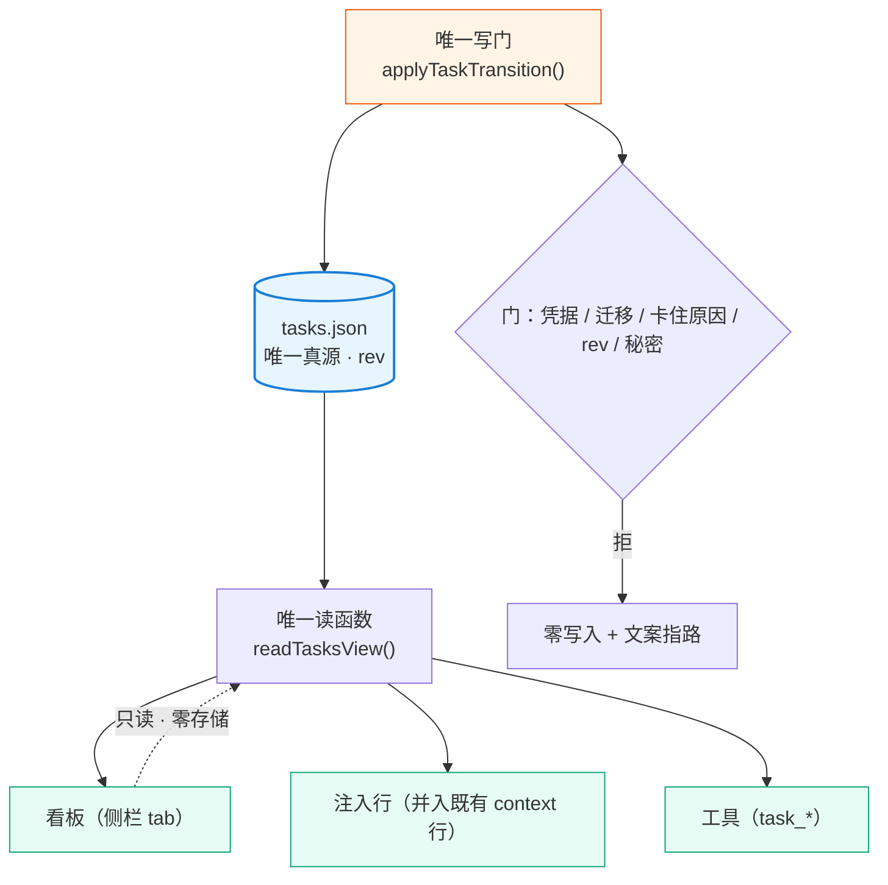
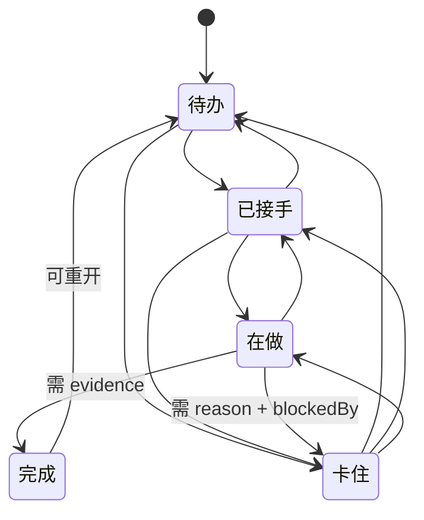

# 设计：个人任务台账 + 侧栏看板（同一套账本）—— 批 36 · 设计档

- 日期：2026-10-16
- 需求档：[`2026-10-16-task-ledger-requirements.md`](./2026-10-16-task-ledger-requirements.md)（**13 节**：原 12 节 + §十三 会后订正）
- 会诊：[`consult-minutes/2026-10-16-consult-83-minutes.md`](./consult-minutes/2026-10-16-consult-83-minutes.md)（consult **#83**，5 模型并行 · 交付 **4/5**；裁定层 §2–§5 由父侧写）
- 前序档：[`2026-10-14-anti-drift-design.md`](./2026-10-14-anti-drift-design.md)（同源注入 / 完成门 / 三域状态的既有做法）· [`2026-10-16-anti-drift-handoff.md`](./2026-10-16-anti-drift-handoff.md)
- 设计评审：**待用户发起**
- 状态：**已实施前**（本档成文后待用户确认 → 评审 → 派 `eng_coder`）
- 事实基线（**全部为父侧实测**，非转述；as-of 2026-10-16）：
  - 装机 `@deepseek-ai/dsh` **0.2.0-rc.2**（`app.asar` → `dsh/node_modules/@deepseek-ai/dsh-app-boot/package.json`）
  - **宿主 `todos` 投影每逢 `turn/start` 清空**：`app.asar:1037250` 原文 `ctx.sessionProjections.register({ key: "todos", init: () => null, apply: (state, event) => { if (event.type === "todo/write") return event.data.todos; if (event.type === "turn/start") return null; return state; }, stateVersion: 2 })`
  - **宿主不把清单回喂模型**：`app.asar:1036959` 原文 `Each assistant tool call retains the entire replacement list in its arguments…`
  - **DSH 右侧栏原生槽位**：`sidebar.right.pane.tab` · `sidebar.right.pane.tab.title`（asar 槽位名清单）
  - **`ctx.betterSidebar` 服务对外开放**：`dsh-better-sidebar` v0.24.1 `lib/client.js:1064` `const registerTab = (descriptor) => {`，服务面含 `updateTab` / `openFile` / `openTab(seed, scope?)`（`lib/client.js:1005-1007`）
  - 本仓既有可复用面：`goal-criteria.json` 的工作区键控 + `writeFileAtomic` 原子写（`lib/state.mjs` / `lib/dsh-home.mjs`）· `systemPrompt.context` 单条注入行（`lib/index.mjs`）· `tools/pre-execute` 门（批 34 C5 已上生产）

<!-- doc-shape
count-marks: 项|处|条|档|值|步|腿
-->

## 一、背景

批 34「长任务防漂」把纪律从**静态提示词**升级为**每回合可见 + 收尾可拦 + 开工可查**。但用户在 2026-10-16 提出一个它**没有回答**的问题：

> 「我就不理解，为什么要用 team-link 的代码写台账，咱们 suite 没有自己的台账吗？要是我没装 team-link 怎么办？」

以及配套的三条：

> 「我这里面看不到**待我决策**的项」
> 「这个看板最关键的一点：**我看到的，跟会话 LLM 看得的是同一套账本吗？如果不是同一套，那就没意义了**」
> 「我能快速复制某个任务直接让主会话告诉我目前进度或者情况吗？」

⇒ 批 34 的「欠账」面**只覆盖目标层**（目标 / 判据 / 验证记录），**没有任务层**；且它唯一触及任务的机制（FR-7 台账写门）落在**另一个插件**上，对"没装 team-link"的部署**整条失效**。

## 二、问题（现象 + 根因，带证据）

### 2.1 现象

| # | 现象 | 证据 |
|---|---|---|
| **P-1** | 任务散在对话里，聊长了就丢；模型说"做完了"用户**没有对照物** | 用户原话（2026-10-16） + 批 34 设计档 §2 R1（「状态住上下文里会衰」）——同族根因 |
| **P-2** | 用户**看不到"什么在等他"** | 用户原话：「我这里面看不到待我决策的项」。批 34 的注入行只渲染「目标 + 判据 + 欠账」，**没有决策队列** |
| **P-3** | 唯一触及任务的机制在**别人仓**里 | 批 34 §5 FR-7：写门落 `dsh-team-link`；其开关默认 OFF，未装 team-link 时**整条不存在** |
| **P-4** | 用户**无法一眼确认**「我看的和模型看的是不是同一份」 | 用户原话（同 §一）；批 34 无此断言 |

### 2.2 根因

**根因 1：批 34 的注入行只锚了"目标"，没锚"任务"。** 目标回答"为什么做"，任务回答"做什么、做到哪"。缺后者 ⇒ 长任务里"下一步干什么"仍靠模型自觉。

**根因 2：宿主自带的任务面不能当台账用**（本批会诊 #83 的决定性发现，父侧已独立复核）：

| 宿主事实 | 实测坐标 | 为什么不能当台账 |
|---|---|---|
| `todos` 投影**每逢 `turn/start` 清空** | `app.asar:1037250` | 它是**本回合的工作计划便签**，天生无法"跨回合 / 跨会话 / 跨重启"存活（需求 N-3） |
| 宿主**不回喂**清单给模型 | `app.asar:1036959` | 「模型用原生工具读写同一套账本」这个体验**不存在**——模型的可见面只是自己历次工具调用的参数 |
| 条目 `{content, status}` 三态、**无 id**、**整表替换** | 会诊四家一致 —— ★ **来自会诊、父侧未逐字复核**（评审 #14 要求的标注；明细见 §十一 U-2/U-3 与需求档 §13.5） | 无稳定对齐键 ⇒ 任何"旁挂注解 + 宿主主清单"方案都会**静默断链** |

⇒ **结论（用户已拍板需求-D13）**：**不复用宿主任何任务面**，台账完全自建。宿主那套与本台账是**两个物种**——它管"这一回合我准备干嘛"，本台账管"我欠哪些事、卡在哪、凭什么算完"。

**软引导（评审 #1 落点 · 需求档 §13.6.1 D-15）**：**不加** `tools/pre-execute` 门去拦原生 `todo_write` —— 两条理由：① **前提已随丙消失**（我们已不关心宿主那个面，不存在"写路径分叉"要保）；② **硬拦会误伤宿主自身的回合级规划**（`todos` 投影每回合清空即证它是规划工具）。**替代措施**两条：① 工具描述与注入行加一句**软引导**——「任务台账用 `task_*`；`todo_write` 只当**本回合草稿**」；② 静态断言腿 **T-15**（本仓零 `todo_write` 调用点）。**代价如实说**：模型仍可能在 `todo_write` 里写了任务而你在看板上看不到 —— **软引导只降概率、不阻断**；接受这个残余风险，因为它比"砍掉宿主规划能力"代价小。

**根因 3：真源一旦有两个，看板就会骗人。** 用户 D-2 已把这条定成红线；本设计把它落成**结构保证**（§五 FR-2：三面共用一个读函数），而不是纪律。

## 三、目标 / 非目标

**目标**（做完之后什么变了）：

- **G1 同一套账本**：看板、注入行、工具三面读**同一个** `readTasksView()` 的结果；`tasks.json` 是盘上唯一真源。
- **G2 完成需凭据**：无凭据的 `done` **拒且零写入**。
- **G3 五态可流转**：`待办 → 已接手 → 在做 → 完成 / 卡住`；`卡住` 必带原因，并区分「等外部 / 等自己动手」。
- **G4 待你决策的项置顶**：`kind: decision` 单独分区，空时给明确空态。
- **G5 跨会话 / 跨重启存活**：绑工作区落盘；**多会话并行写**时有冲突检测（fail-loud，不静默丢更新）。
- **G6 常驻侧栏 + 可降级**：有 better-sidebar ⇒ 右栏 tab；没有 ⇒ 会话内渲染，**内容同源**。
- **G7 一键问进度**：每题一个"复制话术"；另有"复制全部待我决策的项"。

**非目标**（本批不做，逐条给理由；与需求档 §十二 / §一 一致）：

1. **不做第二份存储**（看板零存储）· 2. **不做看板写操作** · 3. **不做截止日期** · 4. **不做团队台账源**（排第二批）· 5. **不做 SQLite** · 6. **不做模糊文档解析** · 7. **不新开注入通道**（任务摘要并入既有行）· 8. **不做宿主镜像**（用户 D-13 拍板）· 9. **不做独立 LLM 完成裁判**（继承批 34 §3 非目标 5）

## 四、决策与理由

> **命名空间（评审 #11）**：本档的 `D1…D12` 一律读作「**设计-Dy**」；与需求档 `D-1…D-16` 的映射见[需求档 §13.6.4](./2026-10-16-task-ledger-requirements.md)。**裸编号（如裸写"D5"）在本批之后视为歧义写法** —— 跨档引用必须带前缀（需求-Dx / 设计-Dy）。

| # | 决策点 | 选定 | 为什么 | 被否决的备选及否决理由 |
|---|---|---|---|---|
| **D1** | 台账归属 | **suite 自建**（`tasks.json`） | 用户 D-6：未装 team-link 也必须能用 | 复用 `team-link` 的 `tasks.md` ⇒ 未装即整条失效（P-3） |
| **D2** | 是否复用宿主 todo | **完全不复用** | 会诊 #83 四家一致 + 父侧复核两条地基事实（§2.2） | ① 乙（宿主为主 + 旁挂注解）⇒ 真源劈两半、无稳定键、静默断链；② 乙′（`tasks.json` 真 + 宿主镜像）⇒ 用户 2026-10-16 拍板**不做**（原生面板默认折叠 + 空不渲染 + 挂 dock 非侧栏 ⇒ 收益趋零而成本为正；★ **这三条来自会诊、父侧未独立复核**，见需求档 §13.5 —— 但**本决策不依赖它们**：地基是 §2.2 两条**已复核**事实） |
| **D3** | 真源唯一性怎么保证 | **三面共用同一个读函数** `readTasksView()` | 「同一个文件」是口头承诺；「同一个读函数」才是结构保证（会诊 D-83-5） | 三面各自解析同一文件 ⇒ 解析歧义即分叉 |
| **D4** | 存储形态 | **JSON + 原子写 + 修订号** | 沿用本仓 `goal-criteria.json` 先例；单人场景不上 SQLite | SQLite ⇒ 无并发收益却有依赖与可读性代价（需求 D-5） |
| **D5** | 并发写 | **修订号 + 读-改-写冲突检测，冲突 fail-loud** | 用户真实部署是**多会话并行**（原话：「还有别的会话在工作」）；原子写只防半文件、**不防丢更新**（会诊 D-83-7） | 「不承诺并发」（需求档原 §九）⇒ **父侧已订正**，因为它与真实部署不符 |
| **D6** | 注入策略 | **并入既有注入行**，不新开通道 | 宿主 `systemPrompt.context` 去重是"同文不重发"；多开一条 = 多牺牲一份前缀缓存收益（批 34 N-5 / L-6） | 另立第二条 context 贡献 ⇒ 双份缓存代价 |
| **D7** | 看板挂载 | **`ctx.betterSidebar.registerTab`**；缺席 ⇒ 降级 | 该服务对外开放（`lib/client.js:1064`），且内置 5 tab 走同一 API | 直接用原生 `sidebar.right.pane.tab`（零依赖，但布局/标题栏/持久化/多语言全自写）⇒ 见 D8 |
| **D8** | 降级路径 | **会话内渲染**（US-11） | 用户 D-1 明确要求；且它是**独立交付单元**不是注释 | 无 better-sidebar 就不给看板 ⇒ 违背用户要求 |
| **D9** | 看板写权限 | **零写操作**（只读渲染 + 两个复制按钮） | 用户明确否决"打勾/改进度"：完成必须带凭据，点一下就勾掉会把这套机制的根废掉 | 板上直接改状态 ⇒ 绕过写门 |
| **D10** | 结构化文档源 | **只认明确列结构**；不达阈值返回 `null` | 靠猜列名解析自由文本必然产出假读数 | 模糊解析 ⇒ 假读数 |
| **D11** | 文档源登记 | **按路径清单显式配置** | 自动发现"哪些 md 是验收档"必然猜错 | 自动发现 ⇒ 静默误纳/漏纳 |
| **D12** | 默认展开状态 | **默认折叠**（与宿主 TodoPanel 一致） | 常驻侧栏默认展开会一直占地方；用户原话是"有个按钮点开就能看" | 默认展开 ⇒ 侵占对话空间 |

## 五、方案（FR-x 交付单元）

| # | 交付单元 | 内容 | 依赖 | 覆盖 |
|---|---|---|---|---|
| **FR-1** | 台账核心 | `tasks.json` 的 schema + 五态迁移表 + **唯一写门** `applyTaskTransition()`（凭据校验 / 卡住原因 / 修订号冲突检测 / 原子写） | 无 | US-1…US-4 · N-1…N-5 |
| **FR-2** | 同源读面 | **`readTasksView()`**（唯一读函数：看板 / 注入行 / 工具三面共用）+ 畸形输入 fail-open | FR-1 | **US-5（核心）** · N-1 · N-8 |
| **FR-3** | 工具面 | `task_add` / `task_update` / `task_done` / `task_list`（+ 决策项同一工具族，`kind` 区分）；写路径唯一走 FR-1 的门 | FR-1 | US-1…US-4 · US-8 |
| **FR-4** | 同源注入 | `renderTaskDigest()` 并入既有注入行（纯确定性 · 有界 · 空集不出段） | FR-2 | US-5 · N-5 |
| **FR-5** | 侧栏看板 | `ctx.betterSidebar.registerTab` 注册一个 tab：防漂移状态区 + **待你决策区（置顶）** + 任务区；点任务 ⇒ 开/定位侧边对话。**数据通道见 §7.4** | FR-2 · 外部 better-sidebar | US-6 · US-8 |
| **FR-6** | 看板降级 | 无 better-sidebar ⇒ 走 **`task_list` 的「看板渲染模式」**，在会话内渲染同源内容（文本或 UI 组件）；**输出由 `readTasksView()` 派生**（评审 #6 指名工具，T-8 因此可具体断言） | FR-2 | **US-11** · N-4 |
| **FR-7** | 复制话术 | 「问这一项」+「复制全部待你决策的项」；模板可配置（默认带"说人话大白话，说清楚前因后果，给建议"） | FR-2 | US-7 |
| **FR-8** | 结构化文档源 | `parseChecklistDoc()`：识别 ≥4 列且含状态列的表格 ⇒ 渲染勾选态与"验收五件齐没齐"；**不可写** | FR-5 / FR-6 | US-10 |
| **FR-9** | 团队开关 | `ledger.mode = off \| standalone`（默认 `standalone`）；检测到团队台账**只提示、不自动关** | FR-1 | US-9 |
| **FR-10** | 复用面登记（**重定义**，评审 #10） | **明确不做宿主复用**；把 §2.2 的宿主事实落成**代码注释 + 静态断言腿**（本仓零 `todo_write` 调用点 · 看板与工具零 `todos` 投影读取）—— 原写"回归腿"**不可实现**（宿主行为无法在本仓 `node --test` 里复现），故改为**静态可机检**形态 | 无 | T-15 |
| **FR-11** | 防漂移状态区 | 看板顶部状态区：当前目标 · 判据 · 欠账 · 本回合被推回次数（**复用批 34 既有读数**，不新建状态） | 批 34 既有面 | US-6 的一部分 |

★★ **实施前必读：「可选依赖」怎么表达（2026-10-17 父侧只读侦察后补 —— 这是一个会直接搞死客户端半边的陷阱）**：

- **事实**：`lib/client.js:1697` = `var inject = ["slots", "connection"];`（`:1724 exports.inject = inject;`）；全仓**零引用** better-sidebar 的任何面；宿主半边 `lib/index.mjs:102` = `export const inject = ["tools", "systemPrompt", "webServer", "llm", "subagents"]`。
- **陷阱**：FR-5 要用 `ctx.betterSidebar.registerTab`。**若把 `"betterSidebar"` 加进 `inject` 数组**，则**没装 better-sidebar 时整个客户端半边会永远 `pending`** —— cordis 语义：**声明了但宿主未注册的服务 ⇒ 该条目永不激活**。后果**不是** FR-6 说的「降级」，而是**连设置页一起死**。
- **正确写法（本仓已有先例）**：**不动 `inject` 数组**；在 `apply` 里用 **`ctx.get("betterSidebar")`** —— **`ctx.get` 豁免 inject 要求**，取不到即 `undefined` ⇒ 走 FR-6 的 `task_list` 看板渲染模式。本仓 `goals` 服务当年踩过同一个坑（属性读抛 `cannot get property "goals" without inject`，改 `ctx.get` 才好）。
- **同理**：宿主半边要用任何新服务，**一律 `ctx.get`，不扩 `inject`**。
- **可机检**：见 §九 **T-8①**（静态断言：客户端 `inject` 不得因本批新增条目）。

## 六、机制伪代码（前置 / 后置条件）

```
// ── FR-1 唯一写门 ─────────────────────────────────────────────
applyTaskTransition(ws, { id, to, evidence?, reason?, blockedBy?, expectedRev }) -> Result
  前置：ws 能解析出工作区键；expectedRev 是调用方读到的修订号
  前置：文件存在 ⇒ 必须是合法 schema；不存在 ⇒ 视为空账本（version:1, rev:0, tasks:[]）
  后置：若 file.rev !== expectedRev            ⇒ 拒（"账本已被其他会话改动"），零写入   ← D5 冲突检测
  后置：若 id 不存在                            ⇒ 拒，零写入
  后置：若 to ∉ ALLOWED_MIGRATIONS[from]        ⇒ 拒，零写入
  后置：若 to === "done" ∧ trim(evidence) === "" ⇒ 拒（"完成必须留凭据"），零写入       ← US-2
  后置：若 to === "done" ∧ kind === "decision"  ⇒ evidence 语义 = **「结论是什么 + 谁拍的」**（需求档 §13.6.2 **D-16**）；**仍走同一条非空校验**，不因它是决策就放行
  后置：若 to === "blocked" ∧ trim(reason) === "" ⇒ 拒，零写入                          ← US-3
  后置：若 to === "blocked" ∧ blockedBy ∉ {external, self} ⇒ 拒，零写入                 ← US-4
  后置：若 evidence/reason 命中疑似凭据形态      ⇒ 拒（非打码），零写入                   ← N-7 / T-10
  后置：成功 ⇒ rev+1、写 at/doneAt、原子替换；**任何拒绝路径文件字节不变**

ALLOWED_MIGRATIONS = {
  "待办":   ["已接手", "卡住"],
  "已接手": ["在做", "待办", "卡住"],      // 可退回（接手后发现不该做）
  "在做":   ["完成", "卡住", "已接手"],    // 可退回（做了一半换人/换法）
  "卡住":   ["待办", "已接手", "在做"],    // 解卡后回到流程
  "完成":   ["待办"],                      // 可重开（但完成时留下的 evidence 不清空）
}

// ── FR-3 建单 / 改单（**同一道门**，评审 #7 补齐）──────────────
applyTaskCreate(ws, { kind, title, check, why?, priority?, expectedRev }) -> Result
  前置：kind ∈ {work, decision}
  后置：若 file.rev !== expectedRev ⇒ 拒（"账本已被其他会话改动"），零写入
  后置：若 trim(title) === ""      ⇒ 拒，零写入
  后置：若 trim(check) === ""      ⇒ 拒（"没写怎么算完成 = 许愿不是任务"），零写入
  后置：`id` 分配 = **`t-<max(既有数值)+1>`**，**在同一把写锁内**计算
        ★ 并发安全由 rev 保证：两个会话读到同一个 rev ⇒ 只有一个能写成功，另一个被 rev 门拒
  后置：新条目 status = "待办" · createdAt = now · rev+1

applyTaskUpdate(ws, { id, patch, expectedRev }) -> Result
  可改字段面（**闭集**）：title · check · why · priority
  **不可改**：id · kind · status（只能走 applyTaskTransition）· evidence ·
             blockedReason · blockedBy · createdAt · doneAt
  后置：patch 命中不可改字段 ⇒ **拒**（不是静默忽略），零写入
  后置：trim(title) === "" ∨ trim(check) === "" ⇒ 拒，零写入
  后置：成功 ⇒ rev+1

// ── FR-2 唯一读函数（三面共用）────────────────────────────────
readTasksView(ws) -> { rev, decisions: T[], active: T[], blocked: T[], done: T[], counts }
  前置：无
  后置：**纯函数**（不写盘、不改内存）；畸形文件 ⇒ 返回空结构 + 一行痕（fail-open），不抛
  后置：所有消费面（看板 / 注入行 / 工具）**只调本函数**，不得各自解析文件   ← D3 结构保证

// ── FR-4 同源注入（并入既有行）────────────────────────────────
renderTaskDigest(view) -> string
  前置：无
  后置：**纯确定性**（同 view ⇒ 逐字节同输出）；**禁时间戳 / 百分比 / 步数 / 随机**   ← 批 34 A-6
  后置：**全序**（评审 #13 —— 缺它则"取 Top-N"不可确定）：排序键 = ① `priority` 降序（缺省 0）
        ② **`id` 升序**（`t-<n>` 按**数值**比较，不是字典序：`t-9` < `t-10`）③ `createdAt` 升序
        三级全相等才允许任意序 —— 而 `id` 唯一 ⇒ **序是唯一的**
  后置：策略 = 决策项**全列** + 活任务按优先级取 Top-N + 完成只给计数
  后置：超预算 ⇒ 以 "…还有 N 项" 收尾（有界，不是截断半句）
  后置：view 为空 ⇒ 返回空串（该段**不出现**）

// ── FR-8 结构化文档只读源 ────────────────────────────────────
parseChecklistDoc(text) -> { rows } | null
  前置：无
  后置：列数 < 4 ∨ 无状态列 ⇒ **返回 null**（不猜、不部分解析）                  ← D10
  后置：状态枚举识别 {TODO, DOING, BLOCKED, PASS, FAIL}（大小写不敏感）
  后置：每行附「验收五件齐没齐」判读（命令/预期/实际/证据/基线身份），**只读**
```

## 七、状态与 schema（谁写谁读）

### 7.1 `tasks.json`（绑工作区；`version: 1`）

**落点与键控（评审 #4 钉死；★ 评审第二轮 N1 更正 —— 此前写错过）**：

- **路径** = `<工作区根>/.thincoder/tasks.json` —— **沿用本仓既有的 `.thincoder/` 目录约定**（该目录在**用户工作区内**）
- **键控** = **按工作区根绝对路径**，**本台账自建**（只是「不新造工作区根的判定」—— 复用的对象是 `lib/dsh-home.mjs` 的 `pickDshHome`，而它返回的是 **DSH profile 根**，**不是**工作区根）
- **原子写** = 复用 `writeFileAtomic`（`lib/dsh-home.mjs`）
- ★ **明确「不照搬 `goal-criteria.json` 的落点做法」**（评审 N1，2026-10-17）：`lib/anti-drift.mjs:232` 的 `return home ? join(home, CRITERIA_SUBDIR, CRITERIA_FILE) : null` 里 **`home` 是 DSH profile 根**；该档 `:227` 自陈其错法后果 ——「**回落到会话 cwd ⇒ 把 `goal-criteria.json` 写进用户工作区**（污染仓库，且每个 cwd 一份碎片）」。本台账**必须绑工作区**（需求 N-3）⇒ **落点与键控自建**，**只在「原子写」这一点上**复用它
- **为什么仍选 `.thincoder/`**：那是本仓既有的**项目侧目录约定**（进工作区、可随仓走）；选它是**约定复用**，不是**实现复用**——两者在上一版被混为一谈，故此处拆开写

| 字段 | 类型 | 谁写 | 谁读 |
|---|---|---|---|
| `version` | `1` | 创建时 | 全部 |
| `rev` | number | **仅** FR-1 写门每次成功 +1 | FR-1（冲突检测）· 看板（陈旧告警） |
| `tasks[].id` | string `t-<n>` | FR-3 | 全部 |
| `tasks[].kind` | `"work" \| "decision"` | FR-3 | FR-2 分区 |
| `tasks[].title` | string 非空 | FR-3 | 看板 + 注入行 |
| `tasks[].status` | 五态枚举 | **仅** FR-1 | 全部 |
| `tasks[].check` | string 非空（怎么算完成） | FR-3 | 看板 + 完成门 |
| `tasks[].evidence` | string（`work` = 跑了什么/看到什么；**`decision` = 结论是什么 + 谁拍的**，见需求档 §13.6.2 **D-16**） | **仅** 转 `完成` 时 | 看板（**N-7 检测覆盖本字段**） |
| `tasks[].blockedReason` / `blockedBy` | string / `external\|self` | 仅转 `卡住` 时 | 看板（卡住区） |
| `tasks[].priority` · `why` | number · string（可选） | FR-3 | 看板 + 注入行排序 |
| `tasks[].createdAt` / `doneAt` | ISO string | FR-1 | 看板 |

### 7.2 三域归属（**沿用批 34 的既有口径，不新造**）

| 域 | 内容 | 落后行为 |
|---|---|---|
| **落章域** | `tasks.json` 全部内容（含 `rev`） | **落盘**，跨重启存活 |
| **会话域** | 看板当前选中项、注入行的"本会话已提示过"标记 | 进程内，`session/disposed` 清 |
| **回合域** | 无（本批不引入回合级状态） | — |

### 7.3 看板侧

**零持久化**（N-1）：tab 的展开/选中状态由 better-sidebar 按会话管理，我们**不写入任何文件**。

### 7.4 看板的数据通道（评审 #5 补 —— 此前完全没写）

看板 tab 在**浏览器半边**（`lib/client.js`），而 `readTasksView()` 在**宿主半边** ⇒ 必须有一条明确通路：

| # | 通路 | 用途 | 定论 |
|---|---|---|---|
| **C-1** | **工具面**：`task_list` 的「看板渲染模式」 | 降级路径（FR-6）· 让模型代为渲染 | **必做**（US-11 / T-8 靠它） |
| **C-2** | **客户端拉取**：tab 挂载后按需取当次快照 | 侧栏 tab 的初渲染与刷新 | **默认方案**。刷新时机 = ① tab 打开 ② 用户点刷新 ③ **写成功后**（★ 评审第二轮 #18 更正：宿主侧只置**失效标记**，客户端**下次拉取**生效 —— 这**不是** C-3 的推送，故与「C-3 本批不做」自洽） |
| **C-3** | **推送**：宿主侧主动推 | 实时性最好 | **本批不做** —— 成本是与既有客户端连接面耦合；C-2 + 写后刷新已够（如实登记为非目标） |

**定论：走 C-2（拉取）+ C-1（降级）。** 另两条配套语义一并钉死：

- **`rev` 陈旧告警怎么送达**：看板渲染时把 `rev` 与快照一起显示；**看板不自己发起写** ⇒ 不存在"看板侧陈旧写"。真正的冲突只发生在**工具写**时，由写门返回冲突文案（§六 T-11）
- **剪贴板**：复制按钮走浏览器原生 **`navigator.clipboard.writeText`**（零依赖）；失败 ⇒ **退化为把文本显示在可选中区块里**让用户手动复制（不弹窗、不报错刷屏）

## 八、图示





## 九、防偏离（机械验证）

> ★ **评审 #2 补**：**T-12/T-13/T-14** 是评审 #2 点名要求补的三条腿（US-6/7/8 原挂占位符）。
> ★ **评审 #10 重定义**：FR-10 原写的"回归腿"**不可实现**（宿主行为无法在本仓单测复现）⇒ 改写成 **T-15 的静态断言**（零 `todo_write` 调用点 / 零 `todos` 投影读取 / 依赖面不变）。

| 腿 | 判据 | 变异自证 |
|---|---|---|
| **T-1** | 无凭据 `done` ⇒ 拒且**零写入**（文件 sha256 前后相同） | 去掉凭据校验 ⇒ 腿红 |
| **T-2** | `blocked` 缺 `reason` 或缺 `blockedBy` ⇒ 拒且零写入 | 同上 |
| **T-3** | 非法迁移被拒（如 `待办 → 完成`） | 删迁移表校验 ⇒ 腿红 |
| **T-4a** | **看板 ≡ 工具读**：同一 `ws` 下两面的任务集合与状态**逐条相等** | 让看板自己解析文件 ⇒ 腿红 |
| **T-4b** | **注入行 ⊆ 看板**：摘要列出的每条 ∈ 看板集合且状态一致（**不要求全等**——注入行有 512 上限） | 摘要编造一条看板没有的 ⇒ 腿红 |
| **T-5** | `renderTaskDigest` **纯确定性**：同 view 调两次逐字节相同；不含时间戳/百分比/步数 | 混入 `Date.now()` ⇒ 腿红 |
| **T-6** | 畸形 `tasks.json` ⇒ `readTasksView` 不抛（fail-open）；写门拒（fail-closed） | 让读面抛 ⇒ 腿红 |
| **T-7** | `parseChecklistDoc` 对列数不足的文本返回 `null`（**不部分解析**）；对真实验收档解析出正确条数与状态分布 | 允许 3 列也解析 ⇒ 腿红 |
| **T-8** | 无 better-sidebar ⇒ ① **静态**：客户端半边的 `inject` 数组**不因本批新增任何条目**（★ 见 §五 末的「可选依赖怎么表达」注 —— 靠 inject 声明可选依赖会让整个客户端半边在缺席时**永不激活**）② **运行时**：`ctx.get("betterSidebar")` 取不到 ⇒ 走 FR-6 的 `task_list` 看板渲染模式，**不抛** ③ 该渲染输出**由 `readTasksView()` 派生** | 把 `betterSidebar` 写进 `inject` 数组 ⇒ 腿红（「降级」会变成「整体失效」）；降级路径抛错 ⇒ 腿红 |
| **T-9** | `ledger.mode = off` ⇒ 决策/任务区消失、防漂移状态区**仍在** | 连状态区一起关 ⇒ 腿红 |
| **T-10** | `evidence` / `reason` 命中疑似凭据 ⇒ **拒写**（非打码） | 改成打码 ⇒ 腿红 |
| **T-11** | **rev 冲突**：用陈旧 `expectedRev` 写 ⇒ 拒且零写入 + fail-loud 文案 | 忽略 rev ⇒ 腿红 |
| **T-12** | **US-6**：tab 注册**不抛**（无 better-sidebar 时亦然）+ 点击载荷含**三要素**（人话说明 / 文档清单 / 核验进度） | 去掉任一要素 ⇒ 腿红 |
| **T-13** | **US-7**：复制话术输出含**默认模板句**（"说人话大白话，说清楚前因后果，给建议"）；**模板可配置**（改配置 ⇒ 输出随之变） | 硬编码模板 ⇒ 腿红 |
| **T-14** | **US-8**：决策分区**位于任务区之前**（置顶）+ 空集时给**明确空态文案**（且**不渲染空分区**） | 决策区排到任务区之后 ⇒ 腿红；空集渲染空壳 ⇒ 腿红 |
| **T-15** | **零新增依赖面 + 零宿主复用**（静态断言，评审 #10 重定义）：`package.json.dependencies` 逐字不变 · 宿主半边**新增的宿主导入说明符为空** · 本仓代码**零 `todo_write` 调用点** · 看板与工具**零 `todos` 投影读取** | 加一条依赖 ⇒ 腿红；加一条宿主 import ⇒ 腿红；引入 `todo_write`/`todos` ⇒ 腿红 |

## 十、边界

| 边界 | 朝向 / 行为 |
|---|---|
| 空集 | 注入行该段**不出现**；看板显示明确空态（不显示空分区） |
| 畸形输入 | 读面 **fail-open**（空 + 一行痕）；写面 **fail-closed**（拒 + 零写入） |
| 并发写 | **rev 冲突 ⇒ 拒 + fail-loud**（不静默丢更新）；原子写保证不产生半文件 |
| 重启 | `tasks.json` 落盘保留；看板 tab 展开态由 better-sidebar 按会话恢复 |
| 升级 | better-sidebar 缺席/不兼容 ⇒ FR-6 降级；宿主 todo 形状变化 ⇒ **与本批无关**（D-13 零依赖） |
| 失败方向 | 看板渲染失败 ⇒ 不影响任何工具与注入；注入渲染失败 ⇒ 该段缺席（其余照常） |
| 实体边界 | `tasks.json` 只记任务元数据，**不记凭据值**；`evidence` 是自由文本 ⇒ T-10 覆盖 |

## 十一、待实测与未知（**不预设答案**）

| # | 未知 | 为什么现在不能定 | 处置 |
|---|---|---|---|
| **U-1** | **点任务后怎么"开侧边对话"** | 已确认客户端有会话机制（`client.beta.sessions.create` / 服务面 `updateTab`·`openFile`·`openTab(seed, scope?)`，`lib/client.js:1005-1007`），但**"从 tab 内点击打开一个新会话并预填话术"这条路径未经端到端实测** | **实施前必做**的小实测（评审 #9：本档已定稿而它仍未做 ⇒ 时点从原写的"动笔后"**改准为"实施前"**，消除时序矛盾）；若不支持 ⇒ 降级为「复制话术 + 提示用户粘贴」，**US-6 的"点开就能聊"降级为"点开看详情 + 一键复制"**，并如实告知用户 |
| **U-2** | 宿主条目 schema 的严格程度 / `content` 唯一约束 / 是否有 `todo_read` 工具 | 会诊四家断言，**父侧未逐字复核** | **对本设计无影响**（D-13 零依赖宿主 todo）；仅作为 §2.2 论据，已在需求档 §13.5 标"未复核" |
| **U-3** | 宿主"实验性 Agent Teams 任务板"的存在与性质 | 同上 | 同上（已登记否决理由，标"来自会诊、未复核"） |
| **U-4** | 注入行并入任务摘要后的**精确字数预算** | 既有行上限 512、实测最长 291（批 34 L-6）；并入后须重新标定 | 设计取 **Top-N + 决策全列 + "…还有 N 项"** 的**有界**策略；**精确 N 与预算在实施阶段用真实样本标定**（不在本档预设数字） |

## 十二、需求 → 交付单元 → 机检腿 对照

| 需求 | 交付单元 | 腿 |
|---|---|---|
| US-1 · US-2 · US-3 · US-4 | FR-1 · FR-3 | T-1 · T-2 · T-3 · T-10 |
| **US-5（核心）** | **FR-2 · FR-4** | **T-4a · T-4b · T-5** |
| US-6 | FR-5 · **FR-11** | **T-12**（+ U-1 实测后补"交互形态"腿） |
| US-7 | FR-7 | **T-13** |
| US-8 | FR-3 · FR-5 | **T-14** |
| US-9 | FR-9 | T-9 |
| US-10 | FR-8 | T-7 |
| US-11 | FR-6 | T-8 |
| N-1 | FR-1 · FR-2 | T-6 · T-11 |
| N-2 | FR-1 | T-11（原子写与冲突检测同批验） |
| N-3 | FR-1 | T-11 + 跨会话读回断言 |
| N-4 | FR-5 · FR-6 · FR-9 | T-6 · T-8 · T-9 |
| N-5 | FR-4 | T-5 |
| N-6 | FR-10 | **T-15** |
| N-7 | FR-1 | T-10（**覆盖 `evidence` 字段**） |
| N-8 | **本表逐条有腿即其本身**（评审 #12 补全：原表缺 N-2/N-3/N-5/N-6，且 US-6/7/8 挂占位符） | — |

## 十三、本档状态

- **日期**：2026-10-16 成文；**2026-10-17 折入设计评审两轮共 21 条**（轮次 1 的 15 条 + 轮次 2 的 6 条；逐条处置表见[需求档 §13.6 / §13.6.5](./2026-10-16-task-ledger-requirements.md)）。
- **设计评审**：轮次 1 **未通过**（`VERDICT: FAIL`；🔴 **2** · 🟡 **8** · 🔵 **5** = **15 条**）⇒ 逐条折入；**轮次 2 复核：PASS**（无未决 🔴、无 must-fix 🟡）⇒ **设计令牌已签发**（有效至 2026-10-23）⇒ 可派 `eng_coder`。轮次 2 另带回 **6 条非阻断**（#16–#21；其中 **#16 是父侧上一轮引入的假引用**，已按**阻塞级**修掉）。
- **未实施**。
- **U-1 是唯一的硬未知**，且它只影响 US-6 的**交互形态**（"点开就能聊" vs "点开看详情 + 复制"），**不影响任何数据面**。

## 十四、受影响文件（评审 #3 补 —— 此前完全没列）

> **规则**：实施者**只许改本表列出的文件**；超出即为偏离，须回来改档。

| 文件 | 动作 | 内容 |
|---|---|---|
| `lib/tasks.mjs` | **新建** | 台账核心：schema · 五态迁移表 · **唯一写门**（`applyTaskCreate` / `applyTaskUpdate` / `applyTaskTransition`）· **唯一读函数** `readTasksView()` · `renderTaskDigest()` · `parseChecklistDoc()` |
| `lib/tool-tasks.mjs` | **新建** | 工具面：`task_add` / `task_update` / `task_done` / `task_list`（含**看板渲染模式**） |
| `lib/index.mjs` | 修改 | 注册上述工具；把任务摘要**并入既有注入行**（不新开通道）；**零 `todo_write` / 零 `todos` 投影读取**（FR-10 / T-15） |
| `lib/client.js` | 修改 | 注册 better-sidebar tab（**只读** `readTasksView()` 的快照）；决策区置顶 + 任务区 + 状态区；两个复制按钮 |
| 既有配置面（**落点在实施第一步回读确认** —— 本仓配置读写集中在哪一档由实测定） | 修改 | `ledger.mode`（`off \| standalone`）· 结构化文档**路径清单** · 复制话术**模板** |
| `test/tasks.test.mjs` | **新建** | **T-1…T-15**（T-4 拆 a/b ⇒ 共 **16 条腿**），含变异自证 |
| `docs/2026-10-16-task-ledger-{requirements,design}.md` | 修改 | 实施状态回填（**只回填实测读数，不预填**） |
| `README.md` · `CHANGELOG.md` | 修改 | 计数与功能条目**同批**（本仓纪律：计数与列表必须同一次编辑） |

**明确不碰**：`lib/anti-drift.mjs`（批 34 已收口）· `lib/client.js` 的既有设置页 section · **`dsh-team-link` 仓的任何文件**（跨仓交付 FR-7 已完成并推送 `1a61668`）。
