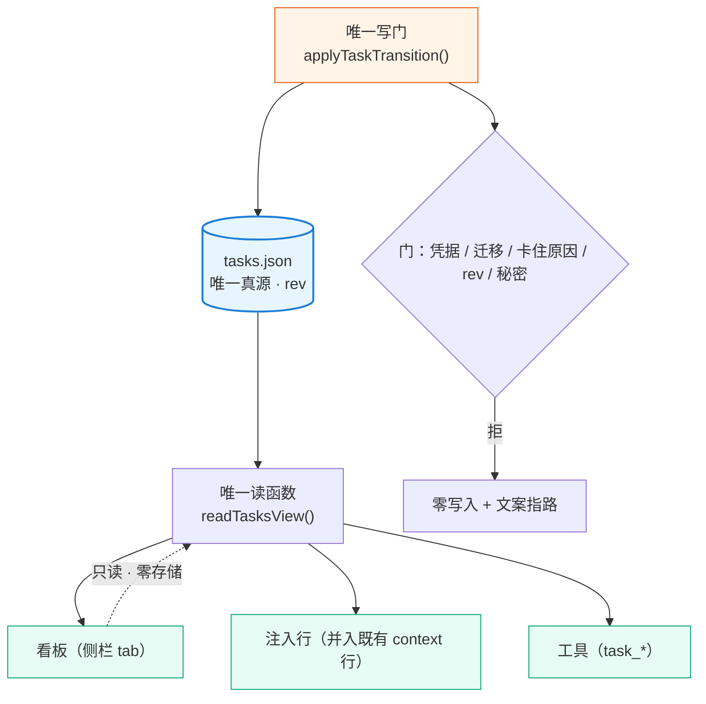
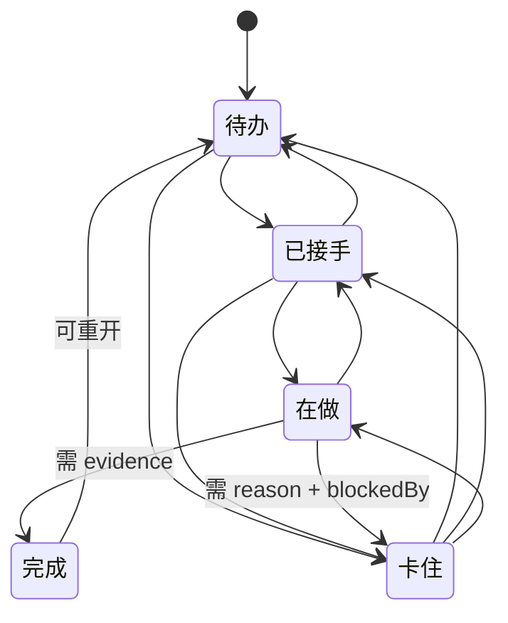

# 设计：个人任务台账 + 侧栏看板（同一套账本）—— 批 36 · 设计档

- 日期：2026-10-16
- 需求档：[`2026-10-16-task-ledger-requirements.md`](./2026-10-16-task-ledger-requirements.md)（**13 节**：原 12 节 + §十三 会后订正）
- 会诊：[`consult-minutes/2026-10-16-consult-83-minutes.md`](./consult-minutes/2026-10-16-consult-83-minutes.md)（consult **#83**，5 模型并行 · 交付 **4/5**；裁定层 §2–§5 由父侧写）
- 前序档：[`2026-10-14-anti-drift-design.md`](./2026-10-14-anti-drift-design.md)（同源注入 / 完成门 / 三域状态的既有做法）· [`2026-10-16-anti-drift-handoff.md`](./2026-10-16-anti-drift-handoff.md)
- 设计评审：**待用户发起**
- 状态：**已实施前**（本档成文后待用户确认 → 评审 → 派 `eng_coder`）
- 事实基线（**全部为父侧实测**，非转述；as-of 2026-10-16）：
  - 装机 `@deepseek-ai/dsh` **0.2.0-rc.2**（`app.asar` → `dsh/node_modules/@deepseek-ai/dsh-app-boot/package.json`）
  - **宿主 `todos` 投影每逢 `turn/start` 清空**：`app.asar:1037250` 原文 `ctx.sessionProjections.register({ key: "todos", init: () => null, apply: (state, event) => { if (event.type === "todo/write") return event.data.todos; if (event.type === "turn/start") return null; return state; }, stateVersion: 2 })`
  - **宿主不把清单回喂模型**：`app.asar:1036959` 原文 `Each assistant tool call retains the entire replacement list in its arguments…`
  - **DSH 右侧栏原生槽位**：`sidebar.right.pane.tab` · `sidebar.right.pane.tab.title`（asar 槽位名清单）
  - **`ctx.betterSidebar` 服务对外开放**：`dsh-better-sidebar` v0.24.1 `lib/client.js:1064` `const registerTab = (descriptor) => {`，服务面含 `updateTab` / `openFile` / `openTab(seed, scope?)`（`lib/client.js:1005-1007`）
  - 本仓既有可复用面：`goal-criteria.json` 的工作区键控 + `writeFileAtomic` 原子写（`lib/state.mjs` / `lib/dsh-home.mjs`）· `systemPrompt.context` 单条注入行（`lib/index.mjs`）· `tools/pre-execute` 门（批 34 C5 已上生产）

<!-- doc-shape
count-marks: 项|处|条|档|值|步|腿
-->

## 一、背景

批 34「长任务防漂」把纪律从**静态提示词**升级为**每回合可见 + 收尾可拦 + 开工可查**。但用户在 2026-10-16 提出一个它**没有回答**的问题：

> 「我就不理解，为什么要用 team-link 的代码写台账，咱们 suite 没有自己的台账吗？要是我没装 team-link 怎么办？」

以及配套的三条：

> 「我这里面看不到**待我决策**的项」
> 「这个看板最关键的一点：**我看到的，跟会话 LLM 看得的是同一套账本吗？如果不是同一套，那就没意义了**」
> 「我能快速复制某个任务直接让主会话告诉我目前进度或者情况吗？」

⇒ 批 34 的「欠账」面**只覆盖目标层**（目标 / 判据 / 验证记录），**没有任务层**；且它唯一触及任务的机制（FR-7 台账写门）落在**另一个插件**上，对"没装 team-link"的部署**整条失效**。

## 二、问题（现象 + 根因，带证据）

### 2.1 现象

| # | 现象 | 证据 |
|---|---|---|
| **P-1** | 任务散在对话里，聊长了就丢；模型说"做完了"用户**没有对照物** | 用户原话（2026-10-16） + 批 34 设计档 §2 R1（「状态住上下文里会衰」）——同族根因 |
| **P-2** | 用户**看不到"什么在等他"** | 用户原话：「我这里面看不到待我决策的项」。批 34 的注入行只渲染「目标 + 判据 + 欠账」，**没有决策队列** |
| **P-3** | 唯一触及任务的机制在**别人仓**里 | 批 34 §5 FR-7：写门落 `dsh-team-link`；其开关默认 OFF，未装 team-link 时**整条不存在** |
| **P-4** | 用户**无法一眼确认**「我看的和模型看的是不是同一份」 | 用户原话（同 §一）；批 34 无此断言 |

### 2.2 根因

**根因 1：批 34 的注入行只锚了"目标"，没锚"任务"。** 目标回答"为什么做"，任务回答"做什么、做到哪"。缺后者 ⇒ 长任务里"下一步干什么"仍靠模型自觉。

**根因 2：宿主自带的任务面不能当台账用**（本批会诊 #83 的决定性发现，父侧已独立复核）：

| 宿主事实 | 实测坐标 | 为什么不能当台账 |
|---|---|---|
| `todos` 投影**每逢 `turn/start` 清空** | `app.asar:1037250` | 它是**本回合的工作计划便签**，天生无法"跨回合 / 跨会话 / 跨重启"存活（需求 N-3） |
| 宿主**不回喂**清单给模型 | `app.asar:1036959` | 「模型用原生工具读写同一套账本」这个体验**不存在**——模型的可见面只是自己历次工具调用的参数 |
| 条目 `{content, status}` 三态、**无 id**、**整表替换** | 会诊四家一致 —— ★ **来自会诊、父侧未逐字复核**（评审 #14 要求的标注；明细见 §十一 U-2/U-3 与需求档 §13.5） | 无稳定对齐键 ⇒ 任何"旁挂注解 + 宿主主清单"方案都会**静默断链** |

⇒ **结论（用户已拍板需求-D13）**：**不复用宿主任何任务面**，台账完全自建。宿主那套与本台账是**两个物种**——它管"这一回合我准备干嘛"，本台账管"我欠哪些事、卡在哪、凭什么算完"。

**软引导（评审 #1 落点 · 需求档 §13.6.1 D-15）**：**不加** `tools/pre-execute` 门去拦原生 `todo_write` —— 两条理由：① **前提已随丙消失**（我们已不关心宿主那个面，不存在"写路径分叉"要保）；② **硬拦会误伤宿主自身的回合级规划**（`todos` 投影每回合清空即证它是规划工具）。**替代措施**两条：① 工具描述与注入行加一句**软引导**——「任务台账用 `task_*`；`todo_write` 只当**本回合草稿**」；② 静态断言腿 **T-15**（本仓零 `todo_write` 调用点）。**代价如实说**：模型仍可能在 `todo_write` 里写了任务而你在看板上看不到 —— **软引导只降概率、不阻断**；接受这个残余风险，因为它比"砍掉宿主规划能力"代价小。

**根因 3：真源一旦有两个，看板就会骗人。** 用户 D-2 已把这条定成红线；本设计把它落成**结构保证**（§五 FR-2：三面共用一个读函数），而不是纪律。

## 三、目标 / 非目标

**目标**（做完之后什么变了）：

- **G1 同一套账本**：看板、注入行、工具三面读**同一个** `readTasksView()` 的结果；`tasks.json` 是盘上唯一真源。
- **G2 完成需凭据**：无凭据的 `done` **拒且零写入**。
- **G3 五态可流转**：`待办 → 已接手 → 在做 → 完成 / 卡住`；`卡住` 必带原因，并区分「等外部 / 等自己动手」。
- **G4 待你决策的项置顶**：`kind: decision` 单独分区，空时给明确空态。
- **G5 跨会话 / 跨重启存活**：绑工作区落盘；**多会话并行写**时有冲突检测（fail-loud，不静默丢更新）。
- **G6 常驻侧栏 + 可降级**：有 better-sidebar ⇒ 右栏 tab；没有 ⇒ 会话内渲染，**内容同源**。
- **G7 一键问进度**：每题一个"复制话术"；另有"复制全部待我决策的项"。

**非目标**（本批不做，逐条给理由；与需求档 §十二 / §一 一致）：

1. **不做第二份存储**（看板零存储）· 2. **不做看板写操作** · 3. **不做截止日期** · 4. **不做团队台账源**（排第二批）· 5. **不做 SQLite** · 6. **不做模糊文档解析** · 7. **不新开注入通道**（任务摘要并入既有行）· 8. **不做宿主镜像**（用户 D-13 拍板）· 9. **不做独立 LLM 完成裁判**（继承批 34 §3 非目标 5）

## 四、决策与理由

> **命名空间（评审 #11）**：本档的 `D1…D12` 一律读作「**设计-Dy**」；与需求档 `D-1…D-16` 的映射见[需求档 §13.6.4](./2026-10-16-task-ledger-requirements.md)。**裸编号（如裸写"D5"）在本批之后视为歧义写法** —— 跨档引用必须带前缀（需求-Dx / 设计-Dy）。

| # | 决策点 | 选定 | 为什么 | 被否决的备选及否决理由 |
|---|---|---|---|---|
| **D1** | 台账归属 | **suite 自建**（`tasks.json`） | 用户 D-6：未装 team-link 也必须能用 | 复用 `team-link` 的 `tasks.md` ⇒ 未装即整条失效（P-3） |
| **D2** | 是否复用宿主 todo | **完全不复用** | 会诊 #83 四家一致 + 父侧复核两条地基事实（§2.2） | ① 乙（宿主为主 + 旁挂注解）⇒ 真源劈两半、无稳定键、静默断链；② 乙′（`tasks.json` 真 + 宿主镜像）⇒ 用户 2026-10-16 拍板**不做**（原生面板默认折叠 + 空不渲染 + 挂 dock 非侧栏 ⇒ 收益趋零而成本为正；★ **这三条来自会诊、父侧未独立复核**，见需求档 §13.5 —— 但**本决策不依赖它们**：地基是 §2.2 两条**已复核**事实） |
| **D3** | 真源唯一性怎么保证 | **三面共用同一个读函数** `readTasksView()` | 「同一个文件」是口头承诺；「同一个读函数」才是结构保证（会诊 D-83-5） | 三面各自解析同一文件 ⇒ 解析歧义即分叉 |
| **D4** | 存储形态 | **JSON + 原子写 + 修订号** | 沿用本仓 `goal-criteria.json` 先例；单人场景不上 SQLite | SQLite ⇒ 无并发收益却有依赖与可读性代价（需求 D-5） |
| **D5** | 并发写 | **修订号 + 读-改-写冲突检测，冲突 fail-loud** | 用户真实部署是**多会话并行**（原话：「还有别的会话在工作」）；原子写只防半文件、**不防丢更新**（会诊 D-83-7） | 「不承诺并发」（需求档原 §九）⇒ **父侧已订正**，因为它与真实部署不符 |
| **D6** | 注入策略 | **并入既有注入行**，不新开通道 | 宿主 `systemPrompt.context` 去重是"同文不重发"；多开一条 = 多牺牲一份前缀缓存收益（批 34 N-5 / L-6） | 另立第二条 context 贡献 ⇒ 双份缓存代价 |
| **D7** | 看板挂载 | **`ctx.betterSidebar.registerTab`**；缺席 ⇒ 降级 | 该服务对外开放（`lib/client.js:1064`），且内置 5 tab 走同一 API | 直接用原生 `sidebar.right.pane.tab`（零依赖，但布局/标题栏/持久化/多语言全自写）⇒ 见 D8 |
| **D8** | 降级路径 | **会话内渲染**（US-11） | 用户 D-1 明确要求；且它是**独立交付单元**不是注释 | 无 better-sidebar 就不给看板 ⇒ 违背用户要求 |
| **D9** | 看板写权限 | **零写操作**（只读渲染 + 两个复制按钮） | 用户明确否决"打勾/改进度"：完成必须带凭据，点一下就勾掉会把这套机制的根废掉 | 板上直接改状态 ⇒ 绕过写门 |
| **D10** | 结构化文档源 | **只认明确列结构**；不达阈值返回 `null` | 靠猜列名解析自由文本必然产出假读数 | 模糊解析 ⇒ 假读数 |
| **D11** | 文档源登记 | **按路径清单显式配置** | 自动发现"哪些 md 是验收档"必然猜错 | 自动发现 ⇒ 静默误纳/漏纳 |
| **D12** | 默认展开状态 | ★ **默认展开**（2026-10-17 用户变更，取代原「默认折叠」）：折叠按钮与折叠分支**均保留** | 原决定「默认折叠」的理由是**不侵占对话空间**；但用户实测后明确要求「侧边栏面板应该要默认展开」 ⇒ 面板的意义就是**一打开就看到当前状态**，折起来等于藏起来 | ~~默认展开 ⇒ 侵占对话空间~~（**该否决理由已被用户推翻**） |

## 五、方案（FR-x 交付单元）

| # | 交付单元 | 内容 | 依赖 | 覆盖 |
|---|---|---|---|---|
| **FR-1** | 台账核心 | `tasks.json` 的 schema + 五态迁移表 + **唯一写门** `applyTaskTransition()`（凭据校验 / 卡住原因 / 修订号冲突检测 / 原子写） | 无 | US-1…US-4 · N-1…N-5 |
| **FR-2** | 同源读面 | **`readTasksView()`**（唯一读函数：看板 / 注入行 / 工具三面共用）+ 畸形输入 fail-open | FR-1 | **US-5（核心）** · N-1 · N-8 |
| **FR-3** | 工具面 | `task_add` / `task_update` / `task_done` / `task_list`（+ 决策项同一工具族，`kind` 区分）；写路径唯一走 FR-1 的门 | FR-1 | US-1…US-4 · US-8 |
| **FR-4** | 同源注入 | `renderTaskDigest()` 并入既有注入行（纯确定性 · 有界 · 空集不出段） | FR-2 | US-5 · N-5 |
| **FR-5** | 侧栏看板 | `ctx.betterSidebar.registerTab` 注册一个 tab：防漂移状态区 + **待你决策区（置顶）** + 任务区；点任务 ⇒ 开/定位侧边对话。**数据通道见 §7.4** | FR-2 · 外部 better-sidebar | US-6 · US-8 |
| **FR-6** | 看板降级 | 无 better-sidebar ⇒ 走 **`task_list` 的「看板渲染模式」**，在会话内渲染同源内容（文本或 UI 组件）；**输出由 `readTasksView()` 派生**（评审 #6 指名工具，T-8 因此可具体断言） | FR-2 | **US-11** · N-4 |
| **FR-7** | 复制话术 | 「问这一项」+「复制全部待你决策的项」；模板可配置（默认带"说人话大白话，说清楚前因后果，给建议"） | FR-2 | US-7 |
| **FR-8** | 结构化文档源 | `parseChecklistDoc()`：识别 ≥4 列且含状态列的表格 ⇒ 渲染勾选态与"验收五件齐没齐"；**不可写** | FR-5 / FR-6 | US-10 |
| **FR-9** | 团队开关 | `ledger.mode = off \| standalone`（默认 `standalone`）；检测到团队台账**只提示、不自动关** | FR-1 | US-9 |
| **FR-10** | 复用面登记（**重定义**，评审 #10） | **明确不做宿主复用**；把 §2.2 的宿主事实落成**代码注释 + 静态断言腿**（本仓零 `todo_write` 调用点 · 看板与工具零 `todos` 投影读取）—— 原写"回归腿"**不可实现**（宿主行为无法在本仓 `node --test` 里复现），故改为**静态可机检**形态 | 无 | T-15 |
| **FR-11** | 防漂移状态区 | 看板顶部状态区：当前目标 · 判据 · 欠账 · 本回合被推回次数（**复用批 34 既有读数**，不新建状态） | 批 34 既有面 | US-6 的一部分 |

★★ **实施前必读：「可选依赖」怎么表达（2026-10-17 父侧只读侦察后补 —— 这是一个会直接搞死客户端半边的陷阱）**：

- **事实**：`lib/client.js:1697` = `var inject = ["slots", "connection"];`（`:1724 exports.inject = inject;`）；全仓**零引用** better-sidebar 的任何面；宿主半边 `lib/index.mjs:102` = `export const inject = ["tools", "systemPrompt", "webServer", "llm", "subagents"]`。
- **陷阱**：FR-5 要用 `ctx.betterSidebar.registerTab`。**若把 `"betterSidebar"` 加进 `inject` 数组**，则**没装 better-sidebar 时整个客户端半边会永远 `pending`** —— cordis 语义：**声明了但宿主未注册的服务 ⇒ 该条目永不激活**。后果**不是** FR-6 说的「降级」，而是**连设置页一起死**。
- **正确写法（本仓已有先例）**：**不动 `inject` 数组**；在 `apply` 里用 **`ctx.get("betterSidebar")`** —— **`ctx.get` 豁免 inject 要求**，取不到即 `undefined` ⇒ 走 FR-6 的 `task_list` 看板渲染模式。本仓 `goals` 服务当年踩过同一个坑（属性读抛 `cannot get property "goals" without inject`，改 `ctx.get` 才好）。
- **同理**：宿主半边要用任何新服务，**一律 `ctx.get`，不扩 `inject`**。
- **可机检**：见 §九 **T-8①**（静态断言：客户端 `inject` 不得因本批新增条目）。

## 六、机制伪代码（前置 / 后置条件）

```
// ── FR-1 唯一写门 ─────────────────────────────────────────────
applyTaskTransition(ws, { id, to, evidence?, reason?, blockedBy?, expectedRev }) -> Result
  前置：ws 能解析出工作区键；expectedRev 是调用方读到的修订号
  前置：文件存在 ⇒ 必须是合法 schema；不存在 ⇒ 视为空账本（version:1, rev:0, tasks:[]）
  后置：若 file.rev !== expectedRev            ⇒ 拒（"账本已被其他会话改动"），零写入   ← D5 冲突检测
  后置：若 id 不存在                            ⇒ 拒，零写入
  后置：若 to ∉ ALLOWED_MIGRATIONS[from]        ⇒ 拒，零写入
  后置：若 to === "done" ∧ trim(evidence) === "" ⇒ 拒（"完成必须留凭据"），零写入       ← US-2
  后置：若 to === "done" ∧ kind === "decision"  ⇒ evidence 语义 = **「结论是什么 + 谁拍的」**（需求档 §13.6.2 **D-16**）；**仍走同一条非空校验**，不因它是决策就放行
  后置：若 to === "blocked" ∧ trim(reason) === "" ⇒ 拒，零写入                          ← US-3
  后置：若 to === "blocked" ∧ blockedBy ∉ {external, self} ⇒ 拒，零写入                 ← US-4
  后置：若 evidence/reason 命中疑似凭据形态      ⇒ 拒（非打码），零写入                   ← N-7 / T-10
  后置：成功 ⇒ rev+1、写 at/doneAt、原子替换；**任何拒绝路径文件字节不变**

ALLOWED_MIGRATIONS = {
  "待办":   ["已接手", "卡住"],
  "已接手": ["在做", "待办", "卡住"],      // 可退回（接手后发现不该做）
  "在做":   ["完成", "卡住", "已接手"],    // 可退回（做了一半换人/换法）
  "卡住":   ["待办", "已接手", "在做"],    // 解卡后回到流程
  "完成":   ["待办"],                      // 可重开（但完成时留下的 evidence 不清空）
}

// ── FR-3 建单 / 改单（**同一道门**，评审 #7 补齐）──────────────
applyTaskCreate(ws, { kind, title, check, why?, priority?, expectedRev }) -> Result
  前置：kind ∈ {work, decision}
  后置：若 file.rev !== expectedRev ⇒ 拒（"账本已被其他会话改动"），零写入
  后置：若 trim(title) === ""      ⇒ 拒，零写入
  后置：若 trim(check) === ""      ⇒ 拒（"没写怎么算完成 = 许愿不是任务"），零写入
  后置：`id` 分配 = **`t-<max(既有数值)+1>`**，**在同一把写锁内**计算
        ★ 并发安全由 rev 保证：两个会话读到同一个 rev ⇒ 只有一个能写成功，另一个被 rev 门拒
  后置：新条目 status = "待办" · createdAt = now · rev+1

applyTaskUpdate(ws, { id, patch, expectedRev }) -> Result
  可改字段面（**闭集**）：title · check · why · priority
  **不可改**：id · kind · status（只能走 applyTaskTransition）· evidence ·
             blockedReason · blockedBy · createdAt · doneAt
  后置：patch 命中不可改字段 ⇒ **拒**（不是静默忽略），零写入
  后置：trim(title) === "" ∨ trim(check) === "" ⇒ 拒，零写入
  后置：成功 ⇒ rev+1

// ── FR-2 唯一读函数（三面共用）────────────────────────────────
readTasksView(ws) -> { rev, decisions: T[], active: T[], blocked: T[], done: T[], counts }
  前置：无
  后置：**纯函数**（不写盘、不改内存）；畸形文件 ⇒ 返回空结构 + 一行痕（fail-open），不抛
  后置：所有消费面（看板 / 注入行 / 工具）**只调本函数**，不得各自解析文件   ← D3 结构保证

// ── FR-4 同源注入（并入既有行）────────────────────────────────
renderTaskDigest(view) -> string
  前置：无
  后置：**纯确定性**（同 view ⇒ 逐字节同输出）；**禁时间戳 / 百分比 / 步数 / 随机**   ← 批 34 A-6
  后置：**全序**（评审 #13 —— 缺它则"取 Top-N"不可确定）：排序键 = ① `priority` 降序（缺省 0）
        ② **`id` 升序**（`t-<n>` 按**数值**比较，不是字典序：`t-9` < `t-10`）③ `createdAt` 升序
        三级全相等才允许任意序 —— 而 `id` 唯一 ⇒ **序是唯一的**
  后置：策略 = 决策项**全列** + 活任务按优先级取 Top-N + 完成只给计数
  后置：超预算 ⇒ 以 "…还有 N 项" 收尾（有界，不是截断半句）
  后置：view 为空 ⇒ 返回空串（该段**不出现**）

// ── FR-8 结构化文档只读源 ────────────────────────────────────
parseChecklistDoc(text) -> { rows } | null
  前置：无
  后置：列数 < 4 ∨ 无状态列 ⇒ **返回 null**（不猜、不部分解析）                  ← D10
  后置：状态枚举识别 {TODO, DOING, BLOCKED, PASS, FAIL}（大小写不敏感）
  后置：每行附「验收五件齐没齐」判读（命令/预期/实际/证据/基线身份），**只读**
```

## 七、状态与 schema（谁写谁读）

### 7.1 `tasks.json`（绑工作区；`version: 1`）

**落点与键控（评审 #4 钉死；★ 评审第二轮 N1 更正 —— 此前写错过）**：

- **路径** = `<工作区根>/.thincoder/tasks.json` —— **沿用本仓既有的 `.thincoder/` 目录约定**（该目录在**用户工作区内**）
- **键控** = **按工作区根绝对路径**，**本台账自建**（只是「不新造工作区根的判定」—— 复用的对象是 `lib/dsh-home.mjs` 的 `pickDshHome`，而它返回的是 **DSH profile 根**，**不是**工作区根）
- **原子写** = 复用 `writeFileAtomic`（`lib/dsh-home.mjs`）
- ★ **明确「不照搬 `goal-criteria.json` 的落点做法」**（评审 N1，2026-10-17）：`lib/anti-drift.mjs:232` 的 `return home ? join(home, CRITERIA_SUBDIR, CRITERIA_FILE) : null` 里 **`home` 是 DSH profile 根**；该档 `:227` 自陈其错法后果 ——「**回落到会话 cwd ⇒ 把 `goal-criteria.json` 写进用户工作区**（污染仓库，且每个 cwd 一份碎片）」。本台账**必须绑工作区**（需求 N-3）⇒ **落点与键控自建**，**只在「原子写」这一点上**复用它
- **为什么仍选 `.thincoder/`**：那是本仓既有的**项目侧目录约定**（进工作区、可随仓走）；选它是**约定复用**，不是**实现复用**——两者在上一版被混为一谈，故此处拆开写

| 字段 | 类型 | 谁写 | 谁读 |
|---|---|---|---|
| `version` | `1` | 创建时 | 全部 |
| `rev` | number | **仅** FR-1 写门每次成功 +1 | FR-1（冲突检测）· 看板（陈旧告警） |
| `tasks[].id` | string `t-<n>` | FR-3 | 全部 |
| `tasks[].kind` | `"work" \| "decision"` | FR-3 | FR-2 分区 |
| `tasks[].title` | string 非空 | FR-3 | 看板 + 注入行 |
| `tasks[].status` | 五态枚举 | **仅** FR-1 | 全部 |
| `tasks[].check` | string 非空（怎么算完成） | FR-3 | 看板 + 完成门 |
| `tasks[].evidence` | string（`work` = 跑了什么/看到什么；**`decision` = 结论是什么 + 谁拍的**，见需求档 §13.6.2 **D-16**） | **仅** 转 `完成` 时 | 看板（**N-7 检测覆盖本字段**） |
| `tasks[].blockedReason` / `blockedBy` | string / `external\|self` | 仅转 `卡住` 时 | 看板（卡住区） |
| `tasks[].priority` · `why` | number · string（可选） | FR-3 | 看板 + 注入行排序 |
| `tasks[].createdAt` / `doneAt` | ISO string | FR-1 | 看板 |

### 7.2 三域归属（**沿用批 34 的既有口径，不新造**）

| 域 | 内容 | 落后行为 |
|---|---|---|
| **落章域** | `tasks.json` 全部内容（含 `rev`） | **落盘**，跨重启存活 |
| **会话域** | 看板当前选中项、注入行的"本会话已提示过"标记 | 进程内，`session/disposed` 清 |
| **回合域** | 无（本批不引入回合级状态） | — |

### 7.3 看板侧

**零持久化**（N-1）：tab 的展开/选中状态由 better-sidebar 按会话管理，我们**不写入任何文件**。

### 7.4 看板的数据通道（评审 #5 补 —— 此前完全没写）

看板 tab 在**浏览器半边**（`lib/client.js`），而 `readTasksView()` 在**宿主半边** ⇒ 必须有一条明确通路：

| # | 通路 | 用途 | 定论 |
|---|---|---|---|
| **C-1** | **工具面**：`task_list` 的「看板渲染模式」 | 降级路径（FR-6）· 让模型代为渲染 | **必做**（US-11 / T-8 靠它） |
| **C-2** | **客户端拉取**：tab 挂载后按需取当次快照 | 侧栏 tab 的初渲染与刷新 | **默认方案**。刷新时机 = ① tab 打开 ② 用户点刷新 ③ **写成功后**（★ 评审第二轮 #18 更正：宿主侧只置**失效标记**，客户端**下次拉取**生效 —— 这**不是** C-3 的推送，故与「C-3 本批不做」自洽） |
| **C-3** | **推送**：宿主侧主动推 | 实时性最好 | **本批不做** —— 成本是与既有客户端连接面耦合；C-2 + 写后刷新已够（如实登记为非目标） |

**定论：走 C-2（拉取）+ C-1（降级）。** 另两条配套语义一并钉死：

- **`rev` 陈旧告警怎么送达**：看板渲染时把 `rev` 与快照一起显示；**看板不自己发起写** ⇒ 不存在"看板侧陈旧写"。真正的冲突只发生在**工具写**时，由写门返回冲突文案（§六 T-11）
- **剪贴板**：复制按钮走浏览器原生 **`navigator.clipboard.writeText`**（零依赖）；失败 ⇒ **退化为把文本显示在可选中区块里**让用户手动复制（不弹窗、不报错刷屏）

## 八、图示





## 九、防偏离（机械验证）

> ★ **评审 #2 补**：**T-12/T-13/T-14** 是评审 #2 点名要求补的三条腿（US-6/7/8 原挂占位符）。
> ★ **评审 #10 重定义**：FR-10 原写的"回归腿"**不可实现**（宿主行为无法在本仓单测复现）⇒ 改写成 **T-15 的静态断言**（零 `todo_write` 调用点 / 零 `todos` 投影读取 / 依赖面不变）。

| 腿 | 判据 | 变异自证 |
|---|---|---|
| **T-1** | 无凭据 `done` ⇒ 拒且**零写入**（文件 sha256 前后相同） | 去掉凭据校验 ⇒ 腿红 |
| **T-2** | `blocked` 缺 `reason` 或缺 `blockedBy` ⇒ 拒且零写入 | 同上 |
| **T-3** | 非法迁移被拒（如 `待办 → 完成`） | 删迁移表校验 ⇒ 腿红 |
| **T-4a** | **看板 ≡ 工具读**：同一 `ws` 下两面的任务集合与状态**逐条相等** | 让看板自己解析文件 ⇒ 腿红（★ **定点修复 3 把这个承诺兑现成可咬的判据**：① **源码级断言** —— `lib/tool-tasks.mjs` 与 `lib/client.js` **零「台账定位 token」**（文件名的引号字面 / `LEDGER_FILE` / `LEDGER_SUBDIR` / `resolveTasksPath`）⇒ 定位不到文件就不可能自解析它；② **运行时判别** —— 载荷定型后改盘，后落的条目**不得**出现在渲染里。旧写法断言的是渲染**表头里的字面**，对该变异**零判别力**） |
| **T-4b** | **注入行 ⊆ 看板**：摘要列出的每条 ∈ 看板集合且状态一致（**不要求全等**——注入行有 512 上限） | 摘要编造一条看板没有的 ⇒ 腿红 |
| **T-5** | `renderTaskDigest` **纯确定性**：同 view 调两次逐字节相同；不含时间戳/百分比/步数 | 混入 `Date.now()` ⇒ 腿红 |
| **T-6** | 畸形 `tasks.json` ⇒ `readTasksView` 不抛（fail-open）；写门拒（fail-closed） | 让读面抛 ⇒ 腿红 |
| **T-7** | `parseChecklistDoc` 对列数不足的文本返回 `null`（**不部分解析**）；对真实验收档解析出正确条数与状态分布 | 允许 3 列也解析 ⇒ 腿红 |
| **T-8** | 无 better-sidebar ⇒ ① **静态**：客户端半边的 `inject` 数组**不因本批新增任何条目**（★ 见 §五 末的「可选依赖怎么表达」注 —— 靠 inject 声明可选依赖会让整个客户端半边在缺席时**永不激活**）② **运行时**：`ctx.get("betterSidebar")` 取不到 ⇒ 走 FR-6 的 `task_list` 看板渲染模式，**不抛** ③ 该渲染输出**由 `readTasksView()` 派生** | 把 `betterSidebar` 写进 `inject` 数组 ⇒ 腿红（「降级」会变成「整体失效」）；降级路径抛错 ⇒ 腿红 |
| **T-9** | `ledger.mode = off` ⇒ 决策/任务区消失、防漂移状态区**仍在** | 连状态区一起关 ⇒ 腿红 |
| **T-10** | `evidence` / `reason` 命中疑似凭据 ⇒ **拒写**（非打码） | 改成打码 ⇒ 腿红 |
| **T-11** | **rev 冲突**：用陈旧 `expectedRev` 写 ⇒ 拒且零写入 + fail-loud 文案 | 忽略 rev ⇒ 腿红 |
| **T-12** | **US-6**：tab 注册**不抛**（无 better-sidebar 时亦然）+ 点击载荷含**三要素**（人话说明 / 文档清单 / 核验进度） | 去掉任一要素 ⇒ 腿红 |
| **T-13** | **US-7**：复制话术输出含**默认模板句**（"说人话大白话，说清楚前因后果，给建议"）；**模板可配置**（改配置 ⇒ 输出随之变） | 硬编码模板 ⇒ 腿红 |
| **T-14** | **US-8**：决策分区**位于任务区之前**（置顶）+ 空集时给**明确空态文案**（且**不渲染空分区**） | 决策区排到任务区之后 ⇒ 腿红；空集渲染空壳 ⇒ 腿红 |
| **T-15** | **零新增依赖面 + 零宿主复用**（静态断言，评审 #10 重定义）：`package.json.dependencies` 逐字不变 · 宿主半边**新增的宿主导入说明符为空** · 本仓代码**零 `todo_write` 调用点** · 看板与工具**零 `todos` 投影读取**。★ **谓词口径**（定点修复 6 在此**补定义**；域 = `lib/**` 全部代码档）：**三形并列** —— ① **引号字面**（把工具名/投影键放进引号里写 = 注册点或投影键的形态）② **调用形**（名字后紧跟左括号）③ **裸属性读**（点号后直接跟名字、不经字符串）；另加两个宿主投影面的**裸标识符**（它们本身就是投影面的名字）。**散文里点名的裸词不算**（那正是「描述 vs 调用」的差别）。★ **残余缝隙（如实登记，不改判据）**：**解构形**（把投影从 ctx 上解构出来再读，如 `const { … } = ctx`）**不在三形之内** —— 它既无引号也无点号。**接受理由**：本腿是**防本仓自己写歪的常设锁**，不是对抗混淆的沙箱（要绕过它得先显式写出一行解构，而那时 T-15 的其余四条判据 —— 依赖面 / 宿主导入面 / 客户端 `inject` / 评审的人眼面 —— 仍在）；下标形（`ctx[<带引号的键名>]`）**属于 ①，照抓**。 | 加一条依赖 ⇒ 腿红；加一条宿主 import ⇒ 腿红；引入 `todo_write`/`todos` ⇒ 腿红（**含 ③ 裸属性读**：旧口径只覆盖 ①②，点号形态**恒绿** ⇒ 已按本口径补齐，并带「旧口径看不见、新谓词必须抓到」的自证） |

## 十、边界

| 边界 | 朝向 / 行为 |
|---|---|
| 空集 | 注入行该段**不出现**；看板显示明确空态（不显示空分区） |
| 畸形输入 | 读面 **fail-open**（空 + 一行痕）；写面 **fail-closed**（拒 + 零写入） |
| 并发写 | **rev 冲突 ⇒ 拒 + fail-loud**（不静默丢更新）；原子写保证不产生半文件 |
| 重启 | `tasks.json` 落盘保留；看板 tab 展开态由 better-sidebar 按会话恢复 |
| 升级 | better-sidebar 缺席/不兼容 ⇒ FR-6 降级；宿主 todo 形状变化 ⇒ **与本批无关**（D-13 零依赖） |
| 失败方向 | 看板渲染失败 ⇒ 不影响任何工具与注入；注入渲染失败 ⇒ 该段缺席（其余照常） |
| 实体边界 | `tasks.json` 只记任务元数据，**不记凭据值**；`evidence` 是自由文本 ⇒ T-10 覆盖 |

## 十一、待实测与未知（**不预设答案**）

| # | 未知 | 为什么现在不能定 | 处置 |
|---|---|---|---|
| **U-1** | **点任务后怎么"开侧边对话"** | ★ **已实测（2026-10-17，用户在看板确认"没有能点的按钮"之后做的）**：**① 能开** —— `sidechat` 是 better-sidebar 的**内置 tab 类型**（其 `lib/client.js:24747`），`openTab({ type: "sidechat" })` 可用（别的插件同款用法，见同档 `:24045`）；**② 不能预填** —— 它的种子 `consumeSidechatSeed()`（`:23363-23372`）**只携带 `threadId`**，**没有任何预填正文的通道**，且那个种子是模块内部变量、服务面不暴露 | **已按实测落地**：条目的动作 = 「**复制话术 + 打开一个侧边会话**」，用户**粘一下**即可（**不假装"点开就自动发"**）。代码见 `lib/client.js` 的 `openSideChatTab()` 与 `TaskRow` 的「在侧边聊」按钮；腿 **T-12** 钉住该按钮必须渲染。⇒ **US-6 的最终形态定版为「点开 = 话术已复制 + 侧边会话已开」** |
| **U-2** | 宿主条目 schema 的严格程度 / `content` 唯一约束 / 是否有 `todo_read` 工具 | 会诊四家断言，**父侧未逐字复核** | **对本设计无影响**（D-13 零依赖宿主 todo）；仅作为 §2.2 论据，已在需求档 §13.5 标"未复核" |
| **U-3** | 宿主"实验性 Agent Teams 任务板"的存在与性质 | 同上 | 同上（已登记否决理由，标"来自会诊、未复核"） |
| **U-4** | 注入行并入任务摘要后的**精确字数预算** | 既有行上限 512、实测最长 291（批 34 L-6）；并入后须重新标定 | 设计取 **Top-N + 决策全列 + "…还有 N 项"** 的**有界**策略；**精确 N 与预算在实施阶段用真实样本标定**（不在本档预设数字） |

## 十二、需求 → 交付单元 → 机检腿 对照

| 需求 | 交付单元 | 腿 |
|---|---|---|
| US-1 · US-2 · US-3 · US-4 | FR-1 · FR-3 | T-1 · T-2 · T-3 · T-10 |
| **US-5（核心）** | **FR-2 · FR-4** | **T-4a · T-4b · T-5** |
| US-6 | FR-5 · **FR-11** | **T-12**（+ U-1 实测后补"交互形态"腿） |
| US-7 | FR-7 | **T-13** |
| US-8 | FR-3 · FR-5 | **T-14** |
| US-9 | FR-9 | T-9 |
| US-10 | FR-8 | T-7 |
| US-11 | FR-6 | T-8 |
| N-1 | FR-1 · FR-2 | T-6 · T-11 |
| N-2 | FR-1 | T-11（原子写与冲突检测同批验） |
| N-3 | FR-1 | T-11 + 跨会话读回断言 |
| N-4 | FR-5 · FR-6 · FR-9 | T-6 · T-8 · T-9 |
| N-5 | FR-4 | T-5 |
| N-6 | FR-10 | **T-15** |
| N-7 | FR-1 | T-10（**覆盖 `evidence` 字段**） |
| N-8 | **本表逐条有腿即其本身**（评审 #12 补全：原表缺 N-2/N-3/N-5/N-6，且 US-6/7/8 挂占位符） | — |

## 十三、本档状态

- **日期**：2026-10-16 成文；**2026-10-17 折入设计评审两轮共 21 条**（轮次 1 的 15 条 + 轮次 2 的 6 条；逐条处置表见[需求档 §13.6 / §13.6.5](./2026-10-16-task-ledger-requirements.md)）。
- **设计评审**：轮次 1 **未通过**（`VERDICT: FAIL`；🔴 **2** · 🟡 **8** · 🔵 **5** = **15 条**）⇒ 逐条折入；**轮次 2 复核：PASS**（无未决 🔴、无 must-fix 🟡）⇒ **设计令牌已签发**（有效至 2026-10-23）⇒ 可派 `eng_coder`。轮次 2 另带回 **6 条非阻断**（#16–#21；其中 **#16 是父侧上一轮引入的假引用**，已按**阻塞级**修掉）。
- **已实施（2026-10-17）**：§十四 表内文件全部落地；**实施期追加的登记面（由常设锁机械触发，非本档原列）见 §十五**。
  - **静态读数（实施者自查）**：新档 [`test/tasks.test.mjs`](../test/tasks.test.mjs) 顶层 `test(` = **16**（T-1…T-15，T-4 拆 a/b）——★ **批 36-补（2026-10-17）后该读数为 `21`**（新增 T-16…T-20，见 **§16.5**）；`lib/tasks.mjs` 与 `lib/tool-tasks.mjs` 只 import `node:` 内建与仓内相对模块（零新增依赖、零宿主 import）；`lib/**` 内 `todo_write` / `todos` 的**引号字面**零命中（软引导只以裸词出现在描述与注释里）。
  - **本交付未执行任何命令**（任务书明令：验证命令由宿主执行并把回执写进交付报告）⇒ 本档**不写运行读数**（禁预填）。待宿主执行：`node --test test/tasks.test.mjs` · `node --test test/doc-hygiene.test.mjs test/test-lifecycle.test.mjs`。
- **U-1 是唯一的硬未知**，且它只影响 US-6 的**交互形态**（"点开就能聊" vs "点开看详情 + 复制"），**不影响任何数据面**。**实施期处置**：U-1 **仍未实测** ⇒ 按 §十一 明写的**降级路径**实现（点开详情三要素 + 一键复制话术），**不假装支持**「点开就能聊」。

## 十四、受影响文件（评审 #3 补 —— 此前完全没列）

> **规则**：实施者**只许改本表列出的文件**；超出即为偏离，须回来改档。

| 文件 | 动作 | 内容 |
|---|---|---|
| `lib/tasks.mjs` | **新建** | 台账核心：schema · 五态迁移表 · **唯一写门**（`applyTaskCreate` / `applyTaskUpdate` / `applyTaskTransition`）· **唯一读函数** `readTasksView()` · `renderTaskDigest()` · `parseChecklistDoc()` |
| `lib/tool-tasks.mjs` | **新建** | 工具面：`task_add` / `task_update` / `task_done` / `task_list`（含**看板渲染模式**） |
| `lib/index.mjs` | 修改 | 注册上述工具；把任务摘要**并入既有注入行**（不新开通道）；**零 `todo_write` / 零 `todos` 投影读取**（FR-10 / T-15） |
| `lib/client.js` | 修改 | 注册 better-sidebar tab（**只读** `readTasksView()` 的快照）；决策区置顶 + 任务区 + 状态区；两个复制按钮 |
| 既有配置面（**落点在实施第一步回读确认** —— 本仓配置读写集中在哪一档由实测定） | 修改 | `ledger.mode`（`off \| standalone`）· 结构化文档**路径清单** · 复制话术**模板** |
| `test/tasks.test.mjs` | **新建** | **T-1…T-15**（T-4 拆 a/b ⇒ 共 **16 条腿**），含变异自证。★ **腿必须写成一档里的顶层 `test(` 调用**（本仓闸门按 `/^\s*test\s*\(/gm` 数） |
| **`test/guard-e.test.mjs`** + **`docs/test-lifecycle.md`** | **修改**（★ 2026-10-17 父侧补 —— 原表**漏了这两处**，会导致 S5 验收必红） | **新建测试档必须同批两处登记**：<br>① `test/guard-e.test.mjs` 的硬编码 `existing` 数组（**数组起点 `:755`**，as-of 2026-10-17）**加一行** `"tasks.test.mjs",` —— **实测该登记行落在 `:866`**；**`:868`** 是 `assert.deepEqual(files, [...existing, "guard-e.test.mjs"].sort())`，**未登记的新档会让 deepEqual 转红**。★ 本行原写的 `:756` / `:857` 是**设计期估读**，已按实测订正为 `:866` / `:868`（行号只作 as-of 括注，改档即失效）；<br>② `docs/test-lifecycle.md` **§三 逐档处置行**加一行 `\| tasks.test.mjs \| <用法数> \| ② \| standing \| — \| <说明> \|`（`test/test-lifecycle.test.mjs:161-162` 做 **台账 ↔ fs ↔ T-E19 清单** 三方对账）。<br>★ **两道纪律**：**a)** 该档**自己在注释里点名**「在其落地的同一 stage 内登记，不得攒到最后一次性补」（guard-e **`:752-753`** 原文，as-of 2026-10-17；★ 本处原写 `:754-755` 亦为**估读漂移**，与 ① 同族，一并按实测订正）；**b)** 「用法数」由闸门**自己 fs+正则算得**（顶层 `test(` 计数），**不读台账** ⇒ 数字必须**实测后再填**，禁抄 |
| `docs/2026-10-16-task-ledger-{requirements,design}.md` | 修改 | 实施状态回填（**只回填实测读数，不预填**） |
| `README.md` · `CHANGELOG.md` | 修改 | 计数与功能条目**同批**（本仓纪律：计数与列表必须同一次编辑） |

**明确不碰**：`lib/anti-drift.mjs`（批 34 已收口）· `lib/client.js` 的既有设置页 section · **`dsh-team-link` 仓的任何文件**（跨仓交付 FR-7 已完成并推送 `1a61668`）。

## 十五、实施期发现：追加的登记面（2026-10-17 回填，**只写实测到的**）

> **来源**：批 36 实施（`eng_coder`）落地 §十四 时，**常设锁机械要求**同批改动的**六处**（下表逐行列出 —— 其中前四处是「锁的期望值/散文面」耦合，后两处是「状态行与事实同步」）—— 它们**不在 §十四 表内**（§十四 是设计期产物），而**不改就会让交付必红**。本节把它们**逐条登记**（不是事后追认，而是把「哪些锁与本批的哪一处机械耦合」写清楚，防后人重踩）。

| 追加文件 | 为什么非改不可（**机械耦合**，带证据） | 改了什么 |
|---|---|---|
| `lib/contract-baseline.mjs` + `test/contract-baseline.test.mjs` | 本批**四个工具**＝四个 `register(textTool({…}))` 注册点 ⇒ 契约基线 #7 的 `textTool` 计数（`11`）**当场变红**（`test/platform-surface.test.mjs` 的 #7 腿与 `lib/contract-baseline.mjs:807-815` 同源） | `REGISTRATION_SURFACE_BASELINE.textTool` **11 → 15**（附 D28-6 口径的上调登记注释）· 同档测试的期望值跟到 15 · 该锁的 evidence 串同步 |
| `test/config-api.test.mjs` | 本批把 `ledger` 并入 `topAllowed`（三面同步：PUT 校验 · merge 白名单 · 运行时解析）⇒ 该档 U3c2b 的**基数钉**（`TOP === 8` / 合计 `21`）变红 | 基数 **8 → 9**、合计 **21 → 22**（标题与注释同改） |
| `cordis.patch.yml` | 同一条 U3c2b 是**双向**锁（散文 ⊆ 权威 ∧ 权威 ⊆ 散文）：权威面加 `ledger` ⇒ 该档的「用户层可配字段白名单」段**必须**同批加它 | 白名单段 + 一行（`ledger`）· base 示例补 `ledger:` 节（子键示例写在段外，避免散文面噪声 token） |
| `README.md` | ① 同一条双向锁（README 的白名单段必须含 `ledger`）；② 契约基线 N-4 腿把 README 头部「**N 个工具**」与 `textTool` 计数**互锁** | 头部「十一 → **十五**个工具」· 白名单段 + `ledger` · base 示例 + `ledger:` 节 · 新增 §⑥ 机制小节（计数句同批改：五种 → 六种 / 五个机制 → 六个机制） |
| `docs/README.md` | 文档地图的状态行与事实同步（本档 §十三 由「未实施」改「已实施」） | 设计档索引行的主题栏末尾加一句实施状态 |
| `AGENTS.md` | 文档卫生第 4 条（**状态行与事实同步**）：新增测试档 ⇒ 该档 §五 的「全仓 **29 档**」当场过期 | 计数 **29 → 30 档**（附「批 36 起」的 as-of） |

**§十四 表内、但实施期才定下具体落点的两处**（设计期已知「落点由实施第一步回读确认」，此处如实补记）：

- **配置面落点**（实测）：本仓配置读写集中在 **`lib/config-store.mjs`**（`loadUserConfig` / `mergeGlobalConfig` 白名单 / `saveUserConfig`）+ **`lib/index.mjs`**（`validateGlobalUserConfig` 的 PUT 校验 + `makeApiHandler` 路由），**设置页表单**在 `lib/client.js`。本批三键（`mode` / `docPaths` / `copyTemplate`）的**归一与默认值**落在 `lib/tasks.mjs` 的 `resolveLedgerConfig`（三面共用的唯一解析点）；**设置页表单未做**（那是批 36 当时的实况，登记为已知残留，落在 CHANGELOG 的诚实清单里）—— ★ **已于批 36-补2 补上**，三个控件与实现读数见 **§十七**（原残留项由本节收口，勿再按「无表单」理解）。
- **看板数据通道落点**（实测）：`GET /thincoder-suite/api/tasks` —— **复用既有 config API 前缀与其信任栅栏**（`connection.requestRejection`），由 `lib/index.mjs` 的 `makeApiHandler` 在栅栏之后分派、载荷由 `lib/tool-tasks.mjs` 的 `buildTasksBoardPayload` 从 `readTasksView()` 派生。★ **实施期的一处语义落地**（与 §7.4 C-2③ 的措辞略有差异，**如实登记**）：C-2③ 写「写成功后宿主侧只置**失效标记**，客户端下次拉取生效」；实现取**更简单且可观察行为等价**的形态 —— **每次拉取都重读磁盘**（无需失效标记），客户端在 ① 打开 ② 点刷新 ③ 每 15 秒（仅可见时）拉取 ⇒ 写后最迟一个拉取周期内刷新。**C-3（推送）仍不做**。

### 15.2 定点修复批追加登记（2026-10-17 · 独立偏离审计 7 条）

> **来源**：批 36 交付后的**独立偏离审计**（**7 条**，本单只修这 7 条）。其中**两条**（第 4、5 条）是「实现已如此、档面查不到」的**登记欠账**
> —— 审计的原始证据是：`lib/tasks.mjs` 的注释自称「已在交付报告登记为设计缺口」，但**设计档与 CHANGELOG 的诚实清单里都没有**。
> 本小节把这两条**落到档面**（⇒ 下表 **3 行**，因为第 4 条含两处语义、第 5 条含两处扩张）。
> **其余五条**（第 1、2、3、6、7 条）的落点**不在本节**，逐条指针见本节末。
> **本节上方的六行表即 15.1**（实施期常设锁追加面），两节合起来才是「实施期发现」的全貌。
> **行号一律 as-of 2026-10-17**（本单修后实测；改档即失效）。

| # | 实现面（`file:line`，as-of 2026-10-17） | 设计档原文 | 为什么实现如此（理由 + 被否决的备选） |
|---|---|---|---|
| **1** | `lib/tasks.mjs:551-552`（转「完成」时清卡住字段）· `:554`（离开「完成」时清 `doneAt`）· `:558-561`（转非「卡住」的目标态时清卡住字段） | **未明写**（§6 只写了「完成 可重开（但完成时留下的 `evidence` 不清空）」） | 清字段是**板面正确性**要求：卡住原因与完成时刻都是**当次状态专属**的读数，留着会给「在做」的任务显示陈旧的卡住原因、给重开的任务显示早已作废的完成时刻。**被否决的备选**「保留历史值」：本批**不做**历史/归档（需求档 §十二 第 7 条）⇒ 保留只会让板面说谎；`evidence` **不清空**（§6 明文）是刻意的例外 —— 它是**凭据**，不是状态读数。 |
| **2** | `lib/tool-tasks.mjs:37-38`（`readChecklistDocs`：路径越出工作区 ⇒ **拒读**，且拒在**读之前**） | **未明写**（§6 FR-8 只写「列数 < 4 ∨ 无状态列 ⇒ `null`」） | **安全型扩张**：`docPaths` 是**配置项** ⇒ 不设边界等于把「看板能读哪些文件」交给配置文件（可被指向工作区外的任意文件）。**拒读**而非裁剪：读的是**只读展示面**，越界一律视为配置错误（如实告知比静默少读一条好）。 |
| **3** | `lib/tasks.mjs:683`（`MAX_DOC_PATHS = 8`）· 写面校验器 `lib/tasks.mjs:698`（`isValidDocPathList`） | **未明写**（§6 / §十四 均无此上限） | **安全型扩张**：上限防「把整仓 md 塞进看板数据源」（看板每次拉取都真读盘）。两面朝向**刻意不同**：读面 `resolveLedgerConfig` **截断**（fail-open，看板照常出）· 写面（配置 PUT）**拒**（fail-closed，让用户知道配置没生效）。 |

**登记带来的腿**（同批落在 `test/tasks.test.mjs`，**不新增顶层 `test(`** ⇒ 腿计数仍为 **16**）：
第 1 行由 T-2④（离开「卡住」⇒ 清卡住原因）覆盖；第 2 行由 **T-7④**（越界相对路径 / 越界绝对路径 ⇒ 拒，且 loader **未见**越界路径）覆盖；第 3 行由 **T-9** 末尾四条断言（恰 8 条 ⇒ 放行 · 第 9 条 ⇒ 拒 · 空清单合法 · 空串项 ⇒ 拒）覆盖。

**本单其余五条（第 1、2、3、6、7 条）的落点**（**不在本节**，逐条给指针，防读者在 §十五 找不到）：① 第 1 条「测试档 realm 缺陷」（`node:vm` 另一 realm 的 Array ⇒ `deepEqual` 判不等）⇒ 修在 `test/tasks.test.mjs` 的 T-8①；② 第 2 条「工具层静默丢弃只读字段」⇒ 修在 `lib/tool-tasks.mjs` 的 `strayArgKeys` 前置（由 `test/tasks.test.mjs` 的 T-3⑥ 取证）；③ 第 3 条「腿强度不足（T-4a / T-8⑤）」⇒ 判据写进 **§九 T-4a 行**；④ 第 6 条「T-15 的谓词口径」⇒ 写进 **§九 T-15 行**；⑤ 第 7 条「`guard-e` 的行号漂移」⇒ 订正在 **§十四**（原地）。

★ **运行读数（本单实测，非预填）**：`node --test test/tasks.test.mjs` ⇒ `ℹ tests 16 | ℹ pass 16 | ℹ fail 0`（exit 0）。§十三 所述「批 36 实施交付未执行任何命令」指的**是上一交付**（任务书明令由宿主执行）；本追加登记批是宿主点名的**最小范围自证批**，故此处**写实测读数**。

## 十六、批36-补：归属与交接 + 用户命令（2026-10-17 追加，用户拍板）

> **来源**：用户实测后提出两个问题 ——「① 其他会话的台账都是空」② 「做了 `sessionId`，**交接轮换新会话的时候怎么办**？」
> **裁定**：「**待接手区不判会话活性**」（用户 2026-10-17 原话「回『不判』」）。
> **命令面**：用户原话「**模型工具要有，命令也要有 `/task_add` `/task_list` 等等**」。

### 16.1 为什么不能只加一个 `sessionId`（用户识破的那个断层）

新会话拿到**新的 `sessionId`** ⇒ 旧会话记的条目会从新会话的「本会话」视图里**全部消失** ⇒ **交接即失忆**。
**⇒ 必须两个字段**：

| 字段 | 语义 | 可变 |
|---|---|---|
| `createdBy` | 谁建的（审计事实） | **不可变** |
| `owner` | 现在归谁负责 | **可改，且只能经 `task_claim`** |
| `claimedFrom` | 接手时记下的旧 `owner` | 由 `task_claim` 写一次 |

**向后兼容**：旧台账（本批之前写的）**没有 `owner`** ⇒ 读面视为 `owner = createdBy = null`（即「无归属」），**不报错、不迁移、不改写**。

### 16.2 交接机制（这是「换新会话怎么办」的答案）

- **看板三区**：**本会话**（默认，`owner === 当前会话`）· **待接手（N）**（`status ∈ 未完成` ∧ `owner !== 当前会话`）· **全部**。
- ★ **每区内部的分区**：`待你决策`（未完成 decision，**置顶**）· `卡住` · `任务`（`待办`/`已接手`/`在做`，行上带状态标签）· **`已完成`（★ 2026-10-17 补正：**列出条目**，含标题与**完成凭据**，不再只给计数）**。
  **历史**：批 36-补的三区改造曾把 `已完成` 设成 `countOnly`（只打数字、不列条目）；用户 2026-10-17 实测指出「看板里只有待办、没有已完成 —— 不是 5 态吗？」⇒ **完成态必须看得见是什么活、凭据是什么**（完成凭据本身就是这套机制的核心产物），故改回**正常分区**。
  **空分区规则不变**：`已完成` 为空 ⇒ 整段不渲染（T-14）。
- **交接动作 = `task_claim(id)`**：只把 `owner` 改成当前会话（并记 `claimedFrom`），**不改 `status`** ⇒ **凭据门 / 五态 / rev 全不破**。
- **轮换场景**：旧会话把活停在 `在做`/`卡住` ⇒ 新会话打开看板 ⇒「待接手 N 条」⇒ 点接手 ⇒ 继续。**这就是不断层的那一下。**
- ★ **绝不自动改归属**（悄悄吞掉别人的活比断层更糟）。
- ★ **待接手区不判会话活性**（用户裁定）：列表就是「别人/前任留下的未完成项」；不引入会话活性依赖（那会让判据 flaky）。

**边界（如实登记）**：`dsh-team-link` 的 `team/<name>/tasks.md` 是**另一套台账**，本批**不做联动**，不假装打通。

### 16.3 用户命令（C 面）

**已实证可行**（父侧从 115 MB 的 `app.asar` 里挖到官方 `/compact` 的完整源码）：

```js
// 官方 @deepseek-ai/dsh-command-compact（逐字）
const inject = ["commands", "compaction"];
function apply(ctx) {
  ctx.effect(function* () {
    yield async () => { await Promise.allSettled(active); };   // teardown
    yield ctx.commands.register({
      definitionId: CommandDefinitionId("@deepseek-ai/dsh-command-compact"),
      name: "compact", description: "...", handler,
    });
  }, "command-compact lifecycle");
}
// handler(invocation) => Promise<{ kind: "success" | "error", text, sourceEventSeq? }>
// invocation = { rawInput, agent, signal, commandId }
```

**本批要加的四条**（同一条官方通道）：

| 命令 | 行为 | 走哪道门 |
|---|---|---|
| `/task_list` | 打印看板（=`task_list` 的 board 模式） | 只读 |
| `/task_add <标题> \| <怎么算完成>` | 建单 | **同一道写门**（不得自校验） |
| `/task_done <id> \| <凭据>` | 标完成 | **同一道写门**（凭据门照旧） |
| `/task_claim <id>` | 接手 | **同一道写门**（只改 `owner`） |

**两条硬约束**：
1. **`inject` 数组不扩**：用 `ctx.get("commands")` 取服务（与 §五末「可选依赖」纪律一致）。缺它 ⇒ **命令不注册，工具与看板照常**（只 warn）。
2. **不 import 宿主包**：`CommandDefinitionId` 是**类型品牌**，运行时传纯字符串 `"@dsh-external/dsh-thincoder-suite/task_list"`；若运行时真做校验 ⇒ **如实报错**，不去加宿主依赖。

### 16.4 腿（同批落在 `test/tasks.test.mjs`）

| 腿 | 判据 | 变异自证 |
|---|---|---|
| **T-16** | `task_claim` **只改 `owner`**，`status` / `evidence` **逐字不变**；`claimedFrom` 记旧 owner | 让 claim 顺手改 status ⇒ 红 |
| **T-17** | **两会话互不淹没**：同工作区两个不同 `owner` 的条目，各自「本会话」视图**只看到自己的**；「待接手」视图看到对方未完成的 | 让筛选恒返回全部 ⇒ 红 |
| **T-18** | **向后兼容**：无 `owner` 的旧台账**能读**（`owner=null`），不抛、不迁移 | 让读面对缺字段抛 ⇒ 红 |
| **T-19** | 命令面：缺 `commands` 服务 ⇒ **不抛**且四条都没注册；有则**四条全注册**（名字逐字） | 让缺服务时抛 ⇒ 红 |
| **T-20** | 命令走**同一道写门**：`/task_done` 无凭据 ⇒ 拒且**零写入** | 让命令自己校验状态机 ⇒ 红 |

### 16.5 实施与自证（2026-10-17 回填 · **只写实测到的**）

**状态**：**已实施**（`S1…S4` 四阶段逐段自检通过后交付）；**本单未重启 DSH**（命令与工具都是装配期注册，**重启后生效**——重启时机由用户定）。

**运行读数（本会话实测，非预填）**：

| 命令 | 读数 |
|---|---|
| `node --test test/tasks.test.mjs` | `ℹ tests 21 · ℹ pass 21 · ℹ fail 0`（exit 0）——**改动前基线 = `16/16` 绿** |
| `node --test test/doc-hygiene.test.mjs test/test-lifecycle.test.mjs` | `ℹ tests 31 · ℹ pass 31 · ℹ fail 0`（exit 0） |
| `node --test`（全量 30 档） | `ℹ tests 652 · ℹ pass 651 · ℹ fail 1`，唯一红项 = **`A28-4`**（`contractWatch` 在空 ctx 下的版本读数）。**已证明与本单无关**：用 `git archive HEAD` 导出**未改动的 HEAD**、在同一执行宿主上跑同一档 ⇒ **同样红**（该档在真实宿主上曾复现不出来，见 CHANGELOG 上一交付的「换执行宿主假红」登记）⇒ **不处置**，如实登记 |

**实施期由常设锁机械追加的登记面（与 §十五 同款处置）**：

> ⚠ **2026-10-17 措辞订正（独立审计 Q8 指出原文过宽）**：原先一句「不改则交付必红」把下表五处并称，
> **实况是两类**：**真锁 2 处**（`lib/contract-baseline.mjs` 的 `textTool` 计数 · `test/contract-baseline.test.mjs`
> 的中文数词表与 README 互锁）—— 不改**必红**；**文档卫生 2 处**（`docs/README.md` 状态行 · `README.md`/`CHANGELOG.md`
> 的计数与条目）—— 不改**由 doc-hygiene 判红**，性质是「状态行与事实同步」而不是锁的期望值。
> **⇒ 两类都改了，但不再混称"必红"。**

| 追加文件 | 为什么非改不可（机械耦合） | 改了什么 |
|---|---|---|
| `lib/contract-baseline.mjs` + `test/contract-baseline.test.mjs` | 本单**新增第 5 个工具** `task_claim` ⇒ 注册面基线 #7 的 `textTool` 计数（`15`）当场变红；且该档 N-4 腿用**中文数词表**读 README 头部的「N 个工具」，原表只到 `十五` | `textTool` **15 → 16**（附上调登记注释）· 同档期望值跟到 16 · 数词表补 **`十六: 16`** |
| `docs/test-lifecycle.md` | `test-lifecycle.test.mjs` 的 T-LC2 用 fs+正则**自己算**用例数并与台账行对账 ⇒ 新增 5 条腿必须同批改行 | `tasks.test.mjs` 行 **16 → 21**，理由列补 T-16…T-20 的覆盖面 |
| `README.md` | N-4 腿把 README 头部「N 个工具」与 `textTool` **互锁**（计数与列表必须同一次编辑） | 头部「十五 → **十六**个工具」· 工具表加 `task_claim` · §⑥ 补三区/交接/四条命令 · 看板「只读」措辞按本单收窄 |
| `CHANGELOG.md` | 交付面登记（计数与列表同批） | 新增「同版交付面：批 36-补」一节（**不含** `基线 N`/`本批 N` 令牌——那会撞 doc-hygiene 的绑定值唯一锁） |
| `docs/README.md` | **状态行与事实同步**（本仓 AGENTS.md 文档卫生第 4 条；非锁） | 该档索引行的「已实施」状态段补一句：本批后 `test/tasks.test.mjs` 为 **21 条腿**，新增面与实测读数指向 **§16.5** |

**取代关系（既有腿的期望值更新：这是「世界变了」，不是「写错了」）**：

- **T-4a · T-12 · T-13 · T-14 的夹具补 `owner`**：看板自本单起有**归属维度**，默认区 = **本会话**。旧夹具的条目**没有归属**（= `null`）⇒ 按设计它们属于「待接手」而不属于「本会话」，默认区因此为空。**这些腿的判据一条没改**（决策区仍置顶、空分区仍不渲染、复制话术仍可配置、看板仍 ≡ 工具读），改的只是夹具要造出「属于本会话的条目」。**T-4a 的「看板 ≡ 工具读」**比对的是载荷的 `ledger`（**全账本**四分区，不随区变）⇒ 该腿的强度原样保留。
- **`renderBoardText`（降级看板）改渲染三区**：本会话沿用完整分区（决策置顶），**待接手逐条列出并给 `task_claim` 指引**，全部只给计数。T-8 的「载荷定型后改盘，后落的条目不得出现」判据不变。

**实现期定死的三处（设计档 §16 未明写，此处逐条登记 + 被否决的备选）**：

| # | 实现 | 为什么这么定 | 被否决的备选 |
|---|---|---|---|
| 1 | **看板「接手」按钮真的写**：新增 `POST /thincoder-suite/api/tasks/claim`（复用 §7.4 的同一条 HTTP 通道与**同一道信任栅栏**，回调零状态机 ⇒ 判定全在 `applyTaskClaim`）。**收窄声明**：本单之后「看板零写操作」应读作「**唯一的看板写入 = 改归属（owner/claimedFrom）**；状态、凭据、卡住原因**仍然不可从看板改**」 | 「点接手」是 §16.2 写明的交接动作（用户原话流程：打开看板 ⇒ 待接手 N ⇒ **点接手** ⇒ 继续）。若只复制一条命令，用户要再来回粘贴一次 —— 那不是「接手」，是「提示去接手」。D9 之所以禁看板写，理由是「完成必须带凭据，点一下就勾掉会把这套机制的根废掉」——**接手不碰状态与凭据，故不触犯该理由** | ① 按钮只复制 `/task_claim <id>`（零新写入通道，但交接多一步、且与本单「点接手」表述不符）；② 完全不做按钮（§16.2 的「点接手」落空） |
| 2 | `applyTaskClaim(ws, { id, expectedRev, **sessionId** })`：**缺接手方会话 id ⇒ `owner-required` 拒**（不落 `null`） | §16.2 的签名只写了 `{ id, expectedRev }`，但 `owner` 必须来自某个会话。建单时落 `null` 是**诚实**（那台机器真不知道会话是谁）；接手时落 `null` 则是**静默把归属抹掉**——用户点一下「接手」反而变成「没人管」 | 缺 id 时落 `null`（会静默抹掉旧 owner，且 `claimedFrom` 也失去意义） |
| 3 | 三区判据单源：`isOwnedBy` / `isClaimableBy` / `tasksInScope`（`lib/tasks.mjs`）· **无会话 id ⇒ `defaultScope = "all"`** 且**不可接手**（`canClaim:false`，按钮不渲染） | ① 判据只许有一份（三面共用，与 D3 同一条纪律）；② 无会话 id 时「本会话」恒空 ⇒ 默认给「全部」，否则看板会骗人；③ 没有会话 id 就落不了 owner（写门会拒）⇒ 把它算成「可接手」等于给一个**点不动的按钮** | 前端自己按 `owner === sessionId` 过滤（= 长出第二份判据）；无会话 id 时仍默认「本会话」（空看板） |
| **4**（★ 2026-10-17 独立审计 Q4 补登） | **`/task_add` 有一处「参数形态」前置提示**：`|` 两边为空 ⇒ 直接回用法文案，**先于写门**拦下 `title-required` / `check-required`（`lib/task-commands.mjs` 的 `task_add` handler） | 用户没按 `/task_add <标题> \| <怎么算完成>` 的格式写时，**回格式提示比回拒绝码有用**；它**不是**状态机/凭据校验（那两样一律由写门做）。**代价如实说**：这一种输入看不到写门的拒绝码 | ① 让它落到写门（拿到 `title-required`，但用户看到的是一串码而不是「格式怎么写」）；② 干脆不提示（最差） |

**已知残留（如实登记）**：

- **命令面未在真机 DSH 上跑过**（本单**不重启 DSH**）：`ctx.commands.register` 是否对 `definitionId` 做**运行时品牌校验**未经实测。若真校验 ⇒ 注册失败，处置是**只 warn 一条、不中断装配**（其余三条命令与工具/看板不受影响），**本单不为此新增任何宿主依赖**（铁律 3）。
- **「待接手」不判会话活性是**用户 2026-10-17 的**裁定**（不是遗漏）：判据只看 `owner`，因此**一个早已不在的会话**留下的活照样可接手（T-17 用「从未存在过的 owner」把这条钉住）。
- **交接只在同一工作区内成立**：台账按工作区根落盘，换目录就看不到（与 §7.1 的键控一致，不是缺陷）。
- **`dsh-team-link` 的 `team/<name>/tasks.md` 是另一套台账**：本单**不做联动**，不假装打通。

## 十七、批36-补2：设置页台账配置表单（2026-10-17 追加，任务 t-1 的设计）

### 17.1 背景与问题

批 36 交付的**已知残留②**：`ledger` 三个键（`mode` / `docPaths` / `copyTemplate`）**已在 user 层白名单里**，`PUT /thincoder-suite/api/config` 也有**严格校验**（`lib/index.mjs:502-526`），但**设置页没有任何控件** ⇒ 想改配置只能**手编 `config.json`** 或**自己发 HTTP 请求**。

**⇒ 可用性硬伤**：一个「给人和模型共用的机制」，连开关都得手编配置，等于默认关着。

### 17.2 目标 / 非目标

| | 内容 |
|---|---|
| **目标** | 设置 → Thincoder 段里出现「**个人任务台账**」一组控件（**三个键各一个控件**），能读、能改、能保存、能恢复默认，且校验规则与后端**逐条一致** |
| **非目标** | ① **不改后端校验**（已在，且已测）；② 不做「每个工作区一份配置」（`ledger` 是全局 user 层配置，与 §7.1 的**落盘**不是一回事）；③ 不做实时预览会话效果 |

### 17.3 决策与理由

| # | 决策 | 为什么 | 被否决的备选 |
|---|---|---|---|
| 1 | **`mode` 用下拉**（`standalone` / `off`） | 合法值是**闭集两元素**（`isValidLedgerMode`），自由文本只会制造非法态 | 文本输入 + 内联报错（多一次往返才知道写错） |
| 2 | **`docPaths` 用多行文本框（一行一个路径）** | 路径很长（Windows 全路径），逐行编辑器把宽度耗在控件上；**行序即数组序**，split/join **双向无损** | ① 逐行增删（更多 UI 机械与状态）② 文件对话框（要新增宿主 RPC，本批不做） |
| 3 | **`copyTemplate` 用文本域 + 实时字数**（≤500） | 边打边看得见上限，比提交后报错好 | 无计数的单行输入 |
| 4 | **前端校验只为提前提示，最终裁决永远是后端** | 保存失败要把后端 `errors` **原样**打出来 | 只靠后端（等往返） |
| 5 | **文本↔数组转换做成纯函数** | 客户端 bundle 不能直接单测，**纯函数可以** ⇒ 「一行一条 / 去空行 / 超限」这类**能有真腿** | 直接写在组件里（只能靠人眼） |

### 17.4 字段与控件（逐条钉死）

| 键 | 控件 | 前端校验（提前提示） | 后端权威校验（已在） |
|---|---|---|---|
| `mode` | `<select>`：`standalone`（默认）/ `off` | 无（闭集由下拉保证） | `off\|standalone` |
| `docPaths` | `<textarea>`，一行一个 | 行数 ≤ **8**（`MAX_DOC_PATHS`）；每行去首尾空白后非空 | 数组、≤8 项、每项非空字符串 |
| `copyTemplate` | `<textarea>`，2~3 行高 | 非空、≤ **500** 字符 | 非空、≤500 |

**来源标注**：沿用页面既有 `base / user / effective` 三栏口径 —— `user` 面显示可编辑值，`effective` 面显示实际生效值。

**空态**：`user.ledger` 不存在 ⇒ 控件显示**默认值**（`mode=standalone`、`docPaths=[]`、`copyTemplate=` 内置默认），并标注「未在 user 配置中显式设置 ⇒ 当前用内置默认」。

**恢复默认**：沿用页面既有 `DELETE /config`（整节恢复），**不新增单键重置**。

### 17.5 腿（落在既有测试档，**不新增**顶层测试档 ⇒ 档数仍 30）

| 腿 | 落点 | 判据 |
|---|---|---|
| **C-L1** | `test/config-api.test.mjs` | `PUT` 接受三键合法值 ⇒ `effective.ledger` 逐字段等于所给值 |
| **C-L2** | 同上 | `PUT` 拒绝：非法 `mode` · `docPaths` 超 8 项 · 含空串 · `copyTemplate` 超 500 ⇒ **零写入**且 `errors` 点名那个键 |
| **C-L3** | 同上 | 文本↔数组纯函数：`"a\r\n b \n\n" → ["a","b"]` · 空文本 → `[]` · 往返无损 |
| **C-L4** | 源码级结构断言 | 设置页组件里**三个控件都在**，且保存走**既有** `PUT /config`（**不新增第二个写盘点**） |

### 17.6 边界

- **未保存就离开**：沿用页面既有行为（不新增脏检查）。
- **后端报错**：把后端 `errors` **原样**显示（不自己翻译成另一套码）。
- **并发改配置**：沿用既有（`PUT` 是整份替换，无 rev 门）—— **本批不改**，登记为已知边界。

### 17.7 实施与实测读数（2026-10-17 · 批36-补2 交付回填，**只写实测到的**）

**状态**：§17.4 的三个控件已落地（`lib/client.js` 设置段里新增「**个人任务台账（ledger）**」卡片）；§17.5 的四条腿全部落地；**本单未重启 DSH**（改动是客户端 bundle + 一个纯函数模块，下次打开设置页即是新代码）。

**运行读数（本会话实测，非预填）**：

| 命令 | 实测读数 |
|---|---|
| `node --test test/config-api.test.mjs` | `tests 34 · pass 34 · fail 0`（exit 0）——改动前基线同样是 `34`（新腿并入既有顶层 `test(` 块，见下表第 1 行） |
| `node --test test/tasks.test.mjs` | `tests 21 · pass 21 · fail 0`（exit 0）——本单未改该档，「不得因本单变红」的判据成立 |
| `node --test test/doc-hygiene.test.mjs test/test-lifecycle.test.mjs` | `tests 31 · pass 31 · fail 0`（exit 0） |
| `node --test`（全量，`test/*.test.mjs` 实测 **30** 档） | `tests 652 · pass 652 · fail 0`（exit 0）——**档数与用例总数都未变**（未新增测试档，也未新增顶层用例） |

★ **执行宿主如实声明**：本会话**没有通用 shell 工具**，上述命令经插件的 Node 运行时（`ego-browser nodejs` 的 `child_process`）在**仓库根**执行。档数与用例总数是文件系统派生量，不依赖宿主环境；若父会话在真实宿主上复跑，读数应逐字相同。

**实施期定死的两处（§17 未明写，此处逐条登记 + 理由 + 被否决的备选）**：

| # | 做法 | 为什么这么定 | 被否决的备选 |
|---|---|---|---|
| **1** | 四条腿**并入既有顶层 `test(` 块**（C-L1/C-L2 → `T-D31`；C-L3 → `U3d`；C-L4 → `U3c2`），**不新开顶层用例** | `docs/test-lifecycle.md` 的 `T-LC2` 把「每档用例数」**锁死**（fs 正则实算 == 台账登记行），而该台账档**不在本单写域**（铁律 1）⇒ 新开顶层用例会打红一个本单**无权修**的档。「并入既有块」是本仓既有先例（批 9/11/13/17 同款） | 新开四条顶层 `test(` 并同批改台账 —— 越出本单写域 |
| **2** | 客户端**镜像**一份实现（`lib/client.js` 的 `docPathsToText` / `textToDocPaths` / `ledgerDraftErrors` / `ledgerDraftToPayload` 与 [`lib/ledger-config-text.mjs`](../lib/ledger-config-text.mjs) 同名同签名），由 **C-L4 的逐夹具行为等值锁 + 常量字面互锁**约束 | §17.3 决策 5 要求「文本↔数组转换做成**可单测的纯函数**」，而 `lib/client.js` 是手写 CJS bundle：factory 收到的 `require` **只认宿主静态模块表**（react 等），**没有相对路径解析** ⇒ 客户端**无法 import** 该 ESM 模块（同档处理 `ENG_APP_SERVER_RUNNER_REFUSAL` 时已写死这条事实）。**这是 §17 未预见的一处缺口**：本节要求「前端校验只用 `ledgerDraftErrors`」，却没有为「纯函数住在 lib、表单住在浏览器 bundle」这一组合给出通道 | ① 客户端不做任何校验（违背 §17.4「前端校验（提前提示）」列）；② 新增一个 GET 端点把规则下发给浏览器（新增后端面，且超出本单写域）；③ 引入构建步骤（本仓**免构建**是硬约束） |

**为什么「镜像」不等于「重写规则」**：C-L4 把两边放在**同一组夹具**上逐条比输出——mode 不在闭集 · 超条数 · 空串项 · 纯空白模板 · 超长模板 · 恰好等于上限 · CRLF 多行 · 非数组 · 草稿里没有 `ledger`；外加**字面互锁**（`LEDGER_MAX_DOC_PATHS` ⇄ `MAX_DOC_PATHS` · `LEDGER_COPY_MAX_CHARS` ⇄ `isValidCopyTemplate` 的边界 · 默认话术句 ⇄ `DEFAULT_COPY_TEMPLATE` · mode 闭集 ⇄ `LEDGER_MODES`）。任一侧单独改动 ⇒ C-L4 立刻红。规则的可执行单一源仍是 `lib/ledger-config-text.mjs`（上限 `COPY_TEMPLATE_MAX_CHARS` 还是**从谓词探出来的**，不是另抄一个 500）。

**变异自证（本会话实测；每条跑完都逐字节还原，sha256 前后一致）**：

| 变异（把被测代码改坏） | 打红的是哪条腿（报文摘要） |
|---|---|
| `textToDocPaths` 去掉「去空行」 | C-L3 ① ⇒ `actual ["a","b","",""]` vs `expected ["a","b"]` |
| `textToDocPaths` 去掉「逐行 trim」 | C-L3 ① ⇒ `actual ' b '` vs `expected 'b'` |
| 超条数分支失效（`> MAX_DOC_PATHS` → `> 1e9`） | C-L3 ③ ⇒ 错误没有点名上限 |
| PUT 侧删掉 `mode` 的 `else`（**后端临时变异，已逐字节还原**） | C-L2 ⇒ 非法 `ledger.mode` 返回 200 |
| PUT 侧把 `docPaths` / `copyTemplate` 的校验放松为恒真（临时变异，已还原） | C-L2 ⇒ 对应非法值返回 200 |
| PUT 侧删掉 `sanitized.ledger = lgOut`（临时变异，已还原） | C-L1 ⇒ 「三键原样进 user 层」不等 |
| 客户端把 `mode` 的 `select` 换成 `input` | C-L4 ①-a ⇒ mode 必须是下拉 |
| 客户端加一个 `apiCall("PUT", "/ledger-config", …)` | C-L4 ② ⇒ 写端点闭集多出 `PUT /ledger-config` |
| 客户端镜像的错误文案漂移一个字 | C-L4 ③ ⇒ 与单一源逐条不同 |
| 客户端去掉 `ledgerDirty` 守卫 | C-L4 ② ⇒ 没动过也把默认值写进载荷 |

**受影响文件（本单；改档即须同批更新本表）**：

| 文件 | 动作 | 内容 |
|---|---|---|
| `lib/ledger-config-text.mjs` | **新建** | 文本↔数组纯函数 + 提前提示 + 载荷映射（规则全部 import 自 `lib/tasks.mjs`） |
| `lib/client.js` | 修改 | 设置段的「个人任务台账（ledger）」卡片（三控件 + 实时字数/条数 + 空态与来源标注）· 草稿/载荷/合并三处接线 · 保存前的提前提示 |
| `test/config-api.test.mjs` | 修改 | 腿 C-L1…C-L4（**并入既有顶层 `test(` 块**，不新开用例） |
| `README.md` · `CHANGELOG.md` | 修改 | 设置页入口说明 · 同版交付面与诚实清单 |
| `docs/2026-10-16-task-ledger-design.md` | 修改 | 本节（§17.7 读数与登记）· **§十五 表头下方那张六行表**里「设置页表单未做」一行的状态同步（★ 该表**没有** `### 15.1` 标题 —— 由 `:397` 的注记「本节上方的六行表即 15.1」事后声明；原指针写成「§15.1」**解析不到**，已被独立审计 Q2 指出并在此改为可解析写法） |

**明确不碰**：`lib/tasks.mjs`（常量与谓词的唯一源，本单只 import）· `lib/index.mjs`（PUT 校验，§17.2 非目标①）· `lib/config-store.mjs`（白名单合并）· `cordis.patch.yml`（白名单段已含 `ledger`）· `dsh-team-link` 仓的任何文件。

## 十八、批36-补3：优先级标记 + 界面审美（2026-10-17 追加，用户当场定调）

### 18.1 来源与用户裁定

用户原话：「**我期望：1. 任务清单有优先级标记 2. 你的前端审美应该进一步提升，包括 thincoder 的设置页和侧边栏看板**」。

两项均由用户在本轮**二选一确认**（不是我叫他选，是他自己提的诉求要我定方案）：

| 决策点 | 用户选定 | 被否决的备选 |
|---|---|---|
| 优先级显示 | **彩色 `P` 徽标；`priority === 0` 不显示** | 高/中/低文字（阈值是我拍的）· 直接显示原始数字（读起来像编号）· 一律显示含 0（满屏噪音） |
| 审美方向 | **毛玻璃卡片**（半透明 + 模糊） | 实心底色（最清楚，但在壁纸皮肤里观感分裂——上次已实测过一次）· 只调排版不动底色（文字压在照片上仍难读） |

### 18.2 现状（父侧实测，不是猜）

- `priority` 是**数字**，默认 `0`，**排序已生效**（`lib/tasks.mjs:260-265` 的全序：① priority 降序 ② id 数值升序 ③ createdAt 升序）。
- **`boardRowOf` 已经把 `priority` 传到前端了**（`lib/tool-tasks.mjs:166` 一带）⇒ **数据面零改动**，纯粹是**渲染面没露**。
- 底色：当前 `.tc-tasks` 无底色（壁纸直接透到文字下，见 §十七 之后的一次像素采样：面板/聊天区/左栏四采样点同色）。

### 18.3 规范（逐条钉死，实施照此）

**① 优先级徽标**

| 档 | 条件 | 文案 | 前景 | 底色 |
|---|---|---|---|---|
| 高 | `priority >= 8` | `P{priority}` | `#FFFFFF` | `#DC2626` |
| 中 | `3 <= priority <= 7` | `P{priority}` | `#FFFFFF` | `#D97706` |
| 低 | `1 <= priority <= 2` | `P{priority}` | `#FFFFFF` | `#64748B` |
| 无 | `priority === 0`（或缺省） | **不渲染** | — | — |

- 位置：**行首**（在 `id` 之前），与状态标签同排。
- `P{priority}` 的 `{priority}` 取**原始数字**（不映射档位值）⇒ 一眼看到真实权重。
- 徽标字号 `11px`、`padding: 1px 6px`、`border-radius: 999px`、`font-weight: 600`、`letter-spacing: .02em`。

**② 毛玻璃卡片**

统一成一组 CSS 变量，供面板与设置页复用：

```css
--tc-glass-bg:    color-mix(in srgb, var(--dsw-alias-bg-base, #ffffff) 62%, transparent);
--tc-glass-brd:   color-mix(in srgb, var(--dsw-alias-label-primary, #111111) 14%, transparent);
--tc-glass-blur:  blur(14px) saturate(1.08);
```

- ★ **必须用 `color-mix` 从主题基底色派生**，**不许硬编码白/黑** —— 硬编码会在深色主题下变成一块刺眼的白板（`--dsw-alias-bg-base` 在深色下是深色）。
- 应用面：`.tc-tasks` 的**卡片**（分区、任务行、详情块）与设置页的**台账卡片**。★ **取代注记（2026-10-18 设计评审 #3）**：设置页侧的「卡片」应用面已由 **§19.6** 重定义（改为一整张面板 + 细分隔线，不再逐卡套玻璃）⇒ 本句在设置页侧以 §19.6 为准，`.tc-tasks` 侧仍按本节执行。原句其余部分：`backdrop-filter: var(--tc-glass-blur)` + `border: 1px solid var(--tc-glass-brd)` + `border-radius: 10px`。
- **不透明度不是 100%**：保住用户的壁纸皮肤（这是他的选择，不是缺陷）。
- 降级：`backdrop-filter` 不被支持时，`color-mix` 仍给出半透明底 ⇒ 文字仍比「全透明」清楚（可接受降级，不新增分支）。

**③ 排版统一**

- 分区标题与任务标题**两级字号**（`12px` 分区 / `12.5px` 正文）· 行内 `gap` 统一 `6px` · 分区之间 `10px`。
- 状态标签沿用既有 `[待办]/[已接手]/[在做]/[卡住]/[完成]`，**不改文案**（腿 T-4a/T-17 依赖它）。

**④ 五态环形图**（2026-10-18 补：用户要求「面板能出类似这种五态的情况」）

- **纯手绘 SVG**（`circle` + `stroke-dasharray` 分段），**零图表库**（本仓免构建）。
- 五段 = 待办 / 已接手 / 在做 / 卡住 / 完成；中心显示**总任务数**；旁边图例逐条给「名 · 计数 · 百分比」。
- ★★ **计数必须从 `payload.ledger` 的四分区行按 `status` 自己数**，**不许读 `payload.counts`** —— 因为 `lib/tasks.mjs:387-388` 的 `counts.doing` 是「在做」**+「已接手」的合并数**，读它会让环图**默默少一段**（四段也「看起来像那么回事」，极难自查）。
- 配色：待办 `#94A3B8` · 已接手 `#6366F1` · 在做 `#0EA5E9` · 卡住 `#EF4444` · 完成 `#22C55E`（灰=没动 · 靛/天蓝=在途 · 红=卡住 · 绿=结束）。
- **总数为 0（空账本）⇒ 不渲染环图**（不留一个空环）。

**⑤ 默认展开**（2026-10-18 补：用户要求「侧边栏面板应该要默认展开」）

- `expanded` 初值 = `true`；**折叠按钮与折叠分支均保留**（用户仍可收起）。
- 取代设计-D12 原「默认折叠」的决定（见 §四 D12 的 ★ 变更注记）。

### 18.4 腿（落在既有 `test/tasks.test.mjs`，**不新增顶层 `test(`** ⇒ 仍 21 条）

| 腿 | 判据 | 变异自证 |
|---|---|---|
| **T-21a** | **宿主侧文本面**（跑真实渲染）：`priority = 0` ⇒ 文本里**没有** `P0`；`= 10` ⇒ 有 `P10`；`= 5` ⇒ 有 `P5`；`= 2` ⇒ 有 `P2`；**`= -3` ⇒ 无 `P-3`**（★ 评审 #5：负数一律不渲染，与 `0` 同待遇） | 把「`priority < 1` 不渲染」的判断删掉 ⇒ 出现 `P0` / `P-3` ⇒ 红 |
| **T-21b** | **客户端侧源码断言**（★ 评审 #2：`client.js` 无法被单测 import，见 §17.7 ⇒ 只能源码级）：三档「类名 ↔ 色值」映射逐条在场（`p10↔#DC2626` · `p5↔#D97706` · `p2↔#64748B`），且渲染判据是 `priority >= 1` | 改错任一档色值 ⇒ 红 |
| **T-22** | 毛玻璃：CSS 里 `.tc-tasks` 卡片含 `backdrop-filter` 且底色走 **`color-mix` 派生的变量**；**源码里不得出现在 `.tc-` 选择器内的硬编码 `#fff`/`#000` 作为卡片底色** | 把变量换成 `#ffffff` 字面量 ⇒ 红 |
| **T-21c** | **五态环图**：五段图例逐条在场（名 · 计数 · 百分比）· 中心数 = 账本总数 · 五段色值逐条等于 §18.3 ④ 的色板 · 各段弧长之和 = 整圈 · **空账本 ⇒ 不渲染环图** | ① 计数改读 `payload.counts`（已接持被并进 `doing`）⇒ 图例里「已接手 0」配非零任务 ⇒ 红 ② 改任一色值 ⇒ 红 |
| **T-21d** | **默认展开**：源码 `useState(true)` **且**折叠分支与「收起/展开」按钮仍在；渲染面上**数据落地后正文不点即出** | 改成 `useState(false)` ⇒ 红 |

### 18.5 边界

- **深色主题**：靠 `color-mix` + `--dsw-alias-bg-base` 自动适配；本批**不做**单独深色分支（做了就是第二份真源）。
- **性能**：`backdrop-filter` 在长列表上可能掉帧 ⇒ **每个卡片**用一次即可，**不要**给每一行都加（行用纯半透明底，卡片才模糊）。
- **无障碍**：徽标是**装饰性**信息（真值在台账里）⇒ 不新增 aria 语义；对比度按上表（白字压深色底）。

## 十九、批36-补4：设置页文案与视觉重构（2026-10-18 追加）

### 19.1 来源与用户裁定

用户原话（两轮）：「**thincoder 这个配置界面页也要一起优化一下，而且文案也要更新下，要说人话让人能看懂的每个项代表什么**」·「**provider、model 这些肯定是要下拉框，text 输入框怎么用？填错一个就完全用不了了**」·「**高级设置就不能直接切换业内的 tab 吗？**」·「**整体的交互和风格你再弄好点，要简洁、高级感，这个看起来就只是加了个毛玻璃特效**」·「**consultTimeoutMs 如果我想设置成 2 小时怎么办？只能下拉吗？会诊加一个 tab 吧**」。

| 决策点 | 用户选定 | 说明 |
|---|---|---|
| 改的范围 | **文案 + 视觉一起** | 半改会留下「有的能看懂、有的看不懂」的割裂感 |
| 字段覆盖 | **全改**（约 20 个可见字段） | 不做「只改常用的几个」 |
| 会诊 | **独立成 tab** | 它有行表（`consultModels`），与单值字段不同构 |
| 会诊超时上限 | ★ **保持 1 小时**（本轮明确选 A） | **不放宽**：看门狗是**防挂死**用的，等超过 1 小时基本等于某家模型已卡住，放宽只会让它卡更久 |
| 时间字段控件 | **数字输入 + 单位下拉**（`[ 10 ] [分钟 ▾]`） | 既不是死选项（可填任意值），也不用让用户心算毫秒 |

### 19.2 现状问题（父侧读码实测，非推测）

1. **标签直接拿配置键当名字**：`engCoderMaxTokens` / `engCoderEffort` 就是标签原文；`provider（模型提供方）`、`推理档 effort`、`budgetCapMs（codex 预算上限，须低于 run_code maxWallMs）` 中英混排、括号里塞实现细节。
2. **毫秒裸数字**：`单轮超时（毫秒）` + `1800000`，用户要自己换算成 30 分钟。
3. **首屏是看不懂的 JSON**：「当前会话视图」卡在**拿不到会话 id** 时显示一个空 textarea，内容是 `advisor_config request={"action":"get"}`。
4. **`provider` / `model` 本身已是下拉**（`ProviderInput` / `ModelInput`），但**目录取不到时降级为文本框**且**没有任何提示** ⇒ 用户以为「只能手填」。
5. **约 20 个字段平铺**，无分组优先级。

### 19.3 结构：4 个 tab

**常用**（Round 1 · 收敛轮）· **会诊**（模型池 · 看门狗）· **任务台账**（mode · docPaths · copyTemplate）· **高级**（工程子代理 · Codex 通道 · 后台与令牌）。

- tab 用**真 `<button role="tab">` + `aria-selected`**，不用折叠区（折叠=藏起来，tab=平级切换）。
- **首屏 = 常用**；用户最常改的模型/档位/超时都在这里。

### 19.4 文案规范（三层）

| 层 | 规格 | 例 |
|---|---|---|
| **主标签** | 12px / 600 / 前景色，**人话** | 用哪家的模型 |
| **技术键** | 9.5px / 400 / muted，紧跟在主标签后 | `provider` |
| **说明** | 11px / muted / 行高 1.6，说明**它影响什么** | 下拉里只有真实存在的服务商。 |

### 19.5 字段前后对照表（逐条钉死）

| 位置 | 现在 | 改成（主标签） | 说明（副文案） |
|---|---|---|---|
| 常用·R1 | `执行后端 runner` | **谁来执行** | 没特殊情况就选「跟着当前会话」。 |
| 常用·R1 | `provider（模型提供方）` | **用哪家的模型** | 下拉里只有真实存在的服务商，选不出错。 |
| 常用·R1 | `model（模型）` | **具体用哪个模型** | 列表跟着上面的服务商联动。 |
| 常用·R1 | `推理档 effort` | **想得多细** | 越细越慢。首次全量评审建议 **high**。 |
| 常用·R1 | `单轮超时（毫秒）` | **一次最多等多久** | 范围 **1 秒 ~ 1 小时**（★ 2026-10-18 订正：原写「30 秒」与后端不符 —— `ADVISOR_TIMEOUT_MIN_MS = 1000` / `MAX_MS = 3600000`，见 `lib/advisor.mjs:383-384`），超出会被拒。 |
| 常用·收敛 | `推理档 effort` | **想得多细** | 复审不追求深度，**建议 low**。 |
| 常用·收敛 | `单轮超时（毫秒）` | **一次最多等多久** | 比 Round 1 短些，卡住能早点收手。 |
| 会诊 | （原在 advisor 之外散落） | **会诊模型池** | **至少两家才叫交叉** —— 只配一家就是普通提问，没有分歧可比。 |
| 会诊 | `consultTimeoutMs` | **会诊看门狗** | 上限 **60 分钟（1 小时）**；到点强制交付已有回答。 |
| 台账 | `mode` | **开不开** | 关掉后看板消失，但「防漂移状态」照常显示。 |
| 台账 | `docPaths` | **要盯住的文档** | 一行一个。看板会把它们的验收表读成「核验进度」。最多 **8 条**。 |
| 台账 | `copyTemplate` | **问任务时开头加什么话** | 点「问这一项」会把这句 + 任务内容一起复制好。上限 **500 字**。 |
| 高级 | `engCoderMaxTokens` | **一次最多输出多少** | 调小会把预算留给正文，但复杂改动可能被截断。 |
| 高级 | `engCoderEffort` | **想得多细** | 写代码建议保持 **high**。 |
| 高级 | `budgetCapMs（…须低于 run_code maxWallMs）` | **总共最多跑多久** | 必须小于 Codex 的总时限。 |
| 高级 | `maxConcurrent（全局 codex 进程上限，R2 UI-4）` | **最多同时开几个** | 开太多会抢内存。 |
| 高级 | `dshBackgroundTimeoutMs` | **后台任务超时** | 作业跑太久会被判定挂死。 |
| 高级 | `engTokenTtlMs` | **设计令牌有效期** | 评审通过后给实现用的授权凭证，过期要重评。 |
| 高级 | `proxyMode` / `proxyUrl` | **走不走代理** / **代理地址** | 只有选了「自定义地址」才出现第二项。 |
| 高级 | `idleTimeoutMs（无输出判假死，二期）` | **多久没动静算卡死** | 二期功能，现在不影响使用。 |

**会话识别卡**：正常 ⇒ 一行 `✓ 当前会话已识别 session-xxxx`；**拿不到时**才展开输入框，并写「没能自动识别会话，把下面这行复制到对话里发给我」。

**目录降级提示**（19.2 第 4 条）：`provider`/`model` 目录取不到而降级成文本框时，**必须**在该字段下方显示「没能拉取模型目录，这里请手动填写，注意拼写」，并把输入框描边改为警示色。

### 19.6 视觉规范

- **一张整体面板**，内部用**细分隔线**分节；**不再每块套一个卡片**（卡片套卡片是廉价感的主因，见 §18.3 同一教训）。
- 面板与卡片沿用 §18.3 的毛玻璃三变量（`color-mix` 派生，不硬编码白黑）。
- **三级字号**：标题 17px/700 · 节标题 12.5px/700 · 正文与控件 12px · 说明 11px。
- 下拉框 `appearance:none` + **自绘箭头**（两个 `linear-gradient` 拼 5×5 三角），去掉原生控件感。
- 间距 8px 节奏：字段间 13px · 节间 14px + 1px 分隔线 · 面板内边距 16px。
- 底部一条**生效值汇总**（`现在实际生效：zai-coding-cn · glm-5.3 · high · 30 分钟`），用 `tabular-nums`。

### 19.7 腿（落在既有测试档，**不新增顶层 `test(`**）

| 腿 | 判据 | 变异自证 |
|---|---|---|
| **T-23** | 文案面：设置页**不得**再出现裸键名当标签（`engCoderMaxTokens`/`engCoderEffort`/`budgetCapMs` 等只许出现在 `fk` 技术键位或说明里）；上表 **21 个**主标签**逐条在场**（★ 评审 #4 订正：§19.5 共 **20 行**，其中 `proxyMode`/`proxyUrl` 是**一行两标签**（走不走代理 / 代理地址）⇒ 标签数 **21**、行数 **20**；两数不可混用） | 把某个主标签改回裸键名 ⇒ 红 |
| **T-24** | 结构面：**4 个 tab** 在场且 `aria-selected` 恰一个为 `true`；`role="tablist"` 存在 | 去掉一个 tab ⇒ 红 |
| **T-25** | 时间字段：`consultTimeoutMs` 渲染为**数字输入 + 单位下拉**（不是纯下拉）；且**上限 60 分钟**的提示文案在场 | 把边界提示删掉 ⇒ 红 |

### 19.8 边界

- **上限不变**：`CONSULT_TIMEOUT_MAX` 仍 `3600000`（用户 2026-10-18 选 A）。前端**提前标红**，后端**仍是唯一裁决**。
- **不改后端校验**（`config-store.mjs` 一字不动）。
- **不新增依赖**：tab、下拉、毛玻璃全部手写，**零第三方 UI 库**（本仓免构建是硬约束）。
- **深色主题**：靠 `color-mix` + 主题变量自适应，不写独立深色分支。

### 19.9 受影响文件表（★ 2026-10-18 设计评审 #1 补：§十四 规则要求实施者只许改本表列出的文件）

| 文件 | 动作 | 范围 |
|---|---|---|
| `lib/client.js` | **修改** | 补3：徽标 · 毛玻璃 · 环图 · 默认展开；补4：4 tab · 20 行/21 标签文案 · 时间字段数字+单位 · 会话卡降级态 · 目录降级提示 |
| `test/tasks.test.mjs` | **修改**（仅补3） | T-21a / T-21b / T-22 / 环图腿 / 默认展开腿；**并入既有顶层块，不新开 `test(`** ⇒ 仍 21 条 |
| `test/config-api.test.mjs` | **修改**（仅补4） | T-23 / T-24 / T-25 / T-26a / T-26b（沿用 §17.5 的 C-L4 先例：**并入既有块**，档数不变） |
| `README.md` · `CHANGELOG.md` · `package.json` | **修改** | 实施期收口：设置页描述、版本号与计数行（三者同一次编辑，`release-check` 的 G-常驻2 锁版本一致） |

**明确不碰**：`lib/tasks.mjs`（数据面零改动）· `lib/tool-tasks.mjs`（`boardRowOf` 已带 `priority`）· `lib/index.mjs` · `lib/config-store.mjs`（后端校验不动）· `cordis.patch.yml`。

### 19.10 两条条件性行为的腿（★ 2026-10-18 设计评审 #6 补）

T-23 的「标签逐条在场」钉不住 §19 里两个**条件性**承诺，各补一条**源码级结构断言**（先例：C-L4 的条件结构检查）：

| 腿 | 判据 | 变异自证 |
|---|---|---|
| **T-26a** | **目录降级提示**：`ProviderInput`/`ModelInput` 的降级分支里**必须**出现「没能拉取模型目录」文案与警示描边类 | 删掉该提示 ⇒ 红 |
| **T-26b** | **会话识别卡**：只在**拿不到 `sessionId`** 时才渲染那个输入框；拿得到时渲染「已识别」行 | 改成无条件渲染输入框 ⇒ 红 |

## 二十、批37：DSH 0.2.1 子代理契约迁移（P0 · 台账 t-5，2026-10-18 立）

### 20.1 背景与根因（读平台源码，非推测）

用户实测：`eng_coder` 起不来，报 `TypeError: ctx.subagents.start is not a function`（`lib/eng.mjs:1947`）。

读平台包后确认**两处断裂**（均在 `@deepseek-ai/dsh-tool-subagent/lib/index.js`）：

| # | 断裂 | 证据 |
|---|---|---|
| **断一** | 派发 API 由「Promise 句柄」改成「激活 + 投递」：`subagents.start(kind, opts)` → `subagents.startActivation({provider,label,request,signal,delivery})`，只返回 `{ childId }` | `:475-481` |
| **断二** | **`persona` 与 `toolFilter` 被明确移除**：`throw new Error("… ${field} is no longer supported; configure persona and tool plugins in an Agent Preset and select it with agentPreset")` | `:355` |

**★ 主线的修正（2026-10-18 实施方实测推翻父侧假设，以此为准）**：下面这条**父侧原假设是错的**，保留原文以示更正轨迹 ——

> ~~`provider 层仍是 Promise 语义`，`getProvider(kind).start(request)` 可用~~ ⇒ **实测不成立**。

实施方从装机 asar 解出 `@deepseek-ai/dsh-subagent-spawn-in-process@0.2.1-rc.2`，用真实 `apply()` + 桩 ctx 跑注册，得到：

| 观测 | 读数 |
|---|---|
| `getProvider("spawn").start` | **`undefined`（不存在）** |
| provider 实际能力 | `{ providerName:"spawn", prepareContinuable: function, capabilities:{agentOptions, agentPreset, outputSchema, depthLimit} }` |
| 平台类型合同 | `SubagentProvider.start?` 是**可选**；`SubagentStartRequest` **不含** `persona` / `toolFilter` |
| ★ `startActivation` 的 receipt | **`{ childId, result, dispose }`** —— 与旧 run 句柄**同形**，`result` resolve `{ output, stopReason }` |

⇒ **修复主线（更正后）= 走 `startActivation({ provider, label, request, signal, delivery })`，直接用其 receipt 的 `result` / `dispose`** —— await 语义**本来就是保留的**，只是入口名字变了。

### 20.2 影响面（7 个真实调用点）

| 档 | 调用点 | 额外用到的能力 |
|---|---|---|
| `eng.mjs` | `:1768` · `:1947` | `persona` |
| `consult.mjs` | `:1120` · `:1125` | `persona` + **`toolFilter`（只读白名单）** |
| `escalate.mjs` | `:522` · `:629` | `persona` · `toolFilter: {deny:[…]}` |
| `codex-app-server.mjs` | `:122` | 已是 provider 名（不受断一影响） |

### 20.3 两阶段（★ 用户 2026-10-18 裁定：先救功能，再补保证）

**阶段 1（S1）· 派发恢复**：只用 `getProvider(name).start(request)`，await 语义、signal、label 全保留。
- ★ **安全铁律（fail-closed）**：`consult` 的**只读**语义在新 API 下无法用 `toolFilter` 表达 ⇒ **阶段 1 必须让 consult 在「无法保证只读」时拒绝运行并明确报错**，**绝不**静默降级成「可写会诊」。
- 同理 `escalate` 的 deny 名单。

**阶段 2（S2）· 预设补位**：用 **Agent Preset** 重建人格与工具面（`agentPresets.resolve` + `mount`，先例见 `dsh-team-link/lib/index.js:9417-9457`）。含 `thincoder-eng` 预设（插件识别它却从不创建它，见 `lib/index.mjs:1863` 的 `PRESET_MATCH`）。

### 20.4 兼容与探测（不许裸崩）

- `getProvider` 缺席 / 返回 undefined / `start` 非函数 ⇒ **显式点名断层**并给出可读文案，而不是裸 `TypeError`。
- ★ **四档分派**（判据看 **provider 实例能力**，不是只看服务方法名）：
  ① provider 有 `start` ⇒ `getProvider(kind).start(request)`；
  ② 只有 `prepareContinuable` ⇒ `startActivation({ … , delivery: "caller" })`，receipt（`{childId,result,dispose}`）**直接当 run 句柄**；
  ③ 只有旧 `subagents.start` ⇒ 原样回退（老宿主）；
  ④ 都没有 ⇒ 抛**含 `getProvider` / `subagents.start` / 「宿主子代理契约断层」**的可读错误。
- ★ **禁止静默降级**：档② 剥离 `persona` / `toolFilter` 时**必须**在源码留显式注释（宿主不再接受，由 S2 的 Agent Preset 替代），且**调用方需要只读语义却走档②时必须抛错**（T-29 钉的正是这条）；**不许**用 `delete` 静默剥字段。

### 20.5 腿

| 腿 | 判据 | 变异自证 |
|---|---|---|
| **T-27** | 四个模块**不再**调用已移除的 `ctx.subagents.start(`（注释除外） | 改回旧调用 ⇒ 红 |
| **T-28** | `getProvider` 缺失 / `start` 非函数 ⇒ **抛可读错误**（含 `getProvider` 字样），不是裸 TypeError | 删守卫 ⇒ 红 |
| **T-29** | ★ `consult` 在拿不到只读保证时 **fail-closed**（拒绝派发并报错），**不得**派出去 | 改成降级放行 ⇒ 红 |
| **T-30** | 老宿主回退路径：只有 `subagents.start` 时仍能派发 | 删回退 ⇒ 红 |

## 二十一、批38：侧栏看板可用性补强（2026-10-18 用户实测后裁定）

### 21.1 来源（用户原话，五条）

「**侧边栏看板中，没有滚动条，导致任务超过4个就看不懂下面的任务了**」·「**每个任务的优先级为什么不是P0开始排而是有P10、P15这类看不懂的优先级**」·「**最好任务栏可以默认【全部展开】【全部收起（只看状态和概述以及几个操作按钮）】**」·「**五个状态要更显眼一些。当前太不起眼了**」。

用户对设计预览的裁定：**「可以」**（2026-10-18，`viz/visualization-9ea5610b.html`）。

### 21.2 四条 FR

| FR | 问题（读码实测） | 做法 |
|---|---|---|
| **FR-1 可滚动** | 看板内容无滚动容器 ⇒ 超出面板高度的行**被直接裁掉**，看不到也滚不到 | 内容区 `overflow-y:auto` + `min-height:0`（弹性容器里必须有它才滚得动）+ **常显细滚动条**（`:hover` 加深）|
| **FR-2 优先级语义化** | 徽标显示裸数字（`P10`/`P15`），**无上界 ⇒ 看不懂**。`0` 按 §18.3 已不显示 | 显示**档位词**：`≥9 紧急` / `6–8 高` / `3–5 中` / `1–2 低`；`0` 与负数**仍不显示**。**台账里存的仍是数字**（排序不变，`lib/tasks.mjs:260-265` 零改动）|
| **FR-3 全部展开 / 全部收起** | 只能逐条点，任务多时无法一眼扫全貌 | 顶栏两个按钮；**收起态**每行只留：状态色条 · 编号 · 标题 · 优先级/状态两个徽标。**默认仍为展开**（§18.3 ⑤）|
| **FR-4 五态更显眼** | 状态是**淡描边 pill**，小字号下几乎看不见；五态只体现在环图与文字 | ① 每行左侧 **4px 状态色条** ② 状态改**实心彩色 pill**（白字）③ 分区标题带状态色条 ④ 顶栏加**五态图例**行 |

### 21.3 视觉规范（延续 §18.3，不新起炉灶）

- **优先级色**（软底 + 同色描边 + 同色字，**不与状态色争抢**）：`紧急 #DC2626` · `高 #EA580C` · `中 #D97706` · `低 #64748B`。
- **状态色**（实心 pill 白字，沿用 §18.3 ④）：`待办 #94A3B8` · `已接手 #6366F1` · `在做 #0EA5E9` · `卡住 #EF4444` · `完成 #22C55E`。
- ★ **一眼分得清**：优先级 = **描边**（轻），状态 = **实心**（重）。两者同现时靠"填不填色"区分，不靠色相。
- 滚动条：宽 9px，thumb `border:2px solid transparent` + `background-clip:padding-box` ⇒ 视觉 5px 的圆角条；深色主题走 `light-dark()`。

### 21.4 腿（并入既有顶层块，**不新增顶层 `test(`**）

| 腿 | 判据 | 变异自证 |
|---|---|---|
| **T-31** | 滚动：`.tc-tasks` 内容区含 `overflow-y` 与 `min-height:0`；含滚动条样式 | 删 `overflow-y` ⇒ 红 |
| **T-32** | 优先级：`0` 与负数**不渲染**；`10` ⇒ 文案含「紧急」且**不含** `P10`；`5` ⇒「中」；`2` ⇒「低」 | 改回裸数字 ⇒ 红 |
| **T-33** | 全部展开/全部收起：两个控件在场；收起态**不渲染** meta 与按钮（或靠类切换）；默认**展开** | 默认改收起 ⇒ 红 |
| **T-34** | 五态显眼：每行含状态色条元素；状态 pill 走**实心底色**类；顶栏含五态图例行 | 删色条 ⇒ 红 |