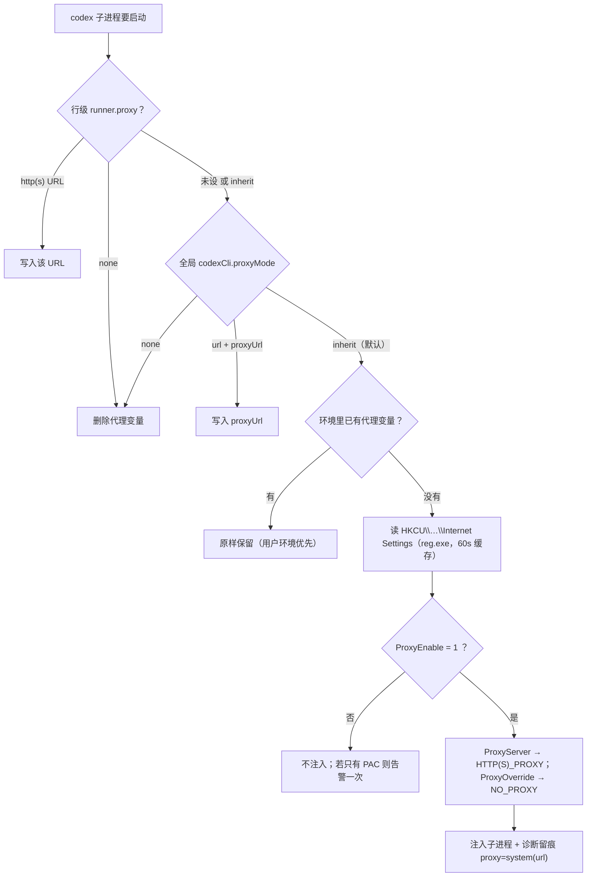

# 批 40 · codex 子进程的系统代理继承（台账 t-7）

<!-- doc-shape
count-marks: 条|处|个
-->

> **一句话**：Windows 的系统代理**不在环境变量里**（在注册表），而 `codexCli.proxyMode` 默认的 `inherit`
> 只继承了**环境变量** ⇒ 开了系统代理的机器上，codex 子进程**等于没有代理** ⇒ 连 `chatgpt.com` 超时。

---

## §0 三句话（给人看）

1. **这事是什么**：默认设置「继承代理」在 Windows 上**是一个空操作** —— 代码只复制了环境变量，而 Windows 的
   系统代理根本不是环境变量。
2. **影响谁**：所有走 `codex-cli` 通道的能力 —— 会诊的 codex 行、advisor 的 codex 行、`eng_coder` 的
   codex 后端、`escalate` 的 codex 行。它们在**开了系统代理**的机器上全部连不上外网。
3. **怎么修**：把「继承」补成**真的继承** —— 先看环境变量；环境里没有代理，就去读 Windows 系统代理设置
   （注册表 `Internet Settings`），把它翻译成 `HTTP(S)_PROXY` 注入子进程；**PAC 脚本明确报不支持**，
   不装作能处理。

---

## §一 背景

- **用户实测**（2026-10-18）：会诊 `#89` 的 codex 行（`codex-cli / gpt-6-astra`）失败，报文：

  ```
  codex 进程失败（非零退出且无有效输出）
  failed to refresh available models: request timed out
  worker quit with fatal: Transport channel closed
    … https://chatgpt.com/backend-api/ps/mcp
  ```

- **用户判断**（本批的触发点）：「codex 连不上 chatgpt.com 是因为你没遵守默认设置里**继承系统代理**的配置。」
- **台账**：`t-7`，优先级 9（本会话接手时已 claim，rev 20→23）。

- **为什么现在做**：codex 是**唯一不漏过只读闸门**的会诊通道（见 `docs/2026-10-18-session-handover.md` §3.3）——
  它坏着的时候，会诊就只剩 dsh 通道，而 dsh 通道的「只读」只是**弱证**。修好 codex = 恢复一条硬保证的通道。

> ★ **成文流程偏离留痕**（评审 #7）：METHODOLOGY 的标准流程是「会诊 → 需求档 + 设计档」，本批是**单点 bugfix**，
> 按 `2026-10-18-session-handover.md` §5 的简化固定流程（写设计档 → 用户发起设计评审 → 实施）执行。
> 本句即偏离记录，不改 METHODOLOGY 本体。

---

## §二 问题与根因

### 2.1 现象

| 事实 | 来源 |
|---|---|
| codex 子进程连 `chatgpt.com` 超时、`Transport channel closed` | 会诊 `#89` 的 codex 行报文（上一会话实测） |
| 同一时刻 dsh 通道的 4 个模型全部正常回复 | 同上（`consult #89` 4/5 回复） |
| 用户配置里 **没有 `codexCli` 节** ⇒ 全部取默认值 | `C:\Users\huangchaowen\.dsh\.thincoder\config.json`（本会话读取，1379 B，无 `codexCli` 键） |

### 2.2 根因（带 `file:line`）

`lib/codex-adapter.mjs:331-349` 的 `childEnvFor` 只有**三条**分支：

| 分支 | 条件 | 行为 |
|---|---|---|
| none | `rowProxy === "none"` 或全局 `proxyMode === "none"` | 删掉 `HTTPS_PROXY/HTTP_PROXY/ALL_PROXY`（大小写各一份） |
| URL | 行级 `runner.proxy` 是 http(s) URL，或全局 `proxyMode="url"` + `proxyUrl` | 写入四个代理变量 |
| **其余（= inherit）** | —— | **什么都不做**：`base` 就是 `deps.env ?? process.env` |

- 默认值：`lib/codex-adapter.mjs:55` `proxyMode: "inherit"`（`defaultCodexCliGlobals()`）。
- 唯一注入点：`lib/codex-adapter.mjs:644` `env: childEnvFor(deps, globals, runner)`。
- Windows 系统代理住在注册表
  `HKCU\Software\Microsoft\Windows\CurrentVersion\Internet Settings`
  的 `ProxyEnable`（DWORD）/ `ProxyServer`（字符串）/ `ProxyOverride`（字符串）/ `AutoConfigURL`（PAC），
  **不是环境变量**。

⇒ 进程环境里没有代理变量时，`inherit` 分支是**空操作**，子进程拿到的就是宿主环境。这就是根因。

### 2.3 为什么 DSH 自己没事（**判断，未验证**）

Electron/Chromium 的网络栈默认解析系统代理（WinINET），而 codex 是独立 Rust 进程、只读环境变量。

> ★ **本条仍是判断、未读 DSH 源码**：拿不到 asar 的可检索副本。**但它已不影响本批结论** ——
> §2.5 的实测已经把「codex 只认环境变量代理」这条证死了（`codex exec` 带上 `HTTPS_PROXY` 就成功），
> 所以「为什么 DSH 自己没事」只剩解释价值，不再承担推理重量。

### 2.4 附带发现：B10「代理」**从来没有测试腿**

- 实测（本会话）：`grep -r "HTTPS_PROXY|HTTP_PROXY|ALL_PROXY" test/` ⇒ **零命中**。
- 设计档 `docs/2026-09-03-codex-runner-research.md` 的 B10 声称三种模式，代码里也写了，
  但**没有任何用例**跑过这三条分支 ⇒ 这正是「写了但没腿」的假保证，也是这个 bug 能活到现在的原因。
- 本批连这个缺口一起补（§八）。

### 2.5 本机实测（2026-10-18 20:45，设计发出后补测）

> 评审在跑的时候我把「这台机器到底有没有系统代理」量了一遍，结果**推翻了本档初稿的一个隐含前提**
> （初稿默认「用户已经开了系统代理」）。如实记进来，因为它改变结论。

| 测得 | 读数 | 含义 |
|---|---|---|
| `HKCU\…\Internet Settings` 的 `ProxyEnable` | **0x0** | **系统代理当前是关的** |
| `ProxyServer` | **不存在**（只有 `MigrateProxy` / `ProxyOverride`） | 没有配置代理地址 |
| `ProxyOverride` | `localhost;127.*;192.168.*;10.*;172.16.*…172.31.*;<local>` | 真实格式样本（进 T-P1 夹具） |
| 进程环境的代理变量 | **0 个** | `inherit` 今天确实什么都没继承 |
| `chatgpt.com` 直连 | TCP 443 **不通**；DNS 解析到 **157.240.17.36**（Facebook 的 IP ⇒ **DNS 污染**） | 直连必败 |
| 本地代理端口 | **`127.0.0.1:7897` 在监听**（`verge-mihomo-alpha`） | 代理软件在跑，但**没开「系统代理」** |
| 经 7897 访问 `chatgpt.com` | HTTP **403**（应用层响应，≠ 网络不通） | 代理链路是通的 |
| **`codex exec` 经 7897** | **成功**：`turn.completed`，正文 `OK`，exit 0 | ★ **codex 确实认环境变量代理**（§十二 第 2 条由此关闭） |

**这组读数改变了两件事**：

1. **「改了 inherit 就修好 codex」是错的**：这台机器系统代理是关的，改了也没东西可继承。
   **今天的现场解法**是把 `codexCli.proxyMode` 设成 `url` + `proxyUrl=http://127.0.0.1:7897`
   —— 这是**现有功能**，不用等本批发版。
2. **但代码该修的理由没变**：用户一旦在代理软件里打开「系统代理」（`ProxyEnable=1`），
   `inherit` 仍然不会读它 ⇒ 同一个坑会再踩一次。本批修的是**语义正确性**，不是今天的救火。

---

## §三 目标 / 非目标

### 目标

1. `proxyMode: "inherit"`（默认）在 Windows 上**真的有代理效果**：环境变量优先，环境里没有则读系统代理。
2. 读到的系统代理**可被看见**：进程日志一行、失败信封的诊断串里带来源。
3. 三条既有语义（`none` / `url` / 行级 `runner.proxy`）**行为零变化**（回归锁）。
4. 给 B10 补上真腿（覆盖三条分支 + 新增系统代理路径），且**每条腿都能红**。

### 非目标

- **不做代理认证**（NTLM / Kerberos / Basic）：环境变量代理承载不了认证，读到了也只会 407。
- **不求值 PAC 脚本**（`AutoConfigURL`）：JS 求值引擎不在本插件职责内；只输出明确告警。
- **不动 `codex-app-server` 通道**：它走平台 provider，不经过我们的子进程环境。
- **不支持只有 `socks=` 的 `ProxyServer`**（评审 #1 定案 B）：socks-only 的注册表配置罕见，且我们求不出
  `ALL_PROXY` 之外该写什么；**只告警不注入**（§九 边界表同款）。
- **不改 DSH 自身网络**、不引入任何依赖（`AC-28`：`dependencies`/`devDependencies` 必须为空）。

---

## §四 决策与理由

| # | 决策 | 理由 | 被否决的备选 |
|---|---|---|---|
| **D-1** | `inherit` → **环境变量优先，系统代理兜底** | `inherit` 的字面意思是「跟随这台机器」；用户已经显式设了环境变量时，不该被注册表覆盖 | **B：新增 `proxyMode: "system"`** —— 要同时改闭集 ×2（`codex-adapter.mjs:33` 与 `index.mjs` 校验）、设置页下拉、老配置迁移，且用户默认仍是 inherit ⇒ **默认仍然坏着**。**C：所有模式都读系统代理** —— `none` 的语义会被污染（用户要求不走代理却走了） |
| **D-2** | 读注册表用 **`reg.exe query`**（`execFileSync`，带超时） | 零依赖（AC-28 锁死）；`reg.exe` 是 Windows 自带、路径稳定 | **native 模块** —— 破零依赖铁律；**PowerShell** —— 更重，且机器策略可能禁 ps1；**直接解析 `ntuser.dat`** —— 极脆 |
| **D-3** | 结果**缓存 60 秒**（模块级） | 每次 codex 调用都起一个 `reg` 进程是浪费；60s 足够让用户改完设置后自愈 | 不缓存 —— 每个任务多 20–40ms 与一个进程；缓存无限 —— 用户改了代理永远不生效 |
| **D-4** | PAC（只有 `AutoConfigURL`、没有 `ProxyServer`）⇒ **响亮告警一次**，不注入 | 我们求不了值；静默不注入会让用户再次掉进「为什么还是连不上」 | 静默忽略 —— 就是现在的失败形态 |
| **D-5** | `ProxyOverride` → `NO_PROXY`：`;`→`,`；`<local>`→`localhost,127.0.0.1,::1`；尾部 `*` 的**IP 前缀**尽量折成 CIDR（`127.*`→`127.0.0.0/8`、`192.168.*`→`192.168.0.0/16`、`172.16.*`→`172.16.0.0/16`），折不了的**原样保留** | 系统设置里「跳过这些地址」是代理语义的一部分，只搬地址不搬例外会造成回环被代理劫持。本机真实值见 §2.5（`localhost;127.*;192.168.*;10.*;172.16.*…;<local>`） | 忽略 override —— 会让本地服务调用走代理；只做 `;`→`,` —— `127.*` 这类写法多数工具**认不出** |
| **D-6** | 诊断可见：首次注入 `console.warn` 一行；**失败信封**诊断串追加 `proxy=system(<url>)` / `proxy=env` / `proxy=none` | 这个 bug 之所以拖了这么久，就是因为「用了哪个代理」**完全不可见** | 只打日志 —— 后台作业里用户看不到 |
| **D-7** | 腿：**新增 4 条顶层 `test(`**（`codex-runner.test.mjs` 190 → 194；全量 652 → 656），四处计数同批更新 | 新模块要有自己的腿；并入既有块会让「哪条腿守哪件事」糊掉。**★ 本项显式推翻 `2026-10-18-session-handover.md` §4 第 5 条「不新开顶层 `test(`」**：那条是上一批为避免四处计数对账而立的临时约束，不是永久的；仓里两条先例都写在台账 §七（批 19：177→185；批 21：185→190）。判定权在用户（§十-2） | 并入既有块 —— 语义浑浊，且 `T-LC2` 看不出新增 |

---

## §五 方案（FR-x）

**代理解析与注入的数据流（本次改动的全部路径）**



> 图里**只有绿线是新加的**（`inherit` 的 `D→F→G→I→J` 一段）；其余分支是既有语义，本批**不动**（T-P2 的回归断言钉住）。

### FR-1 新模块 `lib/system-proxy.mjs`（纯函数为主）

| 导出 | 作用 |
|---|---|
| `WINDOWS_PROXY_REG_PATH` | 注册表路径常量（单一事实源） |
| `parseRegQueryOutput(text)` | `reg query` 文本 → `{ proxyEnable, proxyServer, proxyOverride, autoConfigURL }`（**纯**） |
| `proxyUrlForScheme(serverSpec, scheme)` | `host:port` / `http=a;https=b` → 单协议 URL；**`socks=` 不在支持面**（本批只认 `http`/`https`，其它一律 `null`）（**纯**） |
| `noProxyFromOverride(override)` | `;`→`,` · `<local>`→loopback · 尾部 `*` 的 IP 前缀折 CIDR · 折不了原样保留（**纯**，规则见 D-5） |
| `systemProxyEnvFromReg(text)` | → `{ applied: {https, http, noProxy}, warning }`；**socks-only 走 `warning` 分支（不注入）**（**纯**） |
| `readWindowsSystemProxyRaw(deps)` | 唯一有副作用的读取（`reg.exe` + 60s 缓存 + 注入缝） |
| `applyInheritedSystemProxy(env, deps)` | 读 + 判定「环境里已有代理 ⇒ 不动」→ `{ env, applied, warning }` |
| `_resetSystemProxyCacheForTests()` | 测试用清缓存 |

### FR-2 `childEnvFor` 接入

- 返回值从 `env` 改为 `{ env, proxyNote }`（**内部函数**，唯一调用点 `lib/codex-adapter.mjs:644`）。
- **`lib/index.mjs:1345` 的 deps 显式加一行 `platform: process.platform`**（评审 #3）：新模块**只认 `deps.platform === "win32"`**，
  不用 `process.platform` 兜底 ⇒ 任何**没带 platform 的夹具**在任何机器上都「零读取」，测试与机器无关。
  （实测：`test/codex-runner.test.mjs` 的 64 处 `platform:` 夹具全部为 `"linux"`；`test/design-review-guard.test.mjs` 的 codex 夹具不带 platform ⇒ 由此规则自动免疫。）
- `inherit` 分支调用 `applyInheritedSystemProxy`；`none` / `url` / 行级 URL 三个分支**逐字不动**。

### FR-3 诊断可见性（三态字面固定）

**三态字面（评审 #5 定案：实施代码与腿必须逐字一致）**

| 字面 | 含义 |
|---|---|
| `proxy=env` | 环境变量里本来就有代理（我们没动它） |
| `proxy=system(<url>)` | 从 Windows 系统设置读到并注入（`<url>` = 实际注入的 https 代理） |
| `proxy=none` | 没有代理（未开 / PAC / socks-only / 读取失败） |

- **成功注入时**：`console.warn("[thincoder-suite:codex] 继承系统代理：HTTPS_PROXY=<url>（来源：Windows 系统设置）")`，**每进程一次**（评审 #6：这条也上腿，见 T-P4 ③）。
- **失败信封**（`code !== "OK"` 且**在子进程环境算好之后**）的 `diagnostics` **末尾**追加 ` | <三态字面>`；只在有值时追加。
  ★ **pre-spawn 的失败不追加**（审计 #4 定案）：`RUNNER_UNAVAILABLE`（probe 失败 / executable 解析失败 / 临时目录失败 / spawn 抛错）与 `CONCURRENCY_LIMIT` 都在 `childEnvFor` 之前返回 —— 那时**代理还没算**，编一个三态反而是假信息。
- **`proxy=none` 时再追加一句提示**：`；未使用任何代理 —— 若你依赖本地代理软件，请在设置里配置 codexCli.proxyUrl`。
  只在 `code` ∈ {TIMEOUT, PROCESS_ERROR, NO_OUTPUT} 且三态为 `proxy=none` 时追加 ⇒ **不猜端口、不猜软件名**。

### FR-4 设置页文案

`lib/client.js:1633` 的选项 `（未设——默认 inherit 继承环境）` → `（未设——默认 inherit：先看环境变量，没有则用 Windows 系统代理）`。
只改文案，不动校验与结构。

### FR-5 腿与计数

见 §八；四处计数同步见 §十一。

---

## §六 机制伪代码

```text
readWindowsSystemProxyRaw(deps):
  前置：deps 可含 { env, platform, regQuery, now }
  后置：返回 reg 文本 | null；任何失败 ⇒ null（fail-open 到「没有系统代理」= 今天的行为）；不影响其它分支
  if deps.platform !== "win32": cache=null; return null      // ★ 评审 #3：显式判定，不用 process.platform 兜底
                                                              //   ★ 审计 #5：**平台门控在缓存检查之前**（与 §九「判定在最前」一致；
                                                              //   非 win32 调用会顺手清掉 win32 缓存 —— 生产平台恒定，无用户可见差异）
  if cache 有效（< 60s）: return cache.raw
                                                     //   生产 deps 由 index.mjs 显式带 platform（§十一）；
                                                     //   任何未带 platform 的夹具 ⇒ 机器无关地「零读取」
  try:
    raw = (deps.regQuery ?? defaultRegQuery)()        // execFileSync("reg", ["query", REG_PATH], {encoding, timeout:1500})
  catch: raw = null
  cache = { raw, at: now() }
  return raw

systemProxyEnvFromReg(text):
  前置：text 可能是 null / 空 / 只含表头
  后置：纯函数，返回 { applied | null, warning | null }
  reg = parseRegQueryOutput(text)
  if reg.proxyEnable !== 1:
     if reg.autoConfigURL: return { applied:null, warning:"系统代理是 PAC 脚本（AutoConfigURL），codex 通道无法自动使用 —— 请在 codexCli.proxyUrl 手动填地址" }
     return { applied:null, warning:null }                        // 没开代理 = 正常
  if !reg.proxyServer: return { applied:null, warning:"系统代理已启用但 ProxyServer 为空 —— 忽略" }
  https = proxyUrlForScheme(reg.proxyServer, "https") ?? proxyUrlForScheme(reg.proxyServer, "http")   // 双向回退（评审 N4）
  http  = proxyUrlForScheme(reg.proxyServer, "http") ?? https      // 只认 http/https；socks= / 其它 ⇒ null
  if !https && !http:                                      // ⇒ socks-only 落这里（评审 #1 定案 B）
     return { applied:null, warning:"系统代理地址无法解析（只支持 http/https 代理；socks-only 或未知协议不注入）：" + reg.proxyServer }
  return { applied: { https, http, noProxy: noProxyFromOverride(reg.proxyOverride) }, warning:null }

applyInheritedSystemProxy(env, deps):
  前置：env 是「已展开的环境变量」副本
  后置：环境里**任一**代理变量已存在 ⇒ 原样返回（applied=null，reason="env"），**不覆盖用户环境**
  if hasAnyProxyEnv(env): return { env, applied:null, note:"env" }
  raw = readWindowsSystemProxyRaw(deps)
  r = systemProxyEnvFromReg(raw)
  if r.warning: warnOnce(r.warning)
  if !r.applied: return { env, applied:null, note:"none", warning:r.warning }
  if !r.applied.https && !r.applied.http: return { env, applied:null, note:"none", warning:"代理地址为空" }   // N4 守卫
  env.HTTPS_PROXY = env.https_proxy = r.applied.https   （http 同理；有 noProxy 则写 NO_PROXY/no_proxy）
  return { env, applied:r.applied, note:"system(" + r.applied.https + ")" }   // 三态字面见 FR-3：proxy=system(<url>)
```

**前后置条件（汇总）**

- 前置：`deps.env` 可以是空对象；**`deps.platform` 缺省 ⇒ 视为非 win32（零读取）**（评审 N1：与 FR-2 的平台门控一致，**不用** `process.platform` 兜底）。
- 后置：**任何异常路径都不抛给调用方** —— 最坏情况回到「没有代理」，与今天行为一致（fail-open 到现状）。
- 后置：`none` / `url` / 行级 URL 三个分支的输出**与改动前逐字节相同**（T-P2 的回归断言）。

---

## §七 状态与 schema

| 项 | 变化 |
|---|---|
| 持久化结构（`config.json`） | **零变化**：不新增字段、不改闭集 |
| 模块级状态 | 新增 `systemProxyCache = { raw, at }`（进程内，60s TTL，不落盘） |
| 跨进程/重启 | 缓存随之丢失 —— 下次调用重新读，**无迁移** |
| 子进程环境（派生） | `inherit` 下可能新增 `HTTPS_PROXY/HTTP_PROXY/https_proxy/http_proxy/NO_PROXY/no_proxy` |
| 信封（`runner`） | **不改结构**；只在 `diagnostics` 追加一段文本 |
| 设置页 | 仅 FR-4 的选项文案 |

---

## §八 防偏离（验收腿）

新增 **4 条顶层 `test(`**（`test/codex-runner.test.mjs`，190 → 194）：

| 腿 | 判据（每条都必须能红） |
|---|---|
| **T-P1** `系统代理: reg query 解析与三态` | ① `host:port` 单值 → https/http 同址；② 分协议 `http=…;https=…` 各取各的；③ `ProxyEnable=0` → 不注入；④ 只有 PAC → 告警且不注入；⑤ 畸形/空文本 → `null` 不抛；⑥ **socks-only → 告警且不注入**（评审 #1 定案 B 的腿）；⑦ 真实 `ProxyOverride` 样本（§2.5 那条）→ `<local>` 翻 loopback、`127.*` 折 CIDR |
| **T-P2** `系统代理: inherit 注入 + 环境变量优先 + none/url 回归` | ① inherit + 无 env 代理 + 系统开 → `opts.env.HTTPS_PROXY` 有值；② inherit + 已有 `HTTPS_PROXY` → **原值保留**（不被覆盖）；③ `proxyMode:none` + 系统开 → **零代理变量**；④ `proxyMode:url` → 用配置地址；⑤ 行级 `runner.proxy` URL 优先于全局 |
| **T-P3** `系统代理: 非 Windows 零读取 + 读取失败 fail-open + 缓存` | ① `platform:"linux"` → `regQuery` **零调用**；② `regQuery` 抛错 → 不抛、不注入；③ 60s 内二次调用 → `regQuery` 只被调 1 次；④ 过期后重读 |
| **T-P4** `系统代理: 诊断可见（成功零噪音 / 失败追加 proxy= / warn 恰一次）` | ① 注入后**失败**信封 `diagnostics` 含 `proxy=system(`；② 未注入时**成功**信封不含 `proxy=`（既有夹具零污染）；③ **warn 恰一次**：连续两次注入只 warn 一次，未注入零 warn（评审 #6）；④ `proxy=none` 且 TIMEOUT/PROCESS_ERROR → 含本地代理提示句 |

**变异自证（交付时必须实跑并写进报告）**

1. 删掉 `applyInheritedSystemProxy` 的注入行 ⇒ T-P2 ① 红。
2. 把「环境变量优先」判断删掉 ⇒ T-P2 ② 红。
3. 把 60s 缓存 TTL 改成 0 ⇒ T-P3 ③ 红。
4. 把失败诊断追加删掉 ⇒ T-P4 ① 红。

**负控**：`none` / `url` 两条既有语义**不得**因为新分支而改变（T-P2 ③④ 是负向断言，不是正向）。

---

## §九 边界

| 情形 | 行为 |
|---|---|
| 机器没开系统代理 | 不注入、不告警（正常态） |
| `ProxyServer` 只有 `socks=…`（或其它未知协议） | **告警不注入**（评审 #1 定案 B：本批不支持 socks；`applied` 没有 `ALL_PROXY` 字段，不假装支持） |
| `ProxyOverride` 含 `<local>` | 翻译成 loopback 列表进 `NO_PROXY` |
| PAC（`AutoConfigURL`） | **一次告警**，不注入；提示改用 `codexCli.proxyUrl` 手填 |
| 代理需要认证 | **不处理**（非目标）；表现为 407，诊断串里能看见注入的地址，便于判断 |
| `reg.exe` 不存在/被策略禁 | `catch` → null，行为回到今天（不注入、不报错） |
| 非 Windows | 完全不读注册表（`platform` 判定在最前） |
| 环境里已有代理变量 | **用户环境优先**，不覆盖 |
| 并发 | 缓存写入是「最后写赢」，最坏多起一次 `reg`；无锁需求 |
| 失败方向 | **fail-open 到现状**（没有代理），绝不因读注册表失败而中断 codex 任务 |

---

## §十 需要用户拍板的（本档写的是推荐值）

| # | 事项 | 推荐 | 代价 |
|---|---|---|---|
| **1** | `inherit` 的语义扩成「环境变量优先 → 系统代理兜底」 | **按本档做** | 环境变量存在时行为完全不变；无环境变量时**行为改变**（这正是修复点） |
| **2** | 腿数：新增 4 条顶层用例（652 → 656）——**显式推翻交接档 §4 第 5 条「不新开顶层 `test(`」** | **新增** | 要同批改四处计数（§十一），多一次对账；先例：批 19（177→185）、批 21（185→190） |
| **3** | PAC 只告警不实现 | **不实现** | 用 PAC 的机器仍需手填 `codexCli.proxyUrl` |
| **4** | socks-only 只告警不注入（评审 #1 定案 B） | **不实现 socks** | 极罕见的注册表配置；告警已足以诊断 |
| **5** | `proxy=none` 失败时追加「若你依赖本地代理软件，请配置 codexCli.proxyUrl」提示 | **加**（一句话，不猜端口） | 多一句诊断文案；`proxy=env/system` 时**不出现**，不制造噪音 |
| **6** | ★ **今天要让 codex 可用，不必等本批**：现场把 `codexCli.proxyMode=url` + `proxyUrl=http://127.0.0.1:7897`（§2.5 实测该端口在跑） | **用户自定** | 这是现有功能；本批修的是 `inherit` 的语义正确性 |

---

## §十一 受影响文件与收口清单

| 文件 | 改动 | 计数 |
|---|---|---|
| `lib/system-proxy.mjs` | **新增**（纯函数 + 缓存读取） | — |
| `lib/codex-adapter.mjs` | `childEnvFor` 接入 + 诊断追加 + 注释同步 | — |
| `lib/index.mjs` | deps 加 `platform: process.platform`（一行，评审 #3） | — |
| `lib/client.js` | 设置页选项文案（FR-4） | — |
| `test/codex-runner.test.mjs` | +4 条顶层用例 | **190 → 194** |
| `test/stage-gate.test.mjs` | **T-SG4 执行面基线 2 → 3**（新增 `lib/system-proxy.mjs` 的 `reg.exe` 是**第三处**有意执行面；该腿自注「随设计变更换基线」，批 26 已走过 1→2 的先例） | **2 → 3** |
| `docs/test-lifecycle.md` | §三 该行用例数单元格 + §七 变更记录新行 | **194** |
| `CHANGELOG.md` | 新版本节 + 计数行 | **656/656（基线 652 + 本批 4）** |
| `docs/2026-09-17-scope-alignment-design.md` | `b17-全量用例数` / `b17-用例增量` 两处绑定值（与改 CHANGELOG **同一次编辑**） | **656 / 4** |
| `docs/README.md` | 登记本档 | — |
| `docs/2026-10-18-session-handover.md` | 收口更新：§0-3 摘句 · §2 批次表加批 40 · §3.1 移除 `t-7` · §3.3 改写「codex 会诊不可用」· §5.1 腿数 · §1 状态行（HEAD/版本/读数） | — |
| `package.json` | 版本号（与 CHANGELOG 顶部**同一次编辑**） | — |

**收口四步**（父会话亲跑，不采信子代理自报）：

```
node --test test/codex-runner.test.mjs
node --test test/doc-hygiene.test.mjs test/test-lifecycle.test.mjs
node --test
node release-check.mjs
```

---

## §十二 已知未验证项（如实登记）

1. **系统代理「开着」那条路径没有真机读数**：本机 `ProxyEnable=0`（§2.5）⇒ `inherit` 读注册表这一段**只能靠 T-P1/T-P2/T-P3 的注入桩**证明。
   真机验证需要：先在代理软件里打开「系统代理」，再跑一次 codex 行，看诊断是否为 `proxy=system(...)`。
2. ~~codex 是否读环境变量代理~~ —— **已关闭**（§2.5：`codex exec` 经 `127.0.0.1:7897` 成功返回 `OK`，`turn.completed`）。
3. **DSH/Electron 是否读 WinINET**：§2.3 的判断，仍未读源码；但它已不影响本批（我们只关心子进程环境）。
4. **代理认证（407 / NTLM）**：非目标，未实测。
5. **`codex` 的 models 刷新失败仍会出现**：§2.5 的探针里，`failed to refresh available models: request timed out`
   在**走了代理**的情况下依旧打印（任务本体成功）⇒ 那条通道走的是另一个端点/规则，**与本批无关**，别误判成回归。
6. **本档初稿的失败环境已恢复**：初稿写作时所有子进程 `STATUS_DLL_INIT_FAILED (0xC0000142)`；
   用户改权限后已实测：全量 `node --test` **652/652**（exit 0）、文档闸门 **31/31**。上述计数已由本人复测，不再引用交接档。

---

## §十三 实施回填与偏差裁定（2026-10-18，父会话）

> 实施由 `eng-dsh-49a6db6d60bf4c19` 交付。本节是**父会话对交付方 6 条偏差（D-1…D-6）的裁定**与真实读数，
> 以及设计档 §十一 没预见到的那一处收口（T-SG4 执行面基线）。

### 13.1 偏差裁定：D-1…D-6 全部**采纳**

| # | 交付方的偏差 | 父会话裁定 | 理由 |
|---|---|---|---|
| **D-1** | FR-2 只点名 `index.mjs:1345` 一处 deps，实测另三处（advisor `:1115` / eng_coder `:1242` / escalate `:1271`）是内联字面量且不带 `platform` | **采纳（补齐四处 + 静态锁）** | 不补 = §0 承诺的「四条 codex 链路」里三条**永远静默没代理**。这是设计档的局部遗漏，不是新设计 |
| **D-2** | 注册表 `https=<addr>` 也产出 `http://<addr>` | **采纳** | 注册表里的 scheme 是**目标协议**；`HTTPS_PROXY` 的 URL scheme 是**与代理说话的方式**。Windows 系统代理一律 HTTP，写成 `https://` 会对明文端口做 TLS 握手 ⇒ 必连不上 |
| **D-3** | 显式 `url` / 行级 URL 两分支 `proxyNote = null`（失败信封不追加三态） | **采纳（并扩大到显式 `none` —— 审计 #3）** | FR-3 的三态是**inherit 路径**的可观测面。★ 审计发现初版把 `none` 分支也塞了 `proxyNote="proxy:none"` ⇒ 与 FR-2「none 分支逐字不动」冲突 ⇒ **回退成 null**：显式 `none`/`url`/行级 URL **三分支都不产生三态字面** |
| **D-4** | PAC 告警也覆盖「`ProxyEnable=1` 且无 `ProxyServer`」形态 | **采纳** | 真实 PAC 常见此形态；否则用户看到「ProxyServer 为空」而非「PAC 不支持」，正是 D-4 要消灭的误导 |
| **D-5** | `_resetSystemProxyCacheForTests()` 同时清「warn 恰一次」记录 | **采纳** | 否则 T-P4 ③ 在注入腿之后**恒真**（假腿，`AGENTS.md` §二 第 5 条） |
| **D-6** | 空诊断串时三态不带前导 ` | ` | **采纳** | 避免 `diagnostics` 以分隔符开头；有值时仍严格「末尾追加」 |

**结论：无一条需要回退。** 六条都不改变设计语义，只是把「设计没写到的边界」按设计的方向补齐；每条都可被腿或静态锁观察到。

### 13.2 设计档漏掉的一处收口：T-SG4 执行面基线

`test/stage-gate.test.mjs` 的 **T-SG4** 锁「`lib/**` 里 `child_process` 出现次数 = 2」。新模块用 `execFileSync` 起 `reg.exe` ⇒ 实测 **3** ⇒ 该腿红。

- 这条**不在 §十一 的受影响文件表里**（设计疏漏），交付方按规则**没有动**它，只在报告里报阻塞 —— 处置正确。
- 裁定：**换基线 2 → 3**（该腿自注「再新增执行面仍会红，锁的判别力不降，只随设计变更换基线」；批 26 已走过 1 → 2 的同一条维护路径）。
- 已把 `test/stage-gate.test.mjs` 补进 §十一 的表。

### 13.3 父会话亲跑的真实读数（as-of 2026-10-18 21:10）

| 命令 | 读数 | exit |
|---|---|---|
| `node --test test/codex-runner.test.mjs` | **194 / 194** | 0 |
| `node --test test/doc-hygiene.test.mjs test/test-lifecycle.test.mjs` | **31 / 31** | 0 |
| `node --test`（全量，收口前） | **656 tests · 655 pass · 1 fail**（唯一红 = T-SG4，见 §13.2） | 1 |

**变异自证**（交付方实跑，父会话复核其读数）：4 处定向变异各得 `193 pass / 1 fail` 且命中目标腿，复原后 `194/194`、sha256 与变异前逐字节相同。

### 13.4 仍未闭环的一条（如实登记）

**★ 2026-10-18 21:15 已补真机读数（父会话亲手做，含还原证明）**：临时把注册表改成 `ProxyEnable=1` + `ProxyServer=127.0.0.1:7897`，
用**真实注册表**跑 `applyInheritedSystemProxy({}, { platform: "win32" })`，得：

```json
{ "note": "system(http://127.0.0.1:7897)",
  "HTTPS_PROXY": "http://127.0.0.1:7897", "HTTP_PROXY": "http://127.0.0.1:7897",
  "NO_PROXY": "localhost,127.0.0.0/8,192.168.0.0/16,10.0.0.0/8,172.16.0.0/16,…,localhost,127.0.0.1,::1" }
```

并打出 `[thincoder-suite:codex] 继承系统代理：HTTPS_PROXY=http://127.0.0.1:7897（来源：Windows 系统设置）`。
**随后已还原**（复读：`ProxyEnable 0x0`、`ProxyServer` 不存在）。

⇒ §十二 第 1 条的「读注册表」这一段**已有真机证据**；剩下未闭环的只有「整条 codex 任务在运行中的 DSH 里走一遍」
（需要插件重载/重启才能加载新 `lib/`；按用户级纪律不擅自重启）。

★ 顺带发现一处**瑕疵**（记给收口轮）：`NO_PROXY` 里 `localhost` 出现两次（一次来自 `ProxyOverride` 原文、一次来自 `<local>` 展开）。
不违反设计（去重不是判据），但应由实现去重 —— 记为 §13.5 的 🔵 收口项。

### 13.5 收口轮待办（父会话登记的偏差/瑕疵）

| # | 事项 | 严重度 | 来源 | 处置 |
|---|---|---|---|---|
| 1 | `test/stage-gate.test.mjs` T-SG4 执行面基线 **2 → 3** | 🔴 阻塞（全量 1 红） | 设计疏漏 + 审计 #1 | **eng_coder 修**（基线 + 注释） |
| 2 | `NO_PROXY` 里 `localhost` 重复两次 | 🔵 | 父会话实测 | **eng_coder 修**（`noProxyFromOverride` 输出去重，保序） |
| 3 | 显式 `proxyMode:none` 分支被塞了 `proxyNote="proxy:none"` ⇒ 与 FR-2「逐字不动」冲突 | 🟡 | 审计 #3 | **eng_coder 回退**成 `null`；D-3 已扩写到「三分支都不产生三态」（§十三 D-3） |
| 4 | 三态只覆盖 `fin` 路径；pre-spawn 失败（`RUNNER_UNAVAILABLE` / `CONCURRENCY_LIMIT`）无 `proxy=` | 🔵 | 审计 #4 | **改设计而非改代码**：那时代理还没算，编一个三态是假信息（§五 FR-3 已收窄） |
| 5 | §六 伪代码 cache-first 与实现/§九 的平台优先顺序相反 | 🔵 | 审计 #5 | **改设计**：伪代码改为平台门控在前（§六 已改） |
| 6 | T-P4 只断言 `includes`，缺「末尾位置 / 空诊断无前导分隔符 / `proxy=env` 信封」三条锁 | 🔵 | 审计 #6 | **eng_coder 补断言**（加在既有 T-P4 块内，不新增顶层 `test(`） |
| 7 | 发布收口（CHANGELOG 计数行 / `package.json` 版本 / scope-align `b17` 绑定 / README 状态 / 交接档 §3.3） | 🟡 | 审计 #2 | **父会话收口轮做**（代码评审之后，与四处计数同一次编辑） |
