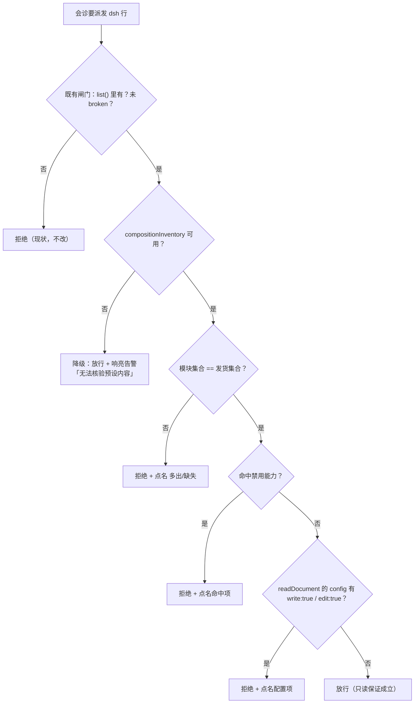

# 批 41 · 只读会诊预设的「内容漂移」检测（台账 t-6）

<!-- doc-shape
count-marks: 条|处|个|行
-->

> **一句话**：现在的闸门只验「只读预设**注册了、没坏**」，验不了「**内容被人改过**」——
> 用户把写工具加回去、或把 `tool-fs` 的 `write` 翻成 `true`，我们照样判绿并派发。
> 本批把「**内容必须是我们发的那一份**」变成机器判据。

---

## §0 三句话（给人看）

1. **这事是什么**：会诊的「只读」保证，现在建立在一个预设上。我们只检查这个预设**在不在、坏没坏**，
   **不检查它里面装的是什么** —— 而它装的东西**是可以被改的**。
2. **影响谁**：如果预设被改（加回 `tool-bash`、或把 `tool-fs.write` 从 `false` 翻成 `true`），
   会诊会**继续以「只读」的名义运行**，实际上子代理已经能写你的文件了 —— **静默失效**。
3. **怎么修**：派发会诊前，把预设的**实际内容**读出来，与我们**发货的那份**做三层比对
   （模块集合 / 禁用能力 / 关键配置）；任一不符 ⇒ **拒绝运行并点名差在哪**。

---

## §一 背景

- **来源**：会诊 `#89` 的 `glm-5.3` 指出（纪要 §4 教训 2）——「你们的 fail-closed 验『已注册 / 非 broken』，
  但**验不了内容漂移**——`T-38` 只断言 presence，正是这个缺口的实例。」
- **台账**：`t-6`，优先级 8（`docs/2026-10-18-session-handover.md` §3.1）。
- **现状（`lib/consult.mjs:973-1018`，`resolveConsultReadonlyRoute`）**：0.2.1 路线下只做三件事 ——
  ① `agentPresets.list()` 里有 `thincoder-consult-ro`；② 它 `broken` 不为真；③ 否则 fail-closed。
  **没有任何一步看「它里面是什么」。**
- **为什么现在做**：`0.34.0` 把 `inherit` 补成真继承后，**codex 是唯一不漏过只读闸门的通道**（它走独立进程）。
  也就是说**dsh 通道的「只读」现在是整个会诊能力的唯一软肋** —— 而它的保证恰恰是这一条。

---

## §二 问题与根因

### 2.1 现象（三个真实可发生的漂移）

| # | 怎么发生 | 现在的后果 |
|---|---|---|
| 1 | 用户在设置里把 `thincoder-consult-ro` 的 `plugins` **加回** `tool-bash` | 闸门判绿 ⇒ 派发 ⇒ **会诊子代理能执行命令** |
| 2 | 用户把 `tool-fs` 的 `write: false` / `edit: false` 改成 `true` | 闸门判绿 ⇒ **能写你的文件** |
| 3 | 版本升级/别的插件**覆盖**了同名预设定义 | 闸门判绿 ⇒ 内容早已不是我们发的那份 |

### 2.2 根因（带 `file:line`）

- `lib/consult.mjs:1001-1017`：`found = rows.find(r => r.id === ...)`，随后只看 `found.broken`。
  **没有读取该预设的 plugins/config。**
- **★ 任务原判据的前提是错的**（本批先做了实测）：`t-6` 的验收写「与 `agentPresets.list()` 里同名预设的
  **实际内容**比对」—— 但平台 `dsh-agent-preset-registry/lib/index.js` 的 `async list()` **只返回显示元数据**：

  ```js
  { id, ...(name), ...(description), ...(order), ...(broken) }
  ```

  **没有 `plugins`**。照原判据实现，永远比不出内容 ⇒ 必须换 API（本批的第一条实测结论）。

### 2.3 可行面（读平台源码得到，实施时需在运行时验证服务面是否暴露）

| API（`ctx.get("agentPresets")` 上） | 返回 | 本批用途 |
|---|---|---|
| `compositionInventory()` | 每个预设 `{ id, name?, description?, isDefault, broken?, rows }`；`rows` = **扁平化后的声明行** `{ entryId, moduleName, enabled, condition? }`（`group` 会被展开） | **模块集合**（第①层） |
| `readDocument(id)` | `{ agentPreset, content, name?, description? }`，`content` = 该预设声明序列化成的 **YAML 文本**（含 `write: false` 这类 config） | **关键配置扫描**（第③层） |
| `list()`（既有） | 显示元数据（见 2.2） | 既有的「注册 + broken」判据，**保留不动** |

### 2.4 为什么不能只靠 `list()` 或只靠 `compositionInventory`

- 只看 `compositionInventory().rows`：`rows` **不含 config** ⇒ 第 2 类漂移（`write: false` → `true`）**看不见**。
- 只看 `readDocument().content`（YAML 文本等值）：平台 `dump()` 的**格式细节**（缩进/引号/键序）一变
  就会误报漂移 ⇒ 会诊被误停。**宁可漏一次格式差异，不可把整条会诊打死**。

---

## §三 目标 / 非目标

### 目标

1. 派发会诊前，**能看见**只读预设的实际内容，并与发货定义做**三层比对**。
2. 漂移 ⇒ **fail-closed 拒绝运行**，拒绝文案**点名差在哪**（多/少哪些模块、命中哪些禁用项）。
3. 观测面缺失（服务不暴露 / API 抛错）⇒ **降级放行 + 响亮告警**（不静默、不假装验过）。
4. `toolFilter` 路线（老宿主）**零变化**；`none`/`url` 等无关路径零变化。

### 非目标

- **不做**预设内容的自动修复/自动回滚（那是平台与用户的事）。
- **不给**「允许漂移」的配置逃生口（详见 D-3）。
- **不把**全局注册的工具纳入本判据 —— 平台语义「作用域注册只遮蔽全局」，预设管不到那一层
  （`CONSULT_READONLY_DISCLAIMER` 的「本部署无法保证只读」**仍然成立**）。
- **不动** `cordis.patch.yml` 的预设定义本身（本批只加校验）。

---

## §四 决策与理由

| # | 决策 | 理由 | 被否决的备选 |
|---|---|---|---|
| **D-1** | **语义三层**（模块集合 / 禁用能力 / 关键配置），**不是** YAML 全文等值 | 全文等值把「平台 dump 格式变化」误判成「用户漂移」⇒ 误停整条会诊；三层各自对准一类真实攻击面，且不依赖文本格式 | **YAML 全文等值** —— 最严但最脆；**只用模块集合** —— 漏第 2 类（`write:true`） |
| **D-2** | 观测面缺失 ⇒ **降级放行 + 响亮告警**（不静默） | 与既有「本部署无法保证只读」口径一致；fail-closed 会在 API 缺失的宿主上**直接停掉会诊**（把安全强化变成可用性事故） | **fail-closed** —— 保守但可能整条功能停摆；**静默放行** —— 等于没做 |
| **D-3** | **不给**逃生口（`allowPresetDrift` 之类） | 只读保证的意义就是「配了就必须是我们发的那份」；给开关等于给「静默弱化」留后门（本仓有先例：把 `policy.writer` 降成 `any` 当修复） | 配置开关 —— 用户一开，保证就没了且**看不出来** |
| **D-4** | 期望模块集 = **代码常量**，另加一条**静态同步锁**腿（文本解析 `cordis.patch.yml` 的 preset 段，与常量逐项比对） | 本仓零依赖（不能引 YAML 解析器）；常量 + 同步锁既零依赖又能防「改了发货定义忘了改常量」 | 运行期解析 YAML —— 破零依赖；只写常量不锁 —— 迟早漂 |
| **D-5** | 只对 **`agentPreset` 路线**生效 | `toolFilter` 路线（0.1.x）没有预设概念，不该被这条判据误伤（T-30 的回退腿仍在） | 全路线生效 —— 老宿主会无故被拒 |

---

## §五 方案（FR-x）

**判据流程图**



### FR-1 新模块 `lib/preset-readonly-guard.mjs`（纯函数 + 常量，零副作用）

| 导出 | 作用 |
|---|---|
| `CONSULT_READONLY_MODULES` | **发货的 9 个模块名**（常量，单一事实源；见 §11 的来源） |
| `FORBIDDEN_MODULE_TOKENS` | 禁用能力词表（`bash` / `pwsh` / `str-replace-editor` / `jobs` / `ralph` / `workflow` / `subagent` / `terminal` / `worktree` / `schedule` / `present` / `goal` / `todo` / `ask-user`） |
| `normalizeModules(rows)` | `rows` → 模块名数组（**去重 + 排序** ⇒ 顺序不同不算漂移）（**纯**） |
| `checkModuleSet(actual)` | → `{ ok, added: [], missing: [] }`（**纯**） |
| `checkForbidden(actual)` | → `{ ok, hits: [] }`（**纯**） |
| `checkDocFlags(yamlText)` | → `{ ok, hits: [] }`：扫 `write:\s*true` / `edit:\s*true`（**纯**） |
| `evaluatePresetDrift({ rows, docContent })` | 三层合一 → `{ ok, reason }`（**纯**） |

### FR-2 接入 `resolveConsultReadonlyRoute`

在既有 `broken` 检查**之后**、`return { ok:true }` **之前**插入一段（顺序即证据顺序）：

1. 取 `presets.compositionInventory`（函数？）→ 调 → 找到本预设的行。
2. `evaluatePresetDrift` ⇒ `ok:false` 时返回 `reason`（**必含「无法保证只读」**，沿用 T-29 判据）。
3. 观测面缺失/抛错 ⇒ 返回 `ok:true` + `degraded` 字段（新字段），由 caller 并入派发文本。

返回值扩展：`{ ok, mode, preset, reason, degraded?: string|null }`（**加性**，不改既有字段语义）。

### FR-3 降级告警可见

`startConsultSession` 的派发文本（既有 `warnPrefix` 通道）追加一行：

```
[thincoder-suite] 只读预设内容未能核验（<原因>）——本部署的「只读」仍是弱证
```

### FR-4 拒绝文案（必须点名）

```text
只读预设内容已漂移（"thincoder-consult-ro"）：<具体差异>
  · 多出模块：@deepseek-ai/dsh-tool-bash
  · 缺失模块：@deepseek-ai/dsh-tool-web
  · 命中禁用能力：dsh-tool-pwsh
  · 关键配置被翻转：write: true
⇒ 无法保证只读（拒绝运行）
```

### FR-5 腿与计数

见 §八；四处计数同步见 §十一。

---

## §六 机制伪代码（前置 / 后置）

```text
evaluatePresetDrift({ rows, docContent }):
  前置：rows 可为 null（观测面缺失）；docContent 可为 null
  后置：任意输入都不抛；ok:false 时 reason 非空且含具体差异
  if rows == null: return { ok:true, degraded:"内容观测面不可用" }   // D-2
  actual = normalizeModules(rows).filter(enabled !== false)         // 停用的行**不算在用**：
                                                                     //  ⇒ 发货集合里的行被停用 = 缺失 = 漂移（保守方向，§九）
  set = checkModuleSet(actual)
  if !set.ok: return { ok:false, reason: "模块集合不符（多出 … / 缺失 …）" }
  bad = checkForbidden(actual)
  if !bad.ok: return { ok:false, reason: "命中禁用能力：" + bad.hits.join(", ") }
  if docContent != null:
     flags = checkDocFlags(docContent)
     if !flags.ok: return { ok:false, reason: "关键配置被翻转：" + flags.hits.join(", ") }
  return { ok:true, degraded:null }

verifyReadonlyPresetContent(presets):
  前置：presets 是 agentPresets 服务对象（可能只暴露 list()）
  后置：**不抛**；缺任何观测面 ⇒ { ok:true, degraded:"…" }
  try:
    inventory = await presets.compositionInventory()      // 可能不存在/抛错
  catch: inventory = null
  row = inventory?.find(r => r.id === CONSULT_READONLY_PRESET)
  if !row: return { ok:true, degraded:"compositionInventory 不可用或缺该预设行" }
  try: doc = await presets.readDocument(CONSULT_READONLY_PRESET) catch: doc = null
  return evaluatePresetDrift({ rows: row.rows, docContent: doc?.content ?? null })
```

**后置条件汇总**

- 前置：`ctx.get("agentPresets")` 可能返回 `undefined`（既有代码已处理）。
- 后置：**任何异常都不抛出**；最坏情况是 `degraded` 非空 + 放行（D-2）。
- 后置：`toolFilter` 路线**完全不经过**本段（D-5）。

---

## §七 状态与 schema

| 项 | 变化 |
|---|---|
| 持久化结构 | **零变化**（纯观测，不写盘） |
| 会话状态 | **零变化**（不新增 state 字段） |
| `resolveConsultReadonlyRoute` 返回值 | **加性**字段 `degraded?: string\|null`；既有四个字段语义不变 |
| 模块级状态 | **无缓存**：每次派发前读一次（低频、开销 = 一次内存调用） |
| 工具/描述面 | 无新增工具；拒绝文案可能与既有不同（**T-29 的「无法保证只读」子串保留**） |

---

## §八 防偏离（验收腿）

新增 **4 条顶层 `test(`**（`test/consult.test.mjs` 7 → 11；全量 656 → 660）：

| 腿 | 判据（每条都必须能红） |
|---|---|
| **T-39 模块集合漂移** | ① 集合完全一致（**顺序打乱**） ⇒ 放行；② 多一个 `dsh-tool-bash` ⇒ 拒绝且 reason 点名列它；③ 少一个 `dsh-tool-web` ⇒ 拒绝且 reason 点名它；④ `enabled:false` 的写行 ⇒ **不算在用**（放行） |
| **T-40 禁用能力与配置翻转** | ① `@deepseek-ai/dsh-tool-pwsh` 在集合里 ⇒ 拒绝；② `readDocument.content` 含 `write: true` ⇒ 拒绝；③ `edit: true` ⇒ 拒绝；④ 正常内容 ⇒ 放行 |
| **T-41 观测面缺失降级** | ① 服务只有 `list()` ⇒ **放行** + `degraded` 非空；② `compositionInventory` 抛错 ⇒ 放行 + `degraded`；③ `readDocument` 抛错但 inventory 正常 ⇒ 模块层仍生效（集合不符仍拒） |
| **T-42 发货定义同步锁** | 静态：文本解析 `cordis.patch.yml` 的 `preset-thincoder-consult-ro` 段，取全部 `name:`（展开 group）⇒ **必须逐项等于** `CONSULT_READONLY_MODULES`（多/少/改名都红） |

**变异自证（交付时必跑并写进报告）**

1. 把 `checkModuleSet` 改成恒 `ok` ⇒ T-39 红。
2. 把 `checkForbidden` 删掉 ⇒ T-40 ① 红。
3. 把 `checkDocFlags` 删掉 ⇒ T-40 ②③ 红。
4. 把「观测面缺失 ⇒ 放行」改成「缺失 ⇒ 拒绝」 ⇒ T-41 红（方向锁）。
5. 从 `CONSULT_READONLY_MODULES` 删一项 ⇒ T-42 红。

**负控**：`toolFilter` 路线（老宿主）**不得**被本判据影响（既有 T-30 腿必须仍绿）。

---

## §九 边界

| 情形 | 行为 |
|---|---|
| 服务只有 `list()`（无 inventory） | 放行 + `degraded` 告警（D-2） |
| `compositionInventory()` 抛错 | 同上 |
| `readDocument()` 抛错 | 模块层仍然生效；配置层标 degraded（**不假装验过**） |
| 预设行 `enabled:false` | 该模块**不算在用**（用户显式停用 ≠ 加了新能力）；但它若在**发货集合**里 ⇒ 集合会比较出「缺失」 ⇒ 拒绝（保守方向）→ **实施时二选一并在腿里钉死**：本档取「**发货集合内的行被停用 ⇒ 也算漂移**」 |
| 用户把预设整个删掉 | 既有判据（list 找不到）先拒 —— 本批不改变 |
| 宿主升级导致模块改名（如 `dsh-tool-fs` → 新名） | **本批会拒绝**（集合不符）⇒ 属**预期行为**，需随升级同批改常量（T-42 会先红，提醒改） |
| 预设里有 `cordis:group` | inventory 已展开；本判据只看**展开后的模块名** |
| 并发 | 每次派发各读一次，无共享可变状态 |

---

## §十 需要用户拍板的（已按 2026-10-18 对话裁定，此处留痕）

| # | 事项 | 裁定 | 代价 |
|---|---|---|---|
| 1 | 观测面缺失时 | **降级放行 + 响亮告警**（D-2） | 缺 API 的宿主上「只读」仍只是弱证，但会**说出来** |
| 2 | 漂移判定口径 | **语义三层**（D-1） | 极端的 YAML 格式歧义可能漏；换来的是不会误停会诊 |
| 3 | 逃生口 | **不给**（D-3） | 想定制只能改发货定义并升版本 |

---

## §十一 受影响文件与收口清单

| 文件 | 改动 | 计数 |
|---|---|---|
| `lib/preset-readonly-guard.mjs` | **新增**（常量 + 4 个纯函数 + 1 个组合判据） | — |
| `lib/consult.mjs` | `resolveConsultReadonlyRoute` 加一段内容校验；返回值加 `degraded`；`startConsultSession` 把告警并入派发文本 | — |
| `test/consult.test.mjs` | +4 条顶层用例 | **7 → 11** |
| `docs/test-lifecycle.md` | §三 该档单元格 + §七 变更行 | **11** |
| `CHANGELOG.md` | 新版本节 + 计数行 | **660/660（基线 656 + 本批 4）** |
| `docs/2026-09-17-scope-alignment-design.md` | `b17-全量用例数` / `b17-用例增量`（与改 CHANGELOG **同一次编辑**） | **660 / 4** |
| `docs/README.md` | 登记本档 | — |
| `package.json` | 版本号（与 CHANGELOG 顶部**同一次编辑**） | — |

**发货常量 `CONSULT_READONLY_MODULES` 的 9 个模块**（来源 = `cordis.patch.yml` 的 `preset-thincoder-consult-ro`，
group 已展开）：

```text
@deepseek-ai/dsh-agent-instructions
@deepseek-ai/dsh-tool-fs
@deepseek-ai/dsh-tool-fs-search
@deepseek-ai/dsh-skill-filesystem
@deepseek-ai/dsh-tool-skill
@deepseek-ai/dsh-tool-web
@deepseek-ai/dsh-compaction-basic
@deepseek-ai/dsh-command-compact
@deepseek-ai/dsh-compaction-tool-result-pruner
```

**收口四步**（父会话亲跑）：

```
node --test test/consult.test.mjs
node --test test/doc-hygiene.test.mjs test/test-lifecycle.test.mjs
node --test
node release-check.mjs v0.35.0
```

---

## §十二 已知未验证项（如实登记）

1. **运行时服务面是否暴露 `compositionInventory` / `readDocument`**：本档只读**平台源码**（class 方法存在），
   **未在运行中的服务对象上实测**。实施第一步必须先探针验证；若只暴露 `list()` ⇒ 本批退化为
   「降级放行 + 告警」= **功能未生效**（会如实体现在派发文本里）。
2. **`compositionInventory()` 的 `rows` 是否包含 config**：源码里 `flattenRows` 只输出
   `{ entryId, moduleName, enabled, condition? }` ⇒ **不含 config**（已读源码）。若实施时发现含 config，
   可直接用它替代 `readDocument`（更结构化）—— 属**加性**改进，需同批更新本档。
3. **`dump()` 的 YAML 形态**：`readDocument().content` 的具体缩进/引号未实测 ⇒ `checkDocFlags` 用宽松正则
   （`write:\s*true`），不依赖缩进。
4. **全局注册工具的残余面不变**（`CONSULT_READONLY_DISCLAIMER` 仍成立）—— 本批**不**宣称「绝对只读」。
