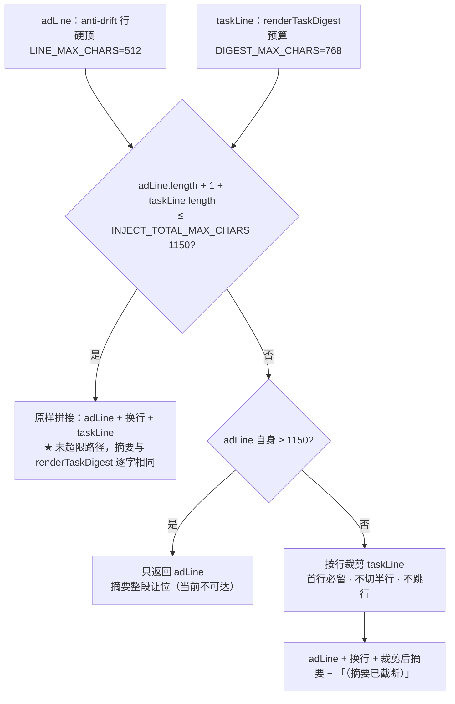

# 批 43 · 注入行任务摘要的字数预算标定（台账 t-3 / 设计档 U-4）

<!-- doc-shape
count-marks: 条|处|个|行
-->

> **一句话**：注入到每一回合的「任务摘要」有个 512 字符预算，**从来没用真实样本标过**。
> 本批拿四个样本量了一遍，发现它**已经贴到天花板**，并顺带挖出两个结构性问题（截断静默、注入行无合计上限）。

---

## §0 三句话（给人看）

1. **量出来的事实**：真实形态的账本摘要 95 字符；**只要带 2 条决策 + 8 条活任务（中文长标题）就到 484 字符**，离 512 只差 28 个字符 —— 也就是**再多一条决策就被截**。
2. **两个坑**：① Top-N 之外的任务**静默消失**（不告诉你「还有 25 项」）；② 注入行是「anti-drift 行 + 任务摘要」**直接拼接**，**没有合计上限**。
3. **怎么修**：预算 512 → **768**；Top-N 截断也报「…还有 N 项」；注入行加**合计上限**并明确「先砍摘要、不砍 anti-drift」。

---

## §一 背景

- 台账 `t-3`（无优先级，属**标定**工作）；设计档 `docs/2026-10-16-task-ledger-design.md` **U-4** 明写
  「**精确 N 与预算在实施阶段用真实样本标定**（不在本档预设数字）」—— 这一条一直没兑现。
- 现行常量：`DIGEST_MAX_CHARS = 512`（`lib/tasks.mjs:713`）· `DIGEST_TOP_N = 5`（`:715`）。
- 注入位点：`lib/index.mjs:1554` `[adLine, taskLine].filter(...).join("\n")`（**as-of 2026-10-19**；批 42 加了成本注释后行号后移）—— **两段各自有预算，合计没有**。

---

## §二 问题与实测（2026-10-18 亲跑 `renderTaskDigest`）

| 样本 | 内容 | 字符 | 字节（UTF-8） |
|---|---|---|---|
| **A** | 真实形态：3 活 + 2 完成 | 95 | 158 |
| **B** | 决策 2 + 卡住 1 + 活 8（长标题） | **501** | 1162 |
| **C** | 大账本：30 活（Top-5 生效） | 170 | 353 |
| **D** | 决策 2 + 活 8（**全中文长标题**） | **484** | 1113 |

**读数含义**：

1. **512 已贴顶**：B=501 / D=484 ⇒ 再加 1 条决策就会触发截断（尾串「…还有 N 项」）。
2. **字节 ≈ 字符 × 2.3**（中文 UTF-8）：若哪天有消费面按**字节**限，512 字符 ≈ **1162 字节**，早已超。
3. **C 暴露静默截断**：30 条活任务只列 5 条，**没有任何「还有 25 项」提示** —— 读者会以为什么都看到了。
   （`lib/tasks.mjs:764-768`：`listable = candidates.length`，而 `active.slice(0, topN)` 已经先把多的砍掉了 ⇒ 分母里根本没有它们。）
4. **注入行无合计上限**：`adLine`（批 34 的 512 预算）+ `taskLine`（512）⇒ 单回合最大 ~1024 字符，
   **没有任何一处管合计**。

---

## §三 目标 / 非目标

### 目标

1. 用实测数字**定死**预算与 Top-N，并写回设计档 U-4（可追溯）。
2. **截断必须可见**：Top-N 截断与预算截断用**同一种尾串**（`…还有 N 项`）。
3. 注入行加**合计上限**，并规定降级顺序（先砍摘要，不砍 anti-drift 行）。

### 非目标

- 不改摘要的**排序**与**分区策略**（决策全列 / 完成只给计数）。
- 不改看板与工具输出（它们不是注入面）。
- 不引入新的注入通道。

---

## §四 决策与理由

| # | 决策 | 理由 | 被否决的备选 |
|---|---|---|---|
| **D-1** | 预算 **512 → 768** | D=484 距 512 只有 28 字符；768 给「多 1–2 条决策 + 长中文标题」留出可观测余量，且仍在千字符内 | **保持 512** —— 现实中一条决策就截，等于默认截断；**提到 1024** —— 单回合注入过大，挤占正文 |
| **D-2** | `DIGEST_TOP_N` **保持 5** | ★ **措辞订正（副轨评审 #7）**：C 样本（30 活）**今天没有尾串**（正是本批要修的坑）；本批补上尾串后形态是「5 条 + …还有 25 项」，**已足够表达「有很多」**；再加 Top-N 只会多吃预算而不增信息 | 调到 8 —— 预算不够；调到 3 —— 看不见活任务全貌 |
| **D-3** | **Top-N 截断也报「…还有 N 项」** | 现在「看不见的任务」与「不存在的任务」长得一样（C 样本）⇒ 静默误导。与预算截断同形 = 一处语义 | 只在预算溢出时报 —— 就是现状的坑 |
| **D-4** | 合计上限 = **1150 字符**（**标定值**），**先砍摘要**（anti-drift 行整行保留） | ★ **副轨评审 #1 修（致命）**：原定「派生量 768+512+1 = **1281**」，而两段**各自**都有硬顶（adLine ≤512、摘要 ≤768）⇒ **合法和恒 ≤1281** ⇒ 裁剪分支**生产永远不可达 = 假保护**，T-4e① 只能用**非法**输入（896 > 768）才触发。**1150** 才是能咬的合法值（见下表） | **1281（派生量）** —— 恒不可达；**1024** —— 与 768 互相蚕食（评审 #2）；**不设上限** —— 现状；**均分** —— 会把 anti-drift 行切半 |

**为什么是 1150（三种 adLine 长度下的摘要可用额度）**

| adLine 实测/上限 | 合计 1150 − adLine − 1 − 尾串(9) | 摘要能否拿满 768 | 说明 |
|---|---|---|---|
| **245**（实测典型） | 895 | ✅ | 典型场景**不裁剪**，预算全额到手 |
| **326**（实测超长目标） | 814 | ✅ | 仍不裁剪 |
| **512**（硬顶，最坏） | 628 | ❌（被裁到 628） | **裁剪只在这种情况下发生** —— 这正是它该干的活 |
| 合法两段 **500 + 700 = 1201** | — | — | **> 1150 ⇒ 真触发裁剪**，两段都合法（500 ≤512、700 ≤768）✅ |

---

## §五 方案（FR-x）

- **FR-1** `DIGEST_MAX_CHARS` 512 → **768**；`DIGEST_TOP_N` 保持 5（常量注释写上本次实测）。
- **FR-2** 尾串统一：`listable` 改为「**可列出总数**」（= 决策 + 卡住 + **全部活任务**），已列出数照旧；
  ⇒ Top-N 截断与预算截断都走同一个 `pending > 0` 分支。
- **FR-3** 新增 **`export function assembleInjection(adLine, taskLine)`**（住 `lib/index.mjs`，**可导出纯函数**，评审 #3：否则 T-4e 无法 import ⇒ 腿不可实施）+ **`export const INJECT_TOTAL_MAX_CHARS = 1150`**（**标定值，非派生量** —— 见 D-4：派生量 1281 恒不可触发）；拼接前若 `adLine.length + 1 + taskLine.length > 上限` ⇒ **按行裁剪 taskLine**（首行必留 + 尽可能多的行 + 「（摘要已截断）」尾），`adLine` **整行保留**。
  ★ **实施方必须**在 `test/tasks.test.mjs` 顶部的 import 里加上 `assembleInjection`（与 `renderTaskDigest` 同处）。
- **FR-4** 把 §二 的四行实测数字写进 `docs/2026-10-16-task-ledger-design.md` **§十一 U-4**。★ **已落盘（2026-10-18，`664fbd0`）**——本批实施时只**核对**该行存在且数字一致（评审 #6：不重复写两遍；权威书写位 = U-4）。
- **FR-5** 腿（见 §八）。

---

## §六 机制伪代码

**数据流（评审 #8：涉及数据流必须配图）**



```text
renderTaskDigest(view, opts):
  前置：同今日（纯确定性、空集返回空串）
  后置：**新增**「Top-N 截断也报尾串」；其余不变
  candidates = 决策全列 + 卡住全列 + 活任务 Top-N
  listable   = 决策.length + 卡住.length + 活.length      // ★ 改成「全部活任务」，不是 candidates.length
  ... 逐行累加，pending = listable - 已列出数
      若 pending > 0 且再加一行会超预算 ⇒ 以 "…还有 " + pending + " 项" 收尾

assembleInjection(adLine, taskLine):
  前置：两段都是字符串（可能为空）
  后置：总长 ≤ INJECT_TOTAL_MAX_CHARS，**除非 `adLine` 本身已超上限**（此时**只返回 adLine**，后置条件对该分支不适用 —— 评审 #4）
  ★ **空段语义（副轨评审 #3）**：`taskLine === ""` ⇒ 返回 `adLine`（**不加**分隔符）；`adLine === ""` ⇒ **不加前导分隔符**、直接返回 `taskLine`；**两段皆空 ⇒ 空串**（不是 `"\n"`）。预算公式里分隔符按 `sep.length` 算（不是恒 1）
  若 adLine.length >= INJECT_TOTAL_MAX_CHARS:
      ⇒ 直接返回 adLine（摘要整段让位），**不**再拼半行 —— 宁可没有摘要，不留残句
  if adLine.length + 1 + taskLine.length <= INJECT_TOTAL_MAX_CHARS:
      return [adLine, taskLine].join("\n")
  TAIL = "\n…（摘要已截断）"
  预算内可用 = INJECT_TOTAL_MAX_CHARS - adLine.length - 1 - TAIL.length
  clipLines(taskLine, 可用)：**按行**累加，**首行（摘要头 rev/计数）必留**，
      之后每行只有在「已用 + 该行长度 + 1 ≤ 可用」时才追加；
      一旦某行放不下 ⇒ **停止**（不切半行、不跳行续接）
  若连首行都放不下 ⇒ **先判** `adLine.length + sep.length + TAIL.length > 上限`：
      成立 ⇒ **只返回 adLine**（★ 代码评审修：否则 `adLine ∈ [cap−8, cap−1]` 时会返回**超上限**的串，
      实测 1150 下 1142→1151、1149→1158，违反本函数后置条件）；
      不成立 ⇒ 返回 [adLine, "…（摘要已截断）"]（不带残行）
  return [adLine, clipLines(...) + TAIL].join("\n")

前置/后置补充：
  · 纯函数、无 IO、确定性（同入参 ⇒ 逐字节同输出，可被 T-4e 直接对拍）
  · 不做字节级裁剪（本批只按字符计量，见 §十二 第 1 条）
```

---

## §七 状态与 schema

**零变化**：不新增持久化字段、不改工具契约；只**改一个常量**（`DIGEST_MAX_CHARS` 512→768）+ **新增一个常量**（`INJECT_TOTAL_MAX_CHARS` = 1150）+ 尾串语义（Top-N 截断也报）。

---

## §八 防偏离（验收腿）

**不新增测试档**；并进既有 `test/tasks.test.mjs` 的既有块（**顶层 `test(` 保持 21**，全量保持 **660**）：

★ **必须先改一条既有腿**（本轮核对发现）：**T-5**（`test/tasks.test.mjs:569`，T-5 起于 `:537` —— **as-of 2026-10-19**）现在写死 `long.length <= 512`。
预算改 768 后它会**立刻变红**。正确处置不是放宽数字，而是**改引常量**：`<= DIGEST_MAX_CHARS`
（腿的原意是「有界」，不是「恰好 512」）。其 40 条决策项夹具（每条 ≈60 字符中文）**仍会溢出 768**，
所以 T-5 的尾串与「列出 + 还有 = 总数」两条断言**照旧成立**。

| 腿 | 判据 |
|---|---|
| **T-4c**（并入 **T-4b** 块，`test/tasks.test.mjs:495` 起） | **Top-N 截断可见**：30 条活任务 ⇒ 摘要含 `…还有 25 项`（旧行为：不含 ⇒ 红）。★ 评审 #7：本档**没有** T-4 块，腿必须落到**已有块**里 |
| **T-4f**（并入 T-5 块，副轨评审 #2） | **跨模块契约锁**：anti-drift 硬顶 `LINE_MAX_CHARS = 512`（`lib/anti-drift.mjs:820`，**未导出**）—— 用 **512 字符 adLine + 768 字符 taskLine**（合法最坏组合 1281 > 1150）断言**仍被裁剪**；这样任一侧常量变动而不同步 ⇒ 本腿红 |
| **T-4d**（并入 **T-5** 块，`test/tasks.test.mjs:537` 起） | **预算边界**：构造 768 字符边缘样本 ⇒ ≤768 时全列、>768 时出尾串（两条都要，防「永远出尾串」）。★ 这里的 **768 是标定锁**（**有意写字面量**，改常量必须同步改腿，评审 #10）；与 T-5 的 `<= DIGEST_MAX_CHARS`（**有界锁**）不是一回事 |
| **T-4e**（并入 **T-5** 块） | **注入合计上限**（`assembleInjection`，**已 export**）：<br>① `adLine` **500** + `taskLine` **700**（**两段都合法**，1201 > 1150）⇒ 真触发裁剪：结果 ≤ **1150**、**adLine 逐字完整**、摘要尾部「（摘要已截断）」★ **副轨评审 #1**：**不许再用 896**（896 > 摘要硬顶 768 是**非法输入**，腿只证明函数对非法输入可用）。原写 700 在 1024 时代不触发、改上限为 1150 后**恰好触发**且两段合法<br>② ★ **反向腿**（评审 #5）：575 + 400（**未超限**）⇒ 摘要部分与 `renderTaskDigest` 输出**逐字相同**（防裁剪器误伤正常路径）<br>③ ★ `adLine` 长度 ≥ 上限 ⇒ 输出**恰为 adLine**、无残句<br>④ ★ `taskLine` 首行就放不下 ⇒ 输出 = `adLine` + 单行「（摘要已截断）」 |

**变异自证**：① 去掉 `listable` 的全量口径 ⇒ T-4c 红；② 把 768 改回 512 ⇒ T-4d 红；③ 去掉合计裁剪 ⇒ T-4e①红；④ 裁剪器误伤未超限路径 ⇒ T-4e②红。

★ **评审 #7 的收口纪律**：本批**不新增顶层 `test(`**（仍 **21**）⇒ 实施时必须**同步更新** `test/tasks.test.mjs` 档头腿清单（`:3-4`）与收口行（`:2264`）的英文清单，计数与枚举同一次编辑。

---

## §九 边界

| 情形 | 行为 |
|---|---|
| 账本为空 | 摘要空串（既有） |
| 决策项极多（>20） | 决策**全列**是既有语义 ⇒ 由预算尾串兜底（截断可见） |
| `adLine` 落在 `[上限−8, 上限−1]`（尾串长度区间） | **只返回 `adLine`**，不拼尾串（否则总长 > 上限 —— 代码评审实测 1142→1151）；T-4e 里有对应边界腿 |
| `adLine` 自身已超上限 | **不裁**（纪律面优先），只返回 `adLine`。★ **当前不可达**：`lib/anti-drift.mjs:820` 的 `LINE_MAX_CHARS = 512` 硬顶住了；只有将来放宽它才可能出现（评审 #4） |
| `maxChars` 由调用方传入 | ★ **订正（副轨评审 #4）**：直接调 `renderTaskDigest` 时可传**整数 ≥80**；**<80 回落默认 768**（不是「沿用」）；**生产注入点不传 `maxChars`**（只 spread `resolveLedgerConfig`，见 `lib/index.mjs`）——这是**测试缝**，不是生产注入缝 |
| 字节 vs 字符 | 本批**只按字符**计量并在注释写明；若消费面按字节限，另开批 |

---

## §十 需用户拍板

无（全部由 §二 实测数据支撑；**四项决策**（D-1…D-4）均已给推荐与代价）。

---

## §十一 受影响文件与收口

| 文件 | 改动 |
|---|---|
| `lib/tasks.mjs` | FR-1 常量 + FR-2 尾串口径（`listable` 改全量） |
| `lib/index.mjs` | FR-3 注入合计上限 |
| `test/tasks.test.mjs` | **T-5 的 `<= 512` 改 `<= DIGEST_MAX_CHARS`**（引常量）+ T-4c/T-4d/T-4e/**T-4f** 四条断言（并入既有块，**不新增顶层 `test(`**） |
| `docs/2026-10-16-task-ledger-design.md` | §十一 U-4 写入实测数字（FR-4） |
| `CHANGELOG.md` / `package.json` / 交接档 / `.thincoder/tasks.json` | 收口（版本 + `t-3` 结项） |

**计数**：`tasks.test.mjs` **21 不变** · 全量 **660 不变**。

---

## §十二 已知未验证项

1. **消费面是按字符还是字节限**未验证：本批只按字符；若平台按字节卡，768 字符 ≈ 1800 字节。
2. **`adLine` 的长度**：★ 已有历史实测 **190–291 字符**（`lib/anti-drift.mjs:823` 的注释记录）＋ **本轮亲测 245 / 326**（典型 / 超长目标，`renderAntiDriftLine` 直调）；硬顶 `LINE_MAX_CHARS = 512`。实施时**再复核一次真实注入行的两段长度**即可（评审 #4）。
2b. **本批不另立需求档**：需求面由台账 `t-3` + 台账设计档 **U-4** 承载（评审 #11 的豁免落纸）。
3. Top-N 截断报尾串是**行为变更**（会有「还有 25 项」这一行），但只影响注入文本，不影响任何判据。
