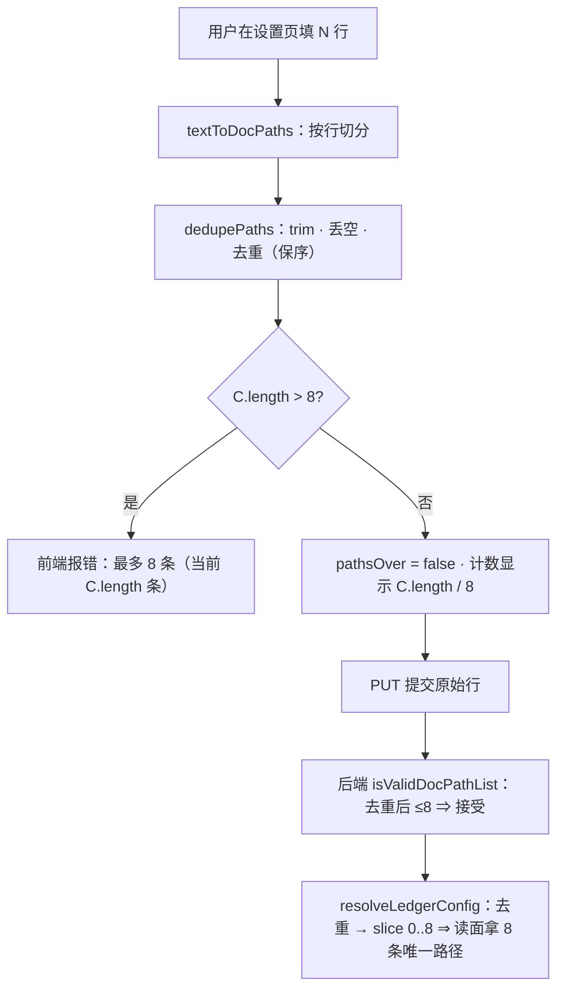

# 批 44 · docPaths 的「去重」补齐镜像（台账 t-8）

<!-- doc-shape
count-marks: 条|处|个|行
-->

> **一句话**：批 42 把「清单里有重复路径」的判定从「按**原始行数**」改成「按**去重后**」，
> 但**只改了后端 PUT 谓词**这一处。设置页的草稿校验、界面计数、以及读面的截断仍按原始行数 ——
> 于是出现最糟的组合：**前端说「已超上限，保存会被拒绝」，后端其实放行**。

---

## §0 三句话（给人看）

1. **现象**：在设置里填 9 行文档路径（其中 1 行重复），前端会显示「**已超上限——保存会被后端拒绝**」，而实际**能存**。
2. **根因**：批 42 只改了「后端谓词」这一处，前端镜像与读面归一仍是**原始行数**口径（4 处，见 §二）。
3. **修法**：四处统一成「**先 trim + 去重（只算非空字符串）→ 再判上限 / 再截断**」，前端与后端镜像同步（有 C-L4 腿逐字比对，不同步会立刻红）。

---

## §一 背景

- 来自批 42（`0.36.0`）的交付代码评审 **#3** 与 **#8**：④ 的「用户可见放宽」只在 PUT 谓词上成立。
- 父会话当时把 ④ 的声明**收窄**为「仅 PUT 谓词」并立台账 **`t-8`**（不塞进除尘批，避免扩范围）。
- 本批把它补齐，使「重复项不占配额」这条声明**在四处都成立**。

---

## §二 问题（现象 + 根因，带 file:line，as-of 2026-10-19）

| # | 位置 | 现状判据 | 后果 |
|---|---|---|---|
| ① | `lib/ledger-config-text.mjs:117-118` | `paths.length > MAX_DOC_PATHS` ⇒ push 错误 | 草稿校验**在谓词之前**按原始行数拒 ⇒ 9 行含重复**存不进** |
| ② | `lib/client.js:172-173` | `paths.length > LEDGER_MAX_DOC_PATHS` ⇒ push 错误（**① 的浏览器镜像**） | 同上；并有 **C-L4** 腿逐字比对两侧文案 |
| ③ | `lib/client.js:1814` / `:1841` / `:1852` | `pathsOver = pathsArr.length > 8`；文案「**已超上限——保存会被后端拒绝**」 | 按原始行数置位 ⇒ **文案与后端事实相反**（最糟的形态） |
| ④ | `lib/tasks.mjs:894` | `.filter(非空).map(trim).slice(0, MAX_DOC_PATHS)` | **不先去重就截断** ⇒ 可能把最后一条**唯一**路径截掉（配置里 9 项含 2 重复 ⇒ 只剩 7 条唯一，第 8 条唯一丢失） |

**根因一句话**：批 42 只把「上限怎么算」改在了**一处**（`isValidDocPathList`），其余三处仍是「按数组长度算」。

---

## §三 目标 / 非目标

### 目标

1. 四处**同一口径**：上限判定与截断都基于「**去重后的非空字符串条数**」。
2. 前端（②③）与后端（①④）**行为一致**：9 行含重复 ⇒ 前端**不报错**、后端**接受**、读面**保留全部唯一路径**。
3. C-L4（两侧文案逐字比对）**仍绿**。

### 非目标

- **不改** `MAX_DOC_PATHS = 8` 这个上限本身。
- **不改**文档读取逻辑（`readChecklistDocs` / `parseChecklistDoc`）。
- **不改**工具契约与持久化结构（schema 零变化）。
- **不做**「自动发现文档」（设计-D11 早已否决）。

---

## §四 决策与理由

| # | 决策 | 理由 | 被否决的备选 |
|---|---|---|---|
| **D-1** | 四处统一「**先 trim + 去重（只算非空字符串）→ 再判/再截**」 | 与已改好的 `isValidDocPathList` 同口径；这是 `t-8` 的定义 | 只改文案（③）—— 治不了 ①（前端仍拒）；**回滚批 42** —— 等于把已发的放宽声明撤回 |
| **D-2** | `resolveLedgerConfig`：去重**之后**再 `slice(0, 8)` | 9 项含 2 重复 ⇒ 保留 **8 条唯一**（现状只留 7 条唯一，**少一条文档**）。★ **这是读面的行为变化**，明写并配腿 | 保持「先截后去重」 —— 会继续丢唯一路径，与 ① 的矛盾不变 |
| **D-3** | `pathsOver` 与「已填 N / 8」按**去重后**计数 | 否则前端仍会显示「超上限」而实际可存 | 只在提交时才算 —— 用户在编辑过程中仍被误导 |
| **D-4** | 前端镜像**手工同改**（不抽公共模块） | `lib/client.js` 是**浏览器打包产物**（`var` 风格、无 ESM import），抽公共模块要动构建链 —— 超范围；仓里已有 **C-L4** 腿兜住「两侧必须逐字一致」 | 抽 `shared/docpaths.mjs` 给两侧 import —— 需改构建，属另一批 |

---

## §五 方案（FR-x）

- **FR-1**（①）`ledger-config-text.mjs`：条数检查改用「去重后的非空字符串数」；文案不变（「最多 8 条」），但**报的当前数**用去重后数。
- **FR-2**（②）`client.js` 的同位镜像：与 FR-1 **逐字同义**（含文案）。
- **FR-3**（③）`client.js:1814` 的 `pathsOver` 与 `:1851` 的「已填 N / 8」都改用去重后计数。
- **FR-4**（④）`resolveLedgerConfig`：`.filter(非空).map(trim)` 之后**去重**，再 `.slice(0, MAX_DOC_PATHS)`。
- **FR-5** 腿（见 §八），**不新增顶层 `test(`**。

---

## §六 机制伪代码

**数据流（涉及校验链，必须配图）**



```text
dedupePaths(paths):                       // 两侧各一份实现（镜像），先保序、再去重
  前置：paths 任意
  后置：纯函数、不抛；返回「trim 后的非空字符串」的**去重保序**数组
  out = []; seen = Set
  for p of (Array.isArray(paths) ? Array.from(paths) : []):
      if typeof p !== "string": continue        // 非字符串直接不算（与 isValidDocPathList 一致）
      t = p.trim()
      if t === "": continue
      if seen.has(t): continue
      seen.add(t); out.push(t)
  return out

校验（①/②）：
  n = dedupePaths(paths).length
  if n > MAX_DOC_PATHS: push("最多 8 条（当前 n 条）")
  else if !isValidDocPathList(paths): push("每一条都必须是非空路径")

展示（③）：
  pathsOver = dedupePaths(pathsArr).length > MAX_DOC_PATHS
  「已填 dedupePaths(pathsArr).length / 8」

归一（④）：
  docPaths = dedupePaths(raw.docPaths).slice(0, MAX_DOC_PATHS)
```

---

## §七 状态与 schema

**零变化**：不新增持久化字段、不改工具契约、不改 `ledger` 的字段白名单（`mode` / `docPaths` / `copyTemplate`）。
唯一变化是**四个判定点的口径**与**读面截断的语义**（D-2）。

---

## §八 防偏离（验收腿）

**不新增顶层 `test(`**（`test/tasks.test.mjs` 仍 **21**；全量仍 **660**）。改动并入既有块：

| 腿 | 判据 | 能红的理由（唯一承载行为的行） |
|---|---|---|
| **T-9d**（并入 T-9 块） | 草稿校验：9 行**含 1 重复** ⇒ `errors` **不含**「最多 8 条」；9 行**互异** ⇒ **含** | 只有 FR-1 的 `dedupePaths(...).length` 决定 ⇒ 改回 `paths.length` 即红 |
| **T-9e**（T-9 块） | 读面：`resolveLedgerConfig({ledger:{docPaths:[9 项含 2 重复]}}).docPaths` ⇒ **长度 8** 且**等于去重后的前 8 条唯一路径**（现状 7 条 ⇒ 红） | 只有 FR-4 的「去重后 slice」决定 |
| **T-9f**（T-9 块） | 前端镜像：同一夹具喂 `ledgerDraftErrors`（镜像函数）⇒ 与 ① **逐字相同**（C-L4 已存在则复用） | 两侧任一不同步 ⇒ C-L4 或本腿红 |
| **T-9g**（T-9 块） | `pathsOver` 对 9 行含重复 ⇒ **false**；对 9 行互异 ⇒ **true** | 只有 FR-3 的去重计数决定 |

**变异自证**：① ① 处改回 `paths.length` ⇒ T-9d 红；② ④ 处去掉去重 ⇒ T-9e 红（7 条）；③ ③ 处改回原始长度 ⇒ T-9g 红。

---

## §九 边界

| 情形 | 行为 |
|---|---|
| 全是空白行 | `dedupePaths` 丢空 ⇒ 计数 0 ⇒ 不报「最多 8 条」；但逐项合法性仍拒（「每一条都必须是非空路径」）——**保留两级**，不改 |
| 非字符串元素（`42` / `null`） | 不计入去重计数；合法性检查仍判非法（`isValidDocPathList` 已如此） |
| 稀疏数组 `Array(9)` | `Array.from` 稠密化后全是 `undefined` ⇒ 计数 0；合法性拒 |
| 8 项全重复（同一条） | 去重后 1 ⇒ 通过（现状也通过） |
| 20 项含重复、去重后 9 | **拒**（去重后仍超 8）—— 与 D-1 同口径 |
| 旧配置（已存的 9 项含重复） | 读面去重后 slice ⇒ 保留 8 条唯一（**比现状多一条**，D-2 的行为变化） |
| 前后端不同步 | **C-L4 腿**兜住（两侧文案与判定逐字比对） |

---

## §十 需用户拍板

无（唯一取舍 D-2 已获用户确认：「可以，推进吧」，2026-10-19）。

---

## §十一 受影响文件与收口

| 文件 | 改动 |
|---|---|
| `lib/ledger-config-text.mjs` | FR-1 条数检查改用去重后计数 |
| `lib/client.js` | FR-2 镜像同步（:172）+ FR-3 `pathsOver`/计数（:1814/:1851） |
| `lib/tasks.mjs` | FR-4 `resolveLedgerConfig` 去重后再 slice |
| `test/tasks.test.mjs` | T-9d/T-9e/T-9f/T-9g 四条断言（并入 T-9 块，**不新增顶层 `test(`**） |
| `CHANGELOG.md` / `package.json` / 交接档 / `.thincoder/tasks.json` | 收口（版本 + `t-8` 结项） |

**计数**：`test/tasks.test.mjs` 顶层 `test(` **21 不变**；全量 **660 不变**。

---

## §十二 已知未验证项

1. **C-L4 的现有夹具是否覆盖「9 行含重复」**：本批实施时先读 `test/tasks.test.mjs` 的 C-L4 段确认；若未覆盖，T-9f 需自带该夹具。
2. **前端打包产物是否需要重新构建**：`lib/client.js` 改动后，本仓开发态直接读该档；**已安装的 profile 副本**需重装/重启才生效 —— 属发布面，收口时在 CHANGELOG 写明。
3. **旧配置的实际分布**未知（本机 `~/.dsh/.thincoder/config.json` 当前无 `ledger.docPaths`）—— D-2 的影响面按「理论最大 1 条」陈述，未做用户调研。
