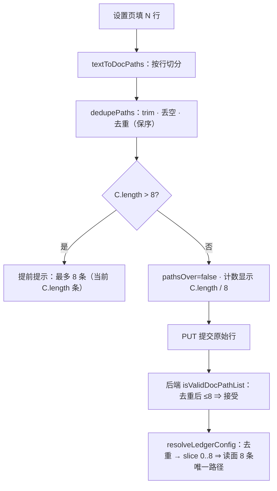

# 批 44 · docPaths 的「去重」补齐镜像（台账 t-8）

<!-- doc-shape
count-marks: 条|处|个|行
-->

> **一句话**：批 42 把「清单里有重复路径」的判定从「按**原始行数**」改成「按**去重后**」，
> 但**只改了后端 PUT 谓词**这一处。**浏览器侧的提前提示**与**读面截断**仍按原始行数 ——
> 于是用户在设置里填 9 行（其中 1 行重复）时，界面说「已超上限——保存会被后端拒绝」，**而后端其实放行**。

---

## §0 三句话（给人看）

1. **现象**：设置页填 9 行文档路径（其中 1 行重复），界面显示「已超上限——保存会被后端拒绝」，但真点保存**能存**。
2. **根因**：批 42 只把「上限怎么算」改在**后端谓词**一处；**浏览器镜像**（两处）与**读面截断**（一处）仍是原始行数口径。
3. **修法**：上述四处 + 规则源一处统一成「**先 trim + 去重（只算非空字符串）→ 再判 / 再截**」；浏览器镜像手工同改（行为等值锁 C-L4 会咬住两侧逐字一致）。

---

## §一 背景

- 来自批 42（`0.36.0`）的交付代码评审 **#3** 与 **#8**：④ 的「用户可见放宽」只在 PUT 谓词上成立。
- 父会话当时把 ④ 的声明**收窄**为「仅 PUT 谓词」并立台账 **`t-8`**（不塞进除尘批，避免扩范围）。
- 本批把声明补齐到**四处 + 规则源**，使「重复项不占配额」在整条链上成立。
- ★ **需求三层豁免（评审 #12）**：本批是 `t-8` 的定向修复 ⇒ **不另立需求档**；目标 = §三，非功能标准沿用既有（行为等值锁 C-L4 · 零新依赖 · 不新增顶层 `test(`）。

---

## §二 问题（现象 + 根因，带 file:line，as-of 2026-10-19）

**调用链现状（评审 #2 要求写清）**

```text
设置页编辑 ──► client.js 的 ledgerDraftErrors 镜像（:157）  ──► 提前提示（**只提示，不阻止**）
           └─► client.js 的 pathsOver（:1814）+「已填 N / 8」（:1851-1852） ──► 界面误导
保存 ──────► 后端 PUT：isValidDocPathList（lib/tasks.mjs，**已去重**）──► **接受**
读面 ──────► resolveLedgerConfig（lib/tasks.mjs:894）──► **按原始顺序 slice** ⇒ 丢唯一路径
规则源 ────► lib/ledger-config-text.mjs（**只被测试 import**，是镜像的规则源 + C-L4 的比对基准）
```

| # | 位置 | 现状判据 | 后果 |
|---|---|---|---|
| ① | `lib/ledger-config-text.mjs:117-118` | `paths.length > MAX_DOC_PATHS` ⇒ push 错误 | **规则源**按原始行数判 ⇒ 镜像照抄即错；C-L4 会把「错」冻成契约 |
| ② | `lib/client.js:172-173`（① 的浏览器镜像） | `paths.length > LEDGER_MAX_DOC_PATHS` ⇒ push 错误 | 浏览器**提前提示**按原始行数 ⇒ 9 行含 1 重复**被劝退**（虽然能存） |
| ③ | `lib/client.js:1814` 与 `:1851-1852`（**两处**） | `pathsOver = pathsArr.length > 8`；文案「已超上限——保存会被后端拒绝」 | 界面**明说会被拒**，与后端事实相反 |
| ④ | `lib/tasks.mjs:894` | `.filter(非空).map(trim).slice(0, MAX_DOC_PATHS)` | **不先去重就截断** ⇒ 9 项含 1 重复时只留 **7 条唯一**（第 9 项那条唯一被截掉） |

★ **勘误（评审 #3）**：上一版把 `lib/client.js:1841` 也算进 ③。实测那是 **`tplOver`（话术模板超限）**，属 `copyTemplate`，**与本批无关**，已从清单移除。
★ **勘误（评审 #1）**：上一版多处写「9 项含 **2** 重复 ⇒ 8 条唯一」——**算术错误**（9−2=7）。统一改为「**9 项含 1 重复 ⇒ 8 条唯一**」。

**根因一句话**：批 42 只把「上限怎么算」改在了**一处**（`isValidDocPathList`），其余三处（规则源 + 浏览器镜像两处 + 读面）仍是「按数组长度算」。

---

## §三 目标 / 非目标

### 目标

1. 四处 + 规则源**同一口径**：上限判定与截断都基于「**去重后的非空字符串条数**」。
2. 浏览器与后端**结论一致**：9 行含 1 重复 ⇒ 界面**不劝退**、后端**接受**、读面**保留 8 条唯一路径**。
3. 行为等值锁 **C-L4**（`test/config-api.test.mjs:547`）**仍绿**。

### 非目标

- **不改** `MAX_DOC_PATHS = 8` 这个上限本身。
- **不改**文档读取逻辑（`readChecklistDocs` / `parseChecklistDoc`）。
- **不改**工具契约与持久化结构（schema 零变化）。
- **不改** `client.js:1841` 的 `tplOver`（话术模板，属另一主题）。
- **不做**路径归一化（`./a.md` vs `a.md`、盘符大小写）—— 会改变既有 `docPaths` 语义，属另一批（评审 #11 的 YAGNI 边界）。

---

## §四 决策与理由

| # | 决策 | 理由 | 被否决的备选 |
|---|---|---|---|
| **D-1** | 五处统一「**先 trim + 去重（只算非空字符串）→ 再判/再截**」 | 与已改好的 `isValidDocPathList` 同口径；这就是 `t-8` 的定义 | 只改文案（③）—— 治不了 ①②；**回滚批 42** —— 等于撤回已发布的放宽声明 |
| **D-2** | `resolveLedgerConfig`：去重**之后**再 `slice(0, 8)` | ★ **算术已订正（评审 #1）**：夹具 = **9 项含 1 重复 ⇒ 8 条唯一**；现状「先截后去重」只留 **7 条唯一**（第 9 项那条唯一被截掉），改后留 **8 条**。⇒ **读面会多显示一条文档**。**方向未变**（都是「多保留唯一路径」），但原陈述的数字是错的，故在此重新写明 | 保持「先截后去重」 —— 继续丢唯一路径，与 ① 的矛盾不变 |
| **D-3** | `pathsOver` 与「已填 N / 8」按**去重后**计数 | 否则前端仍显示「超上限」而实际可存 | 只在提交时才算 —— 编辑过程中仍被误导 |
| **D-4** | 浏览器镜像**手工同改**（不抽公共模块） | `lib/client.js` 是手写 CJS bundle，`require` 只认宿主静态模块表（`CHANGELOG` 批 36 已记此事）⇒ 抽公共模块要动构建链，超范围；**行为等值锁 C-L4** 已兜住「两侧必须逐字一致」 | 抽 `shared/docpaths.mjs` 给两侧 import —— 需改构建，属另一批 |

---

## §五 方案（FR-x）

- **FR-1**（① 规则源）`ledger-config-text.mjs:117-118`：条数检查改用「去重后的非空字符串数」。
  **文案字面量（改后）**：`"ledger.docPaths 最多 " + MAX_DOC_PATHS + " 条（当前 " + n + " 条）"`（**与改前逐字相同，只是 n 的口径变了**）。
- **FR-2**（② 浏览器镜像）`client.js:172-173`：与 FR-1 **逐字同义**。
  **文案字面量（改后）**：`"ledger.docPaths 最多 " + LEDGER_MAX_DOC_PATHS + " 条（当前 " + n + " 条）"`。
- **FR-3**（③ 浏览器展示，**两处**）：
  · `:1814` `var pathsOver = dedupePaths(pathsArr).length > LEDGER_MAX_DOC_PATHS;`
  · `:1851` `"已填 " + dedupePaths(pathsArr).length + " / " + LEDGER_MAX_DOC_PATHS`（`:1852` 的 `pathsOver` 文案随之前移）
- **FR-4**（④ 读面）`resolveLedgerConfig`：`.filter(...).map(...)` 之后**去重**，再 `.slice(0, MAX_DOC_PATHS)`。
- **FR-5** 腿（见 §八），**不新增顶层 `test(`**。

---

## §六 机制伪代码

**数据流（涉及校验链，必须配图）**



```text
dedupePaths(paths):                       // 两侧各一份实现（镜像），保序去重
  前置：paths 任意
  后置：纯函数、不抛；返回「trim 后的非空字符串」的**去重保序**数组
  out = []; seen = Set
  for p of (Array.isArray(paths) ? Array.from(paths) : []):
      if typeof p !== "string": continue        // 非字符串不算（与 isValidDocPathList 一致）
      t = p.trim(); if (t === "") continue
      if (seen.has(t)) continue
      seen.add(t); out.push(t)
  return out

校验（①/②）：**`else if` 链（★ 实施轮订正：评审 #5 的「两条独立 if」被既有契约 C-L3 ③ 证伪）**
  if !Array.isArray(paths):
      push("ledger.docPaths 必须是路径清单（一行一个）")        // 与现状逐字相同
  else if dedupePaths(paths).length > MAX_DOC_PATHS:
      push("…最多 8 条（当前 " + n + " 条）")                   // ★ 计数级：**超上限只报这一条**
  else if !isValidDocPathList(paths):
      push("…每一条都必须是非空路径")                            // 逐项级：只在**未超限**时才可能到这里

  ★ **为什么必须短路（实测证据）**：超上限时 `isValidDocPathList(paths)` 也会判 false
    （它同样按去重后计数）⇒ 若用两条独立 `if`，会**同时报两条**，打红既有腿
    **C-L3 ③「超上限只报一条」**（`test/config-api.test.mjs`，实测 `2 !== 1`）。
    「两级报错」只对**空行/畸形项**成立（那时计数级不触发），与 §九 的表述一致。

展示（③）：
  pathsOver = dedupePaths(pathsArr).length > MAX_DOC_PATHS
  "已填 " + dedupePaths(pathsArr).length + " / 8" + (pathsOver ? "（已超上限——保存会被后端拒绝）" : "")

归一（④）：
  docPaths = dedupePaths(raw.docPaths).slice(0, MAX_DOC_PATHS)
```

---

## §七 状态与 schema

**零变化**：不新增持久化字段、不改工具契约、不改 `ledger` 的字段白名单（`mode` / `docPaths` / `copyTemplate`）。
唯一变化是**五个判定点**的口径（规则源 1 + 浏览器 3 + 读面 1）与**读面截断的语义**（D-2）。

---

## §八 防偏离（验收腿）

**不新增顶层 `test(`**（`test/tasks.test.mjs` 顶层用例数 **21**、全量 **660** —— **as-of 2026-10-19**；交付前复核）。改动并入既有 T-9 块与 `test/config-api.test.mjs` 的既有块：

| 腿 | 判据 | 能红的理由 |
|---|---|---|
| **T-9d** | 草稿校验（规则源）：9 行**含 1 重复** ⇒ `errors` **不含**「最多 8 条」；9 行**互异** ⇒ **含** | 只有 FR-1 的 `dedupePaths(...).length` 决定 |
| **T-9e** | 读面：`resolveLedgerConfig({ledger:{docPaths:<9 项含 1 重复>}}).docPaths` ⇒ **长度 8**，且等于去重后的前 8 条唯一路径（现状 **7** ⇒ 红） | 只有 FR-4 的「去重后 slice」决定 |
| **T-9f**（**静态文本锁**，评审 #7） | 读 `lib/client.js` 源码，断言 `:172` 处的判定表达式**含去重调用**（片段正则），且与规则源**同一口径**；**不 eval 该 bundle**（含 DOM/React，node 下无法加载） | 镜像改回 `paths.length` ⇒ 片段不匹配 ⇒ 红 |
| **T-9g**（**静态文本锁**） | 读 `lib/client.js` 源码，断言 `:1814` 的 `pathsOver` 与 `:1851` 的计数**都用去重后长度** | 改回原始长度 ⇒ 红 |
| **T-9h**（评审 #4；★ **夹具已订正**，第 2 轮 #13） | **数字**也钉住，且夹具必须**真触发计数错误**（判据是严格 `>`）：<br>· **10 行含 1 重复** ⇒ 去重后 **9 > 8** ⇒ 错误文案含 `（当前 9 条）`（**旧实现按原始行数是 `（当前 10 条）`** ⇒ 能分辨）<br>· **9 行互异** ⇒ `（当前 9 条）`，界面 `已填 9 / 8（已超上限…）`<br>· **9 行含 1 重复** ⇒ **不报计数错误**（去重后 8，不 >8），界面 `已填 8 / 8`（**这条属于 T-9d，不放在这里断言报错文案**） | 文案里的 `n` 用回原始长度 ⇒ 红（`10` ≠ `9`）；`已填` 用回原始长度 ⇒ 红（`10` ≠ `9`） |
| **C-L4**（既有） | 浏览器镜像 ≡ 规则源，逐夹具比输出（`test/config-api.test.mjs:547`） | 两侧不同步 ⇒ 既有腿红 |

**变异自证**：① ① 处改回 `paths.length` ⇒ T-9d 红；② ④ 处去掉去重 ⇒ T-9e 红（7 条）；③ ③ 处改回原始长度 ⇒ T-9g 红；④ 文案里的 `n` 改回原始长度 ⇒ T-9h 红。

---

## §九 边界

| 情形 | 行为 |
|---|---|
| 全是空白行 | `dedupePaths` 丢空 ⇒ 计数 0 ⇒ **不报**「最多 8 条」；`else if` 链落到逐项级 ⇒ **报「每一条都必须是非空路径」**（这是「两级报错」的真实含义：**只在计数级不触发时才看逐项级**） |
| 9 条互异（超上限） | **只报计数级一条**（C-L3 ③ 的契约）；逐项级被 `else if` **短路**，不报第二条 |
| 非字符串元素（`42` / `null`） | 不计入去重计数；合法性检查仍判非法 |
| 稀疏数组 `Array(9)` | `Array.from` 稠密化后全是 `undefined` ⇒ 计数 0；合法性拒 |
| 8 项全重复（同一条） | 去重后 1 ⇒ 通过（现状也通过） |
| 20 项含重复、去重后 9 | **拒**（去重后仍超 8） |
| 旧配置：9 项含 1 重复 | 读面去重后 slice ⇒ **8 条唯一**（现状 **7** 条，D-2 的行为变化） |
| 前后端不同步 | **C-L4 腿**兜住（逐夹具比输出） |
| **并发 / 重启 / 升级**（评审 #10） | 本批只改**纯函数判定口径**，不新增持久化、不引入状态 ⇒ **无并发与重启面**；升级面 = 旧配置在下次读取时按新口径归一（无迁移脚本、无写回） |
| **失败方向** | 非法输入 **fail-closed**（拒存，报错）；读面 **fail-soft**（截断/回落默认，不抛）—— 与现状同 |

---

## §十 需用户拍板

无。唯一取舍 **D-2** 已获用户确认（2026-10-19「可以，推进吧」）；★ 但**当时的算术陈述有误**（写成「9 项含 2 重复 ⇒ 8 条」），本轮已订正为「**9 项含 1 重复 ⇒ 8 条**」—— **变更方向未变**（仍是「多保留一条唯一路径」），故无需重新拍板。

---

## §十一 受影响文件与收口

| 文件 | 改动 |
|---|---|
| `lib/ledger-config-text.mjs` | FR-1 规则源条数检查改用去重后计数（两级报错保持） |
| `lib/client.js` | FR-2 镜像（`:172`）+ FR-3 `pathsOver`（`:1814`）与「已填 N / 8」（`:1851`） |
| `lib/tasks.mjs` | FR-4 `resolveLedgerConfig` 去重后再 slice |
| `test/tasks.test.mjs` | T-9d/T-9e/T-9h（并入 T-9 块）· T-9f/T-9g 静态文本锁 |
| `docs/README.md` | ★ **文档地图登记本档**（评审 #8；建了不登 = 地图失真） |
| `CHANGELOG.md` / `package.json` / 交接档 / `.thincoder/tasks.json` | 收口（版本 + `t-8` 结项） |

**计数（as-of 2026-10-19）**：`test/tasks.test.mjs` 顶层 `test(` **21 不变**；全量 **660 不变**。

---

## §十二 已知未验证项

1. **C-L4 的现有夹具是否覆盖「9 行含 1 重复」**：实施时先读 `test/config-api.test.mjs:547` 段落确认；若未覆盖，T-9f 自带该夹具。
2. **前端打包产物是否需重建**：`lib/client.js` 改动后开发态直接读该档；**已安装 profile 副本**需重装/重启才生效（发布面，收口时在 CHANGELOG 写明）。
3. **旧配置的实际分布**未知（本机 `~/.dsh/.thincoder/config.json` 当前无 `ledger.docPaths`）—— D-2 影响面按「理论最多 1 条唯一路径」陈述，未做用户调研。
