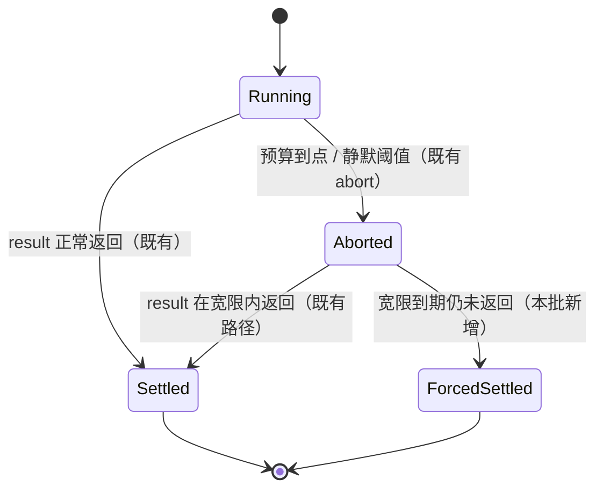
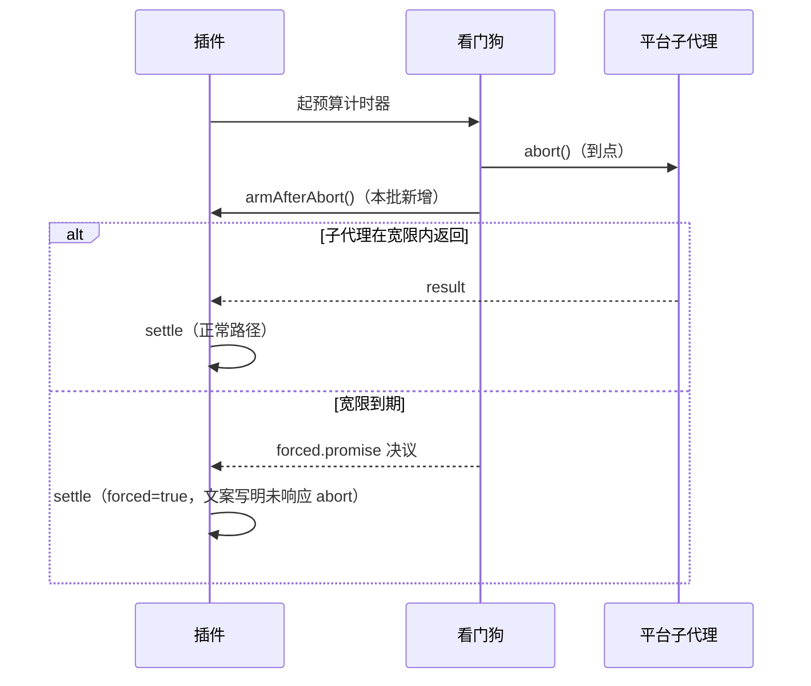

# 设计：到点必落账（看门狗硬结算）

- 日期：2026-10-22
- 需求档：[`2026-10-22-forced-settle-requirements.md`](./2026-10-22-forced-settle-requirements.md)
- 章节：按 [`METHODOLOGY.md`](../METHODOLOGY.md) 的设计档必备章节：§一 背景 · §二 问题 · §三 目标 · §四 决策与理由 · §五 方案 · §六 机制伪代码 · §七 状态与 schema · §八 防偏离 · §九 边界，另加 §十 影响面 · §十一 遗留
- 图示：图 1（结算状态机）· 图 2（拦截时序）
- 状态：**已实施**（设计评审轮 1 FAIL → 轮 2 PASS · token 已用 · 交付代码评审 `VERDICT: PASS`：0 🔴 / 1 🟡 / 2 🔵，两条 🔵 由主代理小修 · 全量 `node --test` 678/678）

<!-- doc-shape
count-marks: 条|处
-->

## §0 三句话（给人看）

1. **这事是什么**：我们的「看门狗」到点只喊一声 abort，然后继续干等；平台不回应，我们就永远不结算——实测有一轮会诊跑到 88.8 分钟，最后靠人手动停。
2. **影响谁**：会诊、eng_coder、escalate 三条 dsh 子代理路径，后台与同步形态都在内。
3. **怎么修**：新增一个叶子模块做「abort 之后的宽限截止」，用 `Promise.race` 让截止这条腿赢下等待；不杀进程、不伪造结果、正常路径零变化。

---

## §一 背景

- **用户实测（2026-10-22）**：会诊、advisor、eng_coder 出现过运行超过一小时的情况，而配置里的预算是 30 分钟（`consultTimeoutMs=1800000` / `dshBackgroundTimeoutMs=1800000`）。
- **同日的宿主崩溃**：三次宿主进程退出（00:10:38、00:41:00、12:29:09），最后一次的最后一条日志正是 eng_coder 的静默看门狗。崩溃本身是原生形态（无 JS 栈、退出码 0xE0000008 / 0xFFFF7003），本批**不**把因果归给它；但「看门狗响了之后任务仍不落账」与崩溃在同一分钟出现，说明**这条路径的可观测性必须补**。
- **为什么现在做**：看门狗是「防挂死」这一层唯一的机制；它只发信号不落账，等于把最终结算权交给了被它怀疑已经卡死的对方。

## §二 问题与根因

### 2.1 现象

| 事实 | 来源 |
|---|---|
| 会诊跑 88.8 分钟，最后靠 `consult_stop` 才结束 | `consult-ledger.jsonl` 中 `#108`：`started` 05:58:01 → `stopped` 07:26:47 |
| 有多轮会诊只有 `started`、没有任何结算事件 | 同上，实测计数见需求档「前置事实」 |
| 6 轮准点 30.0 分钟结算 | 同上（说明看门狗与 abort 在多数情况下是有效的） |
| 30 分钟预算配上「永不返回」的子代理，任务就会一直挂着 | 代码结构，见 2.2 |

### 2.2 根因（带 `path:line`）

**一句话**：超时只改变了「信号」，没有改变「等待」。

- `lib/consult.mjs:1166` 的看门狗：`setTimeout(() => { forward(timeoutError(...)) }, timeoutMs)` —— 只 abort。
- `lib/consult.mjs:1343`：`const result = await run.result` —— 整条 async 函数停在这一次等待上；后面的 `settleChild(...)` 永远不会被调用。
- `lib/consult.mjs:930` 的 `settleChild` 是唯一的结算入口，`lib/consult.mjs:947` 的 `session.pending--` 是整轮结算的闸门（`lib/consult.mjs:490` 的 JSDoc 写明 `pending === 0 || stopped` 才结算）。
- eng_coder 与 escalate 是同一形状：`lib/eng.mjs:1838`、`lib/eng.mjs:2000`、`lib/escalate.mjs:539`、`lib/escalate.mjs:653` 都是裸 `await` 子代理结果。

**推论**：只要平台在某一次 `abort` 之后既不 resolve 也不 reject，等待就无界；这与会诊里「一个慢模型拖住整轮」的组合尤其致命——其余模型的回复已到，却因为 `pending` 不归零而无法交付。

## §三 目标与非目标

**目标**：把「预算到点」变成「结算到点」。会诊、eng_coder、escalate 三条路径合计五个等待点（`lib/consult.mjs:1343` · `lib/eng.mjs:1838` · `lib/eng.mjs:2000` · `lib/escalate.mjs:539` · `lib/escalate.mjs:653`）统一用同一种截止语义。

**非目标**：见需求档「§四 本批不做」。

## §四 决策与理由

- **D1 宽限固定 60 秒，配测试注入缝，不做用户可配。**
  - 选定：`FORCED_SETTLE_GRACE_MS = 60_000`，测试可经 `deps.forcedSettleOpts` 注入小值。
  - 否决「新增 `forceSettleGraceMs` 配置键」：新键要同时改 PUT 校验面、`mergeGlobalConfig` 白名单、运行时解析、设置页与测试，成本远大于收益；且没有人会去调它。
- **D2 只结算，不杀进程，文案如实。**
  - 选定：强制结算时写明「子代理未响应 abort，可能仍在后台运行」。
  - 否决「尝试 kill」：平台没有暴露终止子代理的接口；也否决「静默按成功处理」：那会伪造结果。
- **D3 截止计时器住独立叶子模块。**
  - 选定：新增 `lib/settle-deadline.mjs`，`lib/eng.mjs` 只 import。
  - 否决「直接在 `lib/eng.mjs` 里加 `setTimeout`」：该文件的 `setTimeout` 字面被 **T-AP7** 冻结（字面数的权威值以那两条结构锁为准，本档不复述个数），新增字面会直接打红结构锁测试。这与 `lib/silence-watchdog.mjs` 当初被拆出去是同一个理由。
- **D4 先到者赢 + 幂等闩。**
  - 选定：真结果与强制结算竞争，谁先到谁结算；另一个只记录，不再改状态。
  - 否决「强制结算后再补一次真结果」：`session.pending--` 会被扣两次，整轮会提前结算并且账目错乱。
- **D5 不新增中止写点。**
  - 选定：沿用既有 `ctrl.abort` / `cancelJob` 写点，只在它们的回调里「武装」截止。
  - 否决「在叶子模块里自己 abort」：那会让中止写点计数锁多出一个写点（锁的现值不在本档复述），结构测试直接红。
- **D6 强制路径上的 `dispose` 不 await。**
  - 选定：`void run?.dispose?.().catch(() => {})`。
  - 否决「照旧 `await run.dispose()`」：`lib/consult.mjs:1382` 的 `finally` 会 await dispose，dispose 本身也可能挂住，强制结算又会退化成无界等待。

## §五 方案

- **FR-1 新增 `lib/settle-deadline.mjs`**：导出 `FORCED_SETTLE_GRACE_MS` 与 `createForcedSettle(opts)`，返回 `{ armAfterAbort, disarm, promise, fired }`。未武装时 `promise` 永不 settle（与任何 promise race 都不影响结果）；武装后宽限到期 `resolve(FORCED)`。
- **FR-2 会诊接入**（`lib/consult.mjs`）：看门狗回调里先 `armAfterAbort()` 再 `forward(...)`；把 `await run.result` 改成 `await Promise.race([run.result, forced.promise])`；`forced.fired` 为真时按超时结算并立即返回（不 await dispose）。
- **FR-3 eng_coder 接入**（`lib/eng.mjs`）：后台路径在兜底 `setTimeout` 与静默看门狗回调里武装；等待点改成 race；强制分支返回既有失败信封（`silentMs` / `timedOut` 的文案不动，只追加一句来源说明）。同步路径同理。
- **FR-4 escalate 接入**（`lib/escalate.mjs`）：后台与同步两个等待点同 FR-3 的模板。
- **FR-5 账本与文案**：会诊 `settled` 事件增加加性字段 `forced: true`（仅强制路径写入）；强制结算文案用统一常量，写明「未响应 abort，可能仍在后台运行」。**同步路径的强制分支不得沿用既有的「超限任务被终止」句式**——D2/US-4 明确我们无法终止子代理，那句是旧行为留下的假声明，与紧随其后的诚实说明自相矛盾（审计 F1）。
- **FR-6 测试与登记**：新增模块级测试档；在会诊与 eng 路径各补一条「假子代理永不 settle」的集成腿；`docs/README.md` 登记本需求档与设计档；`CHANGELOG.md` 记一条。

## §六 机制伪代码

### 6.1 叶子模块

```js
// lib/settle-deadline.mjs
export const FORCED_SETTLE_GRACE_MS = 60_000
const FORCED = Symbol("forced-settle")

export function createForcedSettle({ graceMs = FORCED_SETTLE_GRACE_MS, setTimeout: st = setTimeout, clearTimeout: ct = clearTimeout } = {}) {
  let timer = null, fired = false, disarmed = false, resolveOnce
  const promise = new Promise((resolve) => { resolveOnce = resolve })
  return {
    armAfterAbort() {
      if (disarmed || fired || timer !== null) return          // 幂等：重复武装无副作用
      timer = st(() => { timer = null; fired = true; resolveOnce(FORCED) }, graceMs)
      timer?.unref?.()
    },
    disarm() {
      if (disarmed) return
      disarmed = true
      if (timer !== null) { ct(timer); timer = null }
    },
    promise,
    get fired() { return fired }
  }
}
```

- **导出面**：除 `createForcedSettle` 外，模块还导出 `raceForced(settleable, forced)`（判据取 race 胜者、非 thenable 走强制分支的 fail-safe）与 `FORCED_SETTLE_NOTE`（统一来源说明）；两处均属 FR-1/FR-5 的授权面，登记为加性导出。
- **前置**：`graceMs` 为正有限数（非法值由调用方回落常量）。
- **后置**：至多存在一个计时器；`disarm()` 幂等；`fired === true` 后 `promise` 已决议且不再变化；`fired === false` 时 `promise` 永不决议（可安全参与 race）。

### 6.2 会诊接入（示意）

```js
const forced = createForcedSettle(deps.forcedSettleOpts)
const watchdog = setTimeout(() => {
  forced.armAfterAbort()                       // 先武装，再发中止
  forward(timeoutError("consult watch dog deadline reached", "agent", "consultTimeoutMs"))
}, timeoutMs)

try {
  const raced = await raceForced(run.result, forced)   // 判据 = race 胜者（D4）
  if (raced.forced) {
    settleChild(session, null, modelLabel, false,
      timeoutNote() + FORCED_SETTLE_NOTE)      // 文案写明「未响应 abort」
    return
  }
  const result = raced.value                   // 正常返回与既有失败路径沿用原逻辑
  // …
} finally {
  clearTimeout(watchdog)
  forced.disarm()                              // 成功 / 既有失败 / 强制三条路径都清计时器
  if (raced.forced) {
    void run?.dispose?.().catch(() => {})      // 强制路径：不 await，避免 dispose 挂死拖回无界等待
  } else {
    try { await run?.dispose?.() } catch { /* already disposed */ }
  }
}
```

- **前置**：`run` 已派发成功；`session.pending` 已 +1。
- **后置**：无论 `run.result` 是否返回，本函数在 `timeoutMs + graceMs` 内到达一次 `settleChild`；`session.pending` 恰好递减一次；成功 / 既有失败 / 强制三条路径都执行 `disarm()`，不留残留计时器；强制路径不 `await` dispose。

### 6.3 eng / escalate 接入（示意）

同一模板：在既有中止回调（兜底 `setTimeout` / 静默看门狗）里 `armAfterAbort()`，把 `await sub.result` 换成 race，强制分支返回既有失败信封并追加来源说明；`disarm()` 同样进 `finally`，`dispose` 在强制分支只 fire-and-forget。

## §七 状态与 schema

### 7.1 状态机（图 1）



### 7.2 时序（图 2）



### 7.3 字段与读者

| 字段 / 产物 | 位置 | 类型 | 写者 | 读者 |
|---|---|---|---|---|
| `forced` | 会诊账本 `settled` 事件 | boolean（缺省即 false） | `lib/consult.mjs` | 排障者、后续统计 |
| job `detail` | job outcome | string | `lib/eng.mjs` / `lib/escalate.mjs` | 宿主 job 面板、`job_output` |
| 强制结算文案 | 返回文本 | string | 同上 | 模型、用户 |

**兼容**：`forced` 是加性字段，旧账本行没有它时按 `false` 读，不需要迁移。

## §八 防偏离

**验收标准（每条都能被「删掉对应代码」变红）：**

- **AC-1**：假子代理的 `result` 永不决议 ⇒ 会诊在 `timeoutMs + graceMs` 内出现 `settled` 事件。
- **AC-2**：正常返回的路径 ⇒ `armAfterAbort` 从未被调用，输出文本逐字不变。
- **AC-3**：`session.pending` 在强制路径上**恰好递减一次**（多模型场景由最后一个 child 归零；不允许重复递减）。
- **AC-4**：强制结算之后，`run.result` 迟到 reject 不产生未处理拒绝、不再改账。
- **AC-5**：`run.dispose()` 永不返回时，强制结算仍然完成。
- **AC-6**：强制结算文案包含「未响应 abort」且不含「已终止」/「被终止」（后者是审计 F1 的绕过形态）。
- **AC-7**：eng_coder 后台路径在兜底到点后以 `failed` 结算，partial 文本保留。
- **AC-8**：`forced` 只在强制路径写入，正常路径的账本事件逐字不变。
- **AC-9**：既有全量测试零回归。
- **AC-10**：escalate 后台路径的假子代理永不 settle ⇒ 在 `backstopMs + graceMs` 内以 `failed` 结算，文案含「未响应 abort」。
- **AC-11**：eng_coder 同步路径（显式 `background=false`）的假子代理永不 settle ⇒ 在内部截止 + 宽限内以失败结算，文案含「未响应 abort」。
- **AC-12**：既有失败路径（abort 后 `run.result` 在宽限内 reject）同样执行 `disarm()`，无残留计时器。

**机验锚：**

- **锚 A-1（代码锚，正向断言）**：六个既有中止回调内**各恰好一次** `armAfterAbort`——会诊看门狗（`lib/consult.mjs:1166`）· eng 后台兜底（`lib/eng.mjs:1768`）· eng 后台静默看门狗（`lib/eng.mjs:1748-1753`）· eng 同步截止（`lib/eng.mjs:1953`）· escalate 后台兜底（`lib/escalate.mjs:514`）· escalate 同步截止（`lib/escalate.mjs:629`）。正向枚举；不写成「全部调用点都在回调内」——后者在零调用点时空洞成立。
- **锚 A-2（负向锚，逐点枚举）**：五个等待点（`lib/consult.mjs:1343` · `lib/eng.mjs:1838` · `lib/eng.mjs:2000` · `lib/escalate.mjs:539` · `lib/escalate.mjs:653`）均不再出现裸 `await`，而是 race 形态；逐点 grep，缺一点即红。
- **锚 A-3（结构锚）**：`lib/eng.mjs` 的 `setTimeout` 字面数量不变（T-AP7 锁继续绿）。
- **锚 A-4（测试锚）**：AC-1、AC-5、AC-10、AC-11、AC-12 各有一个独立用例；删掉强制分支（或删掉 `finally` 里的 `forced.disarm()`）即红。

## §九 边界

- **空集**：没有子代理 / 没有模型时，本机制不参与（不创建计时器）。
- **畸形输入**：`graceMs` 非正或非数字 ⇒ 回落常量；`deps.forcedSettleOpts` 非对象 ⇒ 忽略。
- **并发**：`consult_stop` 与强制结算同刻到达 ⇒ 先到者赢；`session.stopped` 已置位时按 stop 的死亡行口径结算，对已结算 child 幂等跳过（不重复递减 `pending`）。
- **重启**：旧账本行无 `forced` 字段 ⇒ 按 `false` 读；无迁移。
- **升级**：若平台未来让 `run.result` 变成非 promise 形态，race 前先判 `then` 可用，不可用直接走强制分支（fail-safe）。
- **失败方向**：结算优先（fail-open），但内容绝不伪造——没有真实输出就写「无回复 / 超时」。
- **不在本批的武装面**（审计 F5）：宿主 `job_kill`、`consult_stop`、父 signal 三条中止面不武装宽限——它们只负责中止，不负责结算；一个子代理既不响应 stop 的 abort 也不 settle 时，那一轮仍是既有形态（另开批次）。

## §十 影响面（文件清单）

| 文件 | 改动 |
|---|---|
| `lib/settle-deadline.mjs` | 新增叶子模块 |
| `lib/consult.mjs` | 看门狗回调武装；等待点改 race；强制文案；`forced` 账本字段；`finally` 不 await dispose |
| `lib/eng.mjs` | 后台与同步两个等待点改 race；在既有中止回调里武装（后台兜底 / 后台静默看门狗 / 同步截止） |
| `lib/escalate.mjs` | 后台与同步两个等待点改 race；在既有中止回调里武装 |
| `test/settle-deadline.test.mjs` | 新增：模块级幂等 / 未武装不触发 / 武装到期 / disarm |
| `test/consult.test.mjs` | 新增集成腿：永不 settle 的假 run ⇒ 强制结算（AC-1/AC-3/AC-6）；abort 后 reject ⇒ 无残留计时器（AC-12） |
| `test/silence-watchdog.test.mjs` | 新增集成腿：eng 后台强制结算（AC-7）与 eng 同步（AC-11） |
| `test/escalate.test.mjs` | 新增档：escalate 后台强制结算（AC-10）；**新增测试档必须同步登记** `docs/test-lifecycle.md` §三 与 `test/guard-e.test.mjs` 的 T-E19，否则测试生命周期闸先红 |
| `docs/README.md` | 登记本需求档与设计档（**由主代理落笔，不交 eng_coder**） |
| `CHANGELOG.md` | 记一条（**收口面，由主代理落笔**） |
| `docs/test-lifecycle.md` | §三 登记新测试档（**主代理落笔**） |

## §十一 遗留与风险

- **平台不响应 abort 时，子代理可能仍在后台跑**：本批只能如实标注，不能终止。若平台后续提供终止面，另开批次接入。
- **会诊的「一慢拖全轮」**：强制结算能让整轮在预算内交付其余模型的结果，但被强制结算的那一路没有回复；这属于如实降级，不是修复慢模型本身。
- **宿主原生崩溃**：与本批无因果结论，另行取证（crashpad 未连接、无 minidump）。
- **不可真机验证项**：真实平台在 abort 后是否会「延迟但不返回」——本批只用假子代理覆盖「永不返回」，真机概率未知。

## §十二 评审记录

- **轮 1（2026-10-22，zai-coding-cn:glm-5.3）**：`VERDICT: FAIL`——🔴1（escalate 与 eng 同步零行为级验收 + 锚 A-1 空洞满足）· 🟡3（计数口径 · disarm 只覆盖胜出腿 · finally 形态未画出）· 🔵5（流程豁免留痕 · 总目标宽于射程 · 裸数无 as-of · AC-3 口径 · 落笔分工）。九条**全部已改**，另自查补第 10 条（锚 A-1 实为六个回调而非五个）。
- **轮 2（2026-10-22，deepseek-official:deepseek-flash）**：`VERDICT: PASS`——原 🔴 已实质闭合（AC + 非空洞正向锚 + 测试腿映射齐备）；剩余 🟡（AC-12 缺测试腿映射）与 🔵（评审轮次未留痕）在签发后补齐：A-4 纳入 AC-12、§十 用例清单补该腿、本节即轮次记录。
- **design token**：轮 2 签发，有效至 2026-10-29（已用于实施）。
- **交付代码评审（2026-10-22，zai-coding-cn:glm-5.3）**：`VERDICT: PASS`——0 🔴；🟡1 = CHANGELOG 收口项（主代理已补 `0.39.0` 条目）；🔵2 = 同步路径 spawn 失败漏 `disarm()`、后台 catch 信封漏 `forcedNote()`，两条均由主代理按「评审后小修」补上并复跑全量绿。
