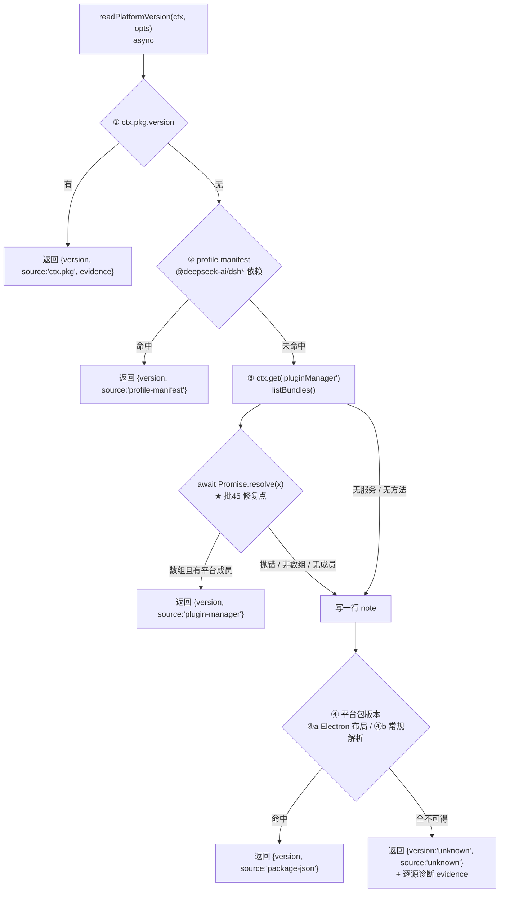
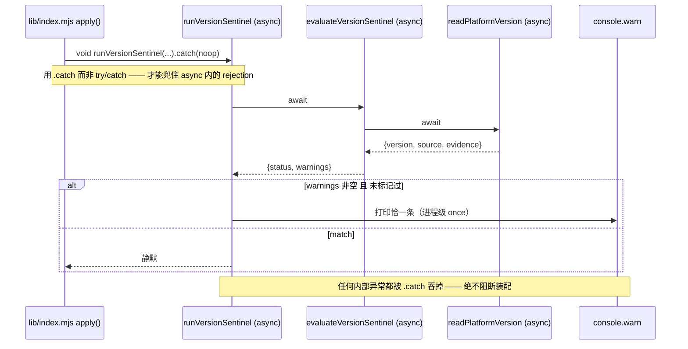

# 批 45 设计：DSH 0.2.2-rc.1 适配与能力验证

<!-- doc-shape
count-marks: 项|处|条|档|版|组
-->

> **状态**：**设计评审 PASS**（2026-11-06，`advisor(type="design")`，🔴0/🟡6/🔵4 全部折入）· **已实施**（批 45，`eng-dsh-6e4e21433eb54afb`）
> **日期**：2026-11-06
> **需求档**：[2026-11-06-platform-022-requirements.md](2026-11-06-platform-022-requirements.md)
> **平台**：DSH `0.2.2-rc.1`（桌面版 2026-11-06 自动更新；基线原为 `0.2.1-rc.2`）

---

## §一 背景

桌面版 DSH 自动从 `0.2.1-rc.2` 升到 `0.2.2-rc.1`。本仓的「平台契约基线」是**单一事实源**（`lib/contract-baseline.mjs`：档头 §④ 的四职责），它同时承载三件事：① 四源版本读取链、② 十条平台触点锁、③ 版本哨兵、④ 作业目录统计。换版之后，前两件的**验证基线**与**探测能力**都需要跟上。

本批的工作全部落在这一份文件与它的两处调用点、一份测试档，以及四处文档；**零功能行为变更**。

---

## §二 问题（现象 + 根因，各带 `file:line` 证据）

### §2.1 问题 A：验证基线过期（可见噪音，非缺陷）

| 项 | 证据 |
|---|---|
| 现象 | 每次装配打印一条「平台版本与本仓验证基线不一致」的响亮告警（只警告不阻断） |
| 根因（值） | `lib/contract-baseline.mjs:50` `PLATFORM_VERSION_BASELINE = "0.2.1-rc.2"`；`:53` `BASELINE_RECORDED_AT = "2026-09-30"` |
| 真机读数 | `contractWatch` → `platformVersion: "0.2.2-rc.1"`、`versionSource: "package-json"`、`versionEvidence: "…dsh-app-boot\\package.json version = 0.2.2-rc.1"` |

### §2.2 问题 B：源③ 静默失效（真实漂移）

| 项 | 证据 |
|---|---|
| 现象 | `versionSource` 落在源④ `package-json`；源③ 的失败 note 是「未返回数组（实为 object）」 |
| 本仓根因 | `lib/contract-baseline.mjs:162` `bundles = manager.listBundles()`（**同步取值**）；`:163` `if (!Array.isArray(bundles))`（**按数组判**） |
| 平台变更 | `@deepseek-ai/dsh-plugin-manager@0.2.1-rc.2`：`listBundles() { const manifest = …; … }` —— 同步返回数组；`@deepseek-ai/dsh-plugin-manager@0.2.2-rc.1`：`listBundles() { return Promise.resolve(this.readBundles().map(…)) }` —— 返回 Promise |
| 取证方式 | 两版源码取自 **npm registry tarball**（`@deepseek-ai/dsh-plugin-manager@0.2.1-rc.2` / `@0.2.2-rc.1` 解包后的 `lib/index.js`），**不是** `app.asar`（后者是归档，`Test-Path` 为 False——会诊 F5 即因此误判「不可复核」）。**可复现**：`npm pack` 两版后 grep `listBundles()` |
| 判读陷阱 | **两个版本的 `.d.ts` 都写 `listBundles(): Promise<BundleInfo[]>`** —— 类型声明在 0.2.1 上**与运行时不符**。本仓当年是**照运行时**写的，所以 0.2.1 上是对的、0.2.2 上失效。⇒ 教训：**不能拿类型声明当运行时契约的判据。** |

### §2.3 问题 C：文本锁的盲区（防偏离失效）

| 项 | 证据 |
|---|---|
| 现象 | 十条锁 `ps1`…`ps10` 全绿，问题 B 未被发现 |
| 根因 | `lib/contract-baseline.mjs:465-482` 的 `LOCK_IDS` 注释与档头 §② 均写明「**一律按源码文本/夹具文本求值**」——只能验「字面在场 + 命中数」 |
| 结论 | 这一类漂移（**返回形状变了、字面没变**）**结构上不可能**被文本锁抓住。补法必须是**行为锁**（fixture 驱动、可变异证伪） |

---

## §三 目标与非目标

### §3.1 目标（做完之后什么变了）

1. 版本哨兵在 `0.2.2-rc.1` 上**静默**（`status === "match"`、`warnings` 为空）。
2. 版本探测源③ 在「平台服务返回 Promise」的形态下**重新可用**，且**同时接受同步数组**（向后兼容）。
3. 新增一条**可变异证伪的行为锁**，使"返回形状漂移"这类问题在下次换版时能被抓红。
4. 文档面（兼容矩阵 / README 门槛 / CHANGELOG / 文档地图）与事实同批同步。
5. advisor / 会诊 / 飞刀三条主链在 `0.2.2-rc.1` 上**各真跑一次**并留证。

### §3.2 非目标（本批不做）

1. 不改 `peerDependencies`（用户决策 **UD-3**；理由见 §四 D3）。
2. 不采用新平台能力（用户决策 **UD-2**）：`ToolsService.restrict()` · 工具注册 `when` · `agent.model.current()/select()`。

> **编号口径**（评审 #2 折入）：`UD-n` = 用户在会话中拍板的决策；`D-n` = 本档的设计决策；`NA-n` = 本档的负向断言；`N-n` = 需求档的非功能标准。四套编号**互不复用**。
3. 不改 advisor / 会诊 / 飞刀 / eng / 台账的任何判定逻辑。
4. 不新增文本锁（见 §2.3）。
5. 不动 `lib/` 里除 `contract-baseline.mjs` 与 `index.mjs` 两处调用点之外的任何文件。

---

## §四 决策与理由

### D1 — 源③ 用「异步化」修，不用「诚实降级」

- **选定**：`readPlatformVersion` / `evaluateVersionSentinel` / `runVersionSentinel` 三个导出**改为 async**；`listBundles()` 的返回值统一 `await Promise.resolve(...)`。
- **为什么**：① 源③ 是四源链里**唯一读平台服务**的一条——把它留成死代码，"四源钉死"就名不副实；② 平台的 `.d.ts` 从头就宣告 `Promise`，异步才是**契约本意**，同步只是 0.2.1 的实现巧合；③ `await Promise.resolve(x)` 对同步值**同样正确**，因此天然向后兼容。
- **被否决的备选**：
  - **B1 诚实降级**（保持同步，只把 thenable 写成精确 note）：1 行改动、零风险，但源③ **永久不可用**，且下次真需要它时没有替代路径。弃。
  - **B2 新增一个异步补源**（同步链不动，另起一条 async 分支）：两条链并存 ⇒ 两个事实源，违反本文件「单一事实源」的立档纪律。弃。
  - **B3 用 `deasync`/忙等同步化 Promise**：引入依赖、阻塞事件循环。弃。

### D2 — 新锁用「行为锁」，不加文本锁

- **选定**：在 `test/contract-baseline.test.mjs` 新增 **T-45a**（Promise 形态必须解析成功）与 **T-45b**（返回值必须是 Promise），并规定实施期做一次**变异自证**（把 `await` 摘掉 ⇒ T-45a 必红）。
- **为什么**：文本锁只能验字面；行为锁才验语义。仓规（根 `AGENTS.md`：§二.5）明确要求「新加的腿必须能红」——行为锁做得到，文本锁做不到。
- **被否决的备选**：
  - **B4 加第 11 条文本锁 `ps11`**（断言 `contract-baseline.mjs` 文本里有 `await`）：**恒真类风险**——只要文件里有任意一个 `await`（本文件别处就有）它就会绿。这正是仓规点名的「假腿」。弃。
  - **B5 在测试里动态 import 后打补丁改源码**：测试会写盘，违反"测试不写被测源码"的纪律。弃。

### D3 — peer 不动，基线动

- **选定**：`package.json#peerDependencies["@deepseek-ai/dsh"]` **保持** `^0.2.1-rc.2`。
- **为什么**：平台的兼容闸门实现是 `semver.satisfies(runtimeVersion, range, { includePrerelease: true })`（`@deepseek-ai/dsh-app-boot` 的 `unmetRequirements`）。实测 `satisfies("0.2.2-rc.1", "^0.2.1-rc.2", {includePrerelease:true}) === true` ⇒ **放行**；只有到 `0.3.0` 才拦。用户已裁定不改（D3）。
- **被否决的备选**：**B6 改用 `engines.dsh`**（平台新口径：写了它就**独自决定**、忽略 peerDependencies）。功能等价，但改动会同时改变"闸门口径"与"文档口径"两处，收益为零。弃（登记为 **R-45-5**，落点见 [2026-11-06-platform-022-requirements.md](2026-11-06-platform-022-requirements.md)：§5.2）。

### D4 — 能力验证的三档深度

- **选定**：
  - **advisor**：用**本批的设计评审本身**作为真跑证据（它走 `ctx.llm.stream` + `ctx.jobs`，与用户点名的 advisor 能力同一条链），零额外成本。
  - **会诊**：**交付前**跑**一次小会诊**（brief 固定为「本批适配方案有无遗漏」），需落纪要——选交付前：若会诊指出遗漏，还有修正窗口。
  - **飞刀**：工程模式下 `lib/escalate.mjs:314-317` **fail-closed 禁用**（源码实测）。⇒ 交付验收通过后 `eng(action='exit')` → 跑一次 `escalate` → 再 `eng(action='enter')`。
- **为什么**：三条链的**底座**本次已逐条比对为"未变"（需求档：§2.3），但"声明相同"不等于"跑得通"。用户明确要求真跑。
- **被否决的备选**：**B7 只做静态比对**（不真跑）：省钱，但答不了"是否还能用"，且会诊/飞刀是本仓最贵的两条链，最该验。弃。
- **飞刀的小任务必须显式禁写**（任务文本写明「只读分析，不要修改任何文件」），避免在交付后污染工作树。

---

## §五 方案（FR-1…FR-5）

### FR-1 版本基线抬升

| 常量 | 旧值 | 新值 |
|---|---|---|
| `PLATFORM_VERSION_BASELINE` | `"0.2.1-rc.2"` | `"0.2.2-rc.1"` |
| `BASELINE_RECORDED_AT` | `"2026-09-30"` | `"2026-11-06"` |
| `PLATFORM_VERSION_BASELINE_EVIDENCE` | 批 31 的 0.2.0 记述 | 改写成「批 45：在 0.2.2-rc.1 上重跑触点复核 + 真机派发」 |

**派生影响面（必须同批同步，否则自相矛盾）**：

| 派生点 | 落点 | 处置 |
|---|---|---|
| ~~`SUPPORT_FLOOR_HINT`~~ → **已拆分**为 `PEER_FLOOR_HINT` + `VERIFIED_BASELINE_HINT` | `lib/contract-baseline.mjs:457` / `:461` | ✅ **第二轮拆分改名（K1 / D-1；代码评审 #1 订正本行）**：原常量在 `lib/` 中**已不存在**；「自动随常量渲染，零改动」这句对它**从来不成立**（版本串是常量，语义不是） |
| 哨兵告警文案 | `:390-405` | ⚠️ **订正（审计 D-1 / 会诊 K1）**：**只有版本串**是常量渲染；句中「只支持 DSH ≥ <基线>」的**语义**在基线 ≠ peer 下限后**不再成立** ⇒ 必须手改为「peer 支持下限」与「已验证基线」两句 |
| `contractWatch` 工具描述 | `lib/index.mjs:1484-1489` | ⚠️ **同上**：版本串自动渲染，但 `SUPPORTED PLATFORM: … supports DSH <基线> and newer` 与 `NINE` 锁数均为**硬编码语义/计数**，需手改 |
| 档头批号注记 | `lib/contract-baseline.mjs:50` 行尾注释 | **需手改**为批 45 的记述 |

### FR-2 源③ 异步化

改动三个导出 + 一个内部源函数（见 §6 伪代码），以及两处调用点：

| 调用点 | 现状 | 改后 |
|---|---|---|
| `lib/index.mjs:1119` | `try { runVersionSentinel(ctx, {...}) } catch { /* 不阻断装配 */ }` | `void runVersionSentinel(ctx, {...}).catch(() => { /* 不阻断装配 */ })` |
| `lib/index.mjs:1498` | `const v = readPlatformVersion(ctx, { cwdHint: … })` | `const v = await readPlatformVersion(ctx, { cwdHint: … })`（`execute()` 本就是 `async`） |

**关键点**：`lib/index.mjs:1119` 的旧写法是**同步 try/catch**，它**捕获不到** async 函数内部的 rejection ⇒ 必须换成 `.catch`，否则平台侧会出现 `unhandledRejection`（需求档 **N-4**）。

### FR-3 行为锁

在 `test/contract-baseline.test.mjs` 新增两条用例（不改既有 23 处调用点的语义，只加 `await`）：

- > **形态说明（审计 D-7）**：这两组断言**并入既有用例块**（仓内批 30/31 先例），不新增顶层 `test()` ⇒ 全量仍 678、`docs/test-lifecycle.md` 逐档计数不动。下文「新增」应读作「新增两组断言」。

- **T-45a**：假 `pluginManager.listBundles()` 返回 `Promise.resolve([{ name: "@deepseek-ai/dsh-base", version: "9.9.9-async-probe" }])` ⇒ 断言 `source === "plugin-manager"` 且 `version === "9.9.9-async-probe"`。
- **T-45b**：断言 `readPlatformVersion({}, …) instanceof Promise`（防止有人把函数改回同步，破坏导出契约）。

### FR-4 文档同步

| 文档 | 改动 |
|---|---|
| `docs/compatibility-matrix.md` | §一 新增**两行**：`v0.39.0`（**既存缺口**——`git tag` 实测有 `v0.39.0` 而矩阵只到 `v0.38.0`）+ `v0.40.0`（本批）；§三「已验证」的 **tag 清单只追加 `v0.40.0`**（该清单枚举的是插件 tag 的版本与 peer 核对，平台版本塞进去会腐蚀语义）；「已在平台 `0.2.2-rc.1` 上完成真机验证」**另落** §一 说明列；一句话结论补"0.2.2-rc.x 仍装 ≥v0.33.0" |
| `README.md` | 门槛节的**数字不动**（仍是 `^0.2.1-rc.2`，那是 peer 闸门），补一句"已在 0.2.2-rc.1 上完成验证"；★ **同批校正锁数口径**：`:197` 与 `:202` 现写「九条」，而 `LOCK_IDS` 实为 **10 条**（`ps1`…`ps10`）⇒ 改为「十条」 |
| `CHANGELOG.md` | 新增 `## [0.40.0] — 2026-11-06`，含**计数行**（实施后实测填入） |
| `docs/README.md` | 登记本档与需求档两行 |
| `package.json` | `version` → `0.40.0` |

### FR-5 能力验证

| 档 | 动作 | 证据落点 |
|---|---|---|
| advisor | 用户发起设计评审 ⇒ `advisor(type='design')` 真跑 | 本档 §12 |
| 会诊 | `consult_start` 一次（brief：「本批适配方案有无遗漏」） | `docs/consult-minutes/` 纪要 + 本档 §12 |
| 飞刀 | 交付后 `eng exit` → `escalate`（只读分析任务，显式禁写）→ `eng enter` | 本档 §12 + 交付报告 |

**降级口径**：若会诊模型池未配置或飞刀通道不可用，**如实登记为「未能验证」并写明原因**，**不得**写成"已验证"（仓规：读数与引用三条硬规矩，见根 `AGENTS.md`：§五）。

---

## §六 机制伪代码（签名 + 前置/后置条件）

```js
/**
 * 源③：平台服务 pluginManager 报告的平台自带组合包版本。
 * @pre  ctx 可为空；notes 为可写数组或 undefined
 * @post 成功 ⇒ {version, source:"plugin-manager", evidence}；任一失败 ⇒ null + 恰一行 note
 *       ★ 无论平台返回同步数组还是 Promise，一律按 Promise 处理（D1）
 */
async function versionFromPluginManager(ctx, notes) {
  if (typeof ctx?.get !== "function") { note("③ ctx 无 get()"); return null }
  let manager = ctx.get("pluginManager")            // 可能抛
  if (manager == null) { note("③ 无 pluginManager 服务"); return null }
  if (typeof manager.listBundles !== "function") { note("③ 无形如函数的 listBundles()"); return null }
  let bundles
  try { bundles = await Promise.resolve(manager.listBundles()) }   // ← 唯一的修复点
  catch (e) { note("③ listBundles() 抛错：" + shortErr(e)); return null }
  if (!Array.isArray(bundles)) { note("③ listBundles() 未返回数组（实为 " + typeof bundles + "）"); return null }
  // …按 PLATFORM_BUNDLE_NAMES 匹配，命中即返回；否则留"见过的名字"一行 note
  return null
}

/**
 * 四源钉死读取链。
 * @post 恒返回 {version, source, evidence}；version === "unknown" ⇔ 四源皆不可得
 * @post 改为 async 后**调用方必须 await**（漏 await 会拿到 Promise 对象）
 */
export async function readPlatformVersion(ctx, opts) { /* ①②③④ 顺序不变 */ }

/**
 * 哨兵纯判定。
 * @post 恒返回 {status, version, source, evidence, warnings}；warnings 为空 ⇔ match
 */
export async function evaluateVersionSentinel(ctx, opts) { /* … */ }

/**
 * 装配期入口。
 * @pre  无
 * @post **装配调用点不产生 unhandledRejection**（内部异常由调用方 `.catch` 吞掉——本函数**自身**在
 *       `opts.warn` / `console.warn` 抛错时仍会 reject，故「永不 reject」是**错的后置条件**，
 *       见 §12.3 的审计 D-4 订正）；绝不阻断装配（D28-1 不变）；进程级 once 只响一次
 */
export async function runVersionSentinel(ctx, opts) { /* … */ }
```

**前置 / 后置条件汇总**：

| 函数 | 前置 | 后置 |
|---|---|---|
| `versionFromPluginManager` | `ctx` 可为空 | 成功返回对象；失败返回 `null` 且 note 恰一行 |
| `readPlatformVersion` | `opts` 可为空 | 恒返回对象；**返回 Promise** |
| `evaluateVersionSentinel` | 同上 | 恒返回对象；`status ∈ {match, mismatch, unknown}` |
| `runVersionSentinel` | 同上 | **装配调用点不产生 unhandledRejection**（内部 `warn` 抛错时该导出**会** reject——这是 AC-7 变异腿能红的依据）；`warnings` 非空且未标记时打印一次、进程级 once |

---

## §七 状态与 schema

| 项 | 变更 | 谁写 | 谁读 |
|---|---|---|---|
| 持久化结构 | **无变更**（本批不新增任何落盘字段） | — | — |
| `sentinelWarned`（进程级布尔） | 不变（仍为"每进程恰一次"） | `runVersionSentinel` | 同函数 |
| 导出函数签名 | ✅ **变更**：`readPlatformVersion` / `evaluateVersionSentinel` / `runVersionSentinel` → `async` | — | `lib/index.mjs:1119` / `:1498` / `test/contract-baseline.test.mjs` |
| `PLATFORM_VERSION_BASELINE` 等三常量 | ✅ 值变更 | — | 哨兵文案 / `contractWatch` 描述 / README |

---

## §八 防偏离（机械验证）

### §8.1 验收标准（AC）

> 形态说明：本批 AC 采用**列表**而非表格。理由是仓内已有先例（[2026-10-22-forced-settle-design.md](2026-10-22-forced-settle-design.md)：§AC 段），且 `doc-shape` 的 `acs` 键一旦声明就要求同时声明 `anchors` 并对两张表做交叉引用核算——本批 AC 只有 10 条且逐条落在明确用例上，声明两张表的成本高于收益。

- **AC-1**：`PLATFORM_VERSION_BASELINE === "0.2.2-rc.1"` 且 `BASELINE_RECORDED_AT === "2026-11-06"`。可失败性：改回旧值 ⇒ 红。
- **AC-2**：`evaluateVersionSentinel({pkg:{version:"0.2.2-rc.1"}})` ⇒ `status==="match"`、`warnings.length===0`。可失败性：基线不对 ⇒ 红。
- **AC-3**：源③ 收到 **Promise** 形态 ⇒ `source==="plugin-manager"`（T-45a）。可失败性：摘掉 `await` ⇒ 红。
- **AC-4**：源③ 收到 **同步数组** 形态 ⇒ 仍解析成功（既有用例覆盖）。可失败性：若写成只认 thenable ⇒ 红。
- **AC-5**：源③ 三条失败路径（抛错 / 非数组 / 无平台成员）各有一行 note。可失败性：note 丢失 ⇒ 红。
- **AC-6**：`readPlatformVersion(...) instanceof Promise`（T-45b）。可失败性：改回同步 ⇒ 红。
- **AC-7**：装配期调用点用 `.catch` 兜底 ⇒ 内部抛错不产生 `unhandledRejection`。**检测机制**：测试内注册 `process.once("unhandledRejection")` 收集器，令 `readPlatformVersion` 的宿主依赖抛错后 `await` 一个宏任务周期（`setTimeout 0`），断言收集器为空。可失败性：用裸 `await` 或旧同步 try/catch ⇒ 红。★ **实测详注（审计第 6 项）**：红的具体表象是 **node:test 把该未处理拒绝判为当前用例失败**（`Error: ac7-warn-boom`，栈 `console.warn → warn → runVersionSentinel`），而**不是**收集器断言那一行——腿仍承重（不红即假腿不成立），但结论应按实际落点描述。
- **AC-8**：**变异自证**——把 `await Promise.resolve(...)` 摘成同步取值 ⇒ AC-3 必红（实施期记录在 §12）。可失败性：摘掉后仍绿 ⇒ 该腿是假腿。
- **AC-9**：`node --test` 全绿，且 CHANGELOG 顶部计数 == 实测通过数。可失败性：计数不符 ⇒ 发布门 G3 红。
- **AC-10**（审计 D-6 / 会诊 F2 订正：原形态**结构上恒真**——逐源诊断只在 `source==="unknown"` 分支拼进 evidence，源④ 命中时那行 note 不可能出现）：改为**可失败形态**——夹具令 ①②④ **全部落空**、③ 返回 `Promise.resolve([{name:"@deepseek-ai/dsh-base", version:"9.9.9-unknown-branch"}])` ⇒ 断言 `source === "plugin-manager"`、且 `evidence` **不含**「未返回数组」。可失败性：摘掉 `await` ⇒ 落回 unknown 分支、evidence 含该 note ⇒ 红。

### §8.2 负向断言（必须成立的反面）

- **NA-1** 不得出现"只有 thenable 才走异步、同步值走不通"的写法（AC-4 反向覆盖）。
- **NA-2** 不得在装配期留下裸的 async 调用（无 `.catch`）。
- **NA-3** 不得把基线常量写进任何**第二处**字面（单源纪律：`SUPPORT_FLOOR_HINT` / 哨兵文案 / `contractWatch` 描述全部经常量渲染）。

### §8.3 锚测试（实施期）

- **锚 A-1**：`node --test test/contract-baseline.test.mjs` 全绿（回归面）。
- **锚 A-2**：变异矩阵——**四次**变异各记录结果：① 摘 `await` ⇒ T-45a 红；② 改回同步导出 ⇒ T-45b 红；③ 删掉一条失败 note ⇒ AC-5 红；④ **把装配期 `.catch` 摘掉** ⇒ AC-7 的 `unhandledRejection` 收集器非空 ⇒ 红。
- **锚 A-3**：真机 `contractWatch` 一次，**期望读数钉死为** `versionSource === "plugin-manager"`（源①②在真机已实测失败，源③修复后应命中）；若该环境 `pluginManager` 服务不可达（该服务在桌面版条件启用），**按 FR-5 降级口径如实登记为「未能验证」并写明原因**，不得改写成通过。

---

## §九 边界与失败方向

| 边界 | 行为 |
|---|---|
| **空集**：无 `pluginManager` 服务 | 源③ 记一行 note，落源④（不变） |
| **空集**：`listBundles()` 返回空数组 | 记"共 0 条"note，落源④（不变） |
| **畸形**：返回的 Promise **reject** | `catch` 记一行 note，落源④（**新增覆盖**） |
| **畸形**：返回非数组（object / string / null） | 记"未返回数组（实为 X）"note，落源④（不变） |
| **畸形**：元素缺 `name` 或 `version` | 跳过该行（既有谓词，不变） |
| **并发**：多处同时调用 | 纯读 + 幂等，无共享可变状态 |
| **重启** | `sentinelWarned` 是进程级内存态，重启自然重置（不变） |
| **升级**：基线再次变更 | 唯一需改的落点是三个常量 + 档头注记；派生文案自动跟随（§5 FR-1 表） |
| **失败方向** | ① 哨兵：**fail-open**（只警告、不阻断装配，D28-1 不变）；② 源③：**fail-open**（落下一源）；③ `runVersionSentinel` 改异步后**由装配调用点的 `.catch` 兜底**⇒ 调用点不产生 `unhandledRejection`（**NA-2**；注意该导出自身在 `warn` 抛错时**会** reject——纠正审计 D-4 指出的“永不 reject”自相矛盾） |

---

## §十 受影响文件清单

| 文件 | 变更类型 | 说明 |
|---|---|---|
| `lib/contract-baseline.mjs` | 改 | 三常量 + 四个函数异步化 + 档头注记 |
| `lib/index.mjs` | 改 | 两处调用点（`:1119` `.catch` / `:1498` `await`） |
| `test/contract-baseline.test.mjs` | 改 | 23 处调用点加 `await`；新增 T-45a / T-45b |
| `package.json` | 改 | `version` → `0.40.0` |
| `README.md` | 改 | 门槛节补"已验证 0.2.2-rc.1"一句 |
| `CHANGELOG.md` | 改 | 新增 0.40.0 条目 + 计数行 |
| `docs/compatibility-matrix.md` | 改 | 新增 v0.39.0 + v0.40.0 两行 + §三 更新 + §一 说明列补真机验证 |
| `docs/README.md` | 改 | 登记本批两档 |
| `docs/2026-11-06-platform-022-requirements.md` | 新 | 需求档（本次已写） |
| `docs/2026-11-06-platform-022-adaptation-design.md` | 新 | 本档 |
| `docs/consult-minutes/` | 新（FR-5） | 会诊纪要（若不跑，登记未验证原因） |

---

## §十一 图示

### §11.1 版本读取链（含本次修复点）



### §11.2 装配期调用时序（改后）



---

## §十二 评审与验证落档

> 本节在评审与实施过程中**逐步追加**（仓规：文档纪律 D1–D7，见 [2026-09-13-doc-discipline-design.md](2026-09-13-doc-discipline-design.md)）。

### §12.1 静态核查（开工前，已完成）

| 核查项 | 结果 |
|---|---|
| 平台版本 | `0.2.2-rc.1`（`contractWatch` 实测） |
| peer 闸门 | `satisfies("0.2.2-rc.1","^0.2.1-rc.2",{includePrerelease:true}) === true`（本机 semver 实测） |
| `ctx.jobs` 底座 | `dsh-jobs-local` 两侧 `lib/index.js` SHA256 相同 |
| 三条主链 API | `ctx.llm` / `ctx.subagents` 签名逐字同 |
| 全量套件（开工前） | `node --test` **678/678** |
| 测试档数 | **32** 个 `test/*.test.mjs`（`glob` 实测） |

### §12.2 设计评审

| 项 | 值 |
|---|---|
| 发起 | 用户（2026-11-06 16:25「评审吧」） |
| 模式 | `advisor(type="design")`，受审 3 份：需求档 + 本档 + `docs/compatibility-matrix.md` |
| 通道 | 后台作业 `advisor-dsh-b8a12d8debc148e6`（`zai-coding-cn:glm-5.3`，预算 1800s，实耗约 4 分钟） |
| 报告全文 | `$DSH_HOME/.thincoder/jobs/advisor-dsh-b8a12d8debc148e6.txt`（3085 字符） |
| 判定 | **`VERDICT: PASS`** —— 🔴 0 · 🟡 6 · 🔵 4，**全部不阻塞** |
| 令牌 | 已签发，有效期至 **2026-11-13**（`engTokenTtlMs`） |
| ★ US-5 副产物 | 这次评审即 **advisor 在 `0.2.2-rc.1` 上的端到端真跑**：后台派发（`ctx.jobs.start`）→ LLM 评审 → 落盘 → 判定与令牌，四段全通 ⇒ **US-5 的 advisor 档已达成** |

**逐条处置**（用户 2026-11-06 17:02 裁定「A：先改档再派实施」）：

| # | 严重度 | 处置 | 落点 |
|---|---|---|---|
| 1 | 🟡 | Fixed | R-45-5 悬空指针 ⇒ 需求档 §5.2 补行 + 本档 D3 指针改为指需求档 §5.2 |
| 2 | 🟡 | Fixed | 编号撞号 ⇒ 用户决策改 `UD-2/UD-3`、负向断言改 `NA-1…NA-3`、本档 §四 新增「编号口径」段 |
| 3 | 🟡 | Fixed | AC-7 补**检测机制**（`unhandledRejection` 收集器 + 宏任务周期）；锚 A-2 补**第四次变异**（摘 `.catch`） |
| 4 | 🟡 | Fixed | 锚 A-3 **钉死期望读数** `versionSource === "plugin-manager"` + 降级口径 |
| 5 | 🟡 | Fixed | 矩阵 §三 语义错位 ⇒ 拆两句：tag 清单只追加 `v0.40.0`；平台验证另落 §一 说明列 |
| 6 | 🟡 | Fixed | 锁数口径（README `:197`/`:202` 写「九条」，`LOCK_IDS` 实为 10 条）⇒ 并入 FR-4 同批校正 |
| 7 | 🔵 | Fixed | 版本缺口（`git tag` 实测有 `v0.39.0`，矩阵只到 `v0.38.0`）⇒ FR-4 一次补两行 |
| 8 | 🔵 | Fixed | T-45b 缺号 ⇒ T-45c 改名 T-45b，全文连号 |
| 9 | 🔵 | Fixed | 会诊时点钉死为**交付前**（含理由：留修正窗口） |
| 10 | 🔵 | **Deferred** | grep 全仓复核零漏点 ⇒ 写进实施任务书**第一步**，结果回填本节 §12.3（理由：实施动作，不必写成设计条文） |

**无 `Not an issue`**：10 条逐条核过，全部属实或成立（其中 #6 / #7 已用 `git tag` 与源码实测确认）。

### §12.3 实施与变异自证

**① 开工第一步（评审 #10 折入）：三导出全仓 grep 复核**

| 面 | 命中 | 判读 |
|---|---|---|
| `lib/contract-baseline.mjs` | 定义 + 内部 2 处 | 已 await |
| `lib/index.mjs` | **2 处**调用点 | `:1121` `void … .catch(…)` · `:1501` `await` |
| `test/contract-baseline.test.mjs` | **29 处**（26 处内联 `await` + 3 处 T-45b 的 `instanceof` 探针，随后立即 `await` 排空） | 零处静默拿 Promise |
| `release-check.mjs` / `scripts/` / 其余 `lib/**` | **0 处** | — |

**扫过的面** = 整个工作树文本（含未跟踪档）；**被排除的面** = ripgrep 默认忽略的 `.git` / `node_modules`。⇒ **零漏点**。

**② 第一轮四次变异自证**（实现者实跑 + 独立审计员在 `%TEMP%` 副本上各自复跑，两边结论一致；每次变异后原样改回，`lib/` 两档 SHA256 与变异前逐字节相同）

| # | 变异 | 期望红 | 实测 |
|---|---|---|---|
| ① | 摘掉 `await Promise.resolve(…)`（改回同步取值） | T-45a | **红**：失败证据正是真机那条 `③ listBundles() 未返回数组（实为 object）` |
| ② | 四个函数改回同步导出 | T-45b | **红**（探针 `false,true,true`） |
| ③ | 删掉「抛错」路径那行 note | AC-5 | **红** |
| ④ | 摘掉装配期 `.catch` | AC-7 | **红**：`Error: ac7-warn-boom`（见 §8.1 AC-7 的实测详注） |

**②之二 第二轮六条变异自证**（**父侧在 `%TEMP%` 完整副本上执行**，仓库零改动；副本基线 `exit=0`，每条「改坏 ⇒ 红 ⇒ 改回 ⇒ 复跑绿」）：M1 支持面语义腿 · M2 旧版指引条件腿 · M3 `TEN` 静态腿 · M4 `all ten` 末句腿 · M5 `PEER_FLOOR` 抬到 `^0.2.2-rc.1` · **M5b** 语义中性的互锁腿（`>=0.2.1-rc.2`）。全量 `node --test` 复跑 **678/678**。读数与命中断言的原文见 [CHANGELOG.md](../CHANGELOG.md) 0.40.0「宿主回执（第二轮）」。

**③ 并发窗口说明（审计与父侧修复同时发生，读数为不同快照）**

审计快照 = 2026-11-06 17:32；父侧在 17:23 已改两份档的状态行、17:28 落会议纪要。因此**审计报的「状态行仍是待评审」等项按快照时间判读**，不作为互斥证据。

**④ 订正记录（本批复审后折入）**

- **D-4**（审计）：§六 后置「永不 reject」与 AC-7 变异腿互斥 ⇒ 已订正为「装配调用点不产生 unhandledRejection」（§六 表 + §九 失败方向）。
- **D-6 / 会诊 F2**：AC-10 原形态结构上恒真 ⇒ 已改可失败形态。
- **D-7**（审计）：T-45a / T-45b 实际**并入既有用例块**（全量仍 678），措辞已改为「新增两组断言」并注明仓内先例。
- **V2 / K1 / D-1**（会诊 + 审计独立同向）：FR-1 派生影响表原写「零改动」，实际只有版本串是常量渲染；锁数措辞与支持面语义是硬编码 ⇒ 已订正该表（见 §五 FR-1）。

### §12.4 能力验证

| 档 | 状态 | 证据 |
|---|---|---|
| **advisor** | ✅ **端到端达成** | 设计评审作业 `advisor-dsh-b8a12d8debc148e6`（`zai-coding-cn:glm-5.3`，预算 1800s / 实耗约 4 分钟）⇒ `VERDICT: PASS` + 令牌签发；§12.2 有完整记录。**后台派发（`ctx.jobs.start`）→ LLM 评审 → 落盘 → 判定与令牌，四段全通** |
| **会诊** | ✅ **达成** | `consult #162`（4 模型并行，**4/4 交付、0 失败**）：`deepseek-official:deepseek-flash` · `zai-coding-cn:glm-5.3` · `deepseek-official:deepseek-v4-pro` · `fangzhou-codeplan:kimi-k3.1-pro`。纪要：[consult-minutes/2026-11-06-consult-162-minutes.md](consult-minutes/2026-11-06-consult-162-minutes.md)（§2 逐条裁定 · §3 分歧 · §4 教训 · §5 不可验）。**4 家独立命中同一最严重问题**（锁数口径只改一半），并独立发现本批引入的支持面语义缺陷 |
| **飞刀 escalate** | ❌ **被本插件自身的 fail-closed 闸门拒绝（非 0.2.2 回归）** | `eng exit` 后实调 ⇒ `Error: escalate (deepseek-official:deepseek-flash) 拒绝运行 —— 新宿主下无法保证 deny 工具面（toolFilter 不被当前子代理契约遵守：route=startActivation；SubagentStartRequest 不含 toolFilter）`。根因在 `lib/escalate.mjs:447-459`（**批 37 / commit `ce941ee` 引入的安全铁律**，早于本次升级）：escalate 的 `toolFilter.deny`（不能再飞刀 / 再进 eng）是安全面，新契约带不了它 ⇒ **宁可拒绝也不静默放行**。**补救**：给该行 `consultModels` 加 `runner: codex-cli`，或等 S2（Agent Preset）补位。父侧**未改动用户 config**（临时改动已按备份逐字节还原，SHA 校验一致） |
| | | **codex-cli 通道也验不通**（同日 22:49 实测）：临时加 `runner: codex-cli` 行后派发 `escalate` ⇒ 作业 `escalate-codex-1171fcc2d9754476` 在 600s 预算内报 **`codex-cli PROCESS_ERROR`**。独立探测：手工跑 `codex exec --sandbox read-only "Reply with exactly: PING-OK"` ⇒ **5 分钟零输出、零退出**（进程挂起），已 kill。本机 `codex-cli 0.162.1` 存在、`~/.codex/auth.json` 存在 ⇒ **是 codex CLI 自身的运行环境问题**，与本批升级无关。⚠️ 诊断受阻：`escalate` 的失败信封只给 `userMessage`（见 R-45-8），拿不到 exit/stderr |
| **锚 A-3 真机 `contractWatch`** | ✅ **达成（2026-11-06 22:35 重启后实测）** | 读数：`platformVersion=0.2.2-rc.1` · **`versionSource=plugin-manager`** · `versionEvidence=pluginManager.listBundles() → @deepseek-ai/dsh-base@0.2.2-rc.1` · **10/10 锁全绿** · AC-10 的「未返回数组」已消失。**这是本批最关键的实证**：源③ 的异步化不是靠单测推断，而是在真机上把「静默失效的那条源」重新点亮——且与源④ 的历史读数互为交叉校验 |

### §12.5 交付代码评审（自动流程节点）

| 项 | 值 |
|---|---|
| 作业 | `advisor-dsh-d48a0c3dedc74cc7`（`zai-coding-cn:glm-5.3`，1800s 预算） |
| 受审面 | 代码三份（`lib/contract-baseline.mjs` · `lib/index.mjs` · `test/contract-baseline.test.mjs`）+ 文档四份 |
| 判定 | **`VERDICT: PASS`** —— 🔴 0 · 🟡 1 · 🔵 2 |

**逐条处置**：

| # | 严重度 | 处置 | 落点 |
|---|---|---|---|
| 1 | 🟡 | **Fixed** | FR-1 派生影响表首行仍写 `SUPPORT_FLOOR_HINT`（该常量已在本批第二轮拆分为 `PEER_FLOOR_HINT` + `VERIFIED_BASELINE_HINT`）⇒ 已改写该行并标注「代码评审 #1 订正本行」 |
| 2 | 🔵 | **Deferred（已登记 R-45-6）** | T-45a 未逐字落 AC-10 的子断言「evidence 不含『未返回数组』」。**等价承重成立**（宿主变异 M1 实证：摘 `await` ⇒ 落 unknown 分支 ⇒ source 断言即红），非假腿；纯字面覆盖缺口 |
| 3 | 🔵 | **Deferred（已登记 R-45-7）** | 同档 `:477` 断言消息写「批 34 的 11 → 15」，权威口径为**批 36**；仅影响失败诊断文案，不影响判定 |

**无 `Not an issue`**；两条 🔵 均已在需求档 §5.2 正式登记（不静默丢弃）。

**会诊通道的如实边界（A30-10）**：本部署**无法保证会诊子会话只读**——`toolFilter.allow` 只是白名单**下发**，平台不保证模型面可见；模型面证据显示子会话实为 `danger-full-access`。brief 内写死的「不要修改任何文件」是**对模型的请求，不是平台强制**。
