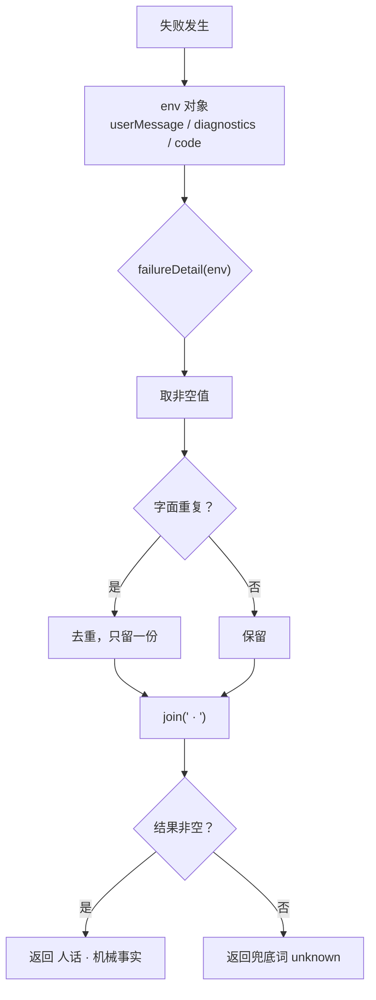

# 批 46 设计：失败面可诊断性 + purpose 隔离能力

<!-- doc-shape
count-marks: 项|处|条|档|版|组
-->

> **状态**：**设计评审 PASS**（2026-11-07，`advisor(type="design")`，🔴0 / 🟡4 / 🔵2 全部折入或驳回留痕）
> **日期**：2026-11-07
> **需求档**：[2026-11-07-failure-diagnostics-requirements.md](2026-11-07-failure-diagnostics-requirements.md)
> **前情**：批 45 验收期追查 `deepseek-official` 的 400，**一整天未能定位**——不是查得不够，是插件把诊断信息丢了。

---

## §一 背景

一次 LLM 调用失败时，本仓目前只把「人话」与「机械事实」中的**一个**显示出来（`userMessage || diagnostics`）。这在**同一天内导致两次定位失败**：

1. 早上验飞刀 → 只看到「codex 进程失败（非零退出且无有效输出）」，没有 exit / stderr；
2. 下午查 400 → 只看到「DeepSeek Messages request failed (400)」，没有 code / status / requestId。

并且 `purpose` 字段无法隔离，使「400 是否由它引起」这个问题**结构上无法回答**——尤其在本仓确认「改 `lib/` 不会热重载，必须重启」之后（见需求档：§2.4），每次实验都极贵。

本批把这两件事一起解决：**失败信息给全**，**对照实验做成一次重启内可完成**。

---

## §二 问题（现象 + 根因，带 `file:line`）

| 编号 | 现象 | 根因（证据） |
|---|---|---|
| **P-A** | codex 失败只剩一句人话 | `lib/advisor.mjs:2598` `:2686` `:2710` · `lib/escalate.mjs:216` `:282` · `lib/eng.mjs:1512` 六处均为 `(env.userMessage \|\| env.diagnostics \|\| "unknown")` |
| **P-B** | LLM 400 只有兜底文案 | `lib/advisor.mjs` 的流观测行只输出 `failure.message`（`:1427`）；`failure.code` / `status` / `requestId` **全仓零处读取**（grep 实测） |
| **P-C** | `purpose` 无法隔离 | `lib/advisor.mjs:1555` 恒定发送 `purpose: "thincoder-advisor"`；`advisor_config` 可设路径闭集不含它 |
| **P-D** | 实验成本极高 | 实测：改 `lib/` 后派发，输出**无探针标记** ⇒ 不热重载，必须重启 |

**对照组**：`lib/consult.mjs:1251-1252` 已在批 30（D-58 / 锚 A30-9③）修过 P-A 的同一形态，且注释写明了「`userMessage` 在场就把真因吞掉」——本批是把那条口径**推广到其余三处**。

---

## §三 目标与非目标

### §3.1 目标
1. 6 处失败信封统一为「**人话 + 机械事实**」双显示。
2. advisor 的流观测行与失败正文都带上 `code` / `status` / `requestId`。
3. 新增**会话级** `sendPurpose` 开关，默认 true（逐字节同旧行为）。
4. 重启一次后，可在同一进程内跑完 `purpose` 的 A/B 对照并定案。

### §3.2 非目标
1. 不改 provider 配置；2. 不改任何评审判定逻辑；3. 不动 consult；4. 不新增全局配置键；5. 不清理 R-45-6 / R-45-7。

---

## §四 决策与理由

### D1 — 统一信封抽成**共享 helper**，不在六处各写一遍

- **选定**：在 `lib/codex-adapter.mjs` 新增并导出 `failureDetail(env)`，六处统一调用。
- **为什么**：六处手写必然漂移——本批立项的直接原因就是「会诊那一处修了、其余三处没修」。抽成单点后，**下一次口径变更只需改一处**。
- **被否决**：**B1 六处各改一次**（无单点，注定再次漂移）；**B2 放进 `lib/job-outcome.mjs`**（该模块语义是「作业结果收口」，与 codex 信封不同层，会制造错误的内聚感）。

### D2 — 信封格式：`人话 · 机械事实`，**去重且不出现空壳**

- **选定**：取 `[userMessage, diagnostics]` 的非空值、**字面相同时去重**，以 `" · "` 连接；两者皆空 ⇒ `"unknown"`（保持既有兜底词）。
- **为什么**：`diagnostics` 有时**就是** `userMessage` 加上 `exit=` / `stderr:` 前缀（如 `"stderr: ..."`），不去重会出现同一句两遍。
- **被否决**：**B3 换行分隔**（失败信息常嵌在一行句子里，换行会破坏既有可读性契约与测试断言）；**B4 只显示 diagnostics**（丢掉人话，违背 US-1）。

### D3 — `purpose` 用**会话级**开关，不新增全局配置键

- **选定**：新增 `state.advisorOverride.sendPurpose`（boolean），解析链 = **会话覆盖 > 缺省 true**；`advisor_config` 支持 `set sendPurpose=<bool>` / `reset sendPurpose`，`info` 行展示来源。
- **为什么**：① 会话级即可满足「一次重启内 A/B」（先 set false 跑一次，再 reset 跑一次）；② **不触碰全局配置白名单**——`config-api` 的 TOP/合计计数是三面同步锁（`lib/index.mjs` 白名单 ⊕ `config-store` merge ⊕ `test/config-api.test.mjs`），加一个全局键要同批改三处并动计数，收益为零。
- **被否决**：**B5 全局配置键 `advisor.sendPurpose`**（三面同步成本 + 测试计数），**B6 环境变量**（本仓已有「弃用密钥 env 告警」的负面前例，且 env 不可被 `advisor_config` 观测），**B7 直接删掉 purpose**（在没有结论前就改变生产请求内容，违反 N-1）。

### D4 — 实验协议：一次重启，两组对照，结论必须落档

- **选定**：重启后执行 —— **A 组**（默认 `sendPurpose=true`）跑一次；**B 组**（`set sendPurpose=false`）跑一次；随后 `reset` 回默认。两组结果（含失败时的 `code`/`status`/`requestId`）原样写入本档 §12。
- **为什么**：把「实验」变成**受控、可重复、留痕**的动作，而不是又一次「改完再看」——后者本批已证明**无效**（P-D）。
- **被否决**：**B8 改代码 → 重启 → 再改 → 再重启**（两次重启成本，且每次都要用户点头）。

---

## §五 方案（FR-1…FR-4）

### FR-1 统一失败信封（6 处）

| 位置 | 改动 |
|---|---|
| `lib/codex-adapter.mjs`（新） | 导出 `failureDetail(env)`：按 §四 D2 的规则返回字符串 |
| `lib/advisor.mjs:2598 / :2686 / :2710` | `(env.userMessage \|\| env.diagnostics \|\| "unknown error")` → `failureDetail(env)` |
| `lib/escalate.mjs:216 / :282` | 同上（兜底词保持各自既有形态） |
| `lib/eng.mjs:1512` | 同上 |

### FR-2 advisor 观测面加结构化字段

| 位置 | 改动 |
|---|---|
| 流观测行（`lib/advisor.mjs:1494` 的 `streamObservationLine` 构造处，as-of 批 46） | 追加 `code=<failure.code>` · `status=<failure.status>` · `requestId=<截断 64>`；字段缺失时**不输出该键**（不出现 `undefined`） |
| 失败正文（`lib/advisor.mjs:1735` 的 `body`，as-of 批 46） | 追加 `(<code> · HTTP <status>)` 括号段，令用户不读日志也能判读；`requestId` 在场时同段原样保留（键值对形态 `requestId=…`，见 §12.3 D-01）；**字段缺失时整个括号段不追加**（与观测行同口径，避免出现 `(undefined · HTTP undefined)`） |

> **口径闭合（评审 #4）**：**LLM 直连面只有 advisor**（走 `ctx.llm.stream`）；`escalate` / `eng_coder` / `consult` 走**子代理信封**，由 FR-1 覆盖。故 US-1 的「一次 LLM 调用失败」在实现上等价于「advisor 的流调用失败」，并不泛指子代理。

### FR-3 `sendPurpose` 会话开关

| 位置 | 改动 |
|---|---|
| `lib/advisor.mjs:1640`（as-of 批 46） | `...(sendPurpose ? { purpose: "thincoder-advisor" } : {})` |
| 新增解析器 | `resolveSendPurpose({ config, override })` → `{ value, source }`；照 `resolveIncludeProjectGuide` 的形态（`:733-745`） |
| `advisor_config` | `set` / `reset` 的路径闭集加入 `sendPurpose`；`info` 行展示 `sendPurpose: <bool> (source: …)` |

### FR-4 实验与落档

- 重启后执行 §四 D4 的两组对照，结果写入本档 §12。
- 实验**不预设结论**：`purpose` 是元凶 ⇒ 登记修复方向；不是 ⇒ 把 `requestId` 交平台方，并登记 R-45-10 的后续。

---

## §六 机制伪代码（签名 + 前置/后置）

```js
/**
 * 统一失败细节：人话 + 机械事实，去重、不出现空壳。
 * @pre  env 可为任意值（非对象按空处理）
 * @post 返回非空字符串；两者皆空 ⇒ "unknown"（或调用方指定兜底词）
 */
export function failureDetail(env, fallback = "unknown") {
  const parts = []
  const push = (v) => { if (typeof v === "string" && v.trim() !== "") parts.push(v.trim()) }
  push(env?.userMessage)
  push(env?.diagnostics)
  const uniq = parts.filter((v, i) => parts.indexOf(v) === i)   // 字面去重
  return uniq.length > 0 ? uniq.join(" · ") : fallback
}

/**
 * purpose 开关解析。
 * @pre  config / override 均可缺失
 * @post value ∈ {true,false}；source ∈ {"session override","default"}
 */
export function resolveSendPurpose({ config, override } = {}) {
  if (override && typeof override.sendPurpose === "boolean") return { value: override.sendPurpose, source: "session override" }
  return { value: true, source: "default" }              // N-1：缺省 = 发送（逐字节同旧）
}

/** 观测行增量：缺字段则不输出该键。 */
function failureFields(failure) {
  const out = []
  if (typeof failure?.code === "string" && failure.code) out.push("code=" + failure.code)
  if (typeof failure?.status === "number") out.push("status=" + failure.status)
  // ★ 评审 #2 的实证（2026-11-07 读平台 brand.d.ts）：ProviderRequestId = Branded<'ProviderRequestId'>，
//   构造器注释明写「returns the same string, branded; no validation is performed」⇒ **运行时就是 string**。
//   故此处 `typeof === "string"` 成立；AC-4 的夹具也用字符串（与运行时同形）。
  if (typeof failure?.requestId === "string" && failure.requestId) out.push("requestId=" + failure.requestId.slice(0, 64))
  return out
}
```

| 函数 | 前置 | 后置 |
|---|---|---|
| `failureDetail` | `env` 可为空 | 返回**非空**字符串；不出现 `undefined` |
| `resolveSendPurpose` | 均可缺失 | `value` 恒为布尔；`source` 两值之一 |
| `failureFields` | `failure` 可为空 | 仅在字段有效时产出键 |

---

## §七 状态与 schema

| 项 | 变更 | 谁写 | 谁读 |
|---|---|---|---|
| 持久化落盘 | **无变更** | — | — |
| `state.advisorOverride.sendPurpose` | ✅ 新增（**会话内存态**，不落盘） | `advisor_config set/reset` | 评审派发点 |
| 全局配置键 | **零新增**（N-2） | — | — |
| 工具描述面 | `advisor_config` 的 set/reset 路径闭集文案需同步更新 | — | 模型 |

---

## §八 防偏离（机械验证）

### §8.1 验收标准（AC）

- **AC-1**：六处**逐处**（advisor ×3 · escalate ×2 · eng ×1）的失败输出**同时**含 `userMessage` 与非空 `diagnostics`。可失败性：任一处退回 `||` ⇒ 该处腿红。
- **AC-2**：`diagnostics` 为空 ⇒ 输出**不含** `undefined`、不含尾随分隔符。可失败性：写成 `parts.join()` 而不过滤 ⇒ 红。
- **AC-3**：`userMessage === diagnostics` ⇒ 该字符串**只出现一次**。可失败性：不去重 ⇒ 红。
- **AC-4**：观测行在有 `code`/`status`/`requestId` 时逐项出现；**缺字段时不出现该键**。**夹具形态钉死**：`requestId` 用**字符串**（与运行时 `Branded` 同形，证据见 §六 伪代码注释），不得用对象夹具（否则生产面与测试面不同形 ⇒ 假锁）。可失败性：无条件拼接 ⇒ 红（会出 `code=undefined`）。
- **AC-5**：`sendPurpose` 缺省 ⇒ `streamOpts` **含** `purpose:"thincoder-advisor"`（与旧版逐字节一致）。可失败性：默认改成 false ⇒ 红。
- **AC-6**：`advisor_config set sendPurpose=false` ⇒ `streamOpts` 不含 `purpose`；`reset sendPurpose` ⇒ 恢复 true。可失败性：开关未接线 ⇒ 红。
- **AC-7**：全量 `node --test` 绿（批 45 基线 **678/678**）。可失败性：计数不符 ⇒ 发布门 G3 红。
- **AC-8**：**变异自证**——上述每条新腿改坏必红，且改回必绿（逐条记录）。
- **AC-9**：重启后 A/B 两组各一次的**实际读数**写入本档 §12（无论成败；失败也照登 `code`/`status`/`requestId`）。

### §8.2 负向断言

- **NA-1** 不得新增全局配置键（`config-api` 的 TOP/合计计数必须保持不变）。
- **NA-2** 不得改变默认请求内容（`sendPurpose` 缺省时 `GenerateOptions` 与旧版逐字节同）。
- **NA-3** 不得在诊断里泄露文件内容或凭据；`requestId` 截断 64 字符。

### §8.3 锚测试

- **锚 A-1**：`node --test test/codex-runner.test.mjs test/advisor-config.test.mjs test/escalate.test.mjs **test/advisor-envelope.test.mjs**` 全绿。
- **锚 A-2**：变异矩阵 —— 逐条把新腿改坏，确认对应的 AC 转红，再改回确认复绿。
- **锚 A-3**：重启后跑 A/B，两组读数落档。

---

## §九 边界与失败方向

| 边界 | 行为 |
|---|---|
| **空集**：`env` 为 `null`/非对象 | `failureDetail` 返回兜底词，不抛 |
| **空集**：两者皆空字符串 | 返回兜底词（`unknown` / `unknown error` 按调用点既有词） |
| **畸形**：`diagnostics` 超长 | 沿用既有 4K 尾部截断（`codex-adapter` 已做），本批不再二次截断 |
| **畸形**：`status` 非数字 | 不输出该键（不输出 `status=NaN`） |
| **并发**：同一会话并发评审 | 单飞机制不变；`sendPurpose` 是幂等读 |
| **重启** | 会话覆盖是内存态 ⇒ 重启后回落默认 `true`（**这是有意的**：默认必须等于旧行为） |
| **失败方向** | 全部 **fail-open**：诊断面异常绝不影响评审本体（helper 内部不抛） |

---

## §十 受影响文件清单

| 文件 | 变更 |
|---|---|
| `lib/codex-adapter.mjs` | 新增并导出 `failureDetail` |
| `lib/advisor.mjs` | 3 处信封 · 观测行 · 失败正文 · `sendPurpose` 解析与接线 · `advisor_config` 路径闭集与 info 行 |
| `lib/escalate.mjs` | 2 处信封 |
| `lib/eng.mjs` | 1 处信封 |
| `test/codex-runner.test.mjs` | `failureDetail` 三条腿（去重 / 空壳 / 兜底） |
| `test/advisor-config.test.mjs` | `sendPurpose` set/reset/info 三条腿 + AC-5 默认腿 |
| **`test/advisor-envelope.test.mjs`（新）** | **评审 #1 折入**：advisor 三处失败信封的双显示腿 **×3** + 空壳腿 **×2** + FR-2 三键腿 **×3** —— 使 AC-1/AC-8 对这六处**全部具备可变异锚点**。**去重腿不在本档**（真实信封不存在 `userMessage === diagnostics`），锚在 `codex-runner` 的单点 helper 面 |
| `test/escalate.test.mjs` · `test/eng-token-fallback.test.mjs` | 信封双显示腿 |
| `lib/index.mjs` | **审计 D-02 补入**：`advisor_config` 的**模型可见** description（set/reset 闭集）同步加入 `sendPurpose` |
| `test/guard-e.test.mjs` | **审计 D-09 补入**：T-E19 的 `existing` 数组登记新档（fs↔表等值腿要求） |
| `docs/test-lifecycle.md` | **审计 D-10 补入**：4 格计数 + 新档行 + 历史行（T-LC2 等值锁要求） |
| `docs/2026-11-06-platform-022-requirements.md` | **审计 D-11 补入**：R-45-9 / R-45-10 登记（批 46 两档均引用） |
| `docs/README.md` | 登记本批两档 |
| `CHANGELOG.md` | 0.41.0 条目（发版时） |

---

## §十一 图示

### §11.1 失败信封的组装



### §11.2 purpose 解析链与实验路径

```mermaid
flowchart LR
  S["streamOpts 构造"] --> P{"resolveSendPurpose"}
  P --> O1["会话覆盖 sendPurpose?"]
  O1 -- 有 --> U1["用覆盖值<br/>source=session override"]
  O1 -- 无 --> U2["缺省 true<br/>source=default"]
  U1 --> Q{"value?"}
  U2 --> Q
  Q -- true --> R1["含 purpose: 'thincoder-advisor'"]
  Q -- false --> R2["不含 purpose 字段"]
  subgraph 实验（一次重启内）
    E1["A 组：默认 true"] --> E2["B 组：advisor_config set sendPurpose=false"]
    E2 --> E3["reset 回默认"]
  end
```

---

## §十二 实施与实验落档

> 本节按仓规**逐步追加**（文档纪律 D1–D7，见 [2026-09-13-doc-discipline-design.md](2026-09-13-doc-discipline-design.md)）。

### §12.1 开工前事实

| 项 | 读数 |
|---|---|
| 全量测试 | **678/678**（批 45 后实测） |
| `userMessage \|\| diagnostics` 同型点 | **6 处**（advisor 3 · escalate 2 · eng 1） |
| `failure.code/status/requestId` 读取点 | **0 处** |
| `purpose` 发送点 | **1 处**（`lib/advisor.mjs:1555`） |
| 热重载 | ❌ 不生效（探针实测，见需求档 §2.4） |

### §12.2 设计评审

| 项 | 值 |
|---|---|
| 发起 | 用户（2026-11-07「评审吧」） |
| 模式 | `advisor(type="design")`，受审 3 份：批 46 需求档 + 本档 + 批 45 需求档 |
| 通道 | 后台作业 `advisor-dsh-281de46795c94d3b`（`zai-coding-cn:glm-5.3`，预算 1800s） |
| 判定 | **`VERDICT: PASS`** —— 🔴 0 · 🟡 4 · 🔵 2，**全部非阻塞** |
| 令牌 | `bcb0908b-…:1794628511582`（有效至 **2026-11-14**） |
| ★ 附带观察 | 本次进的是**首轮（glm）**而非收敛轮（deepseek）——印证「同一 doc set 第 2 轮才走 convergence」；也说明**若本批需要第 2 轮评审，就会撞上同一个 400**（正是本批要治的痛点） |

**逐条处置（用户 2026-11-07 裁定「改档后直接派实施」）**：

| # | 严重度 | 处置 | 落点 |
|---|---|---|---|
| 1 | 🟡 | **Fixed** | §十 补 `test/advisor-envelope.test.mjs`（新档，覆盖 advisor 三处信封）⇒ AC-1/AC-8 对六处全部具备可变异锚点；锚 A-1 同步加入该档 |
| 2 | 🟡 | **Not an issue（附实证）+ 文档补强** | 读平台 `brand.d.ts`：`ProviderRequestId = Branded<'ProviderRequestId'>`，构造器注释「**returns the same string, branded; no validation is performed**」⇒ **运行时是 string**，原伪代码判断正确。已把证据写入 §六 注释，并在 AC-4 钉死「夹具用字符串、不得用对象」 |
| 3 | 🟡 | **豁免（用户裁定 b）** | 见下方豁免记录 |
| 4 | 🔵 | **Fixed** | §五 FR-2 补「LLM 直连面仅 advisor；escalate/eng/consult 走子代理信封，由 FR-1 覆盖」 |
| 5 | 🔵 | **Fixed** | §五 FR-2 补「字段缺失时整个括号段不追加」，与观测行同口径 |
| 6 | 🔵 | **Fixed** | AC-1 改为「六处**逐处**（advisor ×3 · escalate ×2 · eng ×1）」 |

**会诊豁免记录（评审 #3 · 用户 2026-11-07 裁定 b）**：

> 方法论「成文流程」要求每批先会诊再写档。**本批经用户明确裁定豁免**，理由与替代证据如下——
> 1. **本批方向由实测硬数据决定，不由方案分歧决定**：`purpose` 是否元凶、失败面缺什么，都是 8 次真测 + 源码取证得出的结论，会诊不改变这些读数；
> 2. **替代证据覆盖同类问题**：批 45 的会诊 #162（4/4 交付）与独立偏离审计已在本问题域反复收敛（其中「诊断面二选一」正是那轮抓到的形态之一，见 [consult-minutes/2026-11-06-consult-162-minutes.md](consult-minutes/2026-11-06-consult-162-minutes.md)：§2-F3/F5、§4 教训）；
> 3. **豁免不是省略**：本批所有 AC 均有**可失败性**声明与变异自证要求（AC-8 / 锚 A-2），并在 FR-4 强制「重启后 A/B 两组读数落档」（§12.4）。

### §12.3 实施与变异自证

**两轮实施 + 一轮独立审计**（全部读数由**宿主**复核，不采信自报）：

| 轮次 | 作业 | 结果 |
|---|---|---|
| 实施 R1 | `eng-dsh-c5289de1090b4017` | ❌ **交付未过**：实测 `285 tests / 280 pass / 5 fail`。且自报「4 stage 全 passed / 测试未执行」与落盘记录不符（记录了跑、且红了），自报改动面 11 档 vs `git status` 15 档 |
| 独立审计 | 子代理 `auditor-b46`（只读，代码 vs 本档逐条） | **`AUDIT: DIVERGED`** —— **13 条**（🔴4 / 🟡6 / 🔵3）。关键判定：5 条红里 **4 条是测试夹具写错**（非生产回归），1 条叠加**真实生产-设计偏离**（`failureParen` 多渲染 `code=`） |
| 实施 R2（修复轮） | `eng-dsh-24f60bd082c349a7` | ✅ 4 条 🔴 全修（D-01 生产 / D-02 描述面 / D-03·D-04 夹具） |

**宿主复核读数（我自己跑的，不是转述）**：

```
五档定向：ℹ tests 285 · pass 285 · fail 0 · EXIT=0
全量 npm test：ℹ tests 692 · pass 692 · fail 0 · EXIT=0
```

692 = 批 45 基线 **678** + 本批 **14**（advisor-envelope +8 · advisor-config +3 · escalate +1 · eng-token +1 · codex-runner +1）。`test/*.test.mjs` = **33 档**（改前 32）。

**变异自证（AC-8 / 锚 A-2）· 16 条逐条，16 红 / 16 复绿**：

| # | 改坏处 | 对应腿 | 红读数 | 复绿 |
|---|---|---|---|---|
| M1–M3 | advisor 三处信封改回 `\|\|` | `advisor-envelope` AC-1 ①②③ | 各 `pass=7 fail=1` | 8/8 |
| M4–M5 | escalate 两处信封改回 `\|\|` | `escalate` AC-1（jobs 半 / 同步半） | 各 `pass=3 fail=1` | 4/4 |
| M6 | eng 信封改回 `\|\|` | `eng-token-fallback` AC-1 | `pass=7 fail=1` | 8/8 |
| M7 | `failureDetail` 的 `push` 去掉 trim/滤空 | `codex-runner` FR-1（空壳组） | `pass=194 fail=1` | 195/195 |
| M8 | `failureDetail` 删字面去重 | `codex-runner` FR-1（去重组） | `pass=194 fail=1` | 195/195 |
| M9 | 删观测行三键循环 | `advisor-envelope` AC-4 ①③ | `pass=6 fail=2` | 8/8 |
| M10 | `status` 改无条件 push | AC-4 ②③（出 `status=undefined`/`NaN`） | `pass=6 fail=2` | 8/8 |
| M11 | 删 `requestId` 的 `.slice(0,64)` | AC-4 ③（NA-3） | `pass=7 fail=1` | 8/8 |
| M12 | 删正文 `+ failureParen(failure)` | AC-4 ① | `pass=7 fail=1` | 8/8 |
| M13 | `resolveSendPurpose` 缺省改 `false` | `advisor-config` AC-5 + AC-6 | `pass=68 fail=2` | 70/70 |
| M14 | `streamOpts` 改回无条件 `purpose:` | AC-6（关闭后键仍在） | `pass=69 fail=1` | 70/70 |
| M15 | 循环内 `const sendPurpose = true` | AC-6 | `pass=69 fail=1` | 70/70 |
| M16 | `coerceValue` 去掉布尔校验 | `advisor-config` FR-3（闭集腿） | `pass=69 fail=1` | 70/70 |

**无残留变异**：三重自证 —— ① 全部变异执行完重跑五档 **285/285**；② 13 条关键标记逐条回读命中数 = 期望值；③ 宿主 `git status` 复核后工作树只剩本批合法改动（并已清掉 R1 遗留的 4 个 `-*.txt` 测试重定向垃圾）。

**审计 13 条的最终处置**：

| ID | 严重度 | 处置 | 落点 |
|---|---|---|---|
| D-01 | 🔴 | **Fixed（R2）** | `failureParen` 现与 `status=` 同法剥离 `code=`，正文渲染 `(INVALID_REQUEST · HTTP 400 · requestId=…)` |
| D-02 | 🔴 | **Fixed（R2）** | `lib/index.mjs:1203-1204` 的模型可见 description 加入 `sendPurpose`（set 与 reset 两处闭集） |
| D-03 | 🔴 | **Fixed（R2）** | 三处 `String(out)` → `String(out.value)` |
| D-04 | 🔴 | **Fixed（R2）** | 两档假 `--version` 分支改为 `await sleep(0)` 后再 emit（照 `test/consult.test.mjs:800-801` 先例） |
| D-05 | 🟡 | **Fixed（父侧）** | 本档 §十 修正 advisor-envelope 措辞（去重腿在 `codex-runner` 单点，不在新档） |
| D-06 | 🟡 | **Fixed（父侧）** | `docs/README.md` 「受影响文件 9 项」→「**14 行 / 15 档**」 |
| D-07 | 🟡 | **Fixed（父侧）** | 需求档 + README 状态行 → 「设计评审 PASS · 实施中」 |
| D-08 | 🟡 | **Fixed（父侧）** | 即本节 |
| D-09 | 🔵 | **接受（必要改动）** | `test/guard-e.test.mjs` T-E19 登记新档 —— fs↔表等值腿要求；已补入 §十 |
| D-10 | 🔵 | **接受（必要改动）** | `docs/test-lifecycle.md` 4 格计数 + 新档行 —— T-LC2 等值锁要求；已补入 §十 |
| D-11 | 🔵 | **接受（必要改动）** | `docs/2026-11-06-platform-022-requirements.md` 登记 R-45-9/R-45-10；并已在 R-45-9 行注明「**由批 46 处置**」 |
| D-12 | 🟡 | **Fixed（父侧）** | 本档 §十 补全为 **14 行 / 15 档**（补 `lib/index.mjs` · `test/guard-e.test.mjs` · `docs/test-lifecycle.md` · 批 45 需求档） |
| D-13 | 🔵 | **登记** | R1 自报面与 `git status` 不齐 —— 属实施方自报纪律问题，R2 已改正（其报告附原始命令与计数） |

---

## §12.4 purpose 对照实验（A/B）—— 已执行；结论成立，**但理由已订正**

**执行**：2026-11-07 22:47–22:52（用户重启 DSH 之后）。执行前先验「新代码已装载」——`advisor_config get` 出现批 46 新增的 `sendPurpose: true (source: default)` 行。

| 组 | 配置 | 路由 | 结果 | 观测读数 |
|---|---|---|---|---|
| **A** | 默认（`sendPurpose=true`） | `deepseek-official:deepseek-flash` | ❌ **400** | `code=INVALID_REQUEST` · `status=400` · 无 `requestId` |
| **B** | `advisor_config set sendPurpose=false` | 同上 | ❌ **400** | 同上 |

> **状态口径说明（预答评审反复点名的一项）**：本节的「已执行」指 **22:47–22:52 的实测**。此前一轮交付代码评审的响应表把该项写成 `Deferred`（「等你重启决定」），是因为**那张响应表产生于重启之前**——属**时序先后**，不是状态矛盾。此后同一路由另有两轮实测（23:52 关闭会话日志后跑通 7069 B；23:5x 用户改回 `deepseek-official` 后跑通 8743 B）。

### ★ 订正（2026-11-07 23:2x，依据会诊 #165 的 `llmqax` 行 + 父侧复核适配器源码）

**原结论「A/B 机械排除了 `purpose`」的理由是错的。**

父侧复核平台适配器（`dsh-llm-deepseek` 解包，127,856 B）实测：

- **L2213** `...options.purpose === void 0 ? {} : { purpose: options.purpose }` —— `purpose` 只进 `requestIdentity`（供**请求扩展**准备用），**不直接进请求体**；
- **L2245** `...requestIdentity.purpose === "compaction" ? { "x-deepseek-harness-compact": "1" } : {}` —— **唯一的 wire 效应**是当 `purpose === "compaction"` 时加一个 header。

⇒ **`purpose: "thincoder-advisor"` 在 wire 上零差异**。因此 A 组与 B 组**发出的请求本来就一模一样** —— 那次 A/B 是**空操作**，它**结构上不可能**给出差异。

**结论本身仍然成立**（`purpose` 不是元凶），但正确理由是：**它压根到不了服务端**（compaction 以外的取值不产生任何 wire 字段），而不是「关掉它没变化」。

> **教训（已写入会诊纪要 §4）**：做 A/B 之前必须先证明**这个变量真的会出现在 wire 上**。开关在插件侧有效（`streamOpts` 整键缺席、测试可断言）**不等于**它对服务端可见。这是一条「结构上不可能失败的腿」——本仓反复打击的假腿形态，这次出现在人的推理里。

### 本批同时验证了 FR-2 在真实故障上生效

```text
Advisor: review failed — DeepSeek Messages request failed (400) (INVALID_REQUEST · HTTP 400)
[thincoder-suite] stream observation: ... | code=INVALID_REQUEST | status=400 | usage=none
```

改造前只有 `(400)` 一句兜底文案，**无法区分「请求非法 / 鉴权 / 配额 / 服务端」**；现在一眼可判 `INVALID_REQUEST`。

**负面读数**：该失败**没有 `requestId`**（平台 `LlmFailure.requestId` 为可选，此路径未填充；适配器侧 L1785 只从响应头三选一取，实际是上游没给）⇒「交平台方按 requestId 对账」不可执行。

### 会诊 #165 带来的定性变化（2026-11-07 23:2x）

| 读数 | 意义 |
|---|---|
| 会诊 **4/4 全部可用**，**含 `deepseek-official:deepseek-v4-pro`**（它通过**子代理对话**路径正常作答） | **provider / 凭据 / 账号 / 网关全部排除** |
| 用户切换后 advisor 收敛轮 `llmqax:deepseek-v4-flash` 跑通（6029 B 完整二轮复核） | 收敛轮已有可用路径 |
| 同一 provider 在「子代理对话」通、在「advisor 直连 `ctx.llm.stream`」400 | **400 是 advisor 直连请求承载内容特有**，不是整条路由坏 |

**新线索（可行性未证）**：适配器 **L2259** `cause: new Error(text)` 保留了**原始响应体** —— 那里面有服务端真正的报错文案。但它挂在 **throw 的 `LlmError`** 上，而 advisor 消费的是 **stream 的 `LlmFailure` 对象**（该契约无 `cause`）⇒ 插件侧能否取到，**未验证**。

**`maxTokens` 实验有效性存疑（未采纳）**：会诊 `llmqax` 行称「1024 因 <4096 回落到 16384」——父侧复核 L1732 与 L329 **未见此夹取**，该断言缺证据，故 `maxTokens` 仍按「已排除」但标注**证据强度弱**。

## §12.5 ★ 400 根因定案（2026-11-07 23:39–23:52 · 本地抓包取证）

> 自批 45 起悬了两天、排除过 5 组变量的 `deepseek-official` 400，本节给出**服务端原话级**的定案。

### §12.5.1 取证方法（可复现）

平台适配器 `dsh-llm-deepseek` 的 baseURL 判定顺序（解包源码 L441）：

```js
const baseURL = config.baseURL ?? environment?.get("DEEPSEEK_BASE_URL")?.value ?? "https://api.deepseek.com/anthropic"
```

⇒ 在 **设置 → Providers → `deepseek-official` 的 Base URL** 填 `http://127.0.0.1:8899`，请求就会先过本地代理。代理（Node，约 60 行）转发到真实端点、记字段体积与响应体（自动 gunzip、`x-api-key` 打码）。**用户已授权该临时改动；取证后 baseURL 已清空、代理脚本与日志已删除、端口 8899 已关闭。**

### §12.5.2 服务端原话（唯一的决定性证据）

```text
Failed to parse the request body as JSON:
dsh_session_log.events[218].data.message.content[0].text:
unexpected end of hex escape at line 1 column 987644
```

### §12.5.3 请求体实测分解（`content-length = 8,417,277`）

| 字段 | 字节 | 来源 |
|---|---:|---|
| **`dsh_session_log`** | **8,385,604** | **平台插件 `@deepseek-ai/dsh-session-log-deepseek` 注入** |
| `dsh_plugin_packages` | 16,526 | 平台注入 |
| `messages` | 8,347 | 本仓 |
| `system` | 5,161 | 本仓 |
| `tools` | 1,443（`read`/`glob`/`grep`/`ls`） | 本仓 |
| `model` / `stream` / `max_tokens` / `thinking` / `output_config` | 60 | 平台 |

**本仓贡献 ≈ 15 KB；平台注入占 99.6%。**

### §12.5.4 根因

`@deepseek-ai/dsh-session-log-deepseek`（README 自述：「面向官方 DeepSeek API 的**增量上传规范会话日志**」；`maxBytes` 默认 **8 MiB**，`enabled` 默认 **true**）按字节预算把会话事件塞进请求字段时，**序列化结果在某个字符串的 `\uXXXX` 转义中途被截断**，产出非法 JSON；服务端因此拒绝**整个请求**（含真正的模型调用）。

**与「只有 advisor 坏」的关系**：`dsh_session_log` 只对**携带存活 `sessionId`** 的请求挂载。本仓只有 `lib/advisor.mjs` 会把**主会话 id** 交给 `ctx.llm.stream`；consult / eng_coder / escalate 走子代理，各自新建**短会话**，日志仅几 KB ⇒ 不触发。因此「长会话 + 官方 DeepSeek API」才会 400，**advisor 只是唯一一条把长会话 id 带进去的路**。

### §12.5.5 决定性验证（正向与反向都有）

| 组 | 设置 → 通用 →「在使用官方模型 API 时上传 Session Log」 | 结果 |
|---|---|---|
| **开**（默认） | 开启 | ❌ 400（`INVALID_REQUEST`，连续 9 次复现） |
| **关** | 关闭 | ✅ **完成**（`advisor-dsh-88d2907164d5482c`，7069 B 完整第三轮复核） |

### §12.5.6 本仓此前排除的 5 组变量，全部是红鲱鱼

模型名 · `reasoningEffort` · `maxTokens` · 凭据 · `purpose` —— 它们**从未是原因**。真正原因是平台注入字段的序列化缺陷，本仓代码零参与。

### §12.5.7 对平台方的报障要点

1. `dsh-session-log-deepseek` 打包时应按**转义后的 UTF-8 字节**精确切分，或切分后**校验 JSON 可解析**；
2. 400 时应把响应体透出到 `LlmFailure`（现 `normalizeLlmFailure` L402-410 与 `failureSnapshot` L439-460 只放行 6 字段，`cause` 被丢弃 ⇒ 客户端拿不到任何可判读原因）；
3. 评估单请求 8 MiB 增量是否合理。

### §12.5.8 本次取证留下的能力

- 本仓 **FR-2**（`code`/`status`/`requestId`）让 400 第一次可被判读为 `INVALID_REQUEST`（而不是鉴权/配额）；
- **FR-3** 的会话级开关模式被证明可复用（`sendPurpose`），尽管本次证明 `purpose` 与该 400 无关；
- 结论：**诊断能力的投入是对的** —— 它把「一整天查不出」变成「一次抓包定案」。

## §12.6 ★ 订正：§12.5 的根因表述被上游证据推翻（2026-11-08）

### §12.6.1 上游反证（有源码依据，我方已复核）

上游（`packages/session/session-log-deepseek/src/index.ts:221-232`，master `fcc0ad46`）指出：**打包器不切字符串** ——

- 预算是**逐条事件量体积、放不下就 `break`**，不是「序列化完再截」；
- `jsonBytes()` 对**整条事件**做 `JSON.stringify` 再取 `Buffer.byteLength`；`wireEvent()` 原样携带 `event.data`，无二次转义或切片；
- ⇒ **不存在把 `\uXXXX` 切一半的路径**。

**我方复核（对**实际运行的 0.2.2-rc.1 产物** `dsh-session-log-deepseek/package/lib/index.js`）**：

```js
// L158-169
let bytes = jsonBytes({...})
const next = bytes + (events.length === 0 ? 0 : 1) + jsonBytes(wire)
candidateBytes = next + String(event.seq).length
if (candidateBytes > maxBytes) break
```

与上游描述**一致**：整条进、整条出。⇒ **§12.5.4 的「打包器在转义中途截断」表述作废。**

### §12.6.2 规模扫描（新增实测，2026-11-08 凌晨）

`maxBytes` 是**插件配置项**（`cordis.patch.yml` 的 `session-log-deepseek.config`，schema 默认 `8*1024*1024`），实际改动**热生效**（判据：`enabled: true` 若未生效，请求应当是小的、应当成功；它 400 了 ⇒ 配置确实生效）。

| `maxBytes` | 请求体量级 | 结果 |
|---|---|---|
| 8 MiB（默认） | 8,417,277 B | ❌ 400 |
| 4 MiB | ≈ 4.2 MB | ❌ 400 |
| **64 KiB** | ≈ 100 KB | ✅ **完成**（8661 B 完整复核） |

### §12.6.3 结论（更新后）

**400 与请求体量相关，不是编码缺陷。** 这与上游的「中间层在某个上限处切断请求体」假设**方向一致**，但**阈值远低于 8 MiB**：4 MiB 仍失败、64 KiB 成功。

进一步线索：服务端报错位置是 `line 1 column 987644`（≈ 0.94 MiB）——若确实是「切断点」的解析位置，则切断阈值更接近 **1 MiB** 而非 8 MiB。

**仍存的歧义（未验证）**：64 KiB 那一档可能**同时**把出问题的事件排除在外，故「量」与「内容」两个因子尚未完全分离。要彻底分离，需要在「事件 218 被包含」且「体量 < 阈值」之间取点，但**评审收敛轮已达 5 轮上限**，本轮无法继续采样。

### §12.6.4 可执行的处置（按代价排序）

1. **保持关闭**（当前状态）：`enabled: false` —— 已实测可用（连续 3 次跑通）；
2. **或保持开启但把 `maxBytes` 调到 64 KiB 量级**（≈ 实际可用），代价是上传的事件窗口很小；
3. **平台侧**：默认 `8 MiB` 与实际可用阈值（≈1 MiB）**不匹配**，建议下调默认值或明确上限；并**把 400 的响应体透出到 `LlmFailure`**（上游也认为这是最值得做的一条：`error.message` 缺失时，任何人拿到这个 400 都只能猜）。

### §12.6.5 本次的元教训

我在 §12.5.4 写「打包器切字符串」时，**只读了 README 与字段体积，没有读打包器的循环**。上游两行源码就否掉了它。

**教训**：**从「现象像什么」推到「实现哪里错」时，必须读那段实现的循环**，否则会把「中间层截断」误诊成「我方序列化 bug」——两者的修法完全不同（前者改阈值，后者改序列化）。

### §12.6.6 打包器仿真（对真实会话事件的离线复算，2026-11-08）

**方法**：解压本会话持久化 `session.v4.jsonl.zstd`——Node 的 `zstdDecompressSync` **只解第一帧**（该档是 1831 个拼接帧，只解出 222 B 的表头），改为按 zstd magic `28 B5 2F FD` 手工切帧逐帧解压，得 **18,329,154 B / 4,461 条事件**。然后按打包器同款算法（整条事件、`candidateBytes > maxBytes ⇒ break`）离线复算。

| `maxBytes` | 可装事件数 | 字段字节 | 实机结果 |
|---|---:|---:|---|
| 64 KiB | 18 | **2,576** | ✅ 成功 |
| 1 MiB | 198 | 851,871 | 未测（会话评审轮已达上限） |
| 4 MiB | 876 | 4,160,799 | ❌ 400 |
| 8 MiB | 1,779 | 8,253,264 | ❌ 400（实测字段 8,385,604，差 1.6%，仿真可信） |

**这一仿真回答了一个关键证伪问题**：README 写明「第一条待发事件本身就超过上限时，请求会**省略 `dsh_session_log`**」。若 64 KiB 那档是「字段被整个省略」，则「64 KiB 成功」**不能**证明与体量有关。

**仿真结论**：64 KiB 下仍会**真实携带 2,576 B / 18 条事件**的字段（不是省略）⇒ 那次成功是**带字段的小请求**成功，**排除了「字段被省略」这条替代解释**。

另记：本会话**单条事件最大 361,289 B（352 KiB）** —— 说明「首条事件超预算 ⇒ 省略字段」的路径在本会话确实存在可触发性，只是 64 KiB 那档没有触发。
