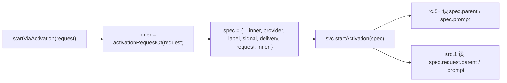

# 批 47 设计：适配平台 0.2.2-rc.5 —— 子代理派发 spec 压平

<!-- doc-shape
count-marks: 项|处|条|档
-->

> **状态**：已实施（提交 `d5b5ffc`）· 待设计评审
> **日期**：2026-11-19
> **触发**：DSH 桌面版自动升级到 `0.2.2-rc.5` 后，**会诊 4/4 全灭**、eng_coder 与飞刀同路径失效。

## §一 背景

平台在 `0.2.2-rc.5` 把 `SubagentActivationSpec` 从「嵌套 `request`」改为「**压平**」：

- `0.2.2-rc.1` 及更早：`{ provider, label, childId?, request: Omit<SubagentStartRequest,'label'|'signal'>, signal, delivery }`
- `0.2.2-rc.5`（源码 `packages/subagent/subagent/src/types.ts:29`）：`interface SubagentActivationSpec extends Omit<SubagentStartRequest,'label'|'signal'>` ⇒ `parent` / `prompt` / `cwd` / `agentPreset` / `agentOptions` 全在**顶层**，`spec.request` **不存在**。

## §二 问题（现象 + 根因）

**现象**：`consult_start` 四行全失败，文案逐字为

```text
(consultation failed: Cannot read properties of undefined (reading 'id'))
```

**根因**（平台源码 `packages/subagent/subagent/src/index.ts:275`）：

```ts
if (this.ctx.get('agents')?.get(spec.parent.id) !== spec.parent) throw new SubagentError(..., 'UNAUTHORIZED')
```

本仓 `lib/subagent-dispatch.mjs` 的 `startViaActivation` 仍按 rc.1 形状把任务塞进 `spec.request` ⇒ `spec.parent === undefined` ⇒ 平台读 `.id` 抛**裸 TypeError**。

**影响面**：会诊 / eng_coder / escalate **三条路共用同一派发入口** ⇒ 同时全灭（advisor 不经过它，故不受影响）。

## §三 目标与非目标

**目标**：一次修复同时兼容新旧宿主；不引入版本嗅探。

**非目标**：不改 escalate 的「dsh 路线无法保证 deny 工具面 ⇒ fail-closed」设计；不改会诊/eng 的业务逻辑；不追平台其它未观测到的漂移。

## §四 决策与理由

**D1 — 同一份 spec 同时给出两形（顶层平铺 + `request`）**

- 为什么：新宿主读顶层、老宿主读 `spec.request`，两侧都只读自己认识的键，未知键被忽略 ⇒ **一个 spec 同时满足**，无需嗅探版本（嗅探要读平台内部版本号，脆弱）。
- 否决：**B1 按版本分支**（需可靠版本来源，且每次升级都要维护）；**B2 只送顶层**（老宿主直接失效）；**B3 只送 `request`**（即当前 bug）。

**D2 — 修复点固定在单一派发入口**

- 为什么：会诊/eng/escalate 三路共用 `lib/subagent-dispatch.mjs`，单点修 ⇒ 一处改动三路受益，避免三处漂移。
- 否决：**B4 三处各改**（必然漂移，本仓已有前例）。

## §五 方案（FR-1 / FR-2）

**FR-1**：`startViaActivation` 构造 `{ ...inner, provider, label, signal, delivery, request: inner }`。

**FR-2**：新增回归锁 `T-30c`（`test/consult.test.mjs`）：断言 spec **顶层**含 `parent` 与 `prompt`，且与 `spec.request` 内**同值**。

## §六 机制伪代码

```js
/** 双形兼容 spec。@pre request 为对象 @post 新旧宿主都能读到 parent/prompt */
const inner = activationRequestOf(request)   // 剥 label/signal/persona/toolFilter
const spec = {
  ...inner,          // 新版（rc.5+）：parent/prompt/cwd/agentPreset/agentOptions 在顶层
  provider, label, signal, delivery: "caller",
  request: inner,    // 旧版（≤rc.1）：仍读 spec.request
}
```

| 函数 | 前置 | 后置 |
|---|---|---|
| `startViaActivation` | `request` 可为任意对象 | 返回适配后的 run 句柄（`id` ← `childId`） |
| `activationRequestOf` | — | 输出不含 `label`/`signal`/`persona`/`toolFilter` |

## §七 状态与 schema

无新增持久化字段；无新增配置键。仅改变派发 spec 的**线上形状**（同一对象多带一份 `request` 键，老宿主用）。

## §八 防偏离

- **AC-1**：`T-30c` 四条断言全绿；把 `...inner` 删掉 ⇒ 必红（父侧已实测：改前 `spec.parent` 为 undefined）。
- **AC-2**：`node --test` 全量 **692/692**。
- **AC-3**：重启后**真机**会诊 4/4 回复（预期读数：`4 of 4 replied (0 failed)`）。
- **NA-1**：不得改动 `activationRequestOf` 的剥离行为（老宿主契约）。

## §九 边界与失败方向

| 边界 | 行为 |
|---|---|
| 老宿主（≤rc.1） | 读 `spec.request` ⇒ 与修复前等价 |
| 新宿主（≥rc.5） | 读顶层 ⇒ 恢复 |
| 未知键 | 平台忽略（TypeScript 接口，无运行时白名单校验） |
| 失败方向 | **fail-closed**：派发失败照实抛错，不静默降级 |

## §十 图示（派发 spec 兼容）



## §十一 实施记录

| 项 | 值 |
|---|---|
| 提交 | `d5b5ffc` |
| 根因证据 | 平台 `lib/index.js:3024` / 源码 `packages/subagent/subagent/src/index.ts:275`；`types.ts:29` 压平 |
| 修复前后读数 | 修复前：会诊 0/4（#175 / #176 各一次）；重启后：会诊 **4/4**（#177） |
| 测试 | 692/692 · consult 15/15 |