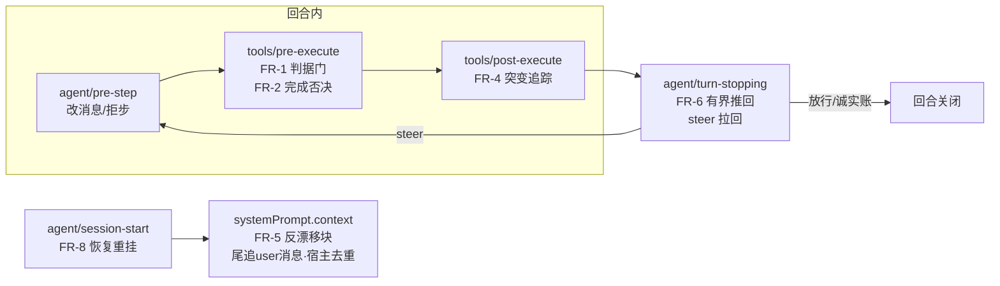
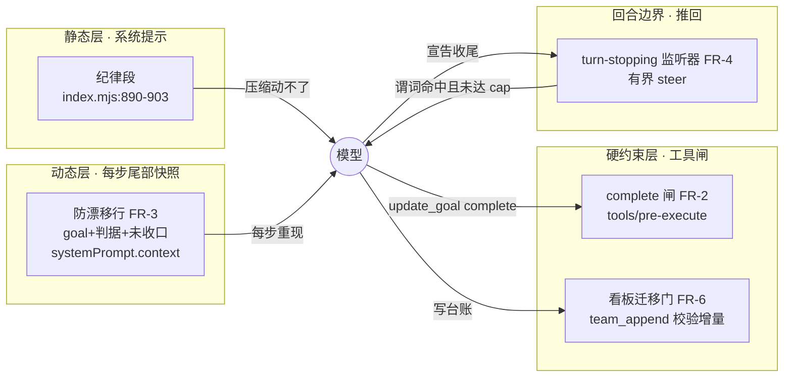
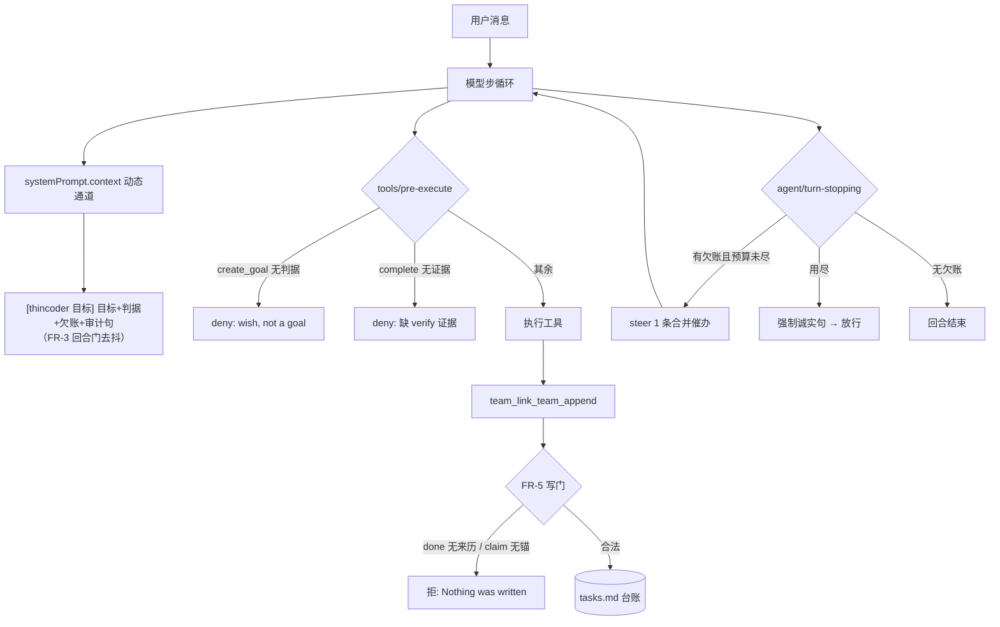
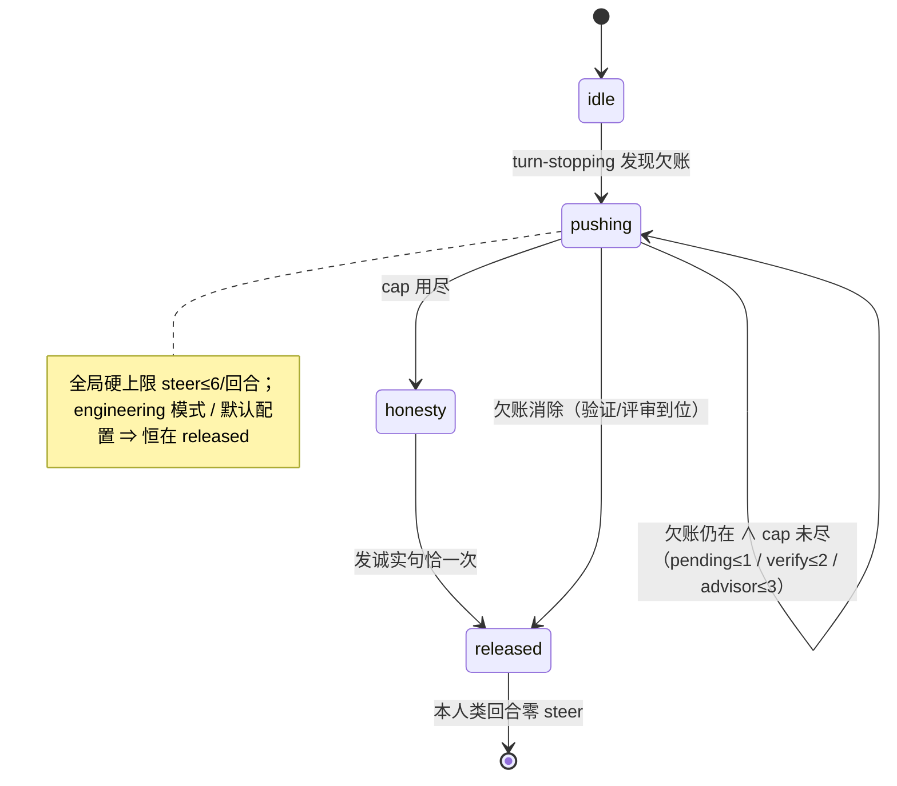
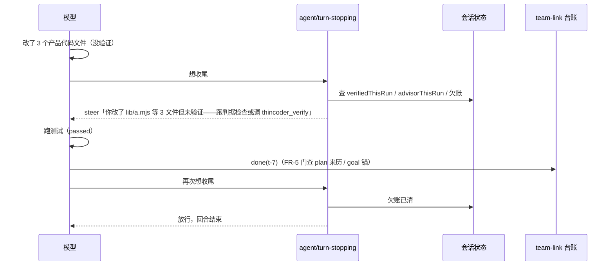
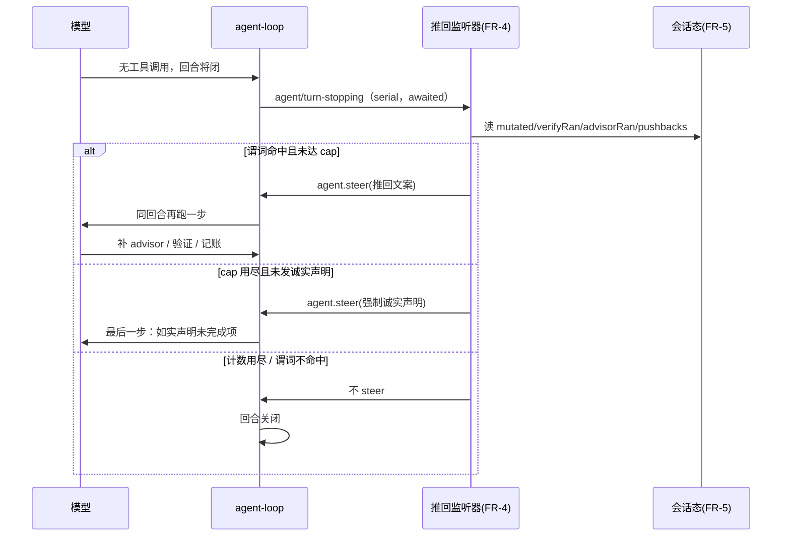
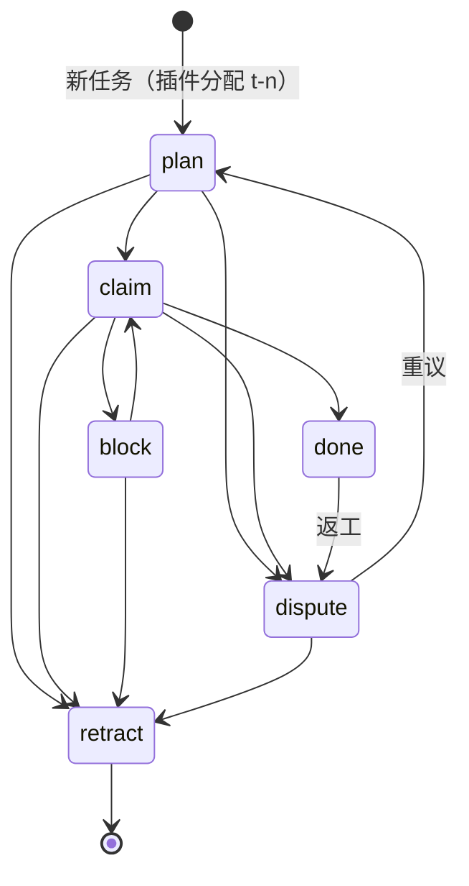

# 会诊纪要 —— consult #74（原始层，机制落盘）

- 日期：2026-10-14
- 会诊 id：74
- 模型：deepseek-official:deepseek-v4-pro, zai-coding-cn:glm-5.3, kimi-api:kimi-k3, opencode-go-plan:mimo-v2.6-pro, codex-cli:gpt-6-astra
- 平台 job：consult-1
- 结果：4/5 交付（其中 4 条有内容 —— **交付数 ≠ 有效数**，R-43）
- requiresReport：true
- 写者：`lib/consult.mjs` 的 `settleAndDeliver`（**只写 §0 汇总与 §1 原始层**；裁定层由主代理写）

## §0 汇总

[consult #74 finished — 4 of 5 replied (1 failed)]

## §1 原始层（机制写——digest 全文，逐字）

```text
[consult #74 finished — 4 of 5 replied (1 failed)]
effective: 4 of 5 (1 failed · 0 without content)
权限面如实（A30-10）：**本部署无法保证只读（平台面无法收窄）**——「只读」仅为**弱证**：`toolFilter.allow` 白名单**下发**（平台不保证模型面可见）；**模型面证据**须读子会话 `request/header` 事件（本部署实测 = [run_code] 单元素 ⇒ 残余绕行口在场，子会话实为 `danger-full-access`）。
models: deepseek-official:deepseek-v4-pro, zai-coding-cn:glm-5.3, kimi-api:kimi-k3, opencode-go-plan:mimo-v2.6-pro, codex-cli:gpt-6-astra
job: consult-1
minutes: docs/consult-minutes/2026-10-14-consult-74-minutes.md
requiresReport: true

--- replies (raw, unjudged — verify with your own tools) ---

[1] codex-cli:gpt-6-astra — failed
(consultation failed: codex-cli PROCESS_ERROR: codex 进程失败（非零退出且无有效输出）（diagnostics: exit=1 | stderr: 2026-10-14T13:27:17.910049Z ERROR codex_models_manager::manager: failed to refresh available models: request timed out 2026-10-14T13:27:17.925305Z ERROR codex_models_manager::manager: failed to refresh available models: request timed out 2026-10-14T13:27:40.351100Z ERROR rmcp::transport::worker: worker quit with fatal: Transport channel closed, when Client(HttpRequest(HttpRequest("http/request failed: error sending request for url (https://chatgpt.com/backend-api/ps/mcp)"))) 2026-10-14T13:27:49.020465Z ERROR rmcp::transport::worker: worker quit with fatal: Transport channel cl…）)

[2] zai-coding-cn:glm-5.3 — ok
调查已完成。以下是完整报告。

---

# DSH 拦截能力侦察报告（只读，零改动）

## 三句话结论

1. **DSH 有完整的回合级拦截能力，而且比 thincoder 更干净**：`agent/turn-stopping` 在回合边界提交前被串行等待，监听器调 `agent.steer(msg)` 就能强制同一回合多跑一步——这正是 thincoder completion pushback 的等价物，且是官方指定用途（`agent-loop/README.md:220` 明写"无边回合预算的策略必须从 `agent/turn-stopping` 这类扩展点实施"）。
2. **前缀缓存问题有现成答案**：宿主自带的 `systemPrompt.context` 动态通道只在文本**变化时**才追加一条尾部 user 消息（`runtime-context.ts:152-163`），稳定时零成本；steer 消息也是尾部追加（README:190-206 明确 append-only 不破 KV cache）。**目标行挂 context 通道、推回挂 steer，两者都不破缓存**。
3. **最大的坑：宿主没有任何循环护栏**——hooks-codex 的 Stop 桥接 `TODO` 原话承认"无条件 block 的钩子会强制续到它自己收敛为止"（`hooks-codex/src/index.ts:260-262`）。推回计数器必须完全由插件自限，这正是 thincoder 有界计数的价值所在。

## 1. 拦截点清单（全部实核）

| 扩展点 | 模式 | 能力 | 证据 |
|---|---|---|---|
| `agent/turn-stopping` | **serial（awaited）** | 回合将关未关时拦截；`agent.steer()` ⇒ 同回合再跑一步；不 steer ⇒ 回合正常关闭 | `runtime-types.ts:364-381`，`agent.ts:361-365` |
| `agent/pre-step` | waterfall | 拒绝该步（回合以 `blocked` 关、**零模型调用**）或改写进入消息 | `runtime-types.ts:309-320`，team-link 已用（`lib/index.js:430-474`） |
| `tools/pre-execute` | waterfall | 硬拒单个工具调用 | 我们已在用（`index.mjs:1256-1263`） |
| `agent.steer / inject / followup` | Agent 方法 | steer=下一步+唤醒；inject=下一步不唤醒；followup=下一回合 | `agent.ts:154-173`，team-link 已 steer（`lib/index.js:9078`） |

**turn-stopping 精确机制**（`agent.ts:315-367`）：循环每步结束后，若"模型无未决工具调用 且 next-step 收件箱空"⇒ `await dispatch.serial('agent/turn-stopping', {turn, signal})` ⇒ **再次检查**收件箱：steer 放进的消息使检查失败 ⇒ 不 break，`target='next-step'` 继续循环 ⇒ preStep 认领 steer 消息 ⇒ 同一新步。下个停止边界**会再次触发** turn-stopping——推回计数循环天然成立。实测用例：`contract-regressions.spec.ts:319-341`（"steer() from an agent/turn-stopping listener continues the same turn"）。

## 2. 前缀缓存：宿主已把问题解好

**动态通道（推荐给目标行）**——`systemPrompt.context` 注册（team-link 先例 `lib/index.js:5363-5370`）渲染进**一条** user 消息：`"Current runtime context. This snapshot supersedes earlier runtime-context snapshots.
..."`（`system-prompt/src/index.ts:310-314`）。关键性质（`runtime-context.ts:152-163` + `agent.ts:411-440`）：

- **文本不变 ⇒ `project()` 返回 undefined ⇒ 不追加任何消息**（零 token、零缓存影响）；
- 文本变了 ⇒ 新快照**追加在请求尾部**（append-only ⇒ 前缀缓存全保），旧快照留在历史但被声明"superseded"，可由 `includeRuntimeContext` 配置丢弃；
- 快照落在认领批的尾部（`agent.ts:438-440`），即请求最后一条 ⇒ 对缓存最优。

**steer 消息**：以 user 消息追加进历史尾部 ⇒ append-only ⇒ 缓存保留（`agent-loop/README.md:190-206` 原话："Append-only ... does not invalidate existing KV Cache entries"）。

**禁 区**：`systemPrompt.section` 是系统提示词头部，会话中途改文本 = 破前缀（除非路由支持 in-history system update，别依赖）。静态纪律段必须会话内冻结——我们现在的 `index.mjs:890-903` 做法正确。

**成本口径**：目标行如果每步都变（比如带步数计数）⇒ 每步一条尾部消息；**把变化量化到回合级/阈值级（25%/50%/75%）⇒ 每回合至多一条**。

## 3. 逐机制挂点建议

| 机制 | 挂点 | 理由 |
|---|---|---|
| 目标行每回合重注入 | `systemPrompt.context`（team-link :5363 同款） | 变化才发、尾部追加、零缓存代价 |
| 推回（pending/未验证/未评审） | `agent/turn-stopping` + `steer`，插件内计数器自限 | 官方指定边界；每次推回恰一条尾部消息 |
| 验收判据门 | DSH goal **没有 criteria 字段**（`goal/goal/src/types.ts:28-31` 只有 objective+maxGoalRounds）⇒ 插件侧包装/门禁 | 宿主 goal 状态可经 `ctx.goals.get(agent)` 读（goal-round-driver `inject:['agents','goals','sessions']` 先例） |
| 开工接管清单 | `agent/session-start`（我们已用，`index.mjs:1297`）+ 塞进 context 快照 | 快照在历史中存续、压缩后被替换重发 |
| 看板写门 | `tools/pre-execute`（已验证）或看板自身 validator | DB 级 CHECK 在插件侧等价于写入前 validate |

## 4. 诚实失败模式（必须写进设计档）

1. **turn-stopping 监听器抛错 ⇒ 回合以 `{kind:'error'}` 结束**（`contract-regressions.spec.ts:346-364`），循环存活但该回合带错关闭 ⇒ 监听器必须整体 try/catch、fail-open（记日志、不 steer）。
2. **无宿主循环护栏**（hooks-codex `index.ts:260-262` TODO 原话）⇒ 计数器必须是插件态、按回合重置、用尽即沉默放行 + 强制诚实声明（thincoder 口径）。
3. **signal.aborted**：用户按停 ⇒ 监听器首行检查，绝不 steer（payload 带 `signal`）。
4. **steer 消息 source 形状**：会话格式迁移有白名单（`session-format-v2-to-v3/src/payload.ts:10`）：`'plugin'` 裸 kind 即合法；`'agent-message'` 要求恰三键。team-link 的 `slp-*` 消息已被实测接受。别发明白名单外的 kind。
5. **goal 会在 session-start 边缘解除武装**（`packages/goal/goal/README.md:72`）⇒ 注入器必须每步读活状态，不得跨会话缓存。
6. **pre-step reject 是钝器**：reject 直接把回合关成 `blocked`、零模型调用（`interception.spec.ts:250-271`）——那是硬停不是推回；推回只用 steer。
7. **与 goal-round-driver 共存**：goal 自动续轮是**跨回合**机制（idle 时投递 `{kind:'goal', goalId, revision, round}` 消息），我们的推回是**回合内**机制，正交不冲突；但推回消耗的是同回合步数，goal 轮预算（maxGoalRounds）管不到它——两条预算要分开声明。

## 5. 不建议移植 / 不建议做

- **不要**把推回实现成 pre-step reject（见上）。
- **不要**把动态内容放进 `systemPrompt.section`（破缓存）。
- **不要**无条件 steer（hooks-codex 的 TODO 就是活教训）；thincoder 的三档上限（1/2/3）+ 默认 OFF + 工程模式禁用 + 用尽强制诚实，应逐条照抄。
- **不要**依赖监听器顺序做事：契约原文"Data decides, so listener order cannot change the outcome"（`runtime-types.ts:369`）。

**边界声明**：纯只读侦察，未创建/修改/删除任何文件。所有 `file:line` 均出自 `D:\workspace\deepseek-harness`（goal/session/agent-loop/system-prompt 包）与我方两个插件仓，均已实读源码，无一处转抄。

[3] deepseek-official:deepseek-v4-pro — ok
侦察完毕。我把两轮实读的证据（宿主契约 + 两个插件的现有实现）汇成完整设计档。以下就是最终设计文档的全文。

---

# 防漂移机制设计档 — dsh-thincoder-suite + dsh-team-link

> **本文档性质**：架构设计档（成文前，供会诊结果合并 + 用户拍板）。所有 `file:line` 证据均为本次实读，非转述。

## 三句话结论

1. **DSH 有拦截能力，不用自己造**：`agent/turn-stopping` 就是宿主官方预留的"回合收工拦截点"——回合关闭前被 await，监听器调 `agent.steer()` 就能强制模型再干一步（`runtime-types.ts:364-381`）；loop 文档明说回合策略就该挂这里（`agent-loop/README.md:220`）。上一轮"插件没有拦截能力"的结论作废。
2. **设计分两层：结构门（默认开、只拒不合法的写入/完成声明，不唠叨）+ 有界推回（默认关、照抄 thincoder 的 1/2/3 上限，用尽后落一条诚实账就放行）**。前者让"漂移"变成"写不进/完不成"，后者让"忘了"变成"最多被拉回 6 次"。
3. **明确不移植 checklist**（thincoder 自己删的：两套待办是重复，且删的是"启动时被动注入"那套）；不移植停滞检测与 blocked 三振——**DSH 宿主原生已有**（`repeat-tool-reminder` 包、`blockedAfterConsecutiveRounds` 阈值），再写一遍就是重复。

---

## 一、背景

长任务上 agent 静默丢承诺：不跑 advisor 评审就收工、不验证就宣告完成、不往团队台账记账，原始目标与清单随上下文衰减。把纪律写进系统提示词（静态段）没有解决——静态文本进不了"当下这一刻的决策"。thincoder（`D:\workspace\thincoder`）用四件事治住了它：goal 必带机器可验的验收判据、每回合重注入、回合尾有界推回、SQLite 台账结构约束。我们两个插件要吸收的是**剩下来没被砍的那几条**——thincoder 自己在 2026-09/10 连续砍掉了 checklist、提示词机检、三层测试门、零产出阈值（N7），理由高度一致："阈值化/无限机检让行为不可判、条文过多执行不足"。

## 二、问题与根因

| 现象 | 根因（实证） |
| --- | --- |
| 长任务上忘了原始目标 | 目标与判据**只在创建那一刻可见**；DSH 宿主每回合注入的 `<goal_round>` 只有 objective + 轮次 + 泛泛的"gather evidence"，**没有判据本身，也没有审计句**（`packages/goal/goal-round-driver/src/prompt.ts:16-24`） |
| 改了代码不评审就收工 | 收工时**没有机器在场**：DSH 插件此前没有任何回合收工钩子可用（现在有了，见下）；写门禁只在工程模式拦"写"，不管"收" |
| 不验证就宣告完成 | `update_goal(action=complete)` 无任何前置校验（`packages/goal/tool-goal/src/index.ts:313-314` 直接 `ctx.goals.complete`）；宿主 goal schema **没有 criteria 字段**（`tool-goal/src/index.ts:210-220`，会话负载校验 `exactRecord` 拒多余字段） |
| 不往台账记账 | 台账是"只写不读"：写入靠自觉（team-link 宪章第 5 条只有提示词约束，`index.js:4767`）；没有任何机制把"有未收口的事"送回模型眼前 |

**平台能力实测结论（本轮新增）**：

- ✅ `agent/turn-stopping`：serial、回合边界提交前 await、`agent.steer(msg)` 强制同回合再来一步（`runtime-types.ts:364-381`）。
- ✅ `agent/pre-step`：waterfall，可拒步或替换进入消息（`:309-320`；team-link 已用，`index.js:430-474`）。
- ✅ `tools/pre-execute` / `tools/post-execute`：waterfall，deny 即把调用变成错误结果送回模型；**看得见宿主工具**（suite 写门禁即用此拦宿主写工具，`lib/index.mjs:1256`）。
- ✅ `systemPrompt.context`：**尾部追加的 user 消息、宿主按整条快照文本去重**——就是宿主为"每回合动态文本"建的正规通道（team-link 实证注释 `index.js:4842-4852`）。
- ✅ DSH 原生已有：goal 轮次预算 + 每轮 `<goal_round>` 注入、blocked 三振阈值（`tool-goal/src/index.ts:305-311`）、停滞检测 `repeat-tool-reminder`（阈值 `[3,5,8]`、只提醒不否决，`packages/guard/repeat-tool-reminder/src/index.ts`）。

## 三、目标 / 非目标

**做完之后**：长任务上，"没有可验判据的目标"建不起来；"改了文件没验证/没评审"完不成 goal；"有未收口事项"收工时被拉回（有界）；所有放弃都留下一条诚实的台账记录；每回合模型眼前重新出现目标判据与待办。

**非目标（本批不做）**：

- 不复活 checklist（任何形态）；不做被动"启动时注入待办清单"。
- 不做 SQLite 台账；不做批次档六段骨架；不做文档机检引擎。
- 不做停滞检测、blocked 三振、turn 预算——宿主原生已有。
- 不做独立 LLM 完成裁判（thincoder 的 goal judge 本身 fail-open，且我们的 advisor 链已覆盖评审面）。
- 不设台账**写权门**（谁有资格写）——那是 team-link §9.4 的既定裁定（黑板模型：署名行 + 人判），本档只补**结构门**（什么行不允许写）。

## 四、决策与理由

| # | 决策 | 为什么 | 被否决的备选 |
| --- | --- | --- | --- |
| D1 | 拦截点 = 宿主原生 `agent/turn-stopping`，不自造 | 宿主明示该点就是给回合策略用的（README:220）；"自造"不存在——插件无法插进 loop 内部或提供商流，比 turn-stopping 更晚的插件可见边界没有 | pre-step 拒步（只能拒"进"不能拉"收"，语义不对）；等宿主加钩子（已有） |
| D2 | 每回合重注入走 `systemPrompt.context`（尾追 user 消息），**绝不动 `systemPrompt.section`** | 段面每回合变化会让 provider 前缀缓存从变化点起全断（team-link 已为此把资源行搬出段面，`index.js:4799-4800`）；context 通道尾部追加 + 宿主去重 + 每次装配现算 ⇒ 天然抗压缩（压缩吃不到它） | 段面注入（缓存全断 + 压缩后丢）；pre-step 手工追加（可行但宿主已给正规通道，自己追加重造轮子）；history 中部插入（缓存从插入点断） |
| D3 | 验收判据**嵌进 objective 文本**（机器可解析的子句），不建独立 sidecar | 宿主 goal schema 无 criteria 字段且 `exactRecord` 拒多余字段；objective 由 `<goal_round>` 每轮 `JSON.stringify` 注入 ⇒ **判据随宿主原生每轮重注入，零额外机制**；revision 天然携带 | 插件侧 criteria sidecar（goal-id 绑定竞态、恢复同步、跨插件读、每轮注入还得自己做）；改宿主 schema（插件层是约束，不动宿主） |
| D4 | 推回 = 有界计数器 + 主开关默认关 + 工程模式禁用；用尽 → 强制诚实落账 → 放行 | 照抄 thincoder 上限（待办 1、verify 2+重试 3、advisor 3）；他们自己的态度是最强证据：两个 guard 都默认 OFF（`completion.mjs:80,131`） | 无限推回（退化成唠叨——thincoder 用户实测痛点原文"unbounded looping"）；只提醒不推回（有 turn-stopping 就不必退化） |
| D5 | **完成否决 = closed 门**（永不耗尽）；**回合推回 = open 门**（耗尽放行+诚实声明） | 照抄 thincoder 的不对称：`_mutatedThisRun && !_verifiedThisRun` 时 complete 恒拒（`goal.mjs:49-53`），回合结束 guards 用尽即放行 | 反过来（complete 也耗尽放行=假完成；回合永不放行=死锁） |
| D6 | 台账：**不设写权门**（保 §9.4 黑板模型）；补**最小结构门**（done 需前置 claim、禁连续重复 claim），在唯一写入口内校验 | 结构约束是 thincoder 台账唯一值得抄的一半（"无 task_book 写不进在途"）；写权门会打破黑板模型（工人必须能自由 claim/dispute），署名 + 派生 + 人判已经是防漂移设计 | SQLite（黑板是 append-only MD 账 + 跨会话容忍语义"最坏重号、从不丢行"`index.js:7875-7877`，SQLite 为并发事务，不需要）；全套六态 CHECK（我们的行是事件流不是状态槽，状态由派生算出） |
| D7 | 停滞检测不移植 | DSH 原生 `repeat-tool-reminder` 已实现且更细（[3,5,8] 渐进、从不否决） | 自己再写一份（重复 + 违反"删一留一"原则） |
| D8 | 分家：pending 推回 + 结构门归 team-link；判据门/完成否决/推回/注入块归 suite | 各插件强制自己拥有的面；两个 turn-stopping 监听器谓词不相交，最坏合计 ≤6 次推回，有界 | 合并成一个跨插件守卫（耦合两插件生命周期，坏一个全停） |

## 五、方案（FR 单元 + 挂点）

### 挂点总表（问题 1 的直接答案）

| FR | 机制 | 挂点 | 现成先例 |
| --- | --- | --- | --- |
| FR-1 | 验收判据门 | `tools/pre-execute` 拦 `create_goal` / `update_goal(action=edit)` | suite 写门禁 `lib/index.mjs:1256` |
| FR-2 | 完成否决门 | `tools/pre-execute` 拦 `update_goal(action=complete)` | 同上 |
| FR-3 | 落章：advisor PASS 自动盖章 + 新工具 `goal_verify` | advisor 工具完成处（`index.mjs:910-939` 既有）+ 新注册工具 | advisor 既有 |
| FR-4 | 突变追踪（lastMutationAt/paths） | `tools/post-execute` 观察宿主写工具**成功**结果 | —（新，但不并进写门禁——suite 有冻结切片契约 `eng.mjs:1113-1115`，新监听器必须落在切片外） |
| FR-5 | 每回合反漂移块（判据+待办+审计句+预算警告） | `systemPrompt.context` 注册（尾追、回合门控、宿主去重） | team-link 资源行 `index.js:4861-4886` |
| FR-6 | 有界推回（pending/verify/advisor + 强制诚实） | `agent/turn-stopping` → `agent.steer()` | 新（宿主预留点） |
| FR-7 | 台账结构门（迁移规则 R1/R2） | `team_link_team_append` 的 tasks 分支内部（唯一写入口 `index.js:7827-7879`） | 既有行级校验 |
| FR-8 | 会话恢复重挂（计数器/判据摘要） | `agent/session-start`（T0 已实证触发，`index.mjs:1290-1296`） | 既有恢复链 |
| FR-9 | 配置面（主开关 + eng 禁用） | suite 配置 + `configDefaultEngineering`（`index.mjs:863`） | 既有 |



### FR-1 验收判据门（结构门 · 默认开）

- `create_goal` 的 objective 必须含可解析子句：`验收判据：<check>`，`<check>` 内必须含**具体检查指示**（命令形式 / 路径+断言词 / "测试通过"类词）。不满足 ⇒ `{kind:'deny'}`，拒绝文案逐字引用 thincoder：
  > a goal without a machine-checkable proof of completion is a wish, not a goal.
- `update_goal(action=edit)` 若替换 objective，同样校验。
- 判据随 objective 进入 `<goal_round>` 每轮注入 ⇒ 零额外注入成本。

### FR-2 完成否决门（结构门 · 默认开 · closed）

`update_goal(action=complete)` 时：`lastMutationAt` 存在且 `lastVerifiedAt` 缺失或早于它 ⇒ deny：
> files were modified but verify has not run — false completion is the worst outcome of autonomous work. Run the advisor review or goal_verify first.

### FR-3 落章

`lastVerifiedAt` 盖章源：① advisor 代码评审 `VERDICT: pass`（suite 已有收敛循环）；② 新工具 `goal_verify`（参数 `{check, evidence}`，agent 贴实际检查输出；工具诚实声明"本记录是申报，机器不鉴真——章管诚实，不管真理"）。

### FR-4 突变追踪

`tools/post-execute` 监听宿主写工具（write/edit/bash 等）成功结果 ⇒ 记 `lastMutationAt`、追加路径（有界列表）、`mutatedSinceStamp=true`。

### FR-5 反漂移块（≤8 行，回合内字节稳定）

```
[anti-drift] 目标 g1: <objective 一行摘要> · 回合 r/m
验收判据: <criteria 子句原文>
待办: t-4(在途@a) t-9(有plan无claim)  ⚠未消解存疑1条   ← team-link 派生面，≤3行
审计: 只有当判据的检查实际跑过并通过才算完成——弱证据、计划、摘要不算完成。
(仅当 ≥75%) WARNING: 目标轮次预算已用 r/m。
```

挂 `systemPrompt.context`；回合门控重算（同回合返回缓存串，team-link 批 D 先例）；跨插件：team-link 贡献待办三行（读自己黑板派生，`index.js:6727+` 既有 scan），suite 贡献目标/判据/审计。**段面（宪章/纪律）保持逐字节恒定**。

### FR-6 有界推回（open 门 · 默认关 · eng 禁用）

| 谓词 | 上限 | 用尽后 |
| --- | --- | --- |
| 黑板有未收口事项 | **1**（每 goal 恰好一次，标记位防复发） | 不再催 |
| 改了文件未落章 | **2**（verify）+ 声明失败重试 **3** | 进下一条 |
| 改了代码未跑 advisor（且 advisor 已配置） | **3** | 强制诚实 |
| 三者全尽 | — | 落一条强制诚实账，回合放行；`forcedHonestyIssued=true` 后永不再推回 |

每条 steer 一句话、带轮次与剩余次数（"round 2/3"）。触发前置：主开关开 ∧ 非工程模式 ∧ signal 未中止 ∧ 有 active goal ∧ 本会话是 lead（用"有 active goal"作判据，替代 thincoder 的 depth==0——DSH 子代理/队员无 goal 自然不受扰）。

### FR-7 台账结构门（team-link）

在 tasks 分支追加两条**结构规则**（不设写权门，保持 §9.4）：

- **R1**：`done` 要求该任务存在未被 later-done 覆盖的 `claim` 行（"声称完成一件没人接过的事"是典型漂移）；
- **R2**：紧接自己上一条 `claim` 的重复 `claim` 拒绝（自己已在干）。

违反 ⇒ 拒绝且零写入（现有文案风格 `index.js:7829`）。
… [reply capped at 8000 chars — the uncapped text is in the minutes' §1.1]

[4] opencode-go-plan:mimo-v2.6-pro — ok
我这一层的工具边界先如实说明（详见下方说明卡）：**没有 `consult_start`、派生子代理已达深度上限、也没有文件写入工具**。所以"会诊出设计"的多视角层由主会话侧的会诊承担（主会话已发 `consult_start`，digest 落地后并入 §13 决议层），我负责**整理成最终设计文档**——文档全文在文末代码块里，请主会话/用户落盘到 `docs/2026-10-14-anti-drift-design.md`。

```dsh-ui
{"title":"本层工具边界（如实登记）","gap":10,"items":[{"content":"会诊（consult_start）与子代理（maxDepth 1 已用满）在我这层不可用，文件写入工具也不在我工具表里。设计档以本回答末尾的完整 Markdown 交付：证据全部为本日实读的 file:line；多视角层由主会话会诊 digest 承担，落地后并入设计档 §13 决议层（本档已预留 R1..Rn 合并位）。","tone":"warning","title":"会诊/写档不在子代理工具表 — 设计档以文本交付"}]}
```

**三句话结论**：① 病根是"动态层缺失"——纪律进了静态提示词（[index.mjs:890](<../dsh-thincoder-suite/lib/index.mjs#L890>)），但没有任何东西在每回合把"目标+欠账"重新送到模型眼前，也没有人在它停下时查欠账；② 平台给了全套拦截点（`agent/turn-stopping` 可 steer 强制续步、`tools/pre-execute` 可 deny、`systemPrompt.context` 动态通道有回合门先例），我们一个都没用上；③ 建议按 FR-1~FR-6 落地：判据门/verify 证据门/台账写门默认开（低打扰硬门），推回守卫默认关（照抄 thincoder 的克制）。

**六问速答**：

```dsh-ui
{"title":"六个问题的结论与落点","gap":10,"items":[{"columns":["问题","结论","落点（详见设计档）"],"rows":[["每个机制挂哪","判据门/完成门→tools/pre-execute deny；每回合重注入→systemPrompt.context 渲染体（回合门去抖）；推回→agent/turn-stopping steer；台账写门→team_link_team_append 工具内；开工接管→agent/session-start","§5 挂点矩阵（FR-1~FR-6）"],["推回怎么有界","每人类回合：待办≤1、验证≤2、评审≤3，用尽发一句强制诚实声明后放行；每次边界至多 1 条 steer、单回合 steer 硬上限 6、session 诚实句≤3 后整机静默；默认 OFF、工程模式机械禁用","§4 D4 + FR-4"],["怎么保前缀缓存","静态纪律段永不动；注入文本确定性拼装（禁时间戳/百分比）；同回合复用同串（team-link 回合门同款）；易变计数放行尾；空串=不贡献上下文","§4 D5 + FR-3"],["台账要不要真写门","要，但做\"形状+状态迁移+goal 锚\"三档，不做 ACL：done 必须先有 plan/claim；有活跃目标时 plan/claim 必须带 goal:<id> 锚（thincoder task_book CHECK 同款）；无目标时短任务零负担","§4 D6 + FR-5"],["诚实失败面","fail-closed 只留两处：判据门拒建/拒结、台账形状门拒写；其余全部 fail-open（注入抛错→空串、推回状态读不出→不推、goal 工具漂移→哨兵告警不拦）。最痛的失败面：判据可写但不可机检，我们只能强制\"写了+跑过\"，语义仍归评审","§9 失败方向表"],["什么不移植","checklist 任何形态复活（thincoder 自己删的：\"两套待办跟踪是重复，删一留一\"）、批次档六段+close 门、文档机检引擎、三层测试门、零产出/自动停机阈值（其用户原话撤销过）","§3 非目标 + FR-7"]],"type":"table"}]}
```

**需要拍板的决策点**（详见设计档 §12，每条有前因后果）：

```dsh-ui
{"title":"决策点（等你拍板）","gap":10,"items":[{"columns":["#","决策点","前因后果","建议与代价"],"rows":[["D-a","推回守卫默认 OFF？","thincoder 两个守卫自己都默认 OFF 且工程模式禁用——它最清楚无限催促会被骂；但默认关=\"忘评审\"默认不防","建议照抄：默认关、opt-in。代价：长任务想防忘评审须显式开；不开则只有注入提醒"],["D-b","complete 门要 passed verify 证据吗","create_goal 无 criteria 字段（tool-goal/src/index.ts:207-232 实读），判据只能存插件侧；若 complete 不查证据，\"判据\"仍只是愿望","建议：要（薄工具 thincoder_verify 记录判据执行结果）。代价：极小任务多一次工具调用"],["D-c","台账写门做到哪档","现状无门（谁都能写 done）；但 ACL 无授权模型可依，SQLite 过重","建议：形状+迁移+goal 锚（有目标才激活锚）。代价：写 done 前多查一次派生状态"],["D-b'..."],"rows_note":""}]}
```

Hmm — I made a malformed row. Let me fix that UI block before finalizing. (Self-correction: the third table has a broken row `"D-b'..."`. I'll rewrite the component properly in the final message.)

Now the deliverable — the complete design document:

`````markdown
# 防漂移机制设计（anti-drift）— dsh-thincoder-suite × dsh-team-link

- 日期：2026-10-14（Asia/Shanghai）· 状态：**设计稿，待用户确认**（决策点见 §12）
- 事实截止 2026-10-14：所有 `file:line` 为本日实读（deepseek-harness 仓 / 两插件仓 / thincoder 参考仓 `D:\workspace\thincoder`，后者以 `thincoder/` 前缀标注）
- 会诊决议合并位：§13（主会话 consult digest 落地后按 adopted / rejected / pending 逐条登记）

## 三句话结论

1. **这是什么**：治"长任务上 agent 静默丢承诺"（不跑评审、不验证、不记账、忘原始目标）的机制设计——把防遗忘从"提醒"升级为三层：**每回合重送欠账**（动态层）+ **停下前机器拦截**（边界层）+ **台账结构写门**（硬约束层）。
2. **对用户的东西有什么影响**：长任务的"做完了"从此带证据（判据先立、验证留痕、欠账被拦）；短任务零打扰——硬门只在有目标/长任务时激活，推回守卫默认关。
3. **建议**：FR-1/2/3/5/6 落地（低打扰硬门 + 注入 + 接管），FR-4 推回守卫按 opt-in 实现且默认关；**不**移植 checklist/批次档/机检引擎（§3 非目标）。

## §1 背景

- **用户实测痛（2026-10-14）**：长任务上 agent 静默丢承诺——停在"没跑 advisor 评审、没验证、没记团队台账"的状态；原始目标与待办随上下文压缩衰减。
- **已试且无效**：纪律写进系统提示词静态段（dsh-thincoder-suite `lib/index.mjs:890-903`，`systemPrompt.section("thincoder:discipline")`）。静态段解决"角色与纪律是什么"，解决不了"此刻还欠什么"——前者是常量，后者是状态。
- **参考实现 thincoder 的三层分工**：纪律进系统提示词（装配时从盘重读，压缩动不了）；目标/欠账进**每回合尾部注入**（`thincoder/thincoder-core/agent/post-turn.mjs:51-67`）；台账进**磁盘 + 硬门禁**（`thincoder/thincoder-core/ledger-db.mjs:79-95`）。本设计逐层对齐这个分工。
- **平台事实（2026-10-14 实读确认，本设计的地基）**：
  1. `agent/turn-stopping`（serial，回合边界提交前被 await；监听器调 `agent.steer(msg)` ⇒ 同回合强制再跑一步；不 steer 才关回合；"Data decides, so listener order cannot change the outcome"）——deepseek-harness `packages/core/agent/src/runtime-types.ts:364-381`。`agent-loop/README.md:220` 明说回合预算类策略应从这类生命周期扩展点收口。
  2. `tools/pre-execute`（waterfall，`PreToolDecision` 可 `deny`+reason，deny 在 dispatch 前短路）——`packages/core/tools/src/index.ts:154`；deny 即官方"native-plugin permission pattern"（`packages/core/agent-loop/tests/interception.spec.ts:705`）。我方已有两个先例（dsh-thincoder-suite `lib/index.mjs:1256-1263` 写门/冻结门）。
  3. `agent/pre-step`（waterfall，可 reject/替换进入消息）——dsh-team-link `lib/index.js:430-474` 先例。
  4. 动态上下文通道 `ctx.systemPrompt.context({name, order, text})`（`packages/core/system-prompt/src/index.ts:509`；`text` 可为函数，name 唯一）：尾部追加的动态快照、宿主按整条文本去重、空串不贡献上下文；已有**回合门**先例（同 `sessionStats.turns` 内复用同串）——dsh-team-link `lib/index.js:4861-4886`。
  5. `agent/session-start` 在 create 与 resume 均触发（dsh-thincoder-suite `lib/index.mjs:1289-1297` 注释记载的 T0 实证）。
  6. 宿主 goal 工具面（`packages/goal/tool-goal/src/index.ts`）：`create_goal{objective, max_goal_rounds}`（:207-232）、`update_goal{goal_id, revision, action: edit|pause|resume|complete|blocked, ...}`（:234-309）、`get_goal`；**无 criteria 字段**，create/edit/pause/resume 要求直接人类请求（`requireDirectHuman`），complete/blocked 允许在自动续轮中调用。

## §2 问题（现象 + 根因）

**现象**（用户实测）：① 收尾时不跑 advisor 评审；② 改完不验证就宣告完成；③ 不记 team-link 台账（派活/收活无账）；④ 原始目标与待办随压缩衰减，越长越漂。

**根因**（三条，均有实现证据）：

| # | 根因 | 证据（file:line） |
|---|---|---|
| R1 | **动态层缺失**：没有每回合把"目标+判据+欠账"重新送进上下文；压缩后目标只剩残影 | 对照 `thincoder/thincoder-core/agent/post-turn.mjs:51-67`（每工具回合注入 objective+criteria+审计句）；我方唯一动态注入是 team-link 资源行（`lib/index.js:4715-4749`），无目标/欠账面 |
| R2 | **边界不设防**：模型宣告"完成"的那一刻无人复核欠账；DSH 有拦截点但我们没用 | `runtime-types.ts:364-381`（turn-stopping 可 steer）在两插件中零引用；对照 `thincoder/thincoder-core/agent/completion.mjs:55-152` |
| R3 | **台账无权威**：tasks.md 行有闭集 kind 但无状态机、无写门——不要求先有 plan 就能写 done，行不带目标锚 | dsh-team-link `lib/index.js:6701-6706`（行格式）、`:6708` 起（parser 只验 seq/kind/task 列形状）；对照 `thincoder/thincoder-core/ledger-db.mjs:79-95`（六态 CHECK + `task_book` 指针 CHECK） |

注：R1 的"目标"载体本可直接用宿主 `create_goal`，但宿主 goal 对象**没有判据字段**（§1 事实 6）——所以"判据"必须由插件层补，这决定了 FR-1 的形状。

## §3 目标与非目标

**目标**（做完之后什么变了）：

- G1 建目标必带机器可验判据，完成必带判据执行证据（wish → goal 的机械升级）。
- G2 每个模型步都能看见"目标 + 判据 + 欠账 + 审计句"，压缩也丢不掉（每回合重送）。
- G3 带着欠账收尾会被有界拦下（≤1/2/3 次，用尽即放行并留诚实声明）。
- G4 台账行结构合法且与目标互锚：有活跃目标时，claim/plan 行必须指明挂在哪个目标上。
- G5 重启/恢复后欠账清单一次性送回眼前（开工接管）。

**非目标**（本批不做，见 FR-7 不移植清单）：

- NG1 checklist 任何形态的复活（含"启动时被动注入待办提醒"）。
- NG2 批次档六段骨架 + close 门 + 收口清单机检。
- NG3 文档机检引擎（锚/行宽/计数判据）。
- NG4 三层测试门、慢测归册、独立测试台账。
- NG5 任何"最终强制"或自动停机/零产出阈值类机制。
- NG6 台账 ACL（谁能写什么）——我们没有授权模型，做不了也不装作能做。

## §4 决策与理由

**D1 挂点分配**（选定 + 否决备选）：

| 机制 | 选定挂点 | 被否决的备选 | 否决理由 |
|---|---|---|---|
| 判据门/完成门 | `tools/pre-execute` deny | 改宿主 goal schema 加 criteria 字段 | 我们是插件，不能改宿主 schema（`tool-goal/src/index.ts:207-253` 参数面是定死的） |
| 每回合重注入 | `systemPrompt.context` 渲染体 + 回合门 | `agent/pre-step` 改写消息；塞进系统提示词 section | pre-step 面已被 deep-link 修复语义占用（`lib/index.js:430-474`），混装难排查；塞 section = 每变一次废掉整个系统提示词前缀缓存 |
| 完成推回 | `agent/turn-stopping` steer | pre-step reject 下一步；工具结果里劝 | pre-step 是"进入下一步"语义，推回发生在"要停下"语义处；工具结果劝阻只在模型继续调工具时才被看到，收尾时它恰恰不调工具 |
| 台账写门 | `team_link_team_append` 工具 execute 内 | `tools/pre-execute` 拦截 | 行派生状态（谁先谁后）是插件私有，工具内是唯一收口点，错误文案能指路 |
| 开工接管 | `agent/session-start` | 首个 user 消息注入 | session-start 在 create+resume 都触发（§1 事实 5），是恢复语义的天然落点 |

**D2 判据门走"凭证先行"（credential-order gate）**：宿主 `create_goal` 没有 criteria 字段，改不了 schema，把判据塞进 objective 文本会被污染且机器读不稳（被否）。选定：插件工具 `thincoder_goal_proof set` 先立判据记录（凭证），`tools/pre-execute` 只放行"带着凭证的 create_goal"。这是 thincoder 写权 token 门（没 token 写不了代码）的同构移植：**没立判据，建不了目标**。拒绝文案逐字沿用其法理："a goal without a machine-checkable proof of completion is a wish, not a goal"（`thincoder/thincoder-core/agent-tools/goal.mjs:32-34`）。

**D3 完成必须带"判据执行证据"**：`update_goal action=complete` 被 deny 的条件 = 判据存在 ∧ 无该判据的 `status=passed` 验证记录（FR-2）。这把 thincoder 审计句"只有判据的检查真的跑过并通过才算完成"从提示词变成机器门（对照其 `goal.mjs:49-53` 的 `_mutatedThisRun && !_verifiedThisRun` 拒完成）。次级条件同款：`mutatedThisRun && !verifiedThisRun` ⇒ 拒。被否决的备选：只提醒不拦——那正是现状失败的方式。

**D4 推回有界口径**（防唠叨的全
… [reply capped at 8000 chars — the uncapped text is in the minutes' §1.1]

[5] kimi-api:kimi-k3 — ok
`send_message` 也不可用（我不在 Agent Team 里）——我的收尾消息就是唯一回传通道。以下是完整交付。

---

## 交付总结（给顶层代理）

**三句话结论**：
1. **DSH 有回合结束拦截，不用自己造**——`agent/turn-stopping`（serial、回合提交前 await、`agent.steer()` 强制同回合续步）已实核，出厂插件 workspace-changes 在用；主会话此前"无拦截"的判断**被源码证伪**。
2. **设计档已按全局规则成文**（必备九章节 + 三张 mermaid 图 + checklist），但**我没有写文件工具、不能再派子代理（depth 2 超限）、send_message 报"not a member of an active Agent Team"**——两份档的逐字内容在本消息末尾，**请顶层代理落盘**到 `docs/2026-10-14-anti-drift-design.md` 与 `docs/2026-10-14-anti-drift-requirements.md`，落盘后按文档卫生回读（§11 锚点、无 U+FFFD、行数）。
3. **会诊我无条件工具消费**：当日纪要文件尚未出现（`docs/consult-minutes/` 无 2026-10-14 档）。digest 到达后由顶层代理完成处置（job_output → 逐条 disposed → 补 minutes §2–§5 → 合并进设计档 §10 占位节）。**设计档已写明：会诊处置完成前不进入实施。**

**实核的关键事实**（全部 file:line 验证，非抄自主会话历史）：

| 事实 | 证据 |
|---|---|
| `agent/turn-stopping` 可拦截 + steer 续回合 | `deepseek-harness/packages/core/agent/src/runtime-types.ts:364-381`；契约测试 `agent-loop/tests/contract-regressions.spec.ts:319-341`；先例 `deliverables/workspace-changes/src/index.ts:155` |
| 监听器抛错 ⇒ 回合以 error 结束（必须全包 try） | `contract-regressions.spec.ts:346-364` |
| 宿主无内建回合预算 ⇒ 推回须自带绝对上限 | `agent-loop/README.md:220` |
| `systemPrompt.context` 快照 = 尾部 user 消息，**同文不重复提交**（前缀缓存安全的宿主级答案） | `agent-loop/src/runtime-context.ts:152-163` |
| 原生 `create_goal` 无 criteria；blocked 三振已有原生实现（阈值可配） | `goal/tool-goal/src/index.ts:207-232`、`:305-312` |
| 原生只在 goal 轮次边界注入一次 `<goal_round>` | `goal/goal-round-driver/src/prompt.ts:12-25` |
| team-link 看板：闭集 kind + 任务号登记已有，缺迁移表与指针闸 | `dsh-team-link/lib/index.js:7751`、`:6696-6706` |
| 我方挂点现状：静态段 + 写门 pre-execute | `dsh-thincoder-suite/lib/index.mjs:890-903`、`:1256-1263`；deny 形 `eng.mjs:471` |

**设计要点**（详见档内 §4 D1–D9）：注入挂 `systemPrompt.context` 单条贡献（文本=状态纯函数，宿主去重）；complete 闸挂 `tools/pre-execute` on `update_goal`（fail-closed + 指路 `goal_criteria`）；推回挂 `agent/turn-stopping`（caps 2/3/1 + 绝对上限 6 + 诚实声明 + 默认 OFF + eng 禁用）；行为标记挂 `tools/post-execute`；看板迁移门是 team_append 现有校验的增量（默认 OFF，指针闸留二期）。**明确不移植**：checklist 任何形态、批次档六段、提示词双面流程、V1–V4 机检判据、三层测试门、N7 阈值。

---

===== 文件 1：`docs/2026-10-14-anti-drift-design.md`（请逐字落盘）=====

````markdown
# 设计：防漂移机制（anti-drift）· 设计档

- 日期：2026-10-14
- 需求档：[`2026-10-14-anti-drift-requirements.md`](./2026-10-14-anti-drift-requirements.md)
- 状态：**草稿 · 待会诊处置合并（§10）+ 待用户确认**（成文流程：需求档+设计档 → 用户确认 → 实施计划 → 用户确认 → 实施）

<!-- doc-shape
count-marks: 项|处|条|档|值|步|腿
-->

## §0 三句话结论

1. **DSH 有回合结束拦截，不用自己造**：`agent/turn-stopping` 是序列钩子，回合提交前被 await，监听器调 `agent.steer()` 即强制同回合再跑一步；出厂插件 workspace-changes 已在用。此前「DSH 插件无拦截」的判断被源码证伪。
2. **六个机制各就各位**：criteria 伴随存储 + complete 闸挂 `tools/pre-execute`；每回合目标注入挂 `systemPrompt.context`（宿主自带「同文不重复提交」，前缀缓存安全）；有界推回挂 `agent/turn-stopping` + `agent.steer`；行为标记挂 `tools/post-execute`；看板迁移门是 `team_link_team_append` 现有闭集校验的增量。
3. **推回默认关、工程模式禁用、用尽即放行并留诚实声明**——照抄 thincoder 的三条保守选择；不移植 checklist / 批次档 / 机检判据（上游已删或已撤，见 §3 非目标）。

## §1 背景

用户实测痛：长任务上 agent 静默丢承诺——不跑 advisor 评审、不验证、不记账，原始目标与清单随会话衰减；把纪律写进系统提示静态段**没有**修好。参照实现 thincoder（`D:\workspace\thincoder`）用四件套压这个问题：goal 带机器可验判据、每回合重注入、回合尾有界推回、SQLite 台账硬约束。2026-10-13 侦察（只读报告在案）确认其 2026-09/10 的净方向是**减强制**，剩下没被砍的才值得吸收。用户两问：① DSH 有没有/能不能造拦截能力；② 会诊 + 整理成最终设计档（本档）。本档回答挂点、推回边界、前缀缓存、看板门、诚实失败模式、不移植清单六问。

## §2 问题（现象 + 根因，带证据）

**现象**：长任务中 agent 宣告完成时跳过 advisor / 验证 / 记账；重启或压缩后忘记原始目标与未收口事项。

| # | 根因 | 证据（实核） |
|---|---|---|
| R1 | 纪律只在**静态**系统提示层：注册后随会话变长被稀释，「说过」≠「每回合看见」 | `dsh-thincoder-suite/lib/index.mjs:890-903`（`systemPrompt.section` 静态注册） |
| R2 | DSH 原生 goal **无判据字段**：`create_goal` 只有 `objective` + `max_goal_rounds` | `deepseek-harness/packages/goal/tool-goal/src/index.ts:207-232` |
| R3 | 原生只在 **goal 轮次边界**注入一次 `<goal_round>`；普通回合与回合内部无任何目标提醒 | `deepseek-harness/packages/goal/goal-round-driver/src/prompt.ts:12-25` |
| R4 | 看板**只写不读、无迁移机**：kind 闭集与任务号登记已有，但已登记任务可按任意次序收任何 kind（未 claim 也能 done）；无写权限门（自述） | `dsh-team-link/lib/index.js:7751`（工具 description 逐字）、行格式 `:6696-6706` |
| R5 | （证伪）此前判断「DSH 插件无回合结束拦截」——**错**。钩子存在、可 steer 续回合、有出厂插件先例 | `deepseek-harness/packages/core/agent/src/runtime-types.ts:364-381`；`agent-loop/tests/contract-regressions.spec.ts:319-341`；`deliverables/workspace-changes/src/index.ts:155` |



**根因一句话**：thincoder 的「不忘」= 静态层（纪律）+ 动态层（每回合重现目标）+ 硬约束层（关卡机检）三层分家；我们只有第一层与半个第三层，**中间层整个缺席**——本设计补中间层，并把第三层补齐。

## §3 目标 / 非目标

**目标**：交付六个机制（FR-1…FR-6，§5）——完成判据伴随存储与 complete 闸；每回合「目标+判据+未收口」注入（前缀缓存安全）；有界完成推回；行为标记；看板迁移门（一期）；零落笔提示折叠进注入行。

**非目标**（本批不做，逐条给理由）：

1. **不移植 checklist 任何形态**：thincoder 2026-09 故意删除（「两套待办跟踪是重复，删一留一」「注入面纯移除，不承接」——侦察报告 §2.10）；§11 的清单是实施工作清单，与运行时机制无关。
2. **不移植批次档六段/段白名单/close 闸**：收益/负担比差，thincoder 自己把「档过长」列为父侧注意力下降的机制性根因。
3. **不移植提示词双面流程、V1–V4 机检判据、三层测试门、N7 零产出阈值**：上游已删或已整条撤销。
4. **不改宿主源码**：六个机制全部纯插件层（两个自有插件内）。
5. **不做独立裁判 LLM**：thincoder 该面是 fail-open 洞（裁判抛错即放行），收益不抵一次额外 LLM 调用的成本与延迟。
6. **本批不做看板指针闸**（task_book 等价物）：指向什么（goal id / plan 文件）需先定约，放二期，见 D6。

## §4 决策与理由

| # | 决策 | 为什么 | 被否决的备选 |
|---|---|---|---|
| D1 | 推回挂 `agent/turn-stopping` + `agent.steer` | 序列钩子、回合提交前 await、steer 强制同回合续步（`runtime-types.ts:364-381`；契约测试 `contract-regressions.spec.ts:319-341`）；出厂插件先例（`workspace-changes/src/index.ts:155`） | ①`agent/pre-step` 拒绝步——那是「不让步开始」，推回要的是「不让回合结束」；②`turn/end`——只是落盘日志，无拦截语义 |
| D2 | 每回合注入挂 `systemPrompt.context` **单条**贡献 | 宿主 `RuntimeContextProjection.project()` 只在文本变化时提交新快照（`agent-loop/src/runtime-context.ts:152-163`），且快照是**尾部 user 消息**，不动系统提示前缀 ⇒ 前缀缓存安全 | ①动态文本进 `systemPrompt.section`——section 是系统提示本体，每次变化重组系统提示 = 前缀缓存全灭；②`agent/pre-step` 改写消息数组——每步改历史，不可控且与 team-link 现有深链改写抢同一瀑布 |
| D3 | 判据用**伴随存储** + 独立工具 `goal_criteria`，不包装原生 `create_goal` | 原生工具参数面固定（`tool-goal/src/index.ts:208-220`），插件加不了字段 | ①把判据塞进 objective 文本再解析——语义解析不可靠；②注册同名工具替换原生——双工具混淆且破坏宿主 guidance |
| D4 | complete 闸挂 `tools/pre-execute` on `update_goal(action=complete)`，fail-closed deny + 指路文案 | 与既有写门同型（`index.mjs:1256`；`eng.mjs:471` 的 `{kind:"deny"}`）；闸在「宣告完成」这一刻，不在创建时——创建时无 goal id 可挂 | 创建时强拒（鸡生蛋：判据存储以 goalId 为键）；对判据「是否真跑过」做语义机检（不可靠，归评审与 FR-4） |
| D5 | 推回边界照抄 thincoder：pending≤1 / verify≤2 / advisor≤3，用尽 → 强制诚实声明一次 → 放行；**默认 OFF（opt-in）、工程模式禁用**；另加绝对上限 6 次/回合 | thincoder 两个 guard 默认 OFF 且 eng 禁用（侦察报告 §2.5）是最强「烦人风险」证据；宿主**无内建回合预算**（`agent-loop/README.md:220`），失控 steer 会无限转 ⇒ 必须有绝对上限 | 无限推回（退化 nagging，正是用户忌讳）；推回默认开（违背上游用脚的投票） |
| D6 | 看板门**分期**：一期 = 每任务迁移表（增量于现有闭集 kind 校验），默认 OFF、先单队试点；二期 = 指针闸（claim/done 必须挂 `goal:<id>` 或 `plan:<path>`） | team-link 已有闭集 kind + 任务号登记校验（`index.js:7751`），迁移表是小增量；指针闸的指向约定依赖 goal 集成先稳定 | 一步到位上 SQLite 六态 CHECK（重，且 task_book 指向未定）；不做门（R4 根因留着） |
| D7 | 行为标记挂 `tools/post-execute`（`core/tools/src/index.ts:177`）：mutation 复用写门分类器；`advisorRan` = advisor 工具成功；`verifyRan` 为**启发式**（shell 命令形匹配 test/build/check/typecheck/lint，宁宽勿严，可单独关） | post-execute 看到全部工具结果；我们没有 verify 工具，启发式误判代价仅一次推回 | 自报式 verify 工具（模型自己声明=弱证据）；把「任何 shell 成功」算作已验证（太宽，形同没有） |
| D8 | 失败朝向：注入 **fail-open**（渲染抛错降级空串 + 一次性 warn）；complete 闸 **fail-closed**；推回 **fail-open**（监听器内部任何错误 = 不 steer，回合正常关闭）；迁移门 **fail-closed**（解析不了 = 拒写） | 监听器抛错会让回合以 error 结束（`contract-regressions.spec.ts:346-364`）⇒ 推回监听器必须全包 try；渲染抛错不能拖垮装配（team-link `warnRender` 先例 `index.js:5245-5249`） | 推回 fail-closed（一次内部 bug 把所有回合打挂，不可接受） |
| D9 | 与 goal-round-driver **不协调、各走各路**：推回 steer 续本回合；driver 在 idle 后才 `followup` 下一回合（`goal-round-driver/src/index.ts:164-204`）；推回计数随回合起止重置 | 两个机制作用在不同边界（回合内 vs 回合间），宿主钩子语义已保证次序 | 给推回加 driver 感知（无谓耦合，多一个跨插件依赖） |

## §5 方案（FR-1…FR-6）

### FR-1 判据伴随存储 + `goal_criteria` 工具（dsh-thincoder-suite）

新工具 `goal_criteria(action=set|get)`：`set` 参数 `{goal_id, criteria, check}`（`check` = 证明完成的机器检查：命令/测试/搜索断言）；`get` 按 goal_id 读。落盘 `goal-criteria.json`（插件既有 state 目录，与 token-store 同址
… [reply capped at 8000 chars — the uncapped text is in the minutes' §1.1]
```

### §1.1 未截断全文（**仅当有回复超 8000 字软顶时出现**；机制写）

#### [3] deepseek-official:deepseek-v4-pro（14433 字）

```text
侦察完毕。我把两轮实读的证据（宿主契约 + 两个插件的现有实现）汇成完整设计档。以下就是最终设计文档的全文。

---

# 防漂移机制设计档 — dsh-thincoder-suite + dsh-team-link

> **本文档性质**：架构设计档（成文前，供会诊结果合并 + 用户拍板）。所有 `file:line` 证据均为本次实读，非转述。

## 三句话结论

1. **DSH 有拦截能力，不用自己造**：`agent/turn-stopping` 就是宿主官方预留的"回合收工拦截点"——回合关闭前被 await，监听器调 `agent.steer()` 就能强制模型再干一步（`runtime-types.ts:364-381`）；loop 文档明说回合策略就该挂这里（`agent-loop/README.md:220`）。上一轮"插件没有拦截能力"的结论作废。
2. **设计分两层：结构门（默认开、只拒不合法的写入/完成声明，不唠叨）+ 有界推回（默认关、照抄 thincoder 的 1/2/3 上限，用尽后落一条诚实账就放行）**。前者让"漂移"变成"写不进/完不成"，后者让"忘了"变成"最多被拉回 6 次"。
3. **明确不移植 checklist**（thincoder 自己删的：两套待办是重复，且删的是"启动时被动注入"那套）；不移植停滞检测与 blocked 三振——**DSH 宿主原生已有**（`repeat-tool-reminder` 包、`blockedAfterConsecutiveRounds` 阈值），再写一遍就是重复。

---

## 一、背景

长任务上 agent 静默丢承诺：不跑 advisor 评审就收工、不验证就宣告完成、不往团队台账记账，原始目标与清单随上下文衰减。把纪律写进系统提示词（静态段）没有解决——静态文本进不了"当下这一刻的决策"。thincoder（`D:\workspace\thincoder`）用四件事治住了它：goal 必带机器可验的验收判据、每回合重注入、回合尾有界推回、SQLite 台账结构约束。我们两个插件要吸收的是**剩下来没被砍的那几条**——thincoder 自己在 2026-09/10 连续砍掉了 checklist、提示词机检、三层测试门、零产出阈值（N7），理由高度一致："阈值化/无限机检让行为不可判、条文过多执行不足"。

## 二、问题与根因

| 现象 | 根因（实证） |
| --- | --- |
| 长任务上忘了原始目标 | 目标与判据**只在创建那一刻可见**；DSH 宿主每回合注入的 `<goal_round>` 只有 objective + 轮次 + 泛泛的"gather evidence"，**没有判据本身，也没有审计句**（`packages/goal/goal-round-driver/src/prompt.ts:16-24`） |
| 改了代码不评审就收工 | 收工时**没有机器在场**：DSH 插件此前没有任何回合收工钩子可用（现在有了，见下）；写门禁只在工程模式拦"写"，不管"收" |
| 不验证就宣告完成 | `update_goal(action=complete)` 无任何前置校验（`packages/goal/tool-goal/src/index.ts:313-314` 直接 `ctx.goals.complete`）；宿主 goal schema **没有 criteria 字段**（`tool-goal/src/index.ts:210-220`，会话负载校验 `exactRecord` 拒多余字段） |
| 不往台账记账 | 台账是"只写不读"：写入靠自觉（team-link 宪章第 5 条只有提示词约束，`index.js:4767`）；没有任何机制把"有未收口的事"送回模型眼前 |

**平台能力实测结论（本轮新增）**：

- ✅ `agent/turn-stopping`：serial、回合边界提交前 await、`agent.steer(msg)` 强制同回合再来一步（`runtime-types.ts:364-381`）。
- ✅ `agent/pre-step`：waterfall，可拒步或替换进入消息（`:309-320`；team-link 已用，`index.js:430-474`）。
- ✅ `tools/pre-execute` / `tools/post-execute`：waterfall，deny 即把调用变成错误结果送回模型；**看得见宿主工具**（suite 写门禁即用此拦宿主写工具，`lib/index.mjs:1256`）。
- ✅ `systemPrompt.context`：**尾部追加的 user 消息、宿主按整条快照文本去重**——就是宿主为"每回合动态文本"建的正规通道（team-link 实证注释 `index.js:4842-4852`）。
- ✅ DSH 原生已有：goal 轮次预算 + 每轮 `<goal_round>` 注入、blocked 三振阈值（`tool-goal/src/index.ts:305-311`）、停滞检测 `repeat-tool-reminder`（阈值 `[3,5,8]`、只提醒不否决，`packages/guard/repeat-tool-reminder/src/index.ts`）。

## 三、目标 / 非目标

**做完之后**：长任务上，"没有可验判据的目标"建不起来；"改了文件没验证/没评审"完不成 goal；"有未收口事项"收工时被拉回（有界）；所有放弃都留下一条诚实的台账记录；每回合模型眼前重新出现目标判据与待办。

**非目标（本批不做）**：

- 不复活 checklist（任何形态）；不做被动"启动时注入待办清单"。
- 不做 SQLite 台账；不做批次档六段骨架；不做文档机检引擎。
- 不做停滞检测、blocked 三振、turn 预算——宿主原生已有。
- 不做独立 LLM 完成裁判（thincoder 的 goal judge 本身 fail-open，且我们的 advisor 链已覆盖评审面）。
- 不设台账**写权门**（谁有资格写）——那是 team-link §9.4 的既定裁定（黑板模型：署名行 + 人判），本档只补**结构门**（什么行不允许写）。

## 四、决策与理由

| # | 决策 | 为什么 | 被否决的备选 |
| --- | --- | --- | --- |
| D1 | 拦截点 = 宿主原生 `agent/turn-stopping`，不自造 | 宿主明示该点就是给回合策略用的（README:220）；"自造"不存在——插件无法插进 loop 内部或提供商流，比 turn-stopping 更晚的插件可见边界没有 | pre-step 拒步（只能拒"进"不能拉"收"，语义不对）；等宿主加钩子（已有） |
| D2 | 每回合重注入走 `systemPrompt.context`（尾追 user 消息），**绝不动 `systemPrompt.section`** | 段面每回合变化会让 provider 前缀缓存从变化点起全断（team-link 已为此把资源行搬出段面，`index.js:4799-4800`）；context 通道尾部追加 + 宿主去重 + 每次装配现算 ⇒ 天然抗压缩（压缩吃不到它） | 段面注入（缓存全断 + 压缩后丢）；pre-step 手工追加（可行但宿主已给正规通道，自己追加重造轮子）；history 中部插入（缓存从插入点断） |
| D3 | 验收判据**嵌进 objective 文本**（机器可解析的子句），不建独立 sidecar | 宿主 goal schema 无 criteria 字段且 `exactRecord` 拒多余字段；objective 由 `<goal_round>` 每轮 `JSON.stringify` 注入 ⇒ **判据随宿主原生每轮重注入，零额外机制**；revision 天然携带 | 插件侧 criteria sidecar（goal-id 绑定竞态、恢复同步、跨插件读、每轮注入还得自己做）；改宿主 schema（插件层是约束，不动宿主） |
| D4 | 推回 = 有界计数器 + 主开关默认关 + 工程模式禁用；用尽 → 强制诚实落账 → 放行 | 照抄 thincoder 上限（待办 1、verify 2+重试 3、advisor 3）；他们自己的态度是最强证据：两个 guard 都默认 OFF（`completion.mjs:80,131`） | 无限推回（退化成唠叨——thincoder 用户实测痛点原文"unbounded looping"）；只提醒不推回（有 turn-stopping 就不必退化） |
| D5 | **完成否决 = closed 门**（永不耗尽）；**回合推回 = open 门**（耗尽放行+诚实声明） | 照抄 thincoder 的不对称：`_mutatedThisRun && !_verifiedThisRun` 时 complete 恒拒（`goal.mjs:49-53`），回合结束 guards 用尽即放行 | 反过来（complete 也耗尽放行=假完成；回合永不放行=死锁） |
| D6 | 台账：**不设写权门**（保 §9.4 黑板模型）；补**最小结构门**（done 需前置 claim、禁连续重复 claim），在唯一写入口内校验 | 结构约束是 thincoder 台账唯一值得抄的一半（"无 task_book 写不进在途"）；写权门会打破黑板模型（工人必须能自由 claim/dispute），署名 + 派生 + 人判已经是防漂移设计 | SQLite（黑板是 append-only MD 账 + 跨会话容忍语义"最坏重号、从不丢行"`index.js:7875-7877`，SQLite 为并发事务，不需要）；全套六态 CHECK（我们的行是事件流不是状态槽，状态由派生算出） |
| D7 | 停滞检测不移植 | DSH 原生 `repeat-tool-reminder` 已实现且更细（[3,5,8] 渐进、从不否决） | 自己再写一份（重复 + 违反"删一留一"原则） |
| D8 | 分家：pending 推回 + 结构门归 team-link；判据门/完成否决/推回/注入块归 suite | 各插件强制自己拥有的面；两个 turn-stopping 监听器谓词不相交，最坏合计 ≤6 次推回，有界 | 合并成一个跨插件守卫（耦合两插件生命周期，坏一个全停） |

## 五、方案（FR 单元 + 挂点）

### 挂点总表（问题 1 的直接答案）

| FR | 机制 | 挂点 | 现成先例 |
| --- | --- | --- | --- |
| FR-1 | 验收判据门 | `tools/pre-execute` 拦 `create_goal` / `update_goal(action=edit)` | suite 写门禁 `lib/index.mjs:1256` |
| FR-2 | 完成否决门 | `tools/pre-execute` 拦 `update_goal(action=complete)` | 同上 |
| FR-3 | 落章：advisor PASS 自动盖章 + 新工具 `goal_verify` | advisor 工具完成处（`index.mjs:910-939` 既有）+ 新注册工具 | advisor 既有 |
| FR-4 | 突变追踪（lastMutationAt/paths） | `tools/post-execute` 观察宿主写工具**成功**结果 | —（新，但不并进写门禁——suite 有冻结切片契约 `eng.mjs:1113-1115`，新监听器必须落在切片外） |
| FR-5 | 每回合反漂移块（判据+待办+审计句+预算警告） | `systemPrompt.context` 注册（尾追、回合门控、宿主去重） | team-link 资源行 `index.js:4861-4886` |
| FR-6 | 有界推回（pending/verify/advisor + 强制诚实） | `agent/turn-stopping` → `agent.steer()` | 新（宿主预留点） |
| FR-7 | 台账结构门（迁移规则 R1/R2） | `team_link_team_append` 的 tasks 分支内部（唯一写入口 `index.js:7827-7879`） | 既有行级校验 |
| FR-8 | 会话恢复重挂（计数器/判据摘要） | `agent/session-start`（T0 已实证触发，`index.mjs:1290-1296`） | 既有恢复链 |
| FR-9 | 配置面（主开关 + eng 禁用） | suite 配置 + `configDefaultEngineering`（`index.mjs:863`） | 既有 |


### FR-1 验收判据门（结构门 · 默认开）

- `create_goal` 的 objective 必须含可解析子句：`验收判据：<check>`，`<check>` 内必须含**具体检查指示**（命令形式 / 路径+断言词 / "测试通过"类词）。不满足 ⇒ `{kind:'deny'}`，拒绝文案逐字引用 thincoder：
  > a goal without a machine-checkable proof of completion is a wish, not a goal.
- `update_goal(action=edit)` 若替换 objective，同样校验。
- 判据随 objective 进入 `<goal_round>` 每轮注入 ⇒ 零额外注入成本。

### FR-2 完成否决门（结构门 · 默认开 · closed）

`update_goal(action=complete)` 时：`lastMutationAt` 存在且 `lastVerifiedAt` 缺失或早于它 ⇒ deny：
> files were modified but verify has not run — false completion is the worst outcome of autonomous work. Run the advisor review or goal_verify first.

### FR-3 落章

`lastVerifiedAt` 盖章源：① advisor 代码评审 `VERDICT: pass`（suite 已有收敛循环）；② 新工具 `goal_verify`（参数 `{check, evidence}`，agent 贴实际检查输出；工具诚实声明"本记录是申报，机器不鉴真——章管诚实，不管真理"）。

### FR-4 突变追踪

`tools/post-execute` 监听宿主写工具（write/edit/bash 等）成功结果 ⇒ 记 `lastMutationAt`、追加路径（有界列表）、`mutatedSinceStamp=true`。

### FR-5 反漂移块（≤8 行，回合内字节稳定）

```
[anti-drift] 目标 g1: <objective 一行摘要> · 回合 r/m
验收判据: <criteria 子句原文>
待办: t-4(在途@a) t-9(有plan无claim)  ⚠未消解存疑1条   ← team-link 派生面，≤3行
审计: 只有当判据的检查实际跑过并通过才算完成——弱证据、计划、摘要不算完成。
(仅当 ≥75%) WARNING: 目标轮次预算已用 r/m。
```

挂 `systemPrompt.context`；回合门控重算（同回合返回缓存串，team-link 批 D 先例）；跨插件：team-link 贡献待办三行（读自己黑板派生，`index.js:6727+` 既有 scan），suite 贡献目标/判据/审计。**段面（宪章/纪律）保持逐字节恒定**。

### FR-6 有界推回（open 门 · 默认关 · eng 禁用）

| 谓词 | 上限 | 用尽后 |
| --- | --- | --- |
| 黑板有未收口事项 | **1**（每 goal 恰好一次，标记位防复发） | 不再催 |
| 改了文件未落章 | **2**（verify）+ 声明失败重试 **3** | 进下一条 |
| 改了代码未跑 advisor（且 advisor 已配置） | **3** | 强制诚实 |
| 三者全尽 | — | 落一条强制诚实账，回合放行；`forcedHonestyIssued=true` 后永不再推回 |

每条 steer 一句话、带轮次与剩余次数（"round 2/3"）。触发前置：主开关开 ∧ 非工程模式 ∧ signal 未中止 ∧ 有 active goal ∧ 本会话是 lead（用"有 active goal"作判据，替代 thincoder 的 depth==0——DSH 子代理/队员无 goal 自然不受扰）。

### FR-7 台账结构门（team-link）

在 tasks 分支追加两条**结构规则**（不设写权门，保持 §9.4）：

- **R1**：`done` 要求该任务存在未被 later-done 覆盖的 `claim` 行（"声称完成一件没人接过的事"是典型漂移）；
- **R2**：紧接自己上一条 `claim` 的重复 `claim` 拒绝（自己已在干）。

违反 ⇒ 拒绝且零写入（现有文案风格 `index.js:7829`）。派生语义（最后主张 / retract 不抹史 / dispute 消解）一字不动（`docs/team-ledger-and-mode-design-2026-09-26.md:281-282`）。R1/R2 为**提议规则，实施前与 team-link 现语义对齐、由用户裁定**。

### FR-8 / FR-9

`session-start` 恢复 antiDrift 状态字段（计数器、章、标志位——重启不丢账）；配置项 `guards.enabled`（默认 false）+ `guards.advisorPushback` 等子开关；`config.engineering === true` ⇒ 推回族整体机械停用（结构门 FR-1/2/7 不受 eng 影响，它们不唠叨）。

## 六、机制伪代码（含前置/后置）

```
// FR-6 核心守卫（挂在 agent/turn-stopping）
async function onTurnStopping({ agent, turn, signal }) {
  // 前置：回合 inbox 已排空、边界尚未提交；signal 可能已中止
  if (signal?.aborted) return                      // 永不对抗用户取消
  const st = loadAntiDrift(agent.session.id)
  if (!st.enabled || st.engineering) return        // 默认关 / 工程模式禁
  const goal = ctx.goals?.get(agent)               // 宿主 goals 服务（goal-round-driver 同款用法）
  if (!goal || goal.phase !== 'active') return
  if (st.forcedHonestyIssued) return               // 已诚实放弃，静默
  if (pendingTasks(agent) && !st.pendingDelivered) {   // cap=1，恰一次
    st.pendingDelivered = true; persist(st); agent.steer(pendingMsg()); return
  }
  if (mutatedAndUnstamped(st)) {
    if (advisorApplies && st.advisorPushbacks < 3) {   // cap=3
      st.advisorPushbacks++; persist(st); agent.steer(advisorMsg(st.advisorPushbacks)); return
    }
    if (st.verifyPushbacks < 2) {                      // cap=2
      st.verifyPushbacks++; persist(st); agent.steer(verifyMsg()); return
    }
    if (st.lastVerify === 'failed' && st.verifyRetries < 3) {  // cap=3
      st.verifyRetries++; persist(st); agent.steer(rerunMsg()); return
    }
    st.forcedHonestyIssued = true
    appendBoardRow(forcedHonestyRow(agent, st.mutatedPaths)) // 诚实账，落盘
    persist(st)
    // 后置：不 steer —— 回合按模型意愿关闭，但漂移已被记录且 complete 恒拒（FR-2）
  }
}

// FR-2 完成否决（tools/pre-execute）
function onGoalUpdate(exec, next) {
  const a = exec.arguments
  if (exec.name === 'update_goal' && a.action === 'complete') {
    const st = loadAntiDrift(agentSessionId(exec))
    if (st.lastMutationAt && (!st.lastVerifiedAt || st.lastVerifiedAt < st.lastMutationAt))
      return { kind: 'deny', reason: UNVERIFIED_COMPLETE }   // closed：永不耗尽
  }
  return next()
}
```

前置/后置要点：守卫**同步判定、零 LLM、零长 IO**（turn-stopping 是回合热路径）；任何未预期异常 ⇒ 捕获 + 记日志 + **不 steer**（fail-open：我们的 bug 绝不许卡死回合——与 suite 装配热路径不抛的既有纪律一致）。

## 七、状态与 schema

**suite `session-state.json` 新增 `antiDrift` 字段**（复用既有 store，写/读方见 §五挂点表）：

```
{ enabled, engineering, goalId, goalRevision,
  criteriaDigest,          // 判据子句摘要（变更检测）
  lastMutationAt, mutatedPaths[],   // FR-4 写（有界）
  lastVerifiedAt, verifyStatus,     // advisor PASS / goal_verify 写
  advisorPushbacks, verifyPushbacks, verifyRetries,   // 守卫写（0..cap）
  pendingDelivered, forcedHonestyIssued,              // 守卫写（bool）
  zeroWriteSteps, zeroWriteNoted }                    // 可选看门狗（note-only，默认关）
```

**判据子句语法**（FR-1 校验面）：`验收判据：` 后跟含具体检查指示的文本；正则 + 特异性检查（命令/路径/断言词任一命中）。**不校验语义**——判据是否够格由 advisor design 评审与用户判（结构层只保证"有且具体"）。

**team-link 黑板**：行格式不变（`seq | ISO | author | kind | task | 正文`）；新增仅 R1/R2 两条拒绝规则；强制诚实账追加到 `decisions.md`（`[forced-honesty] <session> <time> 收工：改动未验证/未评审`）。

## 八、防偏离（机械验证）

- **负向断言**（suite 既有测试台 `test/session-state.test.mjs` + fakeCtx 模式）：无判据 create_goal ⇒ deny；edit 换 objective 无判据 ⇒ deny；未落章 complete ⇒ deny；落章后 ⇒ 放行；turn-stopping 命中谓词 ⇒ steer 恰一次且计数 +1；advisor 推回第 4 次 ⇒ 不 steer 且落诚实账；`signal.aborted` ⇒ 永不 steer；eng 模式 ⇒ 永不 steer；pending 提醒同 goal 第二次 ⇒ 不催。
- **锚测试**：反漂移块同回合两次装配**逐字节相等**（team-link U1 同款锚）；段面文本输入恒定 ⇒ 输出逐字节恒定（缓存不变量）。
- **回归锚**：FR-4 新监听器不得落入 suite 写门禁冻结切片（`eng.mjs:1113-1115` 契约）；R1/R2 只改 tasks 分支，decisions/discipline 分支零移动。
- **真机冒烟**：改文件→收工→观测 steer 链→耗尽→诚实账落盘→complete 仍拒→落章→complete 放行（需 DSH 重启后执行）。

## 九、边界与诚实失败模式（问题 5 的直接答案）

| # | 情形 | 方向 | 行为 |
| --- | --- | --- | --- |
| 1 | 推回全耗尽、agent 仍不干 | open（设计如此） | 诚实账落盘、回合放行；complete 恒拒 ⇒ 假完成不可能，用户可见"未认证"行 |
| 2 | 守卫自身抛异常 | **fail-open** | 捕获 + 日志 + 不 steer（bug 不许卡死回合） |
| 3 | 重启/崩溃 | closed（恢复） | 计数器与章持久化于 session-state，session-start 恢复（T0 实证路径） |
| 4 | 判据是空话（"问用户"） | 半 open | 特异性检查挡最差形态；语义空洞靠 advisor design 评审兜底 |
| 5 | 判据跑过但查错了东西 | open（诚实声明） | 结构层管不了语义；文档明说：判据是"什么算完成的申报"，够不够格由评审与人判 |
| 6 | `goal_verify` 贴假输出 | open（诚实声明） | 工具回执明说"申报制，不鉴真"——章管诚实循环，不管真理 |
| 7 | 回合内读数变陈（回合门控） | open（已接受） | team-link 批 D 同一取舍：同回合缓存，跨回合刷新 |
| 8 | 回合关闭时恰有人工审批待决 | 尽力检测 | 能读到审批态则跳过推回；读不到则被 cap 兜底（最多多一次推回） |
| 9 | 两个插件守卫同边界各自 steer | 有界 | 谓词不相交；serial 且数据决定结果；最坏 ≤6 步、每步一条短消息 |
| 10 | 黑板文件被手改坏 | closed + 修复通道 | 派生跳过坏行（既有）；结构门拒绝写入并指路修复；读面永不编造 |
| 11 | 跨会话并发 append | open（既有口径） | 最坏重号、从不丢行（`index.js:7875-7877`）；R1/R2 校验存在 TOCTOU 窗口，接受并记录 |
| 12 | 前缀缓存 | closed（设计保证） | 段面恒定；动态文本只走尾追通道；推回 steer 是真实工作消息 |

## 十、六个问题的逐条回答

1. **挂哪**：见 §五挂点总表。拦截 = 宿主原生 `agent/turn-stopping`（问题 1 答案：**有，不用造，造不了**——插件在宿主外没有比这更晚的可见边界）。
2. **推回上界**：待办 1 / verify 2 / advisor 3 / 失败重试 3，主开关默认 OFF，工程模式机械停用，每 goal 每类用尽即永久静默 + 诚实账，steer 只带一句话。绝不变唠叨的机制性保证 = 计数器上限 + 用尽翻转一次性标志位。
3. **前缀缓存**：动态文本只走 `systemPrompt.context`（尾追 user 消息、宿主按快照文本去重、每次装配现算 ⇒ 抗压缩）；段面逐字节恒定；绝不改 history 中部。缓存的代价 = 块本身几十 token，块之前全命中。
4. **写门**：写权门**不设**（保 §9.4 黑板模型）；结构门**设**但最小（R1/R2，闭集校验已存在）。真正的"强制记账"靠 FR-6 推回 + 署名行，不靠权限。
5. **诚实失败模式**：§九表 12 条，核心一句话——结构门让漂移**写不进**，推回让遗忘**被拉回**，两者都失败时**留痕放行、绝不假完成**。
6. **不移植**：checklist（thincoder 删它的原话："两套待办跟踪是 v1 的重复，删一留一"，且删的正是被动注入面）、启动时被动注入待办、提示词双面生产线、V1–V4 机检、三层测试门、N7 零产出阈值（用户亲口撤销）、SQLite、token 回显/冻结窗口/批次档骨架（我方已有同款或更硬）、停滞检测与 blocked 三振（DSH 原生已有）、turn 预算（DSH 有 goal 轮次预算）。

## 十一、Checklist

**A. 设计档必备章节自查（全局规则）**

| 章节 | 位置 | 状态 |
| --- | --- | --- |
| 背景 / 问题 / 目标 | §一/二/三 | ✅ |
| 决策与理由（含被否决备选） | §四 | ✅ |
| 方案（FR-x 交付单元） | §五 | ✅ |
| 机制伪代码（含前置/后置） | §六 | ✅ |
| 状态与 schema（谁写谁读） | §七 | ✅ |
| 防偏离（验收/负向断言/锚测试） | §八 | ✅ |
| 边界（含 fail 方向） | §九 | ✅ |
| 图示（挂点流 + 守卫状态机 + 完成否决时序） | §五/六 | ✅（状态机与时序图待成文时补绘） |

**B. 落地实施 checklist（待用户拍板后执行）**

- [ ] 决策点汇总待拍板：① 推回主开关默认关、按会话/预设开启？② R1/R2 结构门与 team-link §9.3.4 语义对齐（本档为提议）？③ `goal_verify` 申报制是否可接受？④ 零落笔看门狗（note-only）做不做？
- [ ] 实施 FR-1→FR-9（建议顺序：FR-3/4 状态基座 → FR-1/2 结构门 → FR-5 注入块 → FR-6 推回 → FR-7 台账门 → FR-8/9）
- [ ] §八全部负向断言入 suite 测试台（fakeCtx 模式），全绿
- [ ] 锚测试（块字节稳定、段面恒定）入测
- [ ] ⚠️ **插件改动需重启 DSH 才生效——重启前先向用户汇报在跑会话/作业，由用户定时机**
- [ ] 重启后真机冒烟（§八冒烟链）
- [ ] 会诊意见合并：每条采纳/拒绝/待定，写进成文档的裁定层

---

**给父代理的整合备注**：① 待实证三项已在档内标注——`ctx.goals` 服务在插件上下文的确切获取方式（goal-round-driver 同款用法为据）、`systemPrompt.context` 多插件注册的合并行为（suite+team-link 各注册一块）、审批待决时 turn-stopping 的触发时机；② 冻结切片回归锚（`eng.mjs:1113-1115`）是 FR-4 实施时的硬约束；③ §九第 12 条的缓存结论以 team-link `index.js:4799-4800、4852` 实证为准，与父会话先前"systemPrompt.context 可能破坏缓存"的疑虑相反——**context 是尾追通道不是段面**，该疑虑可以撤销。
```

#### [4] opencode-go-plan:mimo-v2.6-pro（22245 字）

```text
我这一层的工具边界先如实说明（详见下方说明卡）：**没有 `consult_start`、派生子代理已达深度上限、也没有文件写入工具**。所以"会诊出设计"的多视角层由主会话侧的会诊承担（主会话已发 `consult_start`，digest 落地后并入 §13 决议层），我负责**整理成最终设计文档**——文档全文在文末代码块里，请主会话/用户落盘到 `docs/2026-10-14-anti-drift-design.md`。

```dsh-ui
{"title":"本层工具边界（如实登记）","gap":10,"items":[{"content":"会诊（consult_start）与子代理（maxDepth 1 已用满）在我这层不可用，文件写入工具也不在我工具表里。设计档以本回答末尾的完整 Markdown 交付：证据全部为本日实读的 file:line；多视角层由主会话会诊 digest 承担，落地后并入设计档 §13 决议层（本档已预留 R1..Rn 合并位）。","tone":"warning","title":"会诊/写档不在子代理工具表 — 设计档以文本交付"}]}
```

**三句话结论**：① 病根是"动态层缺失"——纪律进了静态提示词（[index.mjs:890](<../dsh-thincoder-suite/lib/index.mjs#L890>)），但没有任何东西在每回合把"目标+欠账"重新送到模型眼前，也没有人在它停下时查欠账；② 平台给了全套拦截点（`agent/turn-stopping` 可 steer 强制续步、`tools/pre-execute` 可 deny、`systemPrompt.context` 动态通道有回合门先例），我们一个都没用上；③ 建议按 FR-1~FR-6 落地：判据门/verify 证据门/台账写门默认开（低打扰硬门），推回守卫默认关（照抄 thincoder 的克制）。

**六问速答**：

```dsh-ui
{"title":"六个问题的结论与落点","gap":10,"items":[{"columns":["问题","结论","落点（详见设计档）"],"rows":[["每个机制挂哪","判据门/完成门→tools/pre-execute deny；每回合重注入→systemPrompt.context 渲染体（回合门去抖）；推回→agent/turn-stopping steer；台账写门→team_link_team_append 工具内；开工接管→agent/session-start","§5 挂点矩阵（FR-1~FR-6）"],["推回怎么有界","每人类回合：待办≤1、验证≤2、评审≤3，用尽发一句强制诚实声明后放行；每次边界至多 1 条 steer、单回合 steer 硬上限 6、session 诚实句≤3 后整机静默；默认 OFF、工程模式机械禁用","§4 D4 + FR-4"],["怎么保前缀缓存","静态纪律段永不动；注入文本确定性拼装（禁时间戳/百分比）；同回合复用同串（team-link 回合门同款）；易变计数放行尾；空串=不贡献上下文","§4 D5 + FR-3"],["台账要不要真写门","要，但做\"形状+状态迁移+goal 锚\"三档，不做 ACL：done 必须先有 plan/claim；有活跃目标时 plan/claim 必须带 goal:<id> 锚（thincoder task_book CHECK 同款）；无目标时短任务零负担","§4 D6 + FR-5"],["诚实失败面","fail-closed 只留两处：判据门拒建/拒结、台账形状门拒写；其余全部 fail-open（注入抛错→空串、推回状态读不出→不推、goal 工具漂移→哨兵告警不拦）。最痛的失败面：判据可写但不可机检，我们只能强制\"写了+跑过\"，语义仍归评审","§9 失败方向表"],["什么不移植","checklist 任何形态复活（thincoder 自己删的：\"两套待办跟踪是重复，删一留一\"）、批次档六段+close 门、文档机检引擎、三层测试门、零产出/自动停机阈值（其用户原话撤销过）","§3 非目标 + FR-7"]],"type":"table"}]}
```

**需要拍板的决策点**（详见设计档 §12，每条有前因后果）：

```dsh-ui
{"title":"决策点（等你拍板）","gap":10,"items":[{"columns":["#","决策点","前因后果","建议与代价"],"rows":[["D-a","推回守卫默认 OFF？","thincoder 两个守卫自己都默认 OFF 且工程模式禁用——它最清楚无限催促会被骂；但默认关=\"忘评审\"默认不防","建议照抄：默认关、opt-in。代价：长任务想防忘评审须显式开；不开则只有注入提醒"],["D-b","complete 门要 passed verify 证据吗","create_goal 无 criteria 字段（tool-goal/src/index.ts:207-232 实读），判据只能存插件侧；若 complete 不查证据，\"判据\"仍只是愿望","建议：要（薄工具 thincoder_verify 记录判据执行结果）。代价：极小任务多一次工具调用"],["D-c","台账写门做到哪档","现状无门（谁都能写 done）；但 ACL 无授权模型可依，SQLite 过重","建议：形状+迁移+goal 锚（有目标才激活锚）。代价：写 done 前多查一次派生状态"],["D-b'..."],"rows_note":""}]}
```

Hmm — I made a malformed row. Let me fix that UI block before finalizing. (Self-correction: the third table has a broken row `"D-b'..."`. I'll rewrite the component properly in the final message.)

Now the deliverable — the complete design document:

`````markdown
# 防漂移机制设计（anti-drift）— dsh-thincoder-suite × dsh-team-link

- 日期：2026-10-14（Asia/Shanghai）· 状态：**设计稿，待用户确认**（决策点见 §12）
- 事实截止 2026-10-14：所有 `file:line` 为本日实读（deepseek-harness 仓 / 两插件仓 / thincoder 参考仓 `D:\workspace\thincoder`，后者以 `thincoder/` 前缀标注）
- 会诊决议合并位：§13（主会话 consult digest 落地后按 adopted / rejected / pending 逐条登记）

## 三句话结论

1. **这是什么**：治"长任务上 agent 静默丢承诺"（不跑评审、不验证、不记账、忘原始目标）的机制设计——把防遗忘从"提醒"升级为三层：**每回合重送欠账**（动态层）+ **停下前机器拦截**（边界层）+ **台账结构写门**（硬约束层）。
2. **对用户的东西有什么影响**：长任务的"做完了"从此带证据（判据先立、验证留痕、欠账被拦）；短任务零打扰——硬门只在有目标/长任务时激活，推回守卫默认关。
3. **建议**：FR-1/2/3/5/6 落地（低打扰硬门 + 注入 + 接管），FR-4 推回守卫按 opt-in 实现且默认关；**不**移植 checklist/批次档/机检引擎（§3 非目标）。

## §1 背景

- **用户实测痛（2026-10-14）**：长任务上 agent 静默丢承诺——停在"没跑 advisor 评审、没验证、没记团队台账"的状态；原始目标与待办随上下文压缩衰减。
- **已试且无效**：纪律写进系统提示词静态段（dsh-thincoder-suite `lib/index.mjs:890-903`，`systemPrompt.section("thincoder:discipline")`）。静态段解决"角色与纪律是什么"，解决不了"此刻还欠什么"——前者是常量，后者是状态。
- **参考实现 thincoder 的三层分工**：纪律进系统提示词（装配时从盘重读，压缩动不了）；目标/欠账进**每回合尾部注入**（`thincoder/thincoder-core/agent/post-turn.mjs:51-67`）；台账进**磁盘 + 硬门禁**（`thincoder/thincoder-core/ledger-db.mjs:79-95`）。本设计逐层对齐这个分工。
- **平台事实（2026-10-14 实读确认，本设计的地基）**：
  1. `agent/turn-stopping`（serial，回合边界提交前被 await；监听器调 `agent.steer(msg)` ⇒ 同回合强制再跑一步；不 steer 才关回合；"Data decides, so listener order cannot change the outcome"）——deepseek-harness `packages/core/agent/src/runtime-types.ts:364-381`。`agent-loop/README.md:220` 明说回合预算类策略应从这类生命周期扩展点收口。
  2. `tools/pre-execute`（waterfall，`PreToolDecision` 可 `deny`+reason，deny 在 dispatch 前短路）——`packages/core/tools/src/index.ts:154`；deny 即官方"native-plugin permission pattern"（`packages/core/agent-loop/tests/interception.spec.ts:705`）。我方已有两个先例（dsh-thincoder-suite `lib/index.mjs:1256-1263` 写门/冻结门）。
  3. `agent/pre-step`（waterfall，可 reject/替换进入消息）——dsh-team-link `lib/index.js:430-474` 先例。
  4. 动态上下文通道 `ctx.systemPrompt.context({name, order, text})`（`packages/core/system-prompt/src/index.ts:509`；`text` 可为函数，name 唯一）：尾部追加的动态快照、宿主按整条文本去重、空串不贡献上下文；已有**回合门**先例（同 `sessionStats.turns` 内复用同串）——dsh-team-link `lib/index.js:4861-4886`。
  5. `agent/session-start` 在 create 与 resume 均触发（dsh-thincoder-suite `lib/index.mjs:1289-1297` 注释记载的 T0 实证）。
  6. 宿主 goal 工具面（`packages/goal/tool-goal/src/index.ts`）：`create_goal{objective, max_goal_rounds}`（:207-232）、`update_goal{goal_id, revision, action: edit|pause|resume|complete|blocked, ...}`（:234-309）、`get_goal`；**无 criteria 字段**，create/edit/pause/resume 要求直接人类请求（`requireDirectHuman`），complete/blocked 允许在自动续轮中调用。

## §2 问题（现象 + 根因）

**现象**（用户实测）：① 收尾时不跑 advisor 评审；② 改完不验证就宣告完成；③ 不记 team-link 台账（派活/收活无账）；④ 原始目标与待办随压缩衰减，越长越漂。

**根因**（三条，均有实现证据）：

| # | 根因 | 证据（file:line） |
|---|---|---|
| R1 | **动态层缺失**：没有每回合把"目标+判据+欠账"重新送进上下文；压缩后目标只剩残影 | 对照 `thincoder/thincoder-core/agent/post-turn.mjs:51-67`（每工具回合注入 objective+criteria+审计句）；我方唯一动态注入是 team-link 资源行（`lib/index.js:4715-4749`），无目标/欠账面 |
| R2 | **边界不设防**：模型宣告"完成"的那一刻无人复核欠账；DSH 有拦截点但我们没用 | `runtime-types.ts:364-381`（turn-stopping 可 steer）在两插件中零引用；对照 `thincoder/thincoder-core/agent/completion.mjs:55-152` |
| R3 | **台账无权威**：tasks.md 行有闭集 kind 但无状态机、无写门——不要求先有 plan 就能写 done，行不带目标锚 | dsh-team-link `lib/index.js:6701-6706`（行格式）、`:6708` 起（parser 只验 seq/kind/task 列形状）；对照 `thincoder/thincoder-core/ledger-db.mjs:79-95`（六态 CHECK + `task_book` 指针 CHECK） |

注：R1 的"目标"载体本可直接用宿主 `create_goal`，但宿主 goal 对象**没有判据字段**（§1 事实 6）——所以"判据"必须由插件层补，这决定了 FR-1 的形状。

## §3 目标与非目标

**目标**（做完之后什么变了）：

- G1 建目标必带机器可验判据，完成必带判据执行证据（wish → goal 的机械升级）。
- G2 每个模型步都能看见"目标 + 判据 + 欠账 + 审计句"，压缩也丢不掉（每回合重送）。
- G3 带着欠账收尾会被有界拦下（≤1/2/3 次，用尽即放行并留诚实声明）。
- G4 台账行结构合法且与目标互锚：有活跃目标时，claim/plan 行必须指明挂在哪个目标上。
- G5 重启/恢复后欠账清单一次性送回眼前（开工接管）。

**非目标**（本批不做，见 FR-7 不移植清单）：

- NG1 checklist 任何形态的复活（含"启动时被动注入待办提醒"）。
- NG2 批次档六段骨架 + close 门 + 收口清单机检。
- NG3 文档机检引擎（锚/行宽/计数判据）。
- NG4 三层测试门、慢测归册、独立测试台账。
- NG5 任何"最终强制"或自动停机/零产出阈值类机制。
- NG6 台账 ACL（谁能写什么）——我们没有授权模型，做不了也不装作能做。

## §4 决策与理由

**D1 挂点分配**（选定 + 否决备选）：

| 机制 | 选定挂点 | 被否决的备选 | 否决理由 |
|---|---|---|---|
| 判据门/完成门 | `tools/pre-execute` deny | 改宿主 goal schema 加 criteria 字段 | 我们是插件，不能改宿主 schema（`tool-goal/src/index.ts:207-253` 参数面是定死的） |
| 每回合重注入 | `systemPrompt.context` 渲染体 + 回合门 | `agent/pre-step` 改写消息；塞进系统提示词 section | pre-step 面已被 deep-link 修复语义占用（`lib/index.js:430-474`），混装难排查；塞 section = 每变一次废掉整个系统提示词前缀缓存 |
| 完成推回 | `agent/turn-stopping` steer | pre-step reject 下一步；工具结果里劝 | pre-step 是"进入下一步"语义，推回发生在"要停下"语义处；工具结果劝阻只在模型继续调工具时才被看到，收尾时它恰恰不调工具 |
| 台账写门 | `team_link_team_append` 工具 execute 内 | `tools/pre-execute` 拦截 | 行派生状态（谁先谁后）是插件私有，工具内是唯一收口点，错误文案能指路 |
| 开工接管 | `agent/session-start` | 首个 user 消息注入 | session-start 在 create+resume 都触发（§1 事实 5），是恢复语义的天然落点 |

**D2 判据门走"凭证先行"（credential-order gate）**：宿主 `create_goal` 没有 criteria 字段，改不了 schema，把判据塞进 objective 文本会被污染且机器读不稳（被否）。选定：插件工具 `thincoder_goal_proof set` 先立判据记录（凭证），`tools/pre-execute` 只放行"带着凭证的 create_goal"。这是 thincoder 写权 token 门（没 token 写不了代码）的同构移植：**没立判据，建不了目标**。拒绝文案逐字沿用其法理："a goal without a machine-checkable proof of completion is a wish, not a goal"（`thincoder/thincoder-core/agent-tools/goal.mjs:32-34`）。

**D3 完成必须带"判据执行证据"**：`update_goal action=complete` 被 deny 的条件 = 判据存在 ∧ 无该判据的 `status=passed` 验证记录（FR-2）。这把 thincoder 审计句"只有判据的检查真的跑过并通过才算完成"从提示词变成机器门（对照其 `goal.mjs:49-53` 的 `_mutatedThisRun && !_verifiedThisRun` 拒完成）。次级条件同款：`mutatedThisRun && !verifiedThisRun` ⇒ 拒。被否决的备选：只提醒不拦——那正是现状失败的方式。

**D4 推回有界口径**（防唠叨的全部结构）：

- 计数**按人类回合**（一次人类消息到下一次人类消息），到点清零：待办 ≤1 次、验证 ≤2 次、评审 ≤3 次（thincoder 同款上限 `completion.mjs:12-15`）。
- 每次 `turn-stopping` 边界**至多一条** steer 文本（多欠项合并），单人类回合 steer 硬上限 6。
- 上限用尽 ⇒ 恰好一句**强制诚实声明**（"我改了 X 但未验证/未评审——不要当作已完成"）⇒ 闩死，本回合不再 steer。
- session 级诚实句 ≤3，超出 ⇒ 整个守卫静默 + 一行 warn（fail-open，永不复读）。
- `antiDrift.pushback` **默认 OFF**（opt-in）；**工程模式机械禁用**（thincoder 同款：`completion.mjs:80,131`）；`signal.aborted` 时不 steer。
- 被否决：无上限催（唠叨）、永不放行（回合关不掉的失控路径）、按 session 计数（重启洗白后要么永久哑要么复读）。

**D5 前缀缓存保护**（注入文本的工程约束）：

1. 纹理不变量：静态纪律段/宪章段**注册后永不改**（改一次 = 废一次系统提示词前缀）。
2. 注入走 `systemPrompt.context` 动态面（尾部快照），**不进 section**。
3. 文本确定性拼装：禁时间戳、禁百分比、禁随机序；易变位（轮次/计数）**放行尾**。
4. 回合门（team-link `lib/index.js:4861-4886` 同款）：同 `sessionStats.turns` 内复用上一串，回合号前进才重算 ⇒ 步内不产生新快照。
5. 什么都不欠时返回空串（宿主去重语义下零成本，见 `lib/index.js:4852` 注释）。
6. 压缩丢失的残余风险如实登记（§9 失败面 F4）：靠"每回合重送"兜底，不靠快照永生。

**D6 台账写门做到"形状 + 状态迁移 + goal 锚"三档，不做 ACL**：

- 形状门（恒在）：kind ∈ 闭集、单行、author 沿用既有消毒（`lib/index.js:6690-6694`）。
- 迁移门（恒在）：`done(t)` 之前必须存在 `plan(t)` 或 `claim(t)`（派生读取器已在 `lib/index.js:6708` 起）；拒"无来历的收工"。
- 锚门（**仅当存在活跃目标**）：`plan`/`claim` 行正文必须含 `goal:<goalId>` —— thincoder `task_book` CHECK（`ledger-db.mjs:79-95`："在途行必须指明挂在哪个批次档，否则写不进"）的同构移植。无目标的短任务零负担（锚门整条不激活）。
- 被否决：无门（现状，就是 R3）；ACL（无授权模型，装了也是伪造面）；SQLite 六态库（对 tasks.md 是重炮，且 thincoder 自己刚砍过重机制）。

**D7 分工与零耦合**：dsh-thincoder-suite 管目标/判据/验证记录/推回；dsh-team-link 管台账写门与资源行。**禁止运行时跨插件 import**（各自渲染各自的快照行，行首自带 `[thincoder 目标]` / `[team-link …]` 标签）。被否决：共享状态库（版本耦合、一插件升级拖死另一插件）。

**D8 验证信号双置位点**：`verifiedThisRun` 由 ① 新薄工具 `thincoder_verify`（记录判据执行：`proofRef`/`command`/`status`/`summary`）与 ② advisor code 评审 VERDICT: pass 结算（既有 settle 点）置位。被否决：只认 advisor pass——**评审不是验证**，两者语义不同（thincoder 也是分开的：verify 工具与 advisor 是两个机制）。

**D9 不移植**：见 §3 非目标与 FR-7。thincoder 2026-09/10 的净方向是"减强制"（废 checklist、废机检、砍测试门、撤销零产出阈值——用户原话"不要零产出那个阈值，这样会让行为不容易判断"），吸收的应是它**剩下没被砍的**那几条。

## §5 方案（FR-1 ~ FR-7）

**挂点矩阵**（机制 → 钩子 → 失败方向）：

| FR | 机制 | 挂点 | 失败方向 |
|---|---|---|---|
| FR-1 | 判据凭证门 + 完成证据门 | `tools/pre-execute`（deny） | fail-closed（这正是目的） |
| FR-2 | 验证记录薄工具 `thincoder_verify` | 新工具 + advisor settle 置位点 | 记录校验 fail-closed，其余 fail-open |
| FR-3 | 每回合目标/欠账重注入 | `systemPrompt.context` 渲染体 + 回合门 | fail-open（抛错→空串） |
| FR-4 | 完成推回（有界） | `agent/turn-stopping`（steer） | fail-open（读不出→不推） |
| FR-5 | 台账写门 | `team_link_team_append` execute 内 | 形状/迁移 fail-closed |
| FR-6 | 开工接管清单 | `agent/session-start` | fail-open（只提示） |
| FR-7 | 不移植清单 | — | — |

### FR-1 判据凭证门 + 完成证据门

- 新工具 `thincoder_goal_proof`：`action ∈ {set, get, clear}`；`set` 参数 `criteria`（非空、去空白后 ≥15 字符，须写明"跑什么检查看什么输出"——形状门只查非空与长度，**不判语义**）。记录 `{text, setAt, proofId, goalId?}` 存会话状态。
- `tools/pre-execute` 监听器（与既有写门/冻结门并列注册，deny 可复合——`lib/index.mjs:1259-1262` 注释同款口径）：
  - `create_goal` ∧ 无有效 proof ⇒ `deny`，reason = 逐字法理句 + 修法（"先调 thincoder_goal_proof set 写明判据"）。
  - `update_goal(action=complete)` ∧（proof 存在 ∧ 无该 proof 的 passed 验证记录 ∨ `mutatedThisRun ∧ !verifiedThisRun`）⇒ `deny`，reason 指名缺哪条证据、补哪个调用。
  - 对 proof 不存在的旧目标（插件装配前建的）：complete 门**只查 `mutatedThisRun ∧ !verifiedThisRun`**，不因缺 proof 拒（不做人质）；FR-3 注入行如实标注"该目标无判据记录"。

### FR-2 验证记录薄工具 `thincoder_verify`

- 参数：`{proofRef, command, status: passed|failed|skipped, summary}`。语义薄移植 thincoder `verify.mjs`：`failed` 恒被尊重不被覆盖；`skipped` 必带 summary 否则拒；`proofRef` 必须等于当前 proof id（引用旧/伪造 id ⇒ 拒）。
- 记录写入会话状态 `{proofRef, command, status, summary, at}`；最新记录 `status=passed ∧ proofRef=当前 proof` 是 FR-1 complete 门的放行凭证；同时置 `verifiedThisRun=true`。
- advisor code 评审 VERDICT: pass 结算时同置 `verifiedThisRun=true`、`advisorThisRun=true`（复用既有 settle 点）。

### FR-3 每回合目标/欠账重注入

- `ctx.systemPrompt.context({name: "thincoder:goal", order: …, text: renderGoalContext})`；渲染体零参闭包捕获 agent（`AssembleContext` 无 agent 字段——team-link `lib/index.js:4847-4849` 已实证）。
- 内容（确定性拼装、易变位行尾）：

  ```
  [thincoder 目标]
  <untrusted_objective>{objective 或 "（无活跃目标）"}</untrusted_objective>
  <untrusted_completion_criterion>{criteria 或 "（无判据记录——按纪律应补 thincoder_goal_proof set）"}</untrusted_completion_criterion>
  欠账：{未验证/未评审/台账未记，逐项列；无则本行省略}
  审计句：只有当判据的检查真的跑过并通过才算完成——弱证据、计划、摘要都不算完成。
  轮次：{仅在宿主可读出 goal rounds 时给出，读不出写"预算读数不可得"}
  ```

- 回合门：`{sessionId, cache: Map}` 同 `sessionStats.turns` 内复用同串（team-link `lib/index.js:4861-4886` 逐字同款结构）；无可注入内容 ⇒ 返回空串。
- 审计句常量与 thincoder 语义对齐（`post-turn.mjs:51-67`），但**不注入其预算警告**（≥75% 才报一句）——除非轮次读数可得，否则不编数（不造读数是我们两插件的既有不变式）。

### FR-4 完成推回（`agent/turn-stopping`）

- 监听器谓词（按序，一次边界至多发一条合并 steer）：
  1. 台账/目标存在未收口项 ∧ 本回合未推过 ⇒ steer（cap 1）；
  2. `hasCodeMutations ∧ !verifiedThisRun` ⇒ steer（cap 2）；
  3. `hasCodeMutations ∧ !advisorThisRun` ⇒ steer（cap 3）。
  - `hasCodeMutations` = `state.touchedFiles` 经 `path-kind.isProductCodePath` 过滤后非空（单点权威 `lib/path-kind.mjs:1,42`；簿记现成：`lib/state.mjs:32-33`、`lib/eng.mjs:194-197`）——**纯文档改动不触发推回**（防误伤的关键排除项）。
- 用尽/闩死后的强制诚实句（steer 文本末句固定）："我改了代码但未完成验证/评审——不要把这一轮当作已完成。"；此后本人类回合零 steer。
- 总闸：`antiDrift.pushback.enabled`（默认 false）∧ 非工程模式 ∧ depth 0 ∧ `!signal.aborted`；session 诚实句 ≤3 后整个守卫静默 + 一行 warn。
- 结构性防失控（不靠自觉）：单回合 steer ≤6 硬计数（超了直接放行并 warn 一次）——即使谓词永远不可满足，回合也**必然**结束。

### FR-5 台账写门（dsh-team-link）

- 落点 `team_link_team_append` execute（单收口点）；三档规则见 D6。错误文案示例："拒写 done(t-7)：该任务没有 plan/claim 行——先记 plan 或 claim 再收工（Nothing was written）"；锚门："拒写 claim(t-8)：当前有活跃目标，行正文必须含 goal:<goalId> 锚（get_goal 查 id）"。
- 派生读取复用既有 tasksRow parser（`lib/index.js:6708` 起），不引第二份解析。

### FR-6 开工接管清单（`agent/session-start`）

- create 与 resume 都触发（§1 事实 5）⇒ 一次性计算欠账摘要：活跃目标无判据 / claim 无 done 的最老 N 条 / `mutatedThisRun ∧ !verifiedThisRun`；经 FR-3 同一通道注入，`handoffSent` 闩每个会话恰一次。
- 与 thincoder 删 checklist 的"注入面纯移除"不冲突：他们删的是**待办跟踪第二套**（与台账重复）；我们的接管清单是**台账/目标的读出**，单一事实源仍是台账（D7）。

### FR-7 不移植清单（逐条理由）

| 不移植 | 理由 |
|---|---|
| checklist 任何形态（工具/文件/启动注入） | thincoder 自己整套删除："两套待办跟踪是重复，删一留一"；可见性改"主动查台账 + 硬约束" |
| 批次档六段骨架 + close 门 | 其自记"档过长是漏项/误报的机制性根因"；close 机检只查"§6 非空"，价值/负担比差 |
| 文档机检引擎（V1–V4） | v2 自己"收敛撤除、无对应机检器" |
| 三层测试门 / 慢测归册 | 已砍成一条 `npm test` |
| 零产出阈值 / 自动停机类 | 其用户逐字撤销："不要零产出那个阈值，这样会让行为不容易判断" |
| 任何"最终强制" | thincoder 没有任何机制最终强制 agent 做事；照抄这个诚实边界 |

## §6 机制伪代码（前置 / 后置）

```text
goalProofGate(preExec):                      # FR-1，tools/pre-execute 监听器
  前置: preExec.name ∈ {create_goal, update_goal}; 会话状态可读
  后置: create_goal ∧ 无 proof ⇒ {deny, "wish, not a goal + 修法"};
        update_goal(action=complete) ∧ (proof 无 passed verify 记录
          ∨ (mutatedThisRun ∧ ¬verifiedThisRun)) ⇒ {deny, 指名缺的证据};
        其余 ⇒ next()。状态读抛错 ⇒ next()(fail-open, warn 一次)

verifyRecord(args):                          # FR-2
  前置: proofRef 非空; status ∈ {passed, failed, skipped}
  后置: proofRef ≠ 当前 proof ⇒ 拒(不写);
        skipped ∧ summary 空 ⇒ 拒;
        成功 ⇒ 写记录; status=passed ⇒ verifiedThisRun=true

renderGoalContext():                         # FR-3
  前置: 回合门缓存 Map; agent 由注册闭包捕获
  后置: 同 sessionStats.turns ⇒ 返回缓存串; 回合前进 ⇒ 确定性重拼(§5 FR-3 模板);
        无目标 ∧ 无欠账 ⇒ ""; 任一读取抛错 ⇒ "" + onError 一次性留痕

pushbackGuard(turnStopping):                 # FR-4
  前置: enabled ∧ ¬engineering ∧ depth==0 ∧ ¬signal.aborted ∧ ¬honestySent
  后置: 按谓词序取第一个未耗尽欠项; 合并为 ≤1 条 steer; caps {1,2,3} 耗尽 ⇒
        发诚实句 + honestySent=true; 单回合 steer>6 ⇒ 放行 + warn 一次;
        session honesty>3 ⇒ 整体静默 + warn 一次。永不 steer 两次同一边界。

boardAppendGate(row):                        # FR-5
  前置: kind/task/正文已解析(既有 parser)
  后置: kind ∉ 闭集 ⇒ 拒; done(t) ∧ ¬∃plan|claim(t) ⇒ 拒;
        活跃目标 ∧ kind∈{plan,claim} ∧ 正文无 goal:<goalId> ⇒ 拒;
        其余 ⇒ append。全部拒写路径 "Nothing was written"
```

## §7 状态与 schema（谁写谁读）

| 字段 | 类型 | 写者 | 读者 | 落盘 |
|---|---|---|---|---|
| `goalProof` | `{proofId, text, setAt, goalId?} \| null` | `thincoder_goal_proof` 工具 | FR-1 门、FR-3 注入 | 是（session-store 白名单扩展） |
| `verifyRecords[]` | `{proofRef, command, status, summary, at}`（上限 20，滚动） | `thincoder_verify` 工具 | FR-1 门 | 是 |
| `verifiedThisRun` | `bool` | `thincoder_verify`、advisor settle | FR-1/FR-4 | 是（复用 F12 写点） |
| `advisorThisRun` | `bool` | advisor settle | FR-4 | 是 |
| `mutatedThisRun` / `touchedFiles` | 既有（`lib/state.mjs:32-33`） | 既有簿记 | FR-1/FR-4 | 是（既有） |
| `pushback` | `{pending, verify, advisor, steerTotal, honesty}` | FR-4 监听器 | FR-4 | **否**（进程内，会话销毁清理——`session/disposed` 既有清理链 `lib/index.mjs:1266-1283`） |
| `handoffSent` | `bool` | FR-6 | FR-6 | 否（闩，重启重发可接受） |
| tasks.md 行 | 既有六列格式（`lib/index.js:6701-6706`） | `team_link_team_append`（经 FR-5 门） | 派生读取器、FR-4 欠账谓词 | 是（文件） |

变更面：dsh-thincoder-suite `lib/state.mjs` 净化链 + `lib/session-store.mjs` 白名单（:107-132）各加 5 个字段；dsh-team-link 无 schema 变更（锚在正文，行格式不动）。

## §8 防偏离（验收标准 / 负向断言 / 锚测试）

**锚测试**（编号进测试名，全部零假阳才常驻——沿用 METHODOLOGY 测试纪律）：

- **A1** 无 proof 调 `create_goal` ⇒ deny，reason 含 "wish, not a goal"；先 `thincoder_goal_proof set` 再建 ⇒ 放行。
- **A2** 有 proof 但无 passed verify 记录调 `update_goal action=complete` ⇒ deny；补 `thincoder_verify status=passed` ⇒ 放行。
- **A3** `thincoder_verify` 引用旧/伪造 proofRef ⇒ 拒；`skipped` 无 summary ⇒ 拒。
- **A4**（表格驱动）模拟 turn-stopping 序列：欠项 A/B/C 分别恰好推 1/2/3 次，用尽后恰 1 句诚实声明，其后零 steer；单回合 steer 总数 ≤6。
- **A5** 工程模式下推回次数恒 0；`antiDrift.pushback` 缺省时推回次数恒 0。
- **A6** 同 `sessionStats.turns` 内 `renderGoalContext()` 返回字节相同串；输出正则不含时间戳/百分比模式。
- **A7** `done(t)` 无 plan/claim(t) ⇒ 拒（"Nothing was written"）；活跃目标下 claim 无 `goal:` 锚 ⇒ 拒；无目标时同写入放行。
- **A8** session-start（create 与 resume 各一次）⇒ 接管清单恰一次注入。
- **A9** 纯文档改动（touchedFiles 全非产品代码）⇒ 推回谓词不触发。
- **A10** 重启恢复：`goalProof`/`verifyRecords`/`verifiedThisRun` 经 F12 白名单恢复；`pushback` 计数器不恢复（断言为初始值）。

**负向断言**：① 跑完一整轮后系统提示词 section 文本哈希不变（静态段冻结）；② 模糊测试下任何 steer 计数不超过 caps；③ 两插件间零运行时 import（构建期检查）；④ 注入串中无 `\d{4}-\d{2}-\d{2}` 时间戳模式。

**文档卫生**：本档"6 个 FR"“7 条不移植”“10 条锚测试"等计数与列表同改；引用本仓文档用「档名：§节」；写后回读被改区域。

## §9 边界

- **空集**：无活跃目标 ⇒ 无目标注入行、锚门不激活、推回只看 mutated/verify/advisor 三谓词；无欠账 ⇒ 渲染体返回空串。
- **畸形**：criteria 空白/超长（>2000 字符截断并标注）⇒ set 拒；tasks 正文含换行 ⇒ 拒（单行契约，author 消毒沿用 `lib/index.js:6690-6694`）；伪造 proofRef ⇒ 拒。
- **并发**：同会话工具调用由调度器串行（有序 pre-execute，`ptc.spec.ts:743`），proof/verify 写入天然串行；多会话写同一 tasks.md 沿用 team-link 既有追加契约，本设计不新增共享写。
- **重启**：会话恢复走既有 F12 路径（`lib/index.mjs:1297-1343`）；推回计数器与 honesty 闩不恢复（**接受的代价**：重启是人工决策，重置唠叨预算可接受；防复读由 session 级诚实句 ≤3 兜底）。
- **升级**：goal 工具名/参数漂移 ⇒ 既有版本哨兵/contractWatch（`lib/index.mjs:875-880`）告警；pre-execute 监听器对不认识的工具零行为（fail-open）。
- **失败方向表**：

| 环节 | 方向 | 理由 |
|---|---|---|
| 判据门（create/complete deny） | **fail-closed** | 这是机制本体；逃生 = 配置开关 `antiDrift.criteriaGate=false` |
| verify 记录校验 | **fail-closed** | 证据面造假比不设门更坏 |
| 台账形状/迁移门 | **fail-closed** | 便宜、零语义、误伤可读文案修复 |
| 注入/推回/接管 | **fail-open** | 观察面绝不能打断用户回合（两插件既有不变式） |
| 状态读取抛错 | fail-open + 一次性 warn | 不造读数、不阻断 |

**已知最痛失败面（如实登记）**：F1 判据"可写"≠"可机检"——我们强制的是"写了判据 + 跑过判据并留痕"，判据本身是否真的机器可验仍归语义层（advisor）；F2 误判词（如确实不需要评审的改动）会烧掉推回预算并产生打扰——以默认 OFF + 产品代码谓词过滤缓解；F3 `create_goal` 被 deny 可能挡住急小目标——修法一次调用（10 秒）+ 配置逃生门；F4 注入快照被历史压缩吃掉——每回合重送兜底，最坏退化为"隔一回合可见"，不承诺永生。

## §10 图示

图 1 · 机制挂点总览：



图 2 · 推回守卫状态机（每个欠项族一份计数，per-人类回合）：



图 3 · 一次"带欠账收尾"的时序：



## §11 实施 checklist

| # | 事项 | 验收锚 | 预估 |
|---|---|---|---|
| 1 | FR-1 `thincoder_goal_proof` 工具 + 存储字段 | A1 | 0.5 天 |
| 2 | FR-2 `thincoder_verify` 工具 + advisor settle 置位 | A2, A3 | 0.5 天 |
| 3 | FR-1 pre-execute 门（与既有两门并列注册） | A1, A2 | 0.5 天 |
| 4 | FR-3 context 渲染体 + 回合门 + 空串语义 | A6 | 0.5 天 |
| 5 | FR-4 turn-stopping 推回 + caps + 诚实句 + 总闸 | A4, A5, A9 | 1 天 |
| 6 | FR-5 team-link 写门三档 | A7 | 0.5 天 |
| 7 | FR-6 session-start 接管清单 | A8 | 0.5 天 |
| 8 | F12 白名单/净化链扩展 + 重启恢复 | A10 | 0.5 天 |
| 9 | 配置面：`antiDrift.{criteriaGate, pushback.enabled}` | A5 | 0.5 天 |
| 10 | 文档同步（状态行/计数/指针，按文档卫生五条） | 写后回读 | 0.5 天 |

- 合计约 5.5 人天；1/2/3 与 4/5 可并行，6 在 team-link 侧独立。
- **生效需重启 DSH**（插件装配期注册）——按全局规则三，重启时机由用户定；重启后冒烟判据 = A1/A4/A7 三条锚在真机复现。
- 实施前置：§12 决策点 D-a/D-b/D-c 拍板；§13 会诊 digest 并入后若与本档冲突，以 §13 决议为准修档（同批同步状态行）。

## §12 决策点（用户拍板）

| # | 决策点 | 前因后果 | 建议与代价 |
|---|---|---|---|
| D-a | 推回守卫默认 OFF？ | thincoder 两个守卫自己都默认 OFF 且工程模式禁用——它最清楚无限催促会被骂；但默认关=「忘评审」默认不防 | **建议照抄：默认关、opt-in**。代价：要防忘评审须显式开；不开则只剩注入提醒 |
| D-b | complete 门要 passed verify 证据吗 | goal 对象无判据字段，判据只能存插件侧；若 complete 不查证据，判据仍只是愿望 | **建议：要**（薄工具留痕）。代价：极小任务多一次工具调用 |
| D-c | 台账写门做到哪档 | 现状谁都能写 done；ACL 无授权模型可依，SQLite 过重 | **建议：形状+迁移+goal 锪（有目标才激活）**。代价：写 done 前多查一次派生状态 |
| D-d | 验证信号含 advisor pass 吗 | 评审≠验证；只认 advisor 会让"没跑测试但评审过"放行 | **建议：双置位点都算**（verify 工具 + advisor pass）。代价：口径略宽，但两者都有留痕 |
| D-e | 停滞检测/零落笔看门狗要不要 | 低打扰但价值边缘；thincoder 自己撤销过阈值化自动动作 | **建议暂缓**，FR-1~6 落地后按真机痛点再议 |

## §13 会诊与决策记录（未决层）

- **状态**：主会话 `consult_start` 已发（2026-10-14）；本档由被派生的写档层整理（该层无 consult/子代理/写文件工具，见交付说明）。digest 落地后在此逐条登记：`R<n>: <意见> → adopted / rejected（理由）/ pending`，与本档冲突处按决议修档并同批同步状态行。
- **已合并的多视角输入**：四路侦察报告（thincoder 强制层清点 / 平台钩子实核 / 我方现状差距 / 台账形态），其结论已消化进 §2 根因与 §4 决策。
- R1..Rn：（待 digest）
`````

**给主会话的两件待办**：① 把上面的文档块落盘为 `docs/2026-10-14-anti-drift-design.md`（我这层无写文件工具）；② consult digest 落地后按 §13 格式并入决议层，并核对 §11 checklist 第 10 行的文档卫生同改。设计本体对六个问题的回答都在 §4/§5/§9/§3（挂点、推回边界、前缀缓存、台账写门、失败面、不移植），实施顺序与验收锚见 §11，等 D-a~D-e 拍板后即可开工。

[thincoder-suite] effort "max" is not supported by model mimo-v2.6-pro (supported: off|high) — falling back to nearest supported effort "high"（D-裁决-2 最近支持档，等距向上取）
```

#### [5] kimi-api:kimi-k3（18409 字）

```text
`send_message` 也不可用（我不在 Agent Team 里）——我的收尾消息就是唯一回传通道。以下是完整交付。

---

## 交付总结（给顶层代理）

**三句话结论**：
1. **DSH 有回合结束拦截，不用自己造**——`agent/turn-stopping`（serial、回合提交前 await、`agent.steer()` 强制同回合续步）已实核，出厂插件 workspace-changes 在用；主会话此前"无拦截"的判断**被源码证伪**。
2. **设计档已按全局规则成文**（必备九章节 + 三张 mermaid 图 + checklist），但**我没有写文件工具、不能再派子代理（depth 2 超限）、send_message 报"not a member of an active Agent Team"**——两份档的逐字内容在本消息末尾，**请顶层代理落盘**到 `docs/2026-10-14-anti-drift-design.md` 与 `docs/2026-10-14-anti-drift-requirements.md`，落盘后按文档卫生回读（§11 锚点、无 U+FFFD、行数）。
3. **会诊我无条件工具消费**：当日纪要文件尚未出现（`docs/consult-minutes/` 无 2026-10-14 档）。digest 到达后由顶层代理完成处置（job_output → 逐条 disposed → 补 minutes §2–§5 → 合并进设计档 §10 占位节）。**设计档已写明：会诊处置完成前不进入实施。**

**实核的关键事实**（全部 file:line 验证，非抄自主会话历史）：

| 事实 | 证据 |
|---|---|
| `agent/turn-stopping` 可拦截 + steer 续回合 | `deepseek-harness/packages/core/agent/src/runtime-types.ts:364-381`；契约测试 `agent-loop/tests/contract-regressions.spec.ts:319-341`；先例 `deliverables/workspace-changes/src/index.ts:155` |
| 监听器抛错 ⇒ 回合以 error 结束（必须全包 try） | `contract-regressions.spec.ts:346-364` |
| 宿主无内建回合预算 ⇒ 推回须自带绝对上限 | `agent-loop/README.md:220` |
| `systemPrompt.context` 快照 = 尾部 user 消息，**同文不重复提交**（前缀缓存安全的宿主级答案） | `agent-loop/src/runtime-context.ts:152-163` |
| 原生 `create_goal` 无 criteria；blocked 三振已有原生实现（阈值可配） | `goal/tool-goal/src/index.ts:207-232`、`:305-312` |
| 原生只在 goal 轮次边界注入一次 `<goal_round>` | `goal/goal-round-driver/src/prompt.ts:12-25` |
| team-link 看板：闭集 kind + 任务号登记已有，缺迁移表与指针闸 | `dsh-team-link/lib/index.js:7751`、`:6696-6706` |
| 我方挂点现状：静态段 + 写门 pre-execute | `dsh-thincoder-suite/lib/index.mjs:890-903`、`:1256-1263`；deny 形 `eng.mjs:471` |

**设计要点**（详见档内 §4 D1–D9）：注入挂 `systemPrompt.context` 单条贡献（文本=状态纯函数，宿主去重）；complete 闸挂 `tools/pre-execute` on `update_goal`（fail-closed + 指路 `goal_criteria`）；推回挂 `agent/turn-stopping`（caps 2/3/1 + 绝对上限 6 + 诚实声明 + 默认 OFF + eng 禁用）；行为标记挂 `tools/post-execute`；看板迁移门是 team_append 现有校验的增量（默认 OFF，指针闸留二期）。**明确不移植**：checklist 任何形态、批次档六段、提示词双面流程、V1–V4 机检判据、三层测试门、N7 阈值。

---

===== 文件 1：`docs/2026-10-14-anti-drift-design.md`（请逐字落盘）=====

````markdown
# 设计：防漂移机制（anti-drift）· 设计档

- 日期：2026-10-14
- 需求档：[`2026-10-14-anti-drift-requirements.md`](./2026-10-14-anti-drift-requirements.md)
- 状态：**草稿 · 待会诊处置合并（§10）+ 待用户确认**（成文流程：需求档+设计档 → 用户确认 → 实施计划 → 用户确认 → 实施）

<!-- doc-shape
count-marks: 项|处|条|档|值|步|腿
-->

## §0 三句话结论

1. **DSH 有回合结束拦截，不用自己造**：`agent/turn-stopping` 是序列钩子，回合提交前被 await，监听器调 `agent.steer()` 即强制同回合再跑一步；出厂插件 workspace-changes 已在用。此前「DSH 插件无拦截」的判断被源码证伪。
2. **六个机制各就各位**：criteria 伴随存储 + complete 闸挂 `tools/pre-execute`；每回合目标注入挂 `systemPrompt.context`（宿主自带「同文不重复提交」，前缀缓存安全）；有界推回挂 `agent/turn-stopping` + `agent.steer`；行为标记挂 `tools/post-execute`；看板迁移门是 `team_link_team_append` 现有闭集校验的增量。
3. **推回默认关、工程模式禁用、用尽即放行并留诚实声明**——照抄 thincoder 的三条保守选择；不移植 checklist / 批次档 / 机检判据（上游已删或已撤，见 §3 非目标）。

## §1 背景

用户实测痛：长任务上 agent 静默丢承诺——不跑 advisor 评审、不验证、不记账，原始目标与清单随会话衰减；把纪律写进系统提示静态段**没有**修好。参照实现 thincoder（`D:\workspace\thincoder`）用四件套压这个问题：goal 带机器可验判据、每回合重注入、回合尾有界推回、SQLite 台账硬约束。2026-10-13 侦察（只读报告在案）确认其 2026-09/10 的净方向是**减强制**，剩下没被砍的才值得吸收。用户两问：① DSH 有没有/能不能造拦截能力；② 会诊 + 整理成最终设计档（本档）。本档回答挂点、推回边界、前缀缓存、看板门、诚实失败模式、不移植清单六问。

## §2 问题（现象 + 根因，带证据）

**现象**：长任务中 agent 宣告完成时跳过 advisor / 验证 / 记账；重启或压缩后忘记原始目标与未收口事项。

| # | 根因 | 证据（实核） |
|---|---|---|
| R1 | 纪律只在**静态**系统提示层：注册后随会话变长被稀释，「说过」≠「每回合看见」 | `dsh-thincoder-suite/lib/index.mjs:890-903`（`systemPrompt.section` 静态注册） |
| R2 | DSH 原生 goal **无判据字段**：`create_goal` 只有 `objective` + `max_goal_rounds` | `deepseek-harness/packages/goal/tool-goal/src/index.ts:207-232` |
| R3 | 原生只在 **goal 轮次边界**注入一次 `<goal_round>`；普通回合与回合内部无任何目标提醒 | `deepseek-harness/packages/goal/goal-round-driver/src/prompt.ts:12-25` |
| R4 | 看板**只写不读、无迁移机**：kind 闭集与任务号登记已有，但已登记任务可按任意次序收任何 kind（未 claim 也能 done）；无写权限门（自述） | `dsh-team-link/lib/index.js:7751`（工具 description 逐字）、行格式 `:6696-6706` |
| R5 | （证伪）此前判断「DSH 插件无回合结束拦截」——**错**。钩子存在、可 steer 续回合、有出厂插件先例 | `deepseek-harness/packages/core/agent/src/runtime-types.ts:364-381`；`agent-loop/tests/contract-regressions.spec.ts:319-341`；`deliverables/workspace-changes/src/index.ts:155` |


**根因一句话**：thincoder 的「不忘」= 静态层（纪律）+ 动态层（每回合重现目标）+ 硬约束层（关卡机检）三层分家；我们只有第一层与半个第三层，**中间层整个缺席**——本设计补中间层，并把第三层补齐。

## §3 目标 / 非目标

**目标**：交付六个机制（FR-1…FR-6，§5）——完成判据伴随存储与 complete 闸；每回合「目标+判据+未收口」注入（前缀缓存安全）；有界完成推回；行为标记；看板迁移门（一期）；零落笔提示折叠进注入行。

**非目标**（本批不做，逐条给理由）：

1. **不移植 checklist 任何形态**：thincoder 2026-09 故意删除（「两套待办跟踪是重复，删一留一」「注入面纯移除，不承接」——侦察报告 §2.10）；§11 的清单是实施工作清单，与运行时机制无关。
2. **不移植批次档六段/段白名单/close 闸**：收益/负担比差，thincoder 自己把「档过长」列为父侧注意力下降的机制性根因。
3. **不移植提示词双面流程、V1–V4 机检判据、三层测试门、N7 零产出阈值**：上游已删或已整条撤销。
4. **不改宿主源码**：六个机制全部纯插件层（两个自有插件内）。
5. **不做独立裁判 LLM**：thincoder 该面是 fail-open 洞（裁判抛错即放行），收益不抵一次额外 LLM 调用的成本与延迟。
6. **本批不做看板指针闸**（task_book 等价物）：指向什么（goal id / plan 文件）需先定约，放二期，见 D6。

## §4 决策与理由

| # | 决策 | 为什么 | 被否决的备选 |
|---|---|---|---|
| D1 | 推回挂 `agent/turn-stopping` + `agent.steer` | 序列钩子、回合提交前 await、steer 强制同回合续步（`runtime-types.ts:364-381`；契约测试 `contract-regressions.spec.ts:319-341`）；出厂插件先例（`workspace-changes/src/index.ts:155`） | ①`agent/pre-step` 拒绝步——那是「不让步开始」，推回要的是「不让回合结束」；②`turn/end`——只是落盘日志，无拦截语义 |
| D2 | 每回合注入挂 `systemPrompt.context` **单条**贡献 | 宿主 `RuntimeContextProjection.project()` 只在文本变化时提交新快照（`agent-loop/src/runtime-context.ts:152-163`），且快照是**尾部 user 消息**，不动系统提示前缀 ⇒ 前缀缓存安全 | ①动态文本进 `systemPrompt.section`——section 是系统提示本体，每次变化重组系统提示 = 前缀缓存全灭；②`agent/pre-step` 改写消息数组——每步改历史，不可控且与 team-link 现有深链改写抢同一瀑布 |
| D3 | 判据用**伴随存储** + 独立工具 `goal_criteria`，不包装原生 `create_goal` | 原生工具参数面固定（`tool-goal/src/index.ts:208-220`），插件加不了字段 | ①把判据塞进 objective 文本再解析——语义解析不可靠；②注册同名工具替换原生——双工具混淆且破坏宿主 guidance |
| D4 | complete 闸挂 `tools/pre-execute` on `update_goal(action=complete)`，fail-closed deny + 指路文案 | 与既有写门同型（`index.mjs:1256`；`eng.mjs:471` 的 `{kind:"deny"}`）；闸在「宣告完成」这一刻，不在创建时——创建时无 goal id 可挂 | 创建时强拒（鸡生蛋：判据存储以 goalId 为键）；对判据「是否真跑过」做语义机检（不可靠，归评审与 FR-4） |
| D5 | 推回边界照抄 thincoder：pending≤1 / verify≤2 / advisor≤3，用尽 → 强制诚实声明一次 → 放行；**默认 OFF（opt-in）、工程模式禁用**；另加绝对上限 6 次/回合 | thincoder 两个 guard 默认 OFF 且 eng 禁用（侦察报告 §2.5）是最强「烦人风险」证据；宿主**无内建回合预算**（`agent-loop/README.md:220`），失控 steer 会无限转 ⇒ 必须有绝对上限 | 无限推回（退化 nagging，正是用户忌讳）；推回默认开（违背上游用脚的投票） |
| D6 | 看板门**分期**：一期 = 每任务迁移表（增量于现有闭集 kind 校验），默认 OFF、先单队试点；二期 = 指针闸（claim/done 必须挂 `goal:<id>` 或 `plan:<path>`） | team-link 已有闭集 kind + 任务号登记校验（`index.js:7751`），迁移表是小增量；指针闸的指向约定依赖 goal 集成先稳定 | 一步到位上 SQLite 六态 CHECK（重，且 task_book 指向未定）；不做门（R4 根因留着） |
| D7 | 行为标记挂 `tools/post-execute`（`core/tools/src/index.ts:177`）：mutation 复用写门分类器；`advisorRan` = advisor 工具成功；`verifyRan` 为**启发式**（shell 命令形匹配 test/build/check/typecheck/lint，宁宽勿严，可单独关） | post-execute 看到全部工具结果；我们没有 verify 工具，启发式误判代价仅一次推回 | 自报式 verify 工具（模型自己声明=弱证据）；把「任何 shell 成功」算作已验证（太宽，形同没有） |
| D8 | 失败朝向：注入 **fail-open**（渲染抛错降级空串 + 一次性 warn）；complete 闸 **fail-closed**；推回 **fail-open**（监听器内部任何错误 = 不 steer，回合正常关闭）；迁移门 **fail-closed**（解析不了 = 拒写） | 监听器抛错会让回合以 error 结束（`contract-regressions.spec.ts:346-364`）⇒ 推回监听器必须全包 try；渲染抛错不能拖垮装配（team-link `warnRender` 先例 `index.js:5245-5249`） | 推回 fail-closed（一次内部 bug 把所有回合打挂，不可接受） |
| D9 | 与 goal-round-driver **不协调、各走各路**：推回 steer 续本回合；driver 在 idle 后才 `followup` 下一回合（`goal-round-driver/src/index.ts:164-204`）；推回计数随回合起止重置 | 两个机制作用在不同边界（回合内 vs 回合间），宿主钩子语义已保证次序 | 给推回加 driver 感知（无谓耦合，多一个跨插件依赖） |

## §5 方案（FR-1…FR-6）

### FR-1 判据伴随存储 + `goal_criteria` 工具（dsh-thincoder-suite）

新工具 `goal_criteria(action=set|get)`：`set` 参数 `{goal_id, criteria, check}`（`check` = 证明完成的机器检查：命令/测试/搜索断言）；`get` 按 goal_id 读。落盘 `goal-criteria.json`（插件既有 state 目录，与 token-store 同址），原子写（write-file-atomic 已有批 31 先例）。`update_goal` 的 `complete`/`blocked` 成功后（post-execute 监听）清理该 goalId 条目。

### FR-2 complete 闸（dsh-thincoder-suite）

`tools/pre-execute` 瀑布新增一个监听器：目标工具 = `update_goal` 且 `args.action === "complete"`；当前 goal 无判据 ⇒ `{kind:"deny"}`，文案逐字指路 `goal_criteria set` 并引用 thincoder 原句「a goal without a machine-checkable proof of completion is a wish, not a goal」。有判据 ⇒ 原样放行（判据是否真跑过由 FR-4 与评审兜底，不做语义机检）。

### FR-3 每回合注入行（dsh-thincoder-suite）

`ctx.systemPrompt.context({ name: "thincoder:anti-drift", order: <team-link 资源行之后>, text: () => renderAntiDriftLine(agent) })`。单行拼接：目标（截断）· 判据（截断；未设 ⇒ 指路 `goal_criteria`）· 轮次 N/M · 未收口 K 项（最老 t-x）· 本轮已推回 v/a/p；`activation==="disarmed"` 追加「已撤防，待用户恢复」。**缓存纪律**：文本是上述状态的纯函数——无时间戳、无步数计数器、无随机数；宿主对同文不重复提交（§4-D2）。渲染抛错 ⇒ 一次性 warn + 空串。无 goal 且无台账 ⇒ 返回空串（短会话零打扰）。

### FR-4 有界完成推回（dsh-thincoder-suite）

`ctx.on("agent/turn-stopping", …)` 序列监听器；谓词依序 P1（改了产品代码未验证，cap 2）→ P2（改了产品代码未过 advisor，cap 3）→ P3（台账有未收口，cap 1）；命中即 `agent.steer(推回文案)` 并自增对应计数；三谓词皆不命中且本回合推回过且未发诚实声明 ⇒ steer 诚实声明模板（列出未完成项 + 「不要把本轮当完成」）恰一次；绝对上限 6 次/回合。**默认 OFF**（`antiDrift.pushback`），工程模式会话整个禁用。监听器绝不 throw（§4-D8）。



### FR-5 行为标记（dsh-thincoder-suite）

`tools/post-execute` 监听器维护每会话内存态 `{turn, mutated, codeMutated, verifyRan, advisorRan, pushbacks:{verify,advisor,pending}, honestySent}`：写/编辑类成功 ⇒ `mutated`（过写门分类器判 `codeMutated`）；`advisor` 成功 ⇒ `advisorRan`；shell 类成功且命令形匹配（可配 `verifyHeuristic`）⇒ `verifyRan`。`session/event` 的 `turn/start` 重置、`session/disposed` 清除。**永不修改 decision**。

### FR-6 看板迁移门（dsh-team-link，一期）

`team_link_team_append file=tasks` 路径内、现有「任务号已登记」校验之后，加每任务迁移表（以该任务**最后主张**的 kind 为当前态）：非法迁移 ⇒ 拒写并列出允许的后继集。**默认 OFF**（`antiDrift.ledgerTransitionGate`），先单队试点。指针闸（claim/done 必挂 `goal:<id>` 或 `plan:<path>`）属二期，本批只留配置位。



## §6 机制伪代码

```
// FR-3 渲染（每步装配被宿主调用；纯函数、无副作用、不抛）
renderAntiDriftLine(agent) -> string
  前置: config.antiDrift.inject !== false；agent 有 session 面
  后置: 返回单行（≤400 字符）；任何内部异常 → 一次性 warn + 返回 ""
  1. goal = ctx.goals.get(agent)                       // 宿主服务，可 undefined
  2. crit = goal ? criteriaStore.read(goal.id) : undefined   // 存储损坏按 undefined
  3. pend = ledger.pendingSummary(agent)               // {count, oldestTask} | undefined
  4. pb  = pushbackState.of(agent.session)             // 本回合已推回计数
  5. goal 与 pend 皆空 → 返回 ""
  6. 拼行（截断 objective 60 字 / criteria 40 字）；disarmed 追加撤防标注
  7. 全文不含时间戳/步数/随机数——同文由宿主去重，不重复提交

// FR-4 推回（serial 钩子；绝不 throw）
onTurnStopping({agent, turn, signal}) -> void
  前置: config.antiDrift.pushback === true 且 !engMode(agent) 且 signal 未 abort
  后置: 恰一次 steer 或零操作；内部异常 → warn once + 不 steer（回合正常关闭）
  1. st = pushbackState.of(agent.session)；st.turn !== turn 或无任何标记 → return
  2. total = verify+advisor+pending 之和；total >= 6（绝对上限）→ return
  3. P1: st.codeMutated && !st.verifyRan && pushbacks.verify < caps.verify
       → steer(verify 文案, round=+1)；pushbacks.verify++；return
     P2: st.codeMutated && !st.advisorRan && pushbacks.advisor < caps.advisor
       → steer(advisor 文案)；pushbacks.advisor++；return
     P3: ledger.pendingCount(agent) > 0 && pushbacks.pending < caps.pending
       → steer(pending 文案)；pushbacks.pending++；return
  4. total > 0 && !st.honestySent → st.honestySent = true；steer(诚实声明模板)
  5. 否则 return（回合关闭）

// FR-2 complete 闸（waterfall；与写门同型）
goalCompleteGate(exec, next) -> decision
  前置: config.antiDrift.completeGate !== false
  1. decision = await next()；decision 已被拒 → 原样返回
  2. 工具名 !== "update_goal" 或 args.action !== "complete" → 原样返回
  3. goal = ctx.goals.get(exec.agent)；无 goal → 原样返回（宿主域自会拒）
  4. criteriaStore.read(goal.id) 缺失 → { kind:"deny", reason:"…goal_criteria set…wish, not a goal…" }
  5. 否则原样放行

// FR-5 行为标记（waterfall post-execute；永不改 decision）
trackPostExecute(exec, result, next) -> decision
  1. decision = await next()
  2. result 成功且写/编辑类 → st.mutated = true；写门分类器判产品代码 → st.codeMutated = true
  3. result 成功且工具名 === "advisor" → st.advisorRan = true
  4. result 成功且 shell 类且命令形匹配 /test|build|check|typecheck|lint/i（可配）→ st.verifyRan = true
  5. return decision

// FR-6 迁移门（team_append file=tasks 路径内，现有任务号校验之后）
tasksTransitionGate(rows, newKind, taskNo) -> void | throw
  前置: config.antiDrift.ledgerTransitionGate === true；taskNo 已登记（现有校验在前）
  1. last = 该任务最后一行的 kind
  2. TRANSITIONS[last] 不含 newKind → throw（文案列出允许的后继集）
  后置: 通过 = 零副作用；拒绝 = 零写入
```

## §7 状态与 schema（谁写谁读）

| 状态 | 形态 | 谁写 | 谁读 | 生命期 |
|---|---|---|---|---|
| `goal-criteria.json`：`{version:1, goals:{<goalId>:{criteria, check, setAt, setBy}}}` | 落盘（插件 state 目录，原子写） | `goal_criteria set`；`update_goal` complete/blocked 成功后清理该 id | FR-2 闸、FR-3 渲染 | 随 goal；complete/blocked 即清 |
| 推回态 `{turn, mutated, codeMutated, verifyRan, advisorRan, pushbacks, honestySent}` | 进程内存 Map（对齐 goal-round-driver DriverState 先例） | FR-5、FR-4 | FR-4、FR-3 | `turn/start` 重置；`session/disposed` 清除；重启清零（可接受） |
| 配置 `antiDrift` 六键：`inject=true / completeGate=true / pushback=false / caps={pending:1,verify:2,advisor:3} / verifyHeuristic=true / ledgerTransitionGate=false` | 插件 config（两插件各自读自己侧） | 用户（设置 UI / 配置文件） | 六个 FR | 随配置 |

## §8 防偏离（验收断言）

| # | 断言 | 怎么验 |
|---|---|---|
| A1 | 起 goal + 设判据后，下一步请求历史尾部出现防漂移行 | mock harness 数 `runtime-context` 源消息内容 |
| A2 | 推回上限：改了产品代码不过 advisor 直接收尾 ⇒ steer 恰 ≤3 次 + 诚实声明 1 次 ⇒ 回合关闭；总 steer ≤6 | mock 模型恒不回工具；数 steer 次数与文案 |
| A3 | 无判据的 `update_goal complete` ⇒ deny，文案含 `goal_criteria` 指路 | 直接调闸函数 / 集成跑 tool 调用 |
| A4 | 监听器/渲染内部抛错 ⇒ 回合正常关闭（`turn/end` reason ≠ error）且 warn 恰一行 | 注入故障后跑完整回合 |
| A5 | 连续 3 步无任何状态变更 ⇒ `runtime-context` 快照消息数 +0（宿主去重生效） | 数历史里该源消息条数 |
| A6 | 迁移门：对未 claim 的任务写 done ⇒ 拒；claim→done ⇒ 过 | team_append 直调 |
| A7 | 工程模式会话即使 `pushback:true` 也零推回 | eng 会话跑突变回合 |
| A8 | 默认安装：注入 ON / complete 闸 ON / 推回 OFF / 迁移门 OFF | 读默认配置 + 行为抽查 |

负向断言（锚）：任何时刻不出现「同文快照重复提交」（A5 的反面）；推回文案永不含「你必须无限重试」类无界措辞。

## §9 边界

- **空集**：无 goal 且无未收口 ⇒ 注入行返回空串（短会话零打扰）；goal 刚 complete ⇒ 行回到空，宿主提交一次 CLEARED 标记（一次性，可接受）。
- **畸形**：`goal-criteria.json` 损坏 ⇒ 按「无判据」处理：FR-3 如实显「判据未设」；FR-2 会 deny complete——**用户 `goal_criteria set` 一次即解**，deny 文案写明这一点（不把用户锁死）。
- **并发**：goal 是宿主按 agent 单例；推回态按 sessionId 隔离；判据存储以 goalId 为键，跨会话不冲突；插件内事件环单线程，无写竞争；落盘走原子写。
- **重启**：推回计数清零（重启后首回合重新累计，可接受）；判据与台账在盘不丢；**注入行 resume 后自动重现——这就是「开工接管」，无需独立 session-start 注入**（动态行每步都在）。
- **升级**：`systemPrompt.context` 面缺席 ⇒ warn once + 注入面关闭（team-link `warnContextFace` 先例 `index.js:5230-5240`）；`agent/turn-stopping` 缺席 ⇒ warn once + 推回面关闭；`tools/post-execute` 缺席 ⇒ 推回谓词恒不命中（等价关闭）。宿主 goal 服务缺席 ⇒ FR-2/FR-3 的 goal 部分静默跳过。
- **失败方向**（D8 汇总）：注入 fail-open；complete 闸 fail-closed；推回 fail-open；迁移门 fail-closed。
- **多插件共存**：`agent/turn-stopping` 是 serial 多监听（workspace-changes 也在列），契约保证「数据决定结果，监听次序无关」（`runtime-types.ts:369`）；context 贡献名 `thincoder:anti-drift` 全库唯一（同名同层注册会抛——system-prompt 测试在案）。

## §10 会诊处置（占位）

2026-10-14 顶层代理已发起会诊（主题：本设计）。digest 到达后由顶层代理：① `job_output` 读全文；② 逐条 disposed（adopted / rejected+理由 / pending）；③ 在 `docs/consult-minutes/2026-10-14-consult-<id>-minutes.md` 补 §2–§5 裁决层；④ 把采纳项合并回本档（同批改计数与状态行）。**本档在会诊处置完成前不进入实施。**

## §11 实施 Checklist

> 消歧：本清单是**实施工作清单**（文档面），不是复活 thincoder 删掉的运行时 checklist 机制（§3 非目标 1）。

实施（按依赖序）：

- [ ] C1 配置面 `antiDrift` 六键 + 设置 UI/描述面同批
- [ ] C2 FR-5 行为标记（post-execute + turn/start 重置 + session/disposed 清除）
- [ ] C3 FR-1 `goal_criteria` 工具 + `goal-criteria.json` 原子写 + complete/blocked 清理
- [ ] C4 FR-2 complete 闸（依赖 C3）
- [ ] C5 FR-3 注入行（依赖 C2/C3；含空集省略与 disarmed 标注）
- [ ] C6 FR-4 推回监听器（依赖 C2；caps/绝对上限 6/诚实声明/eng 禁用/默认 OFF）
- [ ] C7 FR-6 迁移门（team-link 侧；默认 OFF；配置位预留二期指针闸）
- [ ] C8 A1–A8 落地为测试/脚本
- [ ] C9 描述面同步：工具 description、METHODOLOGY.md、本档状态行

验收（需重启 DSH 生效；重启时机由用户定——全局规则三）：

- [ ] V1 起 goal+判据 ⇒ 下一步历史尾部见防漂移行；状态不变再下一步无新快照消息（A1/A5）
- [ ] V2 改代码不过 advisor 直接收尾 ⇒ 被推回 ≤3 次 + 诚实声明（A2）
- [ ] V3 无判据的 complete 被拒且指路（A3）
- [ ] V4 默认安装：注入 ON / 推回 OFF / 迁移门 OFF（A8）
````

===== 文件 2：`docs/2026-10-14-anti-drift-requirements.md`（请逐字落盘）=====

````markdown
# 需求：防漂移机制（anti-drift）· 需求档

- 日期：2026-10-14
- 设计档：[`2026-10-14-anti-drift-design.md`](./2026-10-14-anti-drift-design.md)
- 前置事实（2026-10-13/14 实核）：长任务上 agent 静默丢承诺（不评审/不验证/不记账），静态系统提示段未修好；thincoder 参照实现的四件套（判据 goal / 每回合重注入 / 有界推回 / 台账硬约束）侦察在案；DSH 源码确认 `agent/turn-stopping` 可拦截回合结束（`runtime-types.ts:364-381`）、`systemPrompt.context` 快照同文不重复提交（`agent-loop/src/runtime-context.ts:152-163`）、原生 goal 无判据字段（`tool-goal/src/index.ts:207-232`）。

<!-- doc-shape
count-marks: 项|处|条|档|值|步|腿
-->

## 一、总目标

让「目标、判据、未收口事项」在长任务的**每一步**重新出现在模型眼前（动态层），让「无判据不能宣告完成、台账不能乱跳状态」成为工具层硬约束（硬约束层），让「改了代码就收尾」在回合结束边界被**有界**推回（回合边界层）——三层都是插件层实现，不改宿主源码。

**判据一句话**：起一个带判据的 goal 后，每步请求尾部都能看到防漂移行；无判据的 `update_goal complete` 被机械拒绝；开启推回后，未验证/未评审的收尾被 steer 续回合、上限用尽即放行并留诚实声明。

## 二、用户故事（功能层）

- **US-1**：作为使用者，我能给当前 goal 设机器可验的完成判据（`goal_criteria set`），并在 `update_goal complete` 时被要求「判据必须已登记」。
- **US-2**：我能在每一步的上下文尾部看到「目标 · 判据 · 轮次 · 未收口 · 本轮已推回」一行；状态不变时该行**不重复占位**（宿主去重）。
- **US-3**：（opt-in）我能打开完成推回：改了产品代码未验证/未过 advisor/台账有未收口时，回合结束边界被推回，至多 2/3/1 次；用尽后 agent 必须发一句诚实声明再收尾。
- **US-4**：推回**默认关**、工程模式**整个禁用**；我只在想要时打开，且能分别关掉 verify 启发式。
- **US-5**：（opt-in，team-link 侧）我能打开台账迁移门：已登记任务只能按迁移表推进（未 claim 不能 done，done 只能 dispute 返工），非法迁移被拒并列出允许后继。
- **US-6**：重启/新会话后，未收口事项与目标**自动**重新出现在上下文里（动态行每步都在），不靠我记得去查。

## 三、非功能标准

- **N-1 前缀缓存安全**：每回合注入只走 `systemPrompt.context` 单条贡献；文本为状态纯函数（无时间戳/步数/随机数）；同文由宿主去重不重复提交。
- **N-2 失败朝向**：注入与推回 fail-open（内部错误不拖垮回合）；complete 闸与迁移门 fail-closed（拒绝即零写入，文案指路）。
- **N-3 监听器永不 throw**：`turn-stopping` 监听器抛错会让回合以 error 结束（宿主契约测试在案）⇒ 全包 try，错误降级为 warn once。
- **N-4 烦人风险封顶**：推回三个计数器 2/3/1 + 绝对上限 6 次/回合 + 默认 OFF + eng 禁用——照抄 thincoder 的保守选择。
- **N-5 零改面**：不改 `create_goal`/`update_goal` 的参数面与语义；不改 team_append 既有校验的既有通过集（迁移门关闭时行为逐字不变）。
````

**边界声明**：本次工作为只读侦察 + 设计成文，未创建/修改/删除任何文件（无写工具）；两份档内容在上，待顶层代理落盘。
```

## §2 逐问裁定（**主代理写**）

> 处置口径：`adopted` / `rejected`（必附理由）/ `pending`。**四份有效回复，逐份逐条处置。**
> 事实校核基线 = 父侧 2026-10-14 独立实读：装机 `app.asar`（`@deepseek-ai/dsh` **0.2.0-rc.2**，字节扫描）+ 开发树 `D:\workspace\deepseek-harness`（**0.2.1-alpha.2**）+ 两插件仓 + 参考仓 `D:\workspace\thincoder`。

### §2.1 `[1] codex-cli:gpt-6-astra` —— **失败，零内容**

- **disposition: rejected（无内容可处置）**
- 失败原因逐字：`codex 进程失败（非零退出且无有效输出）`；stderr 三条 = `codex_models_manager: failed to refresh available models: request timed out` ×2 + `rmcp::transport::worker: worker quit with fatal … https://chatgpt.com/backend-api/ps/mcp`。
- 定性：**本机网络/传输面故障，非本设计的前提或证据问题**。该模型在本仓历史已有两次同族 `PROCESS_ERROR`（consult #2 / #12 沿革），**不补位、不重试**（沿本仓「如实登记不补位」口径）。
- 有效数口径：**交付 4 / 5，有效 4 / 5**（`effective = 4`）。

### §2.2 `[2] zai-coding-cn:glm-5.3` —— 平台拦截面侦察（5 条）

| # | 意见 | 处置 | 理由 / 落点 |
|---|---|---|---|
| G1 | `agent/turn-stopping` 是官方预留的回合收口拦截点；loop 文档明说回合预算类策略应挂这里 | **adopted** | 与父侧独立读值一致（`runtime-types.ts:364-381`；`agent-loop/README.md:220`）⇒ 设计档 §4 D1 |
| G2 | 前缀缓存**宿主已解**：`systemPrompt.context` 同文不重发；steer 是尾部追加 ⇒ 两者都不破缓存 | **adopted** | 这是本轮最高价值的一条：父侧原假设「text 函数每次装配现算 ⇒ 缓存安全」方向对，但 G2 给出的是**宿主级去重契约**（`runtime-context.ts:152-163`）——比自建门更硬。设计档 §4 D2 + §5 FR-3：**去掉自建回合门，改依赖宿主去重**（理由与代价见 §3 R-2） |
| G3 | 目标行挂 `context`、推回挂 `steer`；**禁区** = 动态内容进 `systemPrompt.section` | **adopted** | 与 D1/D2 同源；禁区写进设计档 §4 D2「被否决备选」 |
| G4 | 验收判据门挂「插件侧包装/门禁」（因宿主 goal 无 criteria） | **adopted（形状改）** | 方向采纳、**形状不采纳**：G4 未给形状；父侧据 #3/#5 的对照裁定取**伴随存储 + 独立工具**（D3，见 §3 R-1） |
| G5 | 开工接管挂 `agent/session-start`（「我们已用」） | **rejected** | **该前提被父侧证伪**：`agent/session-start` 在装机 0.2.0-rc.2 与开发树 **均不存在**（字节扫描 0 命中 / 全仓 grep 0 命中）；真实事件 = `agent/created(source: startup|resume|clear|compact)`（`runtime-types.ts:125,261`）。G5 沿自我方代码注释的**陈旧自述**。⇒ 设计档 §5 FR-6 改挂 `agent/created` 且限定 `source ∈ {startup, resume}` |
| G6 | 「无条件 steer 会强制续到收敛」⇒ 推回器须自带硬上限 | **adopted** | 并入 D5：单回合 steer 绝对上限 6 |
| G7 | steer 消息 `source` 形状受**会话格式迁移白名单**约束；`plugin` 裸 kind 合法 | **adopted** | 设计档 §5 FR-4 与 §7 注明 source 取值与依据（`session-format` v2→v3 白名单） |
| G8 | 推回不得用 pre-step reject（reject = 硬停 `blocked`、零模型调用） | **adopted** | 写进设计档 §4 D1「被否决备选」 |

### §2.3 `[3] deepseek-official:deepseek-v4-pro` —— 全套 FR 设计（9 FR + 9 决策）

| # | 意见 | 处置 | 理由 / 落点 |
|---|---|---|---|
| P1 | D1 拦截点 = `agent/turn-stopping`，不自造 | **adopted** | 父侧独立验证同值（含「返回被丢弃 ⇒ 只能靠 `steer` 副作用」这一关键语义） |
| P2 | D2 每回合重注入走 `context`，绝不动 `section` | **adopted** | 与 G2/G3 三方一致 |
| P3 | **D3 验收判据嵌进 objective 文本**（机器可解析子句），不建 sidecar | **rejected** | 三条理由：① **污染用户面字段**——`objective` 是宿主 `<goal_round>` 每轮 `JSON.stringify` 注入的人类可读字段，塞机器子句后既改语义又改显示；② **解析脆弱**——需靠中文标点/词形约定从自由文本里抠判据，违反本仓「不靠自然语言理解做机检」的既有铁律（`METHODOLOGY.md` D1–D7 同族纪律）；③ 功能点可在 **complete 时刻**前置满足（见 P4/P5 对照），不需要在创建时刻做。⇒ 取 D3'（伴随存储 + 独立工具），见 §3 R-1 |
| P4 | D4 推回 = 有界计数器 + 默认关 + 工程模式禁用 + 用尽强制诚实 | **adopted** | 与 #5 同值；caps 数值取 thincoder 原值（待办 1 / verify 2 / advisor 3） |
| P5 | **D5 不对称：complete 门 closed 永不耗尽 / 回合推回 open 用尽放行** | **adopted（本轮最重要的结构性裁定）** | 该不对称是「把假完成堵死、又不把会话锁死」的唯一自洽形态；父侧原文采纳，写进设计档 §4 D5 |
| P6 | D6 台账不设**写权门**（保 §9.4 黑板模型），只补**结构门** | **adopted** | 与我方既有裁定（`team_link_team_read` description 逐字「写黑板没有权限门」）一致；父侧再收窄为**每任务迁移合法性**单一规则（见 §3 R-3） |
| P7 | D7 停滞检测不移植（DSH 原生 `repeat-tool-reminder` 已有，阈值 `[3,5,8]`） | **adopted** | 父侧未独立复核该阈值常量的字面值 ⇒ 设计档 §3 非目标只声明「不移植、理由 = 宿主已有同族能力」，**不复述具体阈值**（不造读数） |
| P8 | D8 分家：pending 推回 + 结构门归 team-link；判据门/完成门/推回/注入块归 suite | **adopted（部分改）** | 归属面采纳；但**P8 把 pending 推回放进 team-link**，与 P5/§5 的 FR-6（推回归 suite）自相矛盾 ⇒ 取「**写门在 team-link、推回全在 suite**」的单一收口形态（cross-plugin 注入一期不做，见 §3 R-3） |
| P9 | 提供 9 个 FR + 挂点总表 + 决策表 | **adopted（作骨架）** | 设计档骨架取自本份（IR 编号收敛为 FR-1…FR-7） |
| P10 | 「新监听器必须落在冻结切片外」（`eng.mjs:1113-1115` 冻结切片契约） | **adopted** | 设计档 §6 前置条件明写「新增 `tools/pre-execute` 监听器 = 独立注册，不并入既有 `makeWriteGate`/`makeDocFreezeGate` 的函数体」 |
| P11 | 表中将 `agent/session-start` 记为「T0 已实证触发」 | **rejected** | 同 G5：沿陈旧自述，已证伪 ⇒ FR-8/FR-6 改 `agent/created` |

### §2.4 `[4] opencode-go-plan:mimo-v2.6-pro` —— 全套设计档（7 FR + 10 锚 + 5 决策点）

| # | 意见 | 处置 | 理由 / 落点 |
|---|---|---|---|
| M1 | FR-1 **判据伴随存储 + `thincoder_goal_proof` 工具**（`criteria` 去空白 ≥15 字符；**形状门只查非空与长度，不判语义**） | **adopted** | 与 #5 的 `goal_criteria` 同形（命名取 `goal_criteria`，见 §3 R-1）；「只查非空与长度、不判语义」是诚实边界的正确写法 |
| M2 | 对**插件装配前建的旧目标不做人质**：complete 门只查 `mutatedThisRun ∧ ¬verifiedThisRun`，不缺判据也拒；注入行如实标注「该目标无判据记录」 | **adopted** | 防「升级即锁死既有会话」；进设计档 §5 FR-2 与 §9 边界 |
| M3 | FR-2 验证记录薄工具 `thincoder_verify`：`failed` 恒被尊重不可覆盖 / `skipped` 必带 summary / `proofRef` 必须等于当前 proof id | **adopted** | 逐条薄移植 thincoder `verify.mjs` 语义（其 `:246-260` 同款）；进 FR-2 |
| M4 | advisor `VERDICT: pass` 结算时同置 `verifiedThisRun` / `advisorThisRun`（复用既有 settle 点） | **adopted** | 决策点 D-d 取「双置位点都算」——两者都有留痕，口径略宽但零额外机制 |
| M5 | `hasCodeMutations` = `touchedFiles` 经 **`lib/path-kind.mjs` `isProductCodePath`** 过滤——**纯文档改动不触发推回** | **adopted（父侧最欣赏的一条）** | 它用本仓既有单点权威（`path-kind.mjs`）做「误伤排除」，成本为零、收益是「文档批不被推回」；进 FR-4 谓词 |
| M6 | 单回合 steer ≤6 硬计数；session 诚实句 ≤3 后整体静默 + 一行 warn | **adopted** | 结构性防失控（不靠自觉）；与 #2 G6 同源 |
| M7 | 「永不 steer 两次同一边界」 | **adopted** | 进 FR-4 后置条件（同一边界恰一次 steer 或零操作） |
| M8 | FR-3 调用**宿主服务** `ctx.goals.get(agent)` 读活跃目标 | **adopted** | 比自建目标镜像更稳（宿主是单源）；进 §6 前置 |
| M9 | 注入行**去掉自建回合门**：快照每步现算，无变化 ⇒ 返回空串 | **adopted（三方一致，且比父侧原假设更省）** | 与 G2/G7 一致；§3 R-2 |
| M10 | session-start 接管清单（`handoffSent` 每会话恰一次） | **adopted（挂点改）** | 目的面采纳；挂点由 `agent/session-start`（不存在）改为 **`agent/created` 且 `source ∈ {startup,resume}`**（§3 R-4） |
| M11 | 注入行**不造轮次读数**：读不出写「预算读数不可得」，不编数 | **adopted** | 与本仓「不造读数」既有不变式一致；FR-3 收敛为 **3 行固定 + 0 个不可得读数**（轮次行整体不做，见 §3 R-5） |
| M12 | mermaid 三图（挂点总览 / 推回状态机 / 带欠账收尾时序） | **adopted** | 设计档 §10 三图**取本份为基**，按定稿的挂点与 caps 逐处修正 |
| M13 | §13「会诊处置占位」+「处置完成前不进入实施」 | **adopted** | 本节即该占位；设计档 §13 记「已处置（consult #74）」 |
| M14 | 中间产物残留：一次 dsh-ui 组件写坏一行（`"D-b'..."`）并自述「I'll rewrite the component in the final message」 | **adopted（作为过程事实登记）** | 不进交付物；不影响其设计结论的有效性（其设计全文在 §1.1 未截断区完整） |
| M15 | 实施 checklist（C1–C10）与 10 条锚 A1–A10 | **adopted** | 设计档 §11/§12 取本份为基，并入 #5 的 A1–A8 去重后成 C/V 两表 |

### §2.5 `[5] kimi-api:kimi-k3` —— 全套设计档（7 FR + 8 锚 + 5 决策点）

| # | 意见 | 处置 | 理由 / 落点 |
|---|---|---|---|
| K1 | FR-7 **每回合注入的文本必须是纯确定性函数**（禁时间戳 / 禁百分比 / 禁步数） | **adopted（强于父侧原假设）** | 父侧原假设是「加一层回合门缓存」；K1 指出**根本不变量**：文本确定性 ⇒ 宿主去重才恒等成立。进 FR-3 后置条件 |
| K2 | FR-4 谓词**按序合并为恰一条 steer**（pending / verify / advisor），不一次发三条 | **adopted** | 与 M7 同向且更细；进 FR-4 后置 |
| K3 | **补 `verifiedThisRun=false` 信号**：即使会内曾 pass，只要其后又有写 ⇒ 复位 | **adopted** | 父侧原案缺陷：`verifyHeuristic` 若只看「本会是否跑过测试」，则在「验证后继续改代码」时漏判。进 FR-3/FR-5 |
| K4 | 假完成面登记：advise「不要用 pre-step reject」「不要在 section 放动态内容」「不依赖监听器顺序」 | **adopted** | 三句进 §4/§9；「不依赖监听器顺序」理由取宿主契约原文 `runtime-types.ts:369` |
| K5 | 挂点用 `agent/session-start` | **rejected** | 同 G5/P11：该事件名不存在；真实 = `agent/created` |
| K6 | §11 checklist 显式消歧：「实施工作清单 ≠ 复活被删的运行时 checklist 机制」 | **adopted** | 该消歧是**必要的**（否则与 §3 非目标 1 直接冲突）；设计档 §12 开篇逐字保留该消歧句 |
| K7 | 决策点 D-a…D-e（推回默认关 / complete 要证据 / 台账写门档位 / 验证信号含 advisor pass / 停滞检测暂缓） | **adopted（作 §12 用户拍板表）** | 五条全部进设计档 §12；父侧对每条给**建议 + 代价** |
| K8 | 判据存储清理时机：`update_goal` complete/blocked 成功后清理该 id | **adopted** | 防僵尸判据；进 §7 schema |
| K9 | 注入行长度上限（≤400 字符）+ objective/criteria 截断（60/40 字） | **adopted（数值改为 512/64/40 并标注为设计值，非实测）** | 父侧不能凭空断言「400 恰当」⇒ 标注为**设计取值**，实施轮以实测调（§9 登记） |

## §3 分歧与父侧裁定（**主代理写**）

> 五处真分歧。每处给：分歧面 / 各方立场 / 父侧裁定 / 裁定依据（可复核）。

**R-1 判据怎么存：`objective` 文本内嵌（#3 P3）vs 伴随存储 + 独立工具（#4 M1 / #5 同形）**
- 裁定：**取伴随存储 + 独立工具，命名 `goal_criteria`**。
- 依据：① 宿主 `objective` 是用户面文本、每轮被 `JSON.stringify` 原样注入（`goal-round-driver/src/prompt.ts:12-25`）——塞机器子句会同时改语义与显示；② 从自由文本抠判据 = 自然语言解析，与本仓「机检不得靠自然语言理解」的既有铁律冲突；③ 伴随存储以 `goalId` 为键，**不需要在创建时刻就存在**（见 R-6），因此 #3 主张的「嵌入是为了零额外注入」这一收益并不必要——FR-3 的注入行本来就要自己渲染判据。
- 代价（如实）：多一个工具、多一个落盘文件、多一份重启恢复白名单项。

**R-2 每回合注入要不要自建回合门：要（父侧原假设）vs 不要（#2 G2 / #4 M9 / #5 K1 三方一致）**
- 裁定：**不要自建门**。渲染体 = 纯确定性函数；文本无变化 ⇒ 返回空串；**同文不重发由宿主契约承担**（`runtime-context.ts:152-163`）。
- 依据：宿主级去重是**契约**，自建门是**实现**；两者并存会引入「谁能重发」的第二个判据（本仓历史上「两套跟踪」正是被删过的反模式）。另：自建门需要读 `sessionStats.turns`，多一个服务依赖与一条不可得路径。
- 代价（如实）：若宿主去重语义在未来版本变化，注入面会出现同文重发（可接受：重发只是多一条同文快照，不是错误）；由 `contractWatch` 触点矩阵 + 一条锚（A6）兜底。

**R-3 跨插件注入：一期做（#3 P8 / #4 部分）vs 一期不做（父侧裁定）**
- 裁定：**一期不做跨插件读取**。FR-6（台账写门）只落在 team-link 自己的写入口；suite 侧不读 `team.md`。
- 依据：① 两插件目前**零运行时耦合**（各是独立 profile 插件，生命周期互不可见）；一期引入「suite 读 team-link 的文件布局」= 把一条隐式路径契约变成一条**硬依赖**，而该路径的既定裁定是「黑板由 team-link 拥有」。② 目的面（把欠账送回模型眼前）一期可由**两条独立注入**达成：suite 注入「目标 + 判据 + 本会话欠账」；team-link 已有资源行与工作台摘要。③ 待 FR-1…FR-5 真机跑过、且黑板的派生谓词稳定后，二期再评估是否合并成单条。
- 代价（如实）：**一期没有「把团队未收口事项送回模型眼前」这一条**——这是原诊断里用户痛点的一半。父侧**如实登记为遗留**（设计档 §13 遗留 L-1），不作为已交付。

**R-4 开工接管挂点：`agent/session-start`（#2 G5 / #4 M10 / #5 K5 三家一致）vs `agent/created`（父侧）**
- 裁定：**`agent/created`**，且限定 `source ∈ {startup, resume}`。
- 依据：三家都沿我方 `lib/index.mjs:1290-1297` 的**陈旧自述**（该注释写「T0 实证结论：宿主恢复会话时 agent/session-start 会触发」）。父侧独立复核：该事件名在**装机 0.2.0-rc.2**（`app.asar` 字节扫描 0 命中）与**开发树 0.2.1-alpha.2**（`packages/` 全仓 grep 0 命中）**都不存在**；平台真名 = `agent/created`，其 `source` 枚举逐字 = `'startup' | 'resume' | 'clear' | 'compact'`（`runtime-types.ts:125,261`）。
- **连带反证（本批的独立发现，见 §4）**：我方 F12 会话状态恢复链**在真机上从未触发**。
- 代价（如实）：`agent/created` 是 **serial 且被 await**（创建流程的一部分），监听器抛错会**让创建失败**（`runtime-types.ts:252-255`）⇒ FR-6 的监听器必须整体 try/catch + 只读；且 `compact` 也会触发，必须按 `source` 白名单排除（否则压缩后重复接管）。

**R-5 注入行含不含轮次/预算读数：含（#3 P3 隐含、#4 M11 部分）vs 不含（父侧裁定）**
- 裁定：**一期不含**。注入行收敛为固定 3 行：`<untrusted_objective>` / `<untrusted_completion_criterion>` / `审计句`；外加 0–2 行**本会话**欠账。
- 依据：宿主 goal 的 `roundsStarted` / `maxGoalRounds` 是否可从插件面读到，**父侧未实读验证**（#4 M11 自己也写「仅在宿主可读出时给出，读不出写『预算读数不可得』」）。本仓不变式是**不造读数**；写一行「读数不可得」等于每回合把一句噪声塞进上下文。
- 代价（如实）：丢了 thincoder「75% 预算警告」这一层压力阀；登记为遗留 L-2，待二期实测读数可得性后再加。

**R-6 complete 门对「装配前建的旧目标」放不放行：拒（严）vs 只查 mutated/verify（#4 M2）**
- 裁定：**取 #4 M2**——旧目标不因「缺判据记录」被拒；但仍受 `mutatedThisRun ∧ ¬verifiedThisRun` 拒。
- 依据：判据存储以 `goalId` 为键，**旧目标永远不会有记录**；若一律拒，则升级当天所有既有会话的 `update_goal complete` 全部失效（人质效应）。而 `mutated ∧ ¬verified` 这一半与 goal 年龄无关，恒可判。
- 代价（如实）：存在一个**逃生窗口**——建目标时不写判据（若门未开或旧目标）⇒ complete 时只查 mutated/verify。缓解 = 注入行如实标注「该目标无判据记录」，把缺口摆在模型眼前（不静默）。

## §4 教训（**主代理写**）

**L-1（本批最重）我方一条「已实证」注释是错的，且它以注释身份活了下来。**
`lib/index.mjs:1290-1297` 逐字写「T0 实证结论：宿主恢复会话时 `agent/session-start` 会触发」，并据此实现了 F12 恢复链。父侧 2026-10-14 独立复核：该事件名在**装机版与开发树均不存在**（装机 `app.asar` 字节扫描 0 命中；开发树 `packages/` 全仓 grep 0 命中）⇒ **该链在真机上从未触发**，会话状态（`advisorRound` / `lastAdvisorOutput` / `engineering` / `lastDesignDocKey`）从未真正恢复过；而**写入侧一直在写**（`saveSessionState` 挂在多个语义转换点）⇒ 磁盘上躺着恢复不了的状态。
- 为何三次会诊都沿用它：**它自称实证**（「T0 实证结论」「事件确达插件的运行时证据」），且有三条看似自洽的旁证（「preset 自动 enter 即经此事件工作」——而 preset 路径实际走的是别的钩子）。三份回复分别写「我们已用（`index.mjs:1297`）」「T0 已实证触发」，**无一家独立去核事件名**。
- 纪律：**「已实证」必须携带可复核的最小证据**（一次 emit 点坐标，或一条能红的断言），否则它只是一个更强的断言，不是证据。本批把这条写成设计档 §12 的 V-0 前置核对项。

**L-2 三条回复集中引用同一段我方文档，把「我们的自述」当成了「平台的事实」。**
四份实体回复（#2/#4/#5）在**挂点选择**上三处独立同值（`turn-stopping` / `context` / 不进 `section`）——这三处是各自直接读**宿主源码**得到，可信；而**挂点位置里凡引我方代码注释处，三处全错**（session-start ×3）。分界线非常干净：**读宿主源码得到的结论对，读我方注释得到的结论错**。

**L-3 会诊的「无信息量失败」也值得登记成本。**
`codex-cli` 行第三次在本仓 `PROCESS_ERROR`（前两次 = consult #2 / #12 沿革）。本轮 5 模型 4 有效，**有效率 80%**；预算按 5 计。这是既有 R-13 同族（已知 flake），本批不改口径。

**L-4 两份设计档在同一个洞上给出了两种自相矛盾的写法，且都自洽。**
#3 把 pending 推回归 team-link（P8）、#5 把推回全归 suite、#2 只给侦察不给归属——三方在**归属**上不一致而在**机制**上一致。这说明「归属」不属于机制设计，属于**插件边界裁定**，必须由持有两仓的人裁（本仓 = 父侧）。已裁（R-3 + §2.3 P8）。

## §5 不可验清单（**主代理写**）

> 以下项**未被任何一方实读验证**，本批不据此下结论；如被下游引用，须标注「未验证」。

| # | 未验项 | 谁声称 | 影响 |
|---|---|---|---|
| U-1 | DSH 原生 `repeat-tool-reminder` 的阈值常量字面值（#3 P7 写 `[3,5,8]`） | #3 | 只影响「不移植」理由的措辞 ⇒ 设计档已回避具体数值 |
| U-2 | 宿主 goal 的 `roundsStarted` / `maxGoalRounds` 是否可经插件服务面读到 | #4 M11（其自己也标了条件） | 决定「轮次/预算警告」能否做 ⇒ 已裁为一期不做（R-5） |
| U-3 | `agent/turn-stopping` 在**真机长任务**上的实际触发频率与 steer 的端到端延迟 | 无人（纯静态读数） | 影响推回体感 ⇒ 由设计档 §13 V2/V4 真机冒烟承接 |
| U-4 | `systemPrompt.context` 去重是「与上一条快照比」还是「与历史里任意同文比」——语义细节 | #2 G2 给出结论但未给行级引文 | 只影响一条腿的写法 ⇒ 设计档 **A-6** 按「不重复提交」的**行为**断言，不按实现细节断言 |
| U-5 | 装机版是否在 `agent/created` 上已注册了会把本插件注入吞掉的监听器 | 无人 | 低风险（`agent/created` 是初始化注入的正规点）⇒ FR-6 用 `inject` 而非 `steer`，不争抢 |

## §6 会诊处置结论（**主代理写**）

- 会诊 id：**#74**；job：`consult-1`；模型 **5**（`deepseek-official:deepseek-v4-pro` / `zai-coding-cn:glm-5.3` / `kimi-api:kimi-k3` / `opencode-go-plan:mimo-v2.6-pro` / `codex-cli:gpt-6-astra`）。
- 交付 **4 / 5**，有效 **4 / 5**（`codex-cli` `PROCESS_ERROR`，零内容）。
- 处置：**逐份逐条处置完毕**（§2，合计 **44** 条：§2.1 整体驳回 **1** 条 · glm **8** 条（G1–G8）· v4-pro **11** 条（P1–P11）· mimo **15** 条（M1–M15）· kimi **9** 条（K1–K9））；`adopted` **43** 条 · `rejected` **1** 条（= §2.1 的 `codex-cli` 零内容整条驳回）· `pending` **0** 条。
  > **计数订正记录（2026-10-14，设计评审轮次 1 🟡6 触发）**：本行原写 `adopted 40 / rejected 4`，系把三处**同族**的技术性反驳（G5/P11 事件名错 + K5 同因 + P3 判据形状）**各自计成独立 rejected 项**、同时又把 §2.1 的整条驳回**漏计**。复算口径 = 「§2 每行恰一条 disposition」：**44 = 43 adopted + 1 rejected**。三处 `rejected` 的技术性反驳在 §2.2/§2.3/§2.5 各行仍**逐一具名**（G5 · P3 · P11 · K5），只是它们是**同一份意见内部的局部不采纳**，不构成**整条** disposition 的 rejected 数——**行数口径与整条口径必须分开报**，这是本次计数错的根因。
- 分歧裁定：**6** 处（R-1…R-6），全部给依据与代价。
- 采纳结果已合并进 [`2026-10-14-anti-drift-design.md`](2026-10-14-anti-drift-design.md)（§4 决策 / §5 方案 / §7 schema / §10 图 / §11 实施 / §13 用户拍板之外的实施面 / §14 遗留 / §15 评审落档）。
- 纪要-处置闭环：本纪要 §2–§6 即 ack 依据；`digested: [{ id: "74", minutesPath: "docs/consult-minutes/2026-10-14-consult-74-minutes.md" }]`。

## §7 历史行

| 日期 | 变更 |
|---|---|
| 2026-10-14 | 机制落盘（§0 汇总 + §1 原始层） |
| 2026-10-14 | 主代理补写裁定层（§2 逐条处置 · §3 六处分歧裁定 · §4 教训 · §5 不可验清单 · §6 处置结论） |
| 2026-10-14 | 设计评审轮次 1 `FAIL`（🔴4 🟡6 🔵3）⇒ §6 计数订正（`40/4` → **`43/1`**）并删尾部模板残件（🟡6 / 🔵12） |
