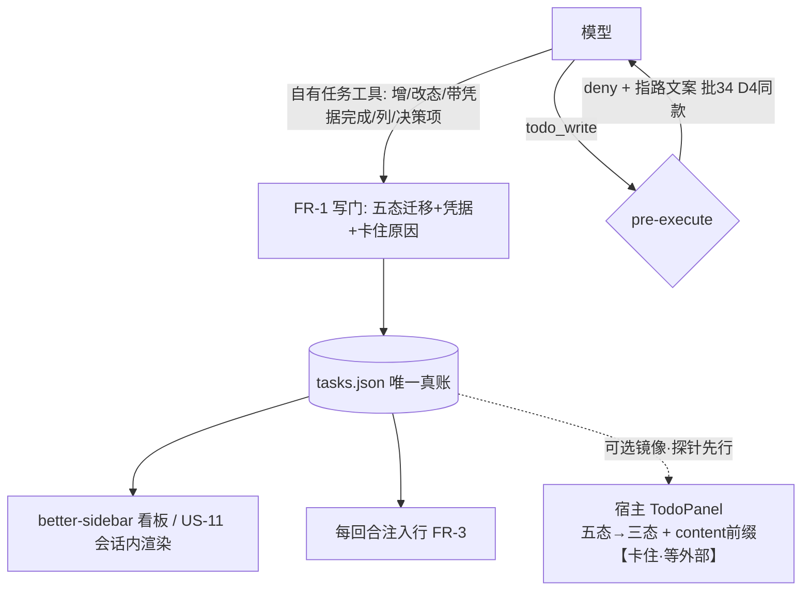

# 会诊纪要 —— consult #83（原始层，机制落盘）

- 日期：2026-10-16
- 会诊 id：83
- 模型：deepseek-official:deepseek-v4-pro, zai-coding-cn:glm-5.3, kimi-api:kimi-k3, opencode-go-plan:mimo-v2.6-pro, codex-cli:gpt-6-astra
- 平台 job：consult-1
- 结果：4/5 交付（其中 4 条有内容 —— **交付数 ≠ 有效数**，R-43）
- requiresReport：true
- 写者：`lib/consult.mjs` 的 `settleAndDeliver`（**只写 §0 汇总与 §1 原始层**；裁定层由主代理写）

## §0 汇总

[consult #83 finished — 4 of 5 replied (1 failed)]

## §1 原始层（机制写——digest 全文，逐字）

```text
[consult #83 finished — 4 of 5 replied (1 failed)]
effective: 4 of 5 (1 failed · 0 without content)
权限面如实（A30-10）：**本部署无法保证只读（平台面无法收窄）**——「只读」仅为**弱证**：`toolFilter.allow` 白名单**下发**（平台不保证模型面可见）；**模型面证据**须读子会话 `request/header` 事件（本部署实测 = [run_code] 单元素 ⇒ 残余绕行口在场，子会话实为 `danger-full-access`）。
models: deepseek-official:deepseek-v4-pro, zai-coding-cn:glm-5.3, kimi-api:kimi-k3, opencode-go-plan:mimo-v2.6-pro, codex-cli:gpt-6-astra
job: consult-1
minutes: docs/consult-minutes/2026-10-16-consult-83-minutes.md
requiresReport: true

--- replies (raw, unjudged — verify with your own tools) ---

[1] codex-cli:gpt-6-astra — failed
(consultation failed: codex-cli PROCESS_ERROR: codex 进程失败（非零退出且无有效输出）（diagnostics: exit=1 | stderr: 2026-10-16T09:59:34.218774Z ERROR codex_models_manager::manager: failed to refresh available models: request timed out 2026-10-16T09:59:34.234443Z ERROR codex_models_manager::manager: failed to refresh available models: request timed out 2026-10-16T09:59:56.960422Z ERROR rmcp::transport::worker: worker quit with fatal: Transport channel closed, when Client(HttpRequest(HttpRequest("http/request failed: error sending request for url (https://chatgpt.com/backend-api/ps/mcp)"))) 2026-10-16T10:00:05.936272Z ERROR rmcp::transport::worker: worker quit with fatal: Transport channel cl…）)

[2] opencode-go-plan:mimo-v2.6-pro — ok
核对完成。宿主实现（`app.asar`，as-of 2026-10-16 字节扫描）、需求档、前序设计档三方证据都已到手。下面是逐条核对 + 明确裁决。

```dsh-ui
{"title":"裁决：纯乙 不行；改走「丙为真源 + 乙为镜像」（乙′）","gap":12,"items":[{"type":"callout","tone":"error","title":"纯乙（宿主 todo 为主、旁挂注解）判不通过","content":"宿主清单无 id、只有可变的 content 字符串、只有三态、按会话日志存续（新会话即空）。把「存在性/状态」放宿主、「凭据/卡住/优先级/为什么」放旁挂文件 = 真源劈成两半，正是你否决的「两套账本」，只是藏进了注解文件。US-2（完成必留凭据）、US-5（同一套账本）、N-1（单一真相源）、N-3（跨会话）四条全被打穿。"},{"type":"callout","tone":"success","title":"乙′ 判通过（= 丙的存储 + 乙的展示红利）","content":"tasks.json 是唯一真源（需求档 §七 schema 原封不动）；宿主 todo/write 降为「3 态有损镜像」，由唯一写门在写入时同步推送。看板、注入行、工具、原生面板四个面里前三个逐条读同一份 tasks.json，第四个是它的投影。11 条 US、8 条 N 全保。"}]}
```

---

# 一、宿主 todo 体系实测事实（9 条，全部带证据）

| # | 事实 | 证据（`app.asar` 行号，as-of 2026-10-16） | 对设计的含义 |
|---|---|---|---|
| F-1 | `TodoItem = { content, status }` 两个字段，无 id、无扩展位 | :290383-290384 | 没有天然对齐键 |
| F-2 | status **只有三态** `pending / in_progress / completed` | :1036870 `TODO_STATUSES = new Set([...])` | 五态（已接手/卡住）宿主表达不了 |
| F-3 | content 必须非空、**已 trim、且全表唯一**（重复即整次调用被拒） | :1036893-1036896 `todo/write repeats content ...` | content 是"事实上的键"，但见 F-4 |
| F-4 | **整表替换**：每次调用重发全表，回放时 last-write-wins | :1036116、:1036146 | content 可被模型任意改写、条目可被静默丢弃 |
| F-5 | 状态存续在**会话日志**里（log-backed），持久性/回放/恢复全来自日志，不是服务 | :1036116 | **按会话存续**，不是按工作区 ⇒ 新会话为空 |
| F-6 | `todos` 投影 = 最近一次整表；首次写入前 `null`；**下一轮次开始时清空**，`turn/end` 保留刚完成的清单 | :1036138 | 看板若读投影会"回合中闪空" |
| F-7 | 不变式**拒收开放轮次之外的 `todo/write`** | :1036635 `todo/write appended outside any open turn` | 不能在启动/看板点击时重推镜像 |
| F-8 | 只有 **owning agent session** 能改；无主调用报 `todo_write requires an owning agent session` | :1036056、:1036852 | 子代理/侧栏 UI 写不进；只能在工具执行面推 |
| F-9 | `todo/write` 事件是"UI 与回放状态，不是第二条模型消息" | :1036187 | 推镜像**不占模型上下文**（对乙′是利好） |

另有两个可用机制（都是本仓已验证先例，不是新发明）：

- `Session.append<T>` 是开放的类型化追加（:290272 声明），`todo/write` 走 declaration-merge 进 `SessionEventMap` ⇒ **插件在工具执行面可以自己追加镜像事件**；
- **`tools/pre-execute` 可以拒工具调用** —— 本仓防漂移批已上生产：`docs/2026-10-14-anti-drift-design.md` §11 C-5（"FR-1/FR-2 门——`tools/pre-execute` 独立注册"，完成门 fail-closed）。这是让"完成必留凭据"在**原生路径上也能硬性拦**的关键。

---

# 二、问题 1：纯乙能否满足"同一套账本"的语义？对齐键用什么？

**裁决：不能。** 不是"表面上不违反"的问题，是**真源被劈成两半**：

- 存在性 + 三态的真源 = 宿主会话日志（F-5，按会话存续）；
- 凭据/卡住原因/优先级/为什么/决策项的真源 = 旁挂文件（按工作区存续）。
- 同一条任务的"状态"因此有两个家：宿主 `status` 与注解里的五态。两边可以合法地互相矛盾（模型把宿主条目写成 `in_progress`，注解说 `blocked`），而**没有任何机制能判定谁对**。
- US-5 要的是"看板 ≡ 注入行 ≡ 工具读取，逐条相同"。纯乙下看板 = 宿主清单 ⊕ 注解，注入行只能读注解（或也去 join）——只要 join 出一次偏差，集合就不等，而且是**静默不等**。T-4（集合相等）在纯乙下只能测"join 函数自洽"，测不了"账本唯一"。

**对齐键**：宿主条目唯一的机械身份就是 content（F-3 强制唯一），但 content 是**可变的**（F-4 整表替换）。所以：

| 候选键 | 判定 |
|---|---|
| 顺序/下标 | 否：整表替换下位置不稳 |
| content 原文 | 否：模型改一个字即断链，且**宿主不禁止改写** |
| 时间戳/模糊匹配 | 否：违反本仓铁律"机检不得靠自然语言理解"（`2026-10-14-anti-drift-design.md` §4 D-3） |
| **content 内嵌 id 标记 `[t-n]`** | **唯一可行**：id 不在宿主 schema 里，就骑在 content 里走（F-3 的唯一性顺带保证标记唯一）；改写 content 只要标记还在，join 就不断 |

**content 被改写时会怎样**：标记被保留 ⇒ 无事；标记被丢 ⇒ 该条与注解**脱钩**。纯乙下脱钩只能猜（禁）；乙′下有兜底——写门拒一切裸 `todo_write`，改写根本进不来，脱钩只剩"孤儿桶"一种残余形态，**必须在看板显式成区 + 留一行痕**，绝不静默合并。

---

# 三、问题 2：分叉时谁是真源？

**裁决：必须先定"唯一真源 = `tasks.json`"，其余一切（包括宿主清单）都是它的派生视图。** 分叉的正确处理不是"谁赢"，而是**让分叉写不进去**：

1. **唯一写门**：只有 suite 的 `task_*` 工具能改账本（含完成凭据校验），它在同一次写入里同步推宿主镜像（`exec.agent.session.append('todo/write', …)`，F-9 不占上下文）；
2. **旁路封死**：`tools/pre-execute` 拒裸 `todo_write` 并指路 `task_*`（先例 = 防漂移 C-5）；
3. **残余显式化**：孤儿注解、镜像推失败（如子代理无主会话 F-8）都进看板"异常区"，带一行痕。

**"乙是不是把两套账本换个地方藏起来？"——按字面乙，是。** 论据很直接：旁挂注解要装 `check/evidence/blockedReason/blockedBy/priority/why/kind/时间` 共 8 类字段，宿主只剩 `content+status` —— **注解文件本来就是需求档 §七 的 `tasks.json`，只是被剥夺了 id**。也就是说纯乙 = 把已拍板的 `tasks.json`（D-6「suite 自己的轻量台账」、§七 schema、N-1）改名成"注解"，再挂到一个按会话存续、无 id、可改写的宿主清单上当主——**每一处都更糟，没有任何一处更好**。而乙′ 只是把宿主清单从"主"降为"镜像"，两套账本的观感立即消失：盘上只有一份 `tasks.json`（N-1 原样成立），宿主面板是它的 3 态投影。

---

# 四、问题 3：降级还是改走丙？

**裁决：不降级，走「丙-真 + 乙-镜像」。** 理由：纯乙逼你砍的恰好是这个产品的灵魂四条——US-2（没凭据完不成）、US-5（同一套账本）、N-1、N-3（跨会话）——砍完剩下的东西用户第一句话就已经否决过了。而乙想要的好处（原生工具零学习成本、原生 TodoPanel 白得）**一条都不用放弃**：镜像一推，原生面板照样显示，模型照样能看懂清单。

---

# 五、11 条 US × 两种路径逐条核对

| # | 需求 | 纯乙（宿主为主） | 乙′（tasks.json 真 + 镜像） | 证据锚点 |
|---|---|---|---|---|
| US-1 | 建任务带 check/优先级/why | ❌ 宿主无这些字段，建单即"裸奔"，无法校验 | ✅ `task_add` 校验 check 非空 | F-1 |
| US-2 | **完成必留凭据，无凭据拒且零写入** | ❌ 原生 `todo_write` 随手 `completed`，**硬门打不着**（除非另挂 pre-execute，那已是乙′的机制） | ✅ 写门 fail-closed + T-1 sha256 腿 | F-4、先例 C-5 |
| US-3 | 五态流转、卡住必带原因 | ⚠️ 半满足：五态只能活在注解，宿主面板永远 3 态 | ✅ 五态为真；镜像降映射为 3 态 | F-2 |
| US-4 | blockedBy external/self | ✅（注解层） | ✅ | 需求档 §七 |
| US-5 | **看到的 ≡ 模型读到的（同回合逐条）** | ❌ 看板=join 两个源，状态可分叉、集合可静默不等 | ✅ 三面同读 `readTasksView()`，T-4 集合相等可机检 | F-5、F-4 |
| US-6 | 侧栏看板 + 点任务开侧边对话 | ✅ 与本题无关 | ✅ | §十.1 仍待小实测 |
| US-7 | 两个复制按钮 | ✅ | ✅ | — |
| US-8 | 决策项独立区置顶 | ⚠️ kind:decision 只能在注解，宿主面板无分区 | ✅ | 需求档 D-8 |
| US-9 | ledger.mode=off | ✅ | ✅ | — |
| US-10 | 结构化文档只读源 | ✅ | ✅ | — |
| US-11 | 无 better-sidebar 降级 | ✅ | ✅ | — |
| N-1 | 盘上只有一份 tasks.json | ❌ 真源劈成"会话日志+旁挂文件"两种介质 | ✅ | F-5 |
| N-3 | **跨会话/跨重启、绑工作区** | ❌ 宿主清单按会话存续，**新会话即空** | ✅ tasks.json 绑工作区 | F-5、F-7 |
| N-5 | 前缀缓存/确定性注入 | ⚠️ 注入摘要若掺宿主状态，随会话日志漂 | ✅ 纯函数读 tasks.json | 先例 L-6 |
| N-8 | 可机检 | ⚠️ T-4 只能测 join 自洽 | ✅ | — |

---

# 六、乙′的代价（如实报）

| # | 代价 | 缓解 |
|---|---|---|
| 1 | 原生 `TodoPanel` 只显示 3 态有损投影（卡住→`pending`，五态/凭据/决策项看不到） | 在镜像 content 前缀加 `⛔`/`✅` 等标记；或提供配置**不推镜像**（原生面板留空），让"多面板状态打架"的观感可关 |
| 2 | 模型写任务要走我们的 `task_*` 工具（不再是裸 `todo_write`） | 工具描述教学 + pre-execute 拒写文案指路；镜像事件让原生面板照常亮 |
| 3 | 镜像只活在会话日志：**新会话的原生面板是空的**，直到本会话第一次写（F-7 拒收轮次外重推） | 看板不依赖镜像；把"原生面板是会话内视图"写进边界表，不承诺跨会话 |
| 4 | 多一套镜像一致性机检腿 | 并进 T-4（集合相等扩到镜面），一次写门保证同步 |

---

# 七、你们可能没想到的风险（10 条）

1. **content 唯一约束会反咬镜像**：两张同名任务会被宿主**整次调用拒掉**（F-3），连带整表没写 ⇒ 镜像与真源不同步。写门推镜像前必须自动消歧（如 `[t-3] 标题` 里 id 已天然消歧，但纯标题撞车仍要处理）。
2. **整表替换 = 静默丢条目**：模型某次少抄一条，宿主清单就少一条而无人报警。纯乙下这就是账本丢数据；乙′下只是镜像丢——但要有"镜像条数 ≠ 真源条数"的痕。
3. **投影生命周期坑**：`todos` 投影在**下一回合开始时清空**（F-6），看板/任何 `useProjection("todos")` 的消费方会在回合中段读到空。看板必须读文件，不读投影。
4. **轮次外不能重推**（F-7）⇒ 别在设计档里承诺"重启后原生面板还在"。同会话 resume 可以（日志回放），**新会话不行**。
5. **子代理/无主会话写不进**（F-8）：delegated subagent 里调用写门 ⇒ 镜像推送会失败。降级行为要设计：注解照写、镜像跳过 + 一行痕（fail-open），不能整个写入失败。
6. **`allowParallelInProgress: true` 是本机现状**（:1061921 等多处）⇒ 多个 `in_progress` 合法；五态的"已接手/在做"映射别假设单活跃。
7. **N-7 秘密禁令的主战场就在 evidence 字段**：「跑了什么、看到什么」是**最容易粘贴 token/密钥**的自由文本。T-10 的疑似凭据检测必须覆盖 evidence，且是**拒写**不是打码。
8. **跨会话并发写**：N-3 打开了"新会话读同一份"，D-5 又只承诺单人单写——**两个活跃会话同工作区**时原子写只防撕裂不防丢更新。要么加文件锁，要么写门带"读后写"版本号。（`goal-criteria.json` 同样暴露，一并处理。）
9. **宿主是 0.2.0-rc.2**：`todo/write` 形状、投影语义、不变式都可能在 rc 期漂移。装配期探测 + 一次降级（镜像面关、机制本体不受影响），照抄防漂移 §5 的"探测降级"先例。
10. **两个面板并排 = "两套账本"的观感风险**：原生 TodoPanel 与我们的看板同时亮着，用户看到两列不同状态。必须在看板上明示"原生面板 = 本账本 3 态投影"，并给"不推镜像"开关——否则修完了数据层还是输在观感层。

---

# 八、请用户拍板（前因后果 + 建议 + 代价）

| # | 决策点 | 前因后果 | **我建议** | 选了会怎样 / 不选会怎样 |
|---|---|---|---|---|
| **D-13** | 真源归属：谁是"那套账本" | 纯乙把状态劈给宿主会话日志、扩展字段给旁挂文件 ⇒ US-2/US-5/N-1/N-3 全被打穿，且注解文件实际就是被剥夺 id 的 tasks.json | **`tasks.json` 唯一真源，宿主 todo = 3 态镜像**（丙-真 + 乙-镜像） | 选：11 US + 8 N 全保，原生面板白得（有损）。不选（纯乙）：必须砍掉完成硬门、集合相等、跨会话三条，用户第一句诉求就没了 |
| **D-14** | 对齐键 | 宿主条目无 id，content 唯一但可变（F-3/F-4） | **id 骑在 content 里：`[t-n] 标题`**；改写丢标记 ⇒ 进看板"孤儿区" + 一行痕 | 选：改写标题不断链。不选：只能按 content 原文对齐，模型改一个字注解就成孤儿 |
| **D-15** | 写路径 | 裸 `todo_write` 绕得过一切完成门（US-2 失守的唯一缺口） | **`task_*` 唯一写门 + `tools/pre-execute` 拒裸 `todo_write`**（留配置逃生口，照抄 `antiDrift.completeGate=false` 先例） | 选：凭据门/五态/决策项全部硬性成立。不选：US-2 降级为"软提醒" |
| **D-16** | 镜像策略 | 原生面板与我们看板并排，状态列可能"打架" | **默认推镜像（content 带状态符号），并提供"不推镜像"开关** | 选：原生面板有用但有损，需在看板注明。不选：原生面板常空，白丢乙的红利 |

**仍需小实测的 3 点**（进设计档前）：① 侧栏能不能开侧边会话（US-6，§十.1，主会话已认领）；② 插件在工具执行面 `exec.agent.session.append('todo/write', …)` 是否真的被不变式接受（F-7/F-8 的边界，决定镜像可行性）；③ `todo_write` 输入 schema 是否拒未知字段（F-1 的严格程度，影响"往宿主塞字段"是否彻底死心）。

**一句话收尾**：乙 的直觉是对的（不要两套账本），但它把"主"安错了地方。账本只能有一个家——`tasks.json`；宿主 todo 是它的镜子，不是它的身。

[thincoder-suite] effort "max" is not supported by model mimo-v2.6-pro (supported: off|high) — falling back to nearest supported effort "high"（D-裁决-2 最近支持档，等距向上取）

[3] zai-coding-cn:glm-5.3 — ok
# 裁决：路径乙**结构性不可行**，不是“实现要认真对齐”的问题 —— 改走丙，丙上带四条修正

我读了需求档全文、anti-drift 设计档全文，并对 `app.asar` 做了逐行 grep 实读（不是转述）。**有一条决定性事实你们的三条路径讨论里都没有**，它单独就能否决乙。

---

## 一、决定性新证据：宿主 todo 是「回合级」的，不是台账

宿主 `todos` 投影的 fold 代码（app.asar 实读，行号为 grep 实测坐标）：

```
1036477:  key: "todos",
1036478:  stateSchema: todosProjectionSchema,
1036481:    if (event.type === "todo/write") return event.data.todos;
1036482:    if (event.type === "turn/start") return null;      ← 下一回合开始，投影清空
```

宿主自己的文档（asar 内嵌，1036138 英文 / 1036314 中文）逐字：

> 「投影即有效计划——最新的整份 `todo/write` 列表，**首次写入前为 `null`，下一轮次开始时清空**，而 `turn/end` 保留刚完成的清单。」

配套事实（全部实读核到）：

| # | 事实 | 证据（app.asar 行号） |
|---|---|---|
| 1 | **每个新回合开始，投影清空**；面板空列表不渲染（`todos.length === 0 ⇒ return null`） | 1036482 · 421233 |
| 2 | **整表替换**：「agent 每次更新都发送完整列表……没有部分更新或逐项编辑」；多余字段被 schema 拒 | 1036096 · 1036416 · 1036447-1036448 |
| 3 | **无 id**，content 是快照内唯一键（重复 content 报错），但**跨快照无任何身份** | 1036448 · 1036187 |
| 4 | **单一会话归属**（"per-session ownership"；无 owning agent session 即报错） | 1036046 · 1036568 |
| 5 | **宿主不把 todos 回喂给模型**：「`todo/write` 会话事件是 UI 与回放状态，而非第二条模型消息」——模型对自己清单的全部认知 = 自己历次工具调用参数，**压缩后即丢**（压缩里只剩 joinText 的有损文本，957154） | 1036187 · 957154 |
| 6 | TodoPanel 是投影**唯一消费者**（全 asar `useProjection("todos")` 仅 1 处）；默认折叠（主会话已验） | 421289 |

**结论一句话**：宿主 todo 体系是「模型本回合的工作计划显示屏」——回合即弃、单会话、三态、无身份、无回喂。它跟你们要的「跨回合、跨会话、绑工作区、带凭据、五态、可机检同源」的台账**不是同一个物种**。

---

## 二、逐问回答

### Q1：乙能否满足「同一套账本」的语义？—— 不能，四条独立致命

1. **生命期错配（最硬的一条）**：账本要求跨回合存续（N-3、D-5、US-5）；宿主列表每个回合开始就被平台清掉。要让任务“在场”，模型必须**每个回合开头重发整张清单**——平台不强制、压缩后模型手里的旧表已丢（事实 5），只能靠你们的注入行把清单喂回去、模型再抄写进 `todo_write`。这是永动的抄写税，且必然间歇性掉链子（模型哪回合忘了发，看板当场清空）。
2. **身份错配**：宿主条目没有 id，唯一可机检的对齐键 = **content 字符串精确相等**。「content 被改写时会怎样」的诚实答案是：**静默断链**——注解（凭据/卡住原因/优先级）变孤儿，新条目变裸条目，无任何报错。模糊匹配撞你们自己的铁律（机检不得靠自然语言理解）。把 id 编进 content（“T-12 · 修登录”）也救不了：宿主的去重键是**整条 content**，不是前缀——两条同 id 不同措辞的条目照样通过查重，id 唯一性**没有 schema 保证**，只剩提示词纪律。
3. **归属错配**：投影按会话隔离（事实 4），注解旁挂文件却绑工作区。你们的生产形态恰是**同工作区多会话并行**（用户自己的规矩：「还有别的会话在工作」）。两个会话各有一张宿主清单 + 一份共享注解 ⇒ “看板 = 宿主 ⊕ 注解”这个合并在多会话下**无定义**。
4. **「模型看的就是这套」本身不成立**：宿主不回喂（事实 5）。模型真正可靠的可见面反而是**你们的注入行**——到那一步，旁挂层+注入行才是真账本，宿主清单退化成一块渲染面。乙的立论就倒了。

补充一个你们没问但该知道的：乙唯一的真执法点（`tools/pre-execute` 拦 `todo_write`，像 anti-drift 拦 `create_goal` 那样）也**被对齐键废掉**——门要判“无凭据不得 completed”，凭据注解挂在旧 content 上，模型改一个字再标完成，门要么误拦要么形同虚设。

### Q2：分叉时谁是真源？—— 旁挂层事实上是真源 ⇒ 乙 = 换了地方的甲

真源必须是有身份、跨会话、带凭据的那份 ⇒ 只能是旁挂文件。宿主清单在合并里赢不了任何字段（五态、凭据、决策分区全在注解侧），它只贡献“本回合计划里有没有这句台词”。**一个永远输的源 + 一个永远赢的源，不叫单一真相源，叫“两套账本 + 一个合并函数”**。而且用户在 D-2 否决的正是“会骗人的看板”：原生面板（清空态/三态）与看板（合并态/五态）常态不一致，看板越权威，面板越像 bug。用户原话「如果不是同一套，那就没意义了」——乙在语义上就是甲，风险**不可接受**。

### Q3：降级还是丙？—— 丙，且**一条用户故事都不用砍**

11 条故事没有一条依赖宿主面板；“原生面板白得”从来不是需求，是乙方案搭售的卖点，而这块面板按事实 1/6（回合清空+默认折叠+空不渲染）本来也亮不起来。**降级没有对象**：要砍的都不是用户拍的，而是乙硬引进的。

**裁决：走丙，附带四条修正（写进设计档）：**

- **丙-1 · 声明物种边界（必做）**：设计档引用证据（1036481-1036482、1036138）写明：宿主 TodoPanel = 模型**本回合工作计划**（回合即弃），本台账 = 跨回合/跨会话任务账本；**看板不读 `todos` 投影**，两者不合并、不镜像。防后人“顺手统一”复发甲/乙。
- **丙-2 · 明确排除宿主全部三块任务面（必做，防复诉）**：宿主其实有**三个**任务体系，逐条记否决理由——① `todos`（回合级，本文）；② plan mode 的 `plan` 投影（规划期专用，宿主提示词明说“Do not use todo_write to track this planning phase”，366708）；③ **实验性 Agent Teams 共享任务板**（`team_task_create/get/list/update` + `agentTeam` 投影，808344/825372/826021——**它是宿主里唯一持久的、带 id 的任务面**，但：experimental 无稳定性承诺、默认关、开启即切换团队模式并**禁用普通子代理委派**（807875），且无凭据门/五态/决策类）。这条是新发现，务必入档，否则半年后一定有人问“为什么不用宿主自带的 team tasks”。
- **丙-3 · 需求档两处措辞顺带修**：§四 D-2 与 N-1 的“同一套账本”语义在丙下**不变且更真**（看板⊕注入行⊕工具三面读同一 `tasks.json`，T-4 集合相等按构造成立）；但 §一 总目标里“因为它们读写的是同一份 tasks.json”要在设计档里落成**三面共用同一个读函数**（`readTasksView`），别只靠“同一个文件”的口头承诺。
- **丙-4 · 乙的执法点回收利用**：`tools/pre-execute` 门不用在 `todo_write` 上，用在自家 FR-1 写门上（无凭据 done 拒且零写入）——这本就是 FR-1，等于乙方案里唯一有价值的零件你们已经有了。

---

## 三、你们可能没想到的风险（乙丙都受影响，丙下必须处理）

| # | 风险 | 说明与对策 |
|---|---|---|
| **R1 同工作区多会话并发写** | 需求档 §九 写“单人单写、不承诺并发”，但你们的真实部署就是**同一用户多个并行会话写同一个 tasks.json**。原子写防半文件，防不了丢更新。⇒ 设计档必须加：修订号/读-改-写冲突检测 + 分叉时显式告警（fail-loud），否则 US-5 的集合相等会在两个会话的读写间隙里真实地破 |
| **R2 注入行预算被台账吃掉** | 台账是唯一会长的东西（几周后的活任务+待决策），512 上限、现最长 291、字段已放宽到 140（L-6）。§十-4 的重标定要做，且摘要策略必须**纯确定性**（如：待决策全列 + 活任务按优先级取 Top-N + done 只给计数），否则撞 A-6/N-5 |
| **R3 原生工具偏好反噬** | 若将来加“镜像到 todo_write”的桥（我建议 v1 不加：回合清空使其收益≈0，反而引入每个回合的镜像税），模型会因原生工具更顺手而冷落你们的 task 工具——镜像若做，工具描述必须写“仅显示用，真源在台账” |
| **R4 会话内没有原生进度条了** | todo_write 的转录行（704169 渲染器）是块免费的用户可见进度面；丙下这块没了，由看板+注入行+US-11 兜底。可接受，但要知道丢了什么 |
| **R5 US-6 侧边会话仍未实测** | 本裁决不动 §十-1 的待实测项 |
| **R6 宿主 todo 行为本身可能漂移** | 乙/镜像类方案赌的是未承诺的宿主行为（turn/start 清空、单消费者、schema 形状都是 0.2.0-rc.2 的实测，无契约保证）；丙对这些零依赖——这本身就是丙的又一论据 |

---

## 四、一句话给用户

> 宿主那套是**模型一个回合内的工作便签**（下个回合开始就自动擦掉），你们的台账是**跨天跨会话的账本**——乙方案等于把账本记在便签上再拿胶带贴注解，胶带（content 对齐）一碰就掉。**走丙：自己的账本+自己的看板**，11 条需求一条不砍；代价是模型要学我们的任务工具（注入行兜底），以及必须现在就把“多会话并发写同一文件”的冲突策略补进设计档。

**证据附录**：app.asar（0.2.0-rc.2）grep 实读——todos 投影注册 1036476-1036486；turn/start 清空 1036482（中文文档复认 1036314）；整表替换/查重/严格 schema 1036096/1036447-1036448/1036416；单会话归属 1036046/1036568；事件不回喂模型 1036187；TodoPanel 空不渲染 421233、唯一消费者 421289；plan-mode 提示词 366708；实验团队任务板 807875/808344/825372/826021。需求档：§一/§二/§四 D-1~D-12/§八 T-4/§九；anti-drift 设计档：§4 D4（pre-execute 门先例）、§14 L-2（投影读法先例）、L-6（注入行预算）。

[4] deepseek-official:deepseek-v4-pro — ok
证据链已闭合。装机版 asar（0.2.0-rc.2，用户机器上实际运行的版本）与源码树（0.2.1-alpha.2）完全一致地证实了三个此前没人读到的关键事实。下面是核对报告。

---

# 核对报告：路径乙（认宿主 todo 为主）逐条核对裁决

## 三句话结论

1. **乙不可行——不是"部分不满足"，是地基不存在。** 宿主的 todo 不是账本，是**每回合开始即被清空的"本回合计划条"**：投影的 apply 函数在 `turn/start` 事件时直接归 `null`（装机版 `app.asar:1036482`，源码 `tool-todo/src/index.ts:119-131`）。一个必须跨回合、跨会话、跨重启存活的台账（需求档 N-3），住不进一个每回合归零的容器。
2. **"模型看同一套账本"在宿主体系里从来就不存在**：宿主只有 `todo_write` 一个工具（无任何 read 工具），且 `todo/write` 事件被宿主文档明确声明为"**是 UI 与回放状态，不是第二条模型消息**"（装机版 README，asar:1036187）。全仓 grep 证实 todos 投影的**唯一**运行时消费者是客户端 TodoDock（`TodoPanel.tsx:107`）。模型的"读面"= 它自己上一次 write 的调用记忆。所以乙的卖点"模型用原生工具读写同一套账本"是个**不存在的体验**。
3. **建议改走丙（自建台账 + 看板），不降级砍需求。** 丙上 11 条用户故事与 N-1/N-3/D-5/D-6 原样成立，US-5 从"靠同步纪律维持"升级为"单文件结构保证"；代价只有一个：模型学一个新工具——而**乙里模型照样必须学我们的注解工具**（凭据/卡住/优先级/为什么/决策项，宿主 schema 一概拒收），还要额外维护两个工具之间的同步纪律。乙的工具面负担反而更重。

---

## 一、乙的三个死穴（带证据）

### 死穴 1：宿主清单是回合级状态，不是账本

```text
// packages/todo/tool-todo/src/index.ts:119-131（装机版 asar:1036482 逐字相同）
// Standing-plan fold: latest whole todo/write list, cleared by the next
// turn/start (turn/end keeps the finished checklist visible); null before the
// first write or after a later turn begins ...
apply: (state, event) => {
  if (event.type === 'todo/write') return event.data.todos
  if (event.type === 'turn/start') return null      // ← 每回合开始，清单归零
  return state
},
```

含义：**每一条用户消息开启新回合的瞬间，宿主清单被清空**；模型必须在新回合里重新写一次才"续命"。TodoDock 渲染的正是这个投影（`TodoDock → useProjection('todos')`），即宿主面板只在"本回合内模型写过清单之后、下一回合开始之前"显示内容。作为"个人任务台账"的载体，它在每个回合起点是空的、在回合之间显示的是上一回合的残影。e2e 测试自己的注释（`apps/web/tests/todo-row.expected.e2e.ts:56`）也写明：面板是"**the standing plan the turn's `todo/write` event feeds**"——本回合计划，不是台账。

### 死穴 2：模型对宿主清单没有读取面

- 宿主只有一个 todo 工具：`todo_write`（`tool-todo/src/index.ts:135-211`）。**没有 read 工具**（全仓 grep `todo_read|todo-read` 零命中）。
- `todo/write` 事件"是 UI 与回放状态，**不是第二条模型消息**"（装机版 README，asar:1036187）——即清单变化不会作为消息重新送进模型上下文。
- 全仓唯一读取 `todos` 投影的运行时代码是客户端 `TodoDock`（`TodoPanel.tsx:107`）；`packages/core` 里没有任何注入逻辑（grep `'todos'` 零命中）。

所以"模型看到的账本"在宿主体系里 = **模型对自己上一次 write 调用的记忆**。它不能读当前清单，除非再写一次——而每次写都是**全量替换**。乙设想的"模型用原生工具读写同一套账本"没有读写循环，只有一个写写循环。

### 死穴 3：注解层与主清单没有稳定对齐键

宿主条目 `{content, status}` 无 id（`TodoItem` 定义 `docs/subsystems/todo.md:22-27`），且：

- **每次写是全量替换**（工具描述逐字："The COMPLETE task list, replacing any previous list"，`tool-todo/src/index.ts:142`）⇒ 改写标题与"删除旧的+新增一个"在数据上**不可区分**。
- **写时强制 content 唯一**（`tool-todo/src/index.ts:89-92`；装机版 asar:1036448 同款 `duplicate content` 报错）⇒ 同快照内 content 可当键，但只保证"这份快照里唯一"，不保证"跨快照稳定"。
- UI 自己也是拿 content 当 React key（`TodoPanel.tsx:88` `key={item.content}`）。

候选键逐一排除：**content 精确匹配** ⇒ 模型重发清单时的任何微小改写（加空格、换措辞）都让注解失联，且每回合清空后模型重写时几乎必然有漂移；**下标** ⇒ 全量替换+重排语义下无意义；**content+status 对** ⇒ 同样漂移；**模糊匹配** ⇒ 违反本仓既有铁律（"机检不得靠自然语言理解/启发式"，见 anti-drift 设计档 §4 D3 被否备选同款理由），且**错挂比丢失更糟**——把完成凭据挂到另一个同名任务上，正是"会骗人的看板"的形态。

---

## 二、三个问题的直接回答

### 问题 1：乙能真正满足"同一套账本"的语义吗？——不能

| 层面 | 乙的实况 |
|---|---|
| 集合同一性 | 回合起点：看板（投影=null）≠ 模型记忆（上一回合它写的清单）≠ 注解文件（持久）。三方三套，**每回合必然发生一次** |
| 模型可见性 | 模型无读面；注解层内容（五态/凭据/为什么/决策项）只有靠我们自己注入才能进模型上下文 |
| 键稳定性 | 无稳定对齐键（死穴 3），注解永远在追一个"每回合清空、又不保证逐字重发"的移动靶 |
| US-5 判据 | "同回合三方集合相等（逐条）"**结构上不可能成立**：看板 = 回合级快照 ⊕ 注解；工具读面不存在；注入行是 ≤512 字符摘要 |

### 问题 2：分叉时谁是真源？——乙只有两个自洽回答，两个都违反用户拍板

- **宿主为真源** ⇒ 注解是装饰 ⇒ 每回合开始账本清空、模型重发时注解随时失联 ⇒ US-2/3/4/8 变成"尽力而为"，用户拍板的凭据门与五态失去权威性。
- **注解文件为真源** ⇒ 每回合都要把注解层投影回宿主清单（全量重写）⇒ 宿主面板显示的永远是我们写进去的副本 ⇒ **这就是丙，外加一个每回合必须维护的镜像**，还多两个失败面（写宿主事件失败、回合清空竞争）。

没有第三个选项。而且分叉**不是"可能发生的坏运气"，是每回合必然发生的结构事实**（turn/start 清空 + 全量重发 + 无稳定键）。结论：**乙确实只是把"两套账本"换了个地方藏起来**——从"tasks.json vs 宿主面板"变成"会话事件日志 vs 注解文件"，且两套的**生命周期不一致**（回合级 vs 持久级），分叉风险比甲还高。

### 问题 3：降级还是改走丙？——改走丙，不降级

若硬走乙必须砍/弱化的，恰恰全是用户拍板的核心：

- US-2 凭据门：从"无凭据 done ⇒ 拒且零写入"退化为"事后标注缺凭据"（技术细节见风险 c：即便用 `tools/pre-execute` 拦 todo_write，门粒度是**整份清单**——一次调用里任何一条无凭据完成会连累同次调用的所有无关变更被整体拒绝，模型无路可走时只能丢弃其余更新）；
- US-3/4 五态：只能在注解面表达，宿主面板显示失真（"卡住"在宿主面板里要么消失、要么伪装成 pending——而 pending 的语义是"没开始"，模型会误判为可开工）；
- US-5 集合相等：降级为"同源+摘要"；
- **N-1 / N-3 / D-5 / D-6 四条已拍板决策要整体翻案**：乙的主清单住在会话事件日志（append-only、按会话持久化）而不是"盘上唯一一份 tasks.json"，与"绑工作区、跨会话跨重启、JSON+原子写、suite 自己的台账"全部冲突。

砍完这些，乙剩下的就是一个"每回合清空的标题+三态壳子 + 我们自己的全部逻辑"——比丙**多两个失败面、少一个硬门**。而丙的代价只有一个"模型学一个新工具"，且该代价乙同样要付（见下）。

---

## 三、US 逐条核对表

| 判据 | 乙 | 丙 |
|---|---|---|
| US-1 check/priority/why | ⚠️ 全部住注解层，模型须学注解工具；与宿主清单靠不稳定键对齐 | ✅ 单文件字段 |
| US-2 无凭据完成不了 | ❌ 硬门退化为跨工具协调：deny todo_write 是"整单拒绝"，补凭据要走第二个工具，两次调用之间是崩溃窗口 | ✅ 单工具单文件前置校验，零写入拒（FR-1 原样） |
| US-3 五态流转 | ❌ 宿主三态，无迁移约束；模型可任意 completed→pending | ✅ tasks.json 状态机 + 写门 |
| US-4 blockedBy | ⚠️ 仅注解面；宿主面板永远显示不出"卡住" | ✅ |
| US-5 同一套账本 | ❌ 回合起点三方必分叉；模型无读面 | ✅ 看板≡工具读≡同一文件（结构保证）；注入行是显式摘要面 |
| US-6/11 看板与降级 | 两案相同（都自建看板，宿主面板不是看板） | 同 |
| US-7 复制话术 | ⚠️ 读面要跨两个源 join，join 即失败点 | ✅ 单源派生 |
| US-8 决策项置顶 | ⚠️ 仅注解面；宿主面板里决策项与普通项无法区分 | ✅ kind 字段分区 |
| US-9 团队开关 | 两案相同 | 同 |
| US-10 结构化文档只读源 | 两案相同（独立机制） | 同 |
| N-1 盘上单一真相源 | ❌ 会话事件日志 + 注解文件 | ✅ 一份 tasks.json |
| N-3 跨会话/跨重启 | ❌ 宿主清单回合级、会话级 | ✅ 绑工作区落盘 |
| D-5/D-6 JSON 原子写、suite 台账 | ❌ 翻案 | ✅ 原样 |
| N-5 前缀缓存 | ❌ 摘要并入注入行后，随 turn/start 每回合必变 ⇒ 该段同文不重发的收益蒸发 | ✅ 台账不变则摘要不变 |

---

## 四、你们可能没想到的风险（按杀伤力排序）

**a.（决定性）回合级清空**——父侧实测读到了"投影注册 + 事件"，但漏读了 apply 函数里的 `turn/start → null` 分支。这是乙的地基性反证：宿主清单**从来没有**被设计成可长期承载任务的容器。

**b. 模型无读面**——"模型用原生 todo_write、零学习成本"的前提（模型能读清单）不成立。而且恰恰相反：**乙里模型要学两个工具**（宿主 todo_write 管标题与三态 + 我们的注解工具管其余一切），还要维护跨工具一致性；丙只要一个。

**c. 凭据门的粒度是整份清单**——todo_write 一次调用携带全部任务。用 `tools/pre-execute`（本仓已有先例，anti-drift FR-2）deny 一次含无凭据完成的调用 = 拒绝同次调用里的所有无关变更。模型要么把合法变更一起丢弃，要么把完成项降回 in_progress 绕过门。门从"写门"退化为"拉扯"。

**d. content 唯一 + 全量替换的组合拳**——两个同名任务在宿主清单里**非法**；而"待拍板决策区"出现同名条目（两个"确认 xxx 方案"）是常见情形。全量替换语义下，改名 = 删旧建新，注解无从跟随。

**e. 两套一致性机制无法事务绑定**——注解文件走原子写，宿主清单走 append-only 事件日志回放。没有任何一个原子操作能把"宿主清单变更 + 注解变更"绑成一个事务；崩溃/压缩在两者之间留下的缝隙就是"会骗人的看板"的出生点。

**f. 升级风险**——宿主投影带 `stateVersion: 2`（`tool-todo/src/index.ts:133`），且宿主文档自述该功能是"Model-facing whole-list replacement"（回合计划）。把核心账本押在一个明确声明为回合计划、语义可随版本合法变化的宿主功能上，等于在宿主每次升级时都可能被震碎对齐层。

**g. "白得宿主面板"是幻觉**——TodoPanel 默认折叠、空列表不渲染（`TodoPanel.tsx:65-68`）、且挂在**输入框上方的 dock**（`conversation.input.dock`，不是右侧栏）。作为台账它多数时刻是空/过期的，反而制造"两套账本"观感。

**h. 五态→三态的映射损失**——"卡住"无宿主表示；"已接手"与"在做"都挤在 in_progress；`allowParallelInProgress: false` 部署下模型只能标一个 in_progress，而我们的"已接手"可能多任务并存——任何映射都丢信息。

---

## 五、代价与建议

**乙的完整代价**（若坚持走）：翻案 D-5/D-6/N-1/N-3 四条用户已拍板决策；US-2 硬门降级、US-3/4 仅注解面、US-5 降为"同源+摘要"；长期维护模糊对齐层（孤儿区、重挂启发式）；看板每回合起点闪烁为空；注入行每回合必变（破 N-5 的缓存收益）。换来的"模型用原生工具"是假收益（无读面）。

**丙的代价**：模型学一个新工具（与乙相比是**纯减负**——一个工具替代两个）；宿主 TodoPanel 空着（它本就只是回合计划条，与台账语义无关；建议向用户讲明这是**范畴差别**：宿主那套管"这一回合我准备干嘛"，台账管"我欠哪些事、卡在哪、凭什么算完"——这正好呼应需求档 §一 非目标 1 与上游 thincoder"删一留一"的教训，二者语义不同，不构成"两套待办跟踪"）。

**给父侧的行动项**：
1. 把这份核对结果给用户拍板（乙→丙），并把需要翻案的 D-5/D-6/N-1/N-3 明列——这些是用户拍过的，换方案必须用户点头。
2. 设计档可补一条可选的丙扩展（若用户舍不得宿主面板）：台账 → 每回合单向投影进宿主清单。但应明确标注这是**丙的扩展、不是乙**，且 v1 不建议（每回合重投影成本 + 模型自写 todo_write 与投影竞争写入）。
3. 设计档需把 US-5/T-4 的"集合相等"落在丙上的精确口径钉死：看板 ≡ 工具读（结构保证，逐条相等）；注入行是显式声明的**有界摘要**（≤512 字符 + "…还有 N 项"尾巴），机器腿断言"摘要列出的每条 ∈ 看板集合且状态一致"，而不是与摘要全等——这已是需求档自己的措辞（"注入行摘要"），只需把腿写准。

**证据索引**：`tool-todo/src/index.ts:119-131`（回合清空）· `:135-211`（唯一工具、全量替换、content 唯一）· 装机版 `app.asar:1036482`（同款清空分支）· `:1036187`（"不是第二条模型消息"）· `:1036448`（duplicate content 报错）· `TodoPanel.tsx:65-68,88,107`（折叠/空不渲染/content 作 key/唯一投影消费者）· 需求档 `docs/2026-10-16-task-ledger-requirements.md` §四 D-5/D-6、§三 N-1/N-3、§二 US-5。

[5] kimi-api:kimi-k3 — ok
核对完成。所有关键机制已在**源码树**（0.2.1-alpha.2）与**装机 asar**（0.2.0-rc.2）**双侧验证一致**。以下是逐条核对报告与裁决。

---

# 核对结论：路径乙 —— **不可行**（仅退化子集可行），建议改走**丙**

## 一、实测事实清单（每条带双侧证据）

| # | 事实 | 证据 |
|---|---|---|
| F1 | 条目 schema 严格 `{content, status}`，`additionalProperties: false`，**未知键在工具运行时边界硬拒**（"fails loud"是宿主刻意设计） | 源码 `packages/todo/tool-todo/src/index.ts:145`（注释 :72-75 逐字说明拒绝扩展形状）；asar :1036500 + 拒绝文案 :1042141 |
| F2 | status 枚举**写死三态** `pending\|in_progress\|completed` | 源码 :26,148-153；asar todoWriteDefinition 区 :1036440-1036558 |
| F3 | **整表替换、last-write-wins、刻意无 id**（"no id — whole-list replace needs no stable identity"；priority 也是刻意砍掉的） | `.agents/notes/archived/feature/2026-06-29-todo-write-tool.md:18,28-30` |
| F4 | content 被 trim、拒空、**拒重复** ⇒ 快照内 content 唯一（对键控唯一的好消息） | 源码 :85-91；asar :1036448 |
| F5 | **`todos` 投影每逢 `turn/start` 清空为 null** ⇒ 宿主面板是"回合内进度条"，不是常驻台账 | 源码 :129；asar :1036482；Agent Note :22（"reopened session re-derives… not followed by a later turn/start"） |
| F6 | 清单**会话私有**：非 agent 调用拒写；官方明示"no shared scope…cross-agent lists remain a separate future design" ⇒ **新会话 = 空清单，同工作区两会话 = 两份清单** | 源码 :194-197；asar :1036568；Agent Note :32-34 |
| F7 | TodoPanel 只渲染 content + 状态点，**默认折叠、空列表不渲染**、React key 就是 content | `packages/client/ui-conversation/src/client/skeleton/TodoPanel.tsx:66-67,87-93`；asar :421231-421288 |
| F8 | `todo/write` **不进模型上下文**（非 surface 事件）；工具回执只有计数 ⇒ **模型侧唯一副本在自己的消息历史里，随压缩衰减** | Agent Note :24-26,61；源码 :187-191；批34 设计档 R1（压缩即残影） |
| F9 | 子代理有自己的会话 ⇒ 子代理的 todo_write **写到主面板看不见的地方** | F6 同型推论；`ui-tool/tests/todo-history.client.spec.ts:50`（嵌套调用走 ptc-dispatch） |
| F10 | 插件**可以**观察 todo_write（`tools/post-execute`，批34 FR-5 同款钩子）、可以用 `tools/pre-execute` deny（批34 D4 已实施）、可以注册自己的投影（tool-todo 本身就是插件，`inject=['tools','sessionProjections']`） | 批34 设计档 §4 D4/§5 FR-5；源码 :23 |
| F11 | `allowParallelInProgress` 是**宿主部署级必填配置**，非我方可按工作区控制 | 源码 :29-43 |
| F12 | 宿主工具描述引导"trivial 任务跳过、开工前每步一条"——**计划便签语义，与常驻台账语义冲突** | 源码 :45-55 |
| F13 | tool-todo **可以被组合不装载**（有专门测试） ⇒ 乙把核心需求的生死绑在部署事实上 | `tool-todo/tests/loader-composition.spec.ts:220-222` |

## 二、逐条核对：11 个用户故事 × 路径乙

| 故事 | 乙能否满足 | 核对结果 |
|---|---|---|
| US-1 建任务带 check/priority/why | ❌ | 字段进不了条目（F1）；判据"建任务时 check 非空校验"无法实施——新建条目在注解层**还没有**对齐目标，pre-execute 只能要么全拒（工具废掉）要么放行（校验空话） |
| US-2 完成必须凭据 | ❌（表面可行实则可绕） | pre-execute 拦 todo_write + 查注解凭据**可做**，但门禁要比对前后全表 diff 才能识别"哪项被完成了"，**配对键还是 content**——模型整表重写时顺手 reword，门禁无法区分"同一项带凭据完成"与"删旧项+新增已完成项"，**无意识即可绕过**，遑论"没有凭据就完成不了"的硬判据 |
| US-3 五态 | ❌ 结构性 | 枚举写死三态（F2）；卡住/已接手只能住注解层 ⇒ 模型读到 `pending`、看板显示「卡住」⇒ US-5 当回合即破 |
| US-4 等外部/等自己动手 | ❌ | 同 US-3，`blockedBy` 无处安放 |
| **US-5 同一套账本（核心）** | ❌ **四个独立死因** | ① 状态维度分叉（US-3）；② 模型侧清单住消息历史、压缩即衰（F8），看板读投影+注解——**两源必然分叉**；③ F5 使宿主侧"同回合"窗口只剩回合内；④ content 键漂移 ⇒ **T-4 集合相等断言在乙下根本写不成确定性机检**（N-8 违反） |
| US-6 常驻侧栏 | ✅（与路径无关） | better-sidebar 路径不变；但"点任务看凭据/为什么"的数据在乙下可能已失联 |
| US-7 复制话术 | ✅（与路径无关） | — |
| US-8 决策项置顶 | ❌ | 决策项只能作为普通 content 条目混入；模型遵医嘱"trivial 跳过"（F12）时隐时现；**模型会把决策项自行标 completed**——"用户拍板"发生在对话里，完成门无法区分 ⇒ 决策区显示模型自封的决定 |
| US-9 团队开关 | ✅（与路径无关） | — |
| US-10 结构化文档源 | ✅（与路径无关） | — |
| US-11 降级渲染 | ⚠️ | 数据源继承乙的全部分叉 |
| N-1 单一真相源 | ❌ | 乙 = 两份存储（会话日志 + 注解文件）；且为跨会话续命，注解层**必须快照清单本体**（F6）⇒ 盘上出现任务集合的第二份拷贝 |
| N-3 跨会话/重启 | ❌ | 会话私有（F6），新会话空清单 |
| N-8 可机检 | ❌ | T-4 无法写成确定性断言（见 US-5④） |

**计：核心诉求（US-1/2/3/4/5/8 + N-1/N-3/N-8）全灭；✅ 的 4 条（US-6/7/9/10）在任何路径下都成立，不是乙的功劳。**

## 三、三个裁决问题的直接回答

**Q1 对齐键 / content 改写**：唯一候选键 = content 字符串（快照内唯一，F4）。但整表替换语义（F3）意味着**模型每次调用都从上下文重新生成全表**，reword/合并/丢弃是常态；压缩后更是凭记忆重写（F8）。content 一改写，注解即成孤儿——看板显示不存在条目的凭据，或新条目丢失卡住原因。位置键更差（重排即崩）；嵌入 `[t-N]` 标记是**无强制的约定**（schema 不管，模型不守即静默失联）；模糊匹配违反本仓"机检不得靠自然语言理解"铁律。**不存在可靠对齐键。**

**Q2 分叉时谁是真源**：乙下**没有自洽答案**——以宿主清单为真源 ⇒ 凭据/卡住/优先级/决策项随漂移静默失效，US-2/3/4/8 全灭；以注解层为真源 ⇒ 注解层必须自存条目快照才能跨会话/跨回合存活 ⇒ **它就是真台账，宿主清单降级成不可信缓存 ⇒ 乙塌缩成"丙 + 一个同步 bug 农场"**。所以是的：**乙只是把两套账本藏进了注解层，而且藏在用不稳定键对齐的地方**——比显性两套更糟，显性两套至少知道哪份是真的。

**Q3 降级还是丙**：**丙，且不是"部分不可行才退而求其次"，是乙的吸引力经核实全部不成立**——

- **"模型零学习成本"是假的**：原生工具的计划便签语义（F12）与台账语义正面冲突，我们必须用 pre-execute deny 把它掰过来——学习成本只是转移，还外加 deny 循环的 token 开销；
- **"白得原生面板"≈ 无价值**：默认折叠、空不渲染、每回合清空、只显示三态（F5/F7）；
- **砍不动**：乙要成立需砍掉 US-3/4（五态）、N-3（跨会话）、US-2（完成门保真）、US-8（决策保真）——砍掉的全是用户已拍板的核心诉求，剩下的乙 ≈ 丙 + 同步问题；
- **批34 已有既定先例**：D3 面对"宿主工具参数面固定"正是走**伴随存储 + 自有工具**；且那次能成是因为 `goal_id` 是稳定键——**本次没有稳定键，同一招复制不了，更应走完整自有工具面**；
- **用户自己的否决逻辑同样适用**："要是我没装 team-link 怎么办？"——tool-todo 同样可以不装（F13），乙把生死绑在部署事实上，丙零依赖；
- **与批34 设计公理自洽**：批34 根因 R1 就是"状态住上下文里会衰"，整个防漂移设计建立在"状态落盘 + 每回合重注入"上——**乙把台账主副本放回模型历史（F8），与自己刚立下的公理矛盾**。

## 四、建议形态：丙 + 回收乙的三个零件



1. **主账 = tasks.json**：需求档 FR-1/FR-2/§七原样，不动；
2. **写路径唯一化**：`tools/pre-execute` 拦 `todo_write` ⇒ deny + 指路文案（批34 D4 已验证的同款钩子）；设计档另查 deployment 能否直接不装 tool-todo（注意 plan-mode 预设引用 `todo_write` 的连带：`packages/bundle/*/cordis.patch.yml`）；
3. **可选镜像（探针先行，不可行就砍，无损）**：台账 → 宿主清单单向投影。整表替换使镜像**幂等自愈**；探针 = 插件以 agent 身份 `ctx.tools.execute('todo_write')` 是否被 owning-session 限制拒掉（F6）；
4. **看板读面**：直接读 tasks.json；`ctx.sessionProjections` 服务对插件开放（F10），需要会话内投影时可自注册键。

## 五、代价（丙，如实说）

| 代价 | 量级 | 缓解 |
|---|---|---|
| 模型要学 4-5 个自有工具，且对 todo_write 有肌肉记忆 | 中 | deny-redirect 文案指路；工具 description 写清"台账 ≠ 计划便签"；每次 deny 烧一个步进的 token（model-dependent） |
| 原生 TodoPanel 永远空（或镜像后显示降维三态） | 小 | 看板在 better-sidebar，原生面板本就不是需求载体 |
| FR-2 工具面实现 + 机检腿 | 中 | 需求档已把 schema/写门/机检腿设计完毕，边际成本**低于**乙的同步层 + 孤儿治理 + 不可机检的 T-4 |

## 六、你们可能没想到的风险

**乙特有（若仍坚持乙，逐条都是实测依据）：**
1. **两回合之间面板是空的**（F5）——用户瞥一眼原生面板，"同一套账本"的第一观感就是欺骗；
2. **同工作区开两个会话 ⇒ 两份宿主清单**（F6）——看板显示哪份？合并 = 自造派生层 = 又一个真源争议；
3. **子代理一派工，计划碎出看板视野**（F9）；
4. **压缩后整表凭记忆重写**（F8）——content 键批量失联不是边缘情况，是整表替换的设计行为在邀请改写；
5. **拒重复 content 的双刃剑**（F4）——两个天然同名任务（如两处"跑测试"）被迫改写措辞，改写即注解失联；
6. **宿主工具描述对抗台账语义**（F12）——模型遵医嘱"开工才列、trivial 跳过"，恰恰在我们最需要可见性的时刻（卡住/空闲/待决策）把清单留空；
7. **deny 压力下的绕行**：模型被拦几次后的典型应对是弃用 todo_write ⇒ 宿主面板死掉 ⇒ 事实上的丙，但带着一地 deny 残渣；
8. **孤儿注解治理是新产品问题**：留着（看板长垃圾）还是删（销毁凭据留痕，违反 US-2 精神）——两条路都违反某条已拍板需求；
9. **乙把核心需求绑在 tool-todo 被装载这一部署事实上**（F13）。

**丙也要注意（诚实清单）：**
10. 镜像探针若失败（owning-session 限制），砍掉镜像即可——但 deny-redirect 必须补上，否则模型自由写 todo_write 会造成"宿主面板 ≠ 看板"的第二观感分叉；
11. 宿主未来若给 todo 加 id/多态，语义重叠重现——按 Agent Note，跨会话共享被列为 "separate future design"，短期无虞，设计档留一条遗留项即可。

---

**裁决一句话**：乙满足不了"同一套账本"的语义，只满足"标题字符串同源"的表象；它把两套账本藏进了用 content 字符串（无 id、整表可重写、压缩即衰）对齐的注解层里——**改走丙**（tasks.json 唯一真账 + deny-redirect 保写路径唯一 + 可选镜像回收原生面板），这同时与批34 D3 的既定先例和"状态落盘+每回合重注入"的设计公理自洽。
```

## §2 逐问裁定（**主代理写**）

> 口径：每条意见**恰一条处置**——采纳 / 不采纳（**必附理由**）/ 待定。**父侧对关键事实做了独立复核**，复核结论一并记入。

### §2.0 父侧独立复核（**先于裁定**，因为四家的关键行号都不可靠）

| 复核项 | 四家给的坐标 | 我实读到的 | 结论 |
|---|---|---|---|
| **`todos` 投影在 `turn/start` 清空**（全部结论的地基） | `asar:1036482` / 源码 `tool-todo/src/index.ts:119-131` | **`asar:1037250`**（我按它给的行号读，读到的是**子代理 stop-reason 代码**，与本主题无关）。实测原文：`ctx.sessionProjections.register({ key: "todos", init: () => null, apply: (state, event) => { if (event.type === "todo/write") return event.data.todos; if (event.type === "turn/start") return null; return state; }, stateVersion: 2 })` | **实质成立**，但**四家给的 asar 行号整体偏移约 228 行** ⇒ 一律不引用它们的坐标，改引父侧实测坐标 |
| **宿主不把清单回喂模型**（"不是第二条模型消息"） | `asar:1036187` | 该坐标处为无关内容。实测原句位于 **`asar:1036959`**：`Each assistant tool call retains the entire replacement list in its arguments. Success returns exactly \`Updated todo list: <pending> pending, <InProgress> in progress…\`` | **实质成立**（模型的可见面 = 自己历次工具调用的参数） |
| **`todos` 中文文档「投影即有效计划…下一轮次开始时清空」** | `asar:1036138` / `:1036314` | 实测该中文段位于 **`asar:1037086`** 附近（「### 会话投影」「### 持久日志不变式」同段还证实：**不变式会拒绝未知状态、空/重复 content、以及开放轮次之外的持久 `todo/write`**） | **实质成立**，坐标更正 |
| 条目 schema 严格 `{content, status}`、三态枚举、无 id | 多家一致 | **未逐字复核**（父侧对结论无分歧，且 §2.1 已由「每回合清空」单独成立） | **待定**（记为未复核，见 §5） |

**父侧结论**：四家的**实质判断可采信**，**具体坐标一律不可采信**。本纪要此后引用坐标时，以「父侧实测」标注的为准。

### §2.1 逐条处置

| # | 来源 | 主张 | 处置 | 理由（含代价） |
|---|---|---|---|---|
| **D-83-1** | 4/4 家一致 | **路径乙（认宿主 todo 为主）不可行；必须改走丙（自建台账 + 自建看板）** | **采纳** | 地基事实已由父侧独立复核：宿主清单**每回合开始被平台清空**（`asar:1037250` 实测）⇒ 它天生无法承载"跨回合、跨会话、跨重启"的台账（需求档 N-3）。**代价如实报**：须**翻案**用户已拍板的 D-5（JSON 原子写）之外的 `D-6` 表述与 `D-1` 的一半——但**D-1 的落点（betterSidebar 挂看板）与 US-6/7/9/10/11 全部不受影响**，前四条决策（D-2/D-3/D-4/D-5）原样成立 |
| **D-83-2** | 2 家（mimo / deepseek） | **乙′：`tasks.json` 唯一真源 + 宿主 todo 降为"3 态有损镜像"（唯一写门同期推送）** | **待定 → 用户裁定**（父侧倾向**不做镜像**，对齐 glm/kimi 的立场） | 镜像的**收益**：原生 TodoPanel 会亮（但它默认折叠、空列表不渲染、且挂在输入框上方 dock）。镜像的**成本**：多一条同步路径 + 一类一致性机检腿；且镜像**必然有损**（五态→三态、"卡住"没有宿主表示）。**父侧倾向**：v1 不做镜像（收益接近零、成本为正），但这条**属用户可见的产品取舍，不由父侧独断** |
| **D-83-3** | mimo 一家 | **`tools/pre-execute` 拒裸 `todo_write`**（拦旁路，保写路径唯一） | **采纳** | 本仓已有同款先例（批 34 D4 已上生产：`create_goal` 门）。**注意**：该门在**丙**下是"防模型误用原生工具"的护栏，**不是**完成门的实现位置（完成门在 FR-1 写门内，与它无关） |
| **D-83-4** | glm 一家 | **宿主其实有三个任务面，逐一记否决理由**：① `todos`（回合级，本文）② plan mode 的 `plan` 投影 ③ **实验性 Agent Teams 共享任务板**（`team_task_create/get/list/update` + `agentTeam` 投影，**宿主里唯一持久、带 id 的任务面**；但 experimental、默认关、开启即切团队模式并禁用普通子代理委派、无凭据门/五态/决策类） | **采纳**（作为设计档的「为什么不复用宿主任务面」证据节） | 这条**我未能独立复核**（见 §5）⇒ 采纳的是"**把它写进档以防后人重复问**"这个动作，**不是**采纳其事实断言；设计档须标明该结论来自会诊且未复核 |
| **D-83-5** | glm / deepseek | **需求档两处措辞要在设计档落成机制**：§一 的"同一份 tasks.json"不能只靠"同一个文件"的口头承诺，须落成**三面共用同一个读函数** `readTasksView()` | **采纳** | 与需求档 N-1、机检腿 T-4 同向；且它把"集合相等"从**纪律**升级为**结构保证** |
| **D-83-6** | glm 一家 | **T-4 的精确口径**：看板 ≡ 工具读（逐条相等，结构保证）；注入行是**显式声明的有界摘要**（≤512 + "…还有 N 项"尾巴）⇒ 机检腿应断言「摘要列出的每条 ∈ 看板集合且状态一致」，**而不是**与看板全等 | **采纳** | 父侧认同：注入行上限 512 是既定事实（批 34 L-6 实测最长 291），全等断言**不可实现**；这条把腿修正为可实现形态 |
| **D-83-7** | glm / deepseek / kimi 三家 | **同工作区多会话并发写同一 `tasks.json`**：原子写只防半文件、**不防丢更新**；而用户的实际部署就是"多个会话在跑"⇒ 必须加**修订号 / 读-改-写冲突检测 + 分叉时 fail-loud** | **采纳**（升格为设计档的**必做项**，不是可选加固） | 这条**直接推翻需求档 §九 的"不承诺并发"**——那个"不承诺"是父侧想当然写的，与用户真实部署不符。**代价**：写门复杂度上升（版本号 + 冲突拒绝文案） |
| **D-83-8** | deepseek 一家 | **N-7 秘密禁令的主战场在 `evidence` 字段**（"跑了什么、看到什么"是最容易粘贴 token 的自由文本）⇒ T-10 必须覆盖该字段，且是**拒写**不是打码 | **采纳** | 与需求档 N-7 同向；把 T-10 的覆盖范围钉到具体字段 |
| **D-83-9** | deepseek 一家 | **"白得宿主面板"是幻觉**：TodoPanel 默认折叠、空列表不渲染、挂在 `conversation.input.dock`（**不是右侧栏**） | **采纳**（作为"不做镜像"的一个依据） | 若该条成立，镜像的收益进一步趋零。**未独立复核**（见 §5） |
| **D-83-10** | glm 一家 | **宿主未来可能给 todo 加 id / 跨会话共享**（其 Agent Note 称"cross-agent lists remain a separate future design"）⇒ 设计档留一条遗留项 | **采纳**（登记为遗留，不阻塞） | 与我方无冲突：届时是"语义重叠重现"，届时再评 |
| **D-83-11** | mimo 一家 | 乙′ 里给镜像 content 加 `⛔`/`✅` 状态符号、并提供"不推镜像"开关 | **随 D-83-2 一并待定** | 若 D-83-2 判"不做镜像"，本条自动作废 |

## §3 分歧与父侧裁定（**主代理写**）

**唯一实质分歧**：宿主清单该不该保留一个"3 态有损镜像"？
- **主张镜像**（2 家：mimo 给出乙′ 完整形态；deepseek 把乙′列为推荐并列出四项代价）——理由：白得原生面板、模型可继续用原生工具；
- **主张不做镜像**（2 家：glm 明写"v1 不加：回合清空使其收益≈0，反而引入每个回合的镜像税"；kimi 写"原生面板永远空（或镜像后显示降维三态），量级：小"）。

**父侧裁定：暂不裁定，交用户** —— 依据：这不是技术可行性分歧，而是**产品取舍**（"你要不要那块原生小面板"）。父侧**倾向不做**，但按全局规则二，用户可见的取舍必须用户拍板。**注意**：无论选哪边，**11 条 US 一条都不用砍**（镜像是纯附加面）。

**四家一致的部分**（无需裁定，直接采信）：乙（宿主为主）不可行；丙（自建台账+看板）满足全部已拍板需求；`content` 字符串**不是可靠对齐键**。

## §4 教训（**主代理写**）

1. **读宿主实现，必须读整个 `apply` 闭包，不能只读 `register({...})` 的键名**。父侧此前实测到了"投影注册 + 事件名 + schema"，**却漏读了 `apply` 体里的 `if (event.type === "turn/start") return null`** —— 而那正是整条结论的地基。四家模型都读到了这一行，**只有父侧漏了**。⇒ **教训：看一个"状态从哪来"的机制时，必须读完它的 fold 函数**（`apply` / reducer / 状态机迁移表），只看注册形状等于没看。
2. **会诊给的 `file:line` 不可直接引用**。四家给的 asar 坐标**整体偏移约 228 行**，按号直读会读到**完全无关**的代码（我读到的是子代理 stop-reason 实现）。⇒ **正确用法**：把它们的**行号当线索、把原文当断言**，然后用**自己的**检索独立定位并记录坐标。
3. **"用户已拍板的决策"可能建立在父侧的错误事实之上**。需求档 §九 的"单人单写、不承诺并发"是父侧写下的，与用户真实部署（多会话并行）不符；若不受本次会诊挑战，它会成为设计档的隐性缺陷。⇒ **教训：拍板的是"需求"，不是"父侧对环境的断言"；后者一旦被证伪，必须回头改档并告知用户**。
4. **"白得的面板"要先确认它真的会亮**。宿主 TodoPanel 默认折叠 + 空列表不渲染 + 挂在 dock（非侧栏）—— 一条都没确认就用它当方案卖点，是父侧早期"路径乙"论证里的实质漏洞。
5. **并行双路核对（子代理 + 会诊）的边际价值很高**：子代理负责"逐条事实"，会诊负责"结构判断"；本次**决定性事实由会诊挖出**（父侧与子代理都漏了），而**坐标可靠性与并发风险由父侧复核补上**。三方互补，缺一都会漏。
6. **写完清单必须把计数回读一遍，而不是凭记忆写"几条"**（2026-10-16 本纪要内当场踩到）：§6 历史行里我凭印象写了"采纳 8 · 待用户裁定 1 · 待定 1 · 随附 1"，实测回读为"**采纳 9 · 待用户裁定 1 · 随附 1 · 待定 0**"——差的 1 条是我把 D-83-11 的"随 D-83-2 一并待定"既算进"待定"又算进"随附"。⇒ **教训：凡"N 条 / N 处 / N 项"的声明，必须由当次实测（grep 计数）产出，且与列表在同一次编辑内改完。**

## §5 不可验清单（**主代理写**）

| # | 未复核的断言 | 为什么没核 | 处置 |
|---|---|---|---|
| 1 | 条目 schema 严格 `{content, status}` + `additionalProperties: false` + **未知键硬拒** | 父侧未逐字读该 schema；且该断言对最终结论**非必需**（结论已由"每回合清空"单独成立） | 记为未复核。**若将来要做镜像（D-83-2），必须先复核这一条**——它决定"能否往宿主条目塞扩展字段" |
| 2 | `content` 被 trim / 拒空 / **拒重复** | 同上 | 同上；**若做镜像**，需先核（决定同名任务怎么处理） |
| 3 | 宿主**无 `todo_read` 工具**（全仓 grep 零命中） | 父侧未独立 grep | 记为未复核。与已核实的 "不回喂"（`asar:1036959`）**方向一致**，故不影响结论 |
| 4 | TodoPanel **默认折叠 / 空不渲染 / 挂在 `conversation.input.dock`**（非右侧栏） | 父侧未读该客户端组件 | 记为未复核；是"不做镜像"的**辅助**依据，不是必需依据 |
| 5 | **实验性 Agent Teams 共享任务板**存在且"是宿主唯一持久、带 id 的任务面" | 父侧未核 | 记为未复核。设计档引用时**必须标明"来自会诊、未复核"** |
| 6 | plan mode 的 `plan` 投影与 `todo_write` 的分工（宿主提示词里那句 "Do not use todo_write to track this planning phase"） | 父侧未核 | 同上 |
| 7 | 四家给出的**源码树**（`D:\workspace\deepseek-harness` @ 0.2.1-alpha.2）路径与行号 | **该树未确认存在**；父侧只核了装机 asar | 一律不引用源码树坐标 |

## §6 历史行

| 日期 | 变更 |
|---|---|
| 2026-10-16 | 机制落盘（§0 汇总 + §1 原始层）；裁定层待主代理补写 |
| 2026-10-16 | **裁定层补齐（§2–§5）**：11 条逐条处置（**采纳 9 · 待用户裁定 1 · 随附 1 · 待定 0**——计数经实测回读核对：`| **采纳** |` 9 条 · `待用户裁定` 1 条 · `随 D-83-2 一并待定` 1 条；原稿误写"采纳 8 · 待用户 1 · 待定 1 · 随附 1"，同批更正，教训入 §4）；核心 = 采纳四家一致的「乙不可行 ⇒ 走丙」，并**对四家引用的关键坐标做了独立复核**（实质成立、坐标整体偏移约 228 行 ⇒ 改引父侧实测坐标 `asar:1037250` / `:1036959` / `:1037086`）。父侧同时接受三条**推翻自己此前假设**的意见：并发写必做冲突检测（推翻需求档 §九 的"不承诺并发"）、T-4 须改为"摘要 ⊆ 看板"口径、秘密禁令须覆盖 `evidence` 字段 |

